# Users, roles and sign-in security

Lanloom supports several people, each with their own account and one of three roles. This guide covers the roles, inviting people, two-step sign-in, sessions, security notices, password reset, the audit log and sign-in through an authentication proxy.

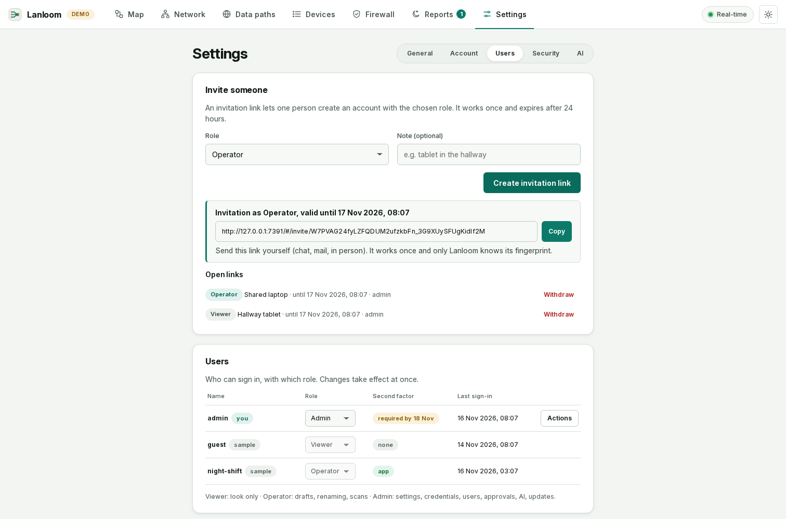

## Roles

There are three roles. Each one includes everything of the previous one.

| Role | Can do |
| --- | --- |
| **Viewer** | Look at everything: the map, the network view, data paths, devices, reports and the firewall views. Change only their own account, their personal language and their look, and set their own notification rules, quiet hours and push devices. |
| **Operator** | Everything a viewer can, and additionally: rename and hide devices, set manual connections, run scans, tick report items, plan maintenance, prepare firewall drafts and undo drafts, and use the AI features ("Explain", "Ask your network", the paragraph "In plain words" on request, suggestions for unknown devices and confirming them, firewall suggestions). |
| **Admin** | Everything an operator can, and additionally: settings, connections and their credentials, users, sign-in security, the audit log, executor approvals (applying firewall plans), AI settings, updates, the nightly report settings, the shared notification limits and the heartbeat, and backup and restore (Settings › Backup). |

The roles are enforced on the server, not in the web page. One central table (`lanloom/access.py`) says which role a route needs, and a test checks every route of the app against it. A route that is missing from the table is for admins only. The web page merely hides controls a role cannot use. Location fields of the site (for example the cell of a mobile router) are visible to admins only.

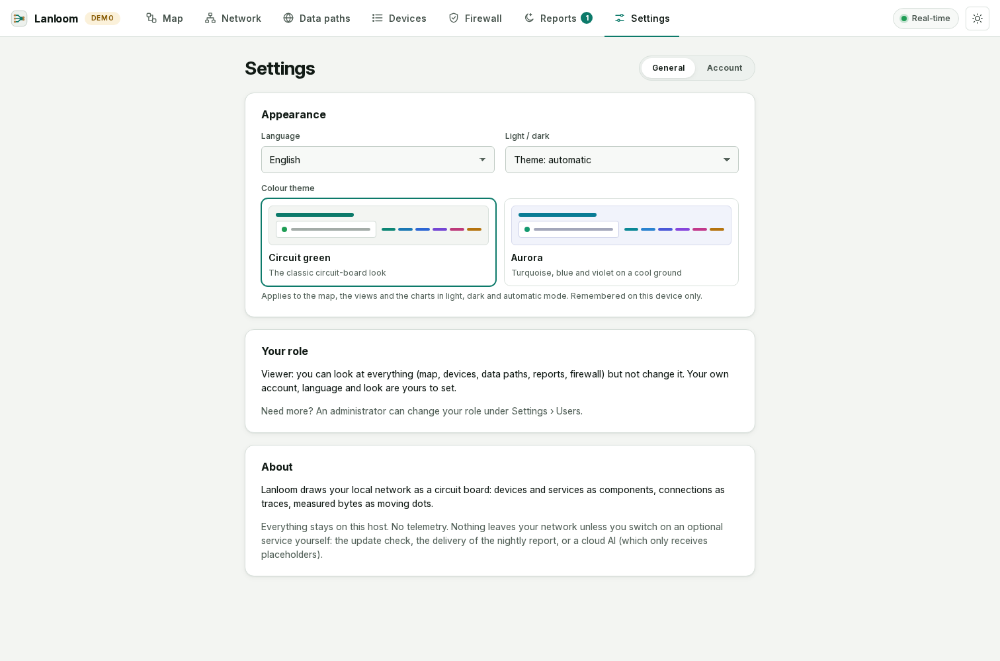

## First account and upgrading

The first account is created in the setup wizard with the one-time setup code, and it is an admin. If you upgrade from a version that had a single account, that account becomes an admin automatically. Nothing else changes until you invite somebody.

## Inviting people

Open *Settings → Users → Invite someone*, choose a role and create the invitation. Lanloom shows a one-time link.

- The link is valid for 24 hours and works once.
- It is bound to the role you chose; the person accepting cannot change it.
- Only a hash of the token is stored. Open links are listed and can be withdrawn.
- Lanloom sends no e-mail. Pass the link on yourself.

The person opens the link, chooses a name and a password (at least 10 characters) and can add a passkey or the authenticator app right away.

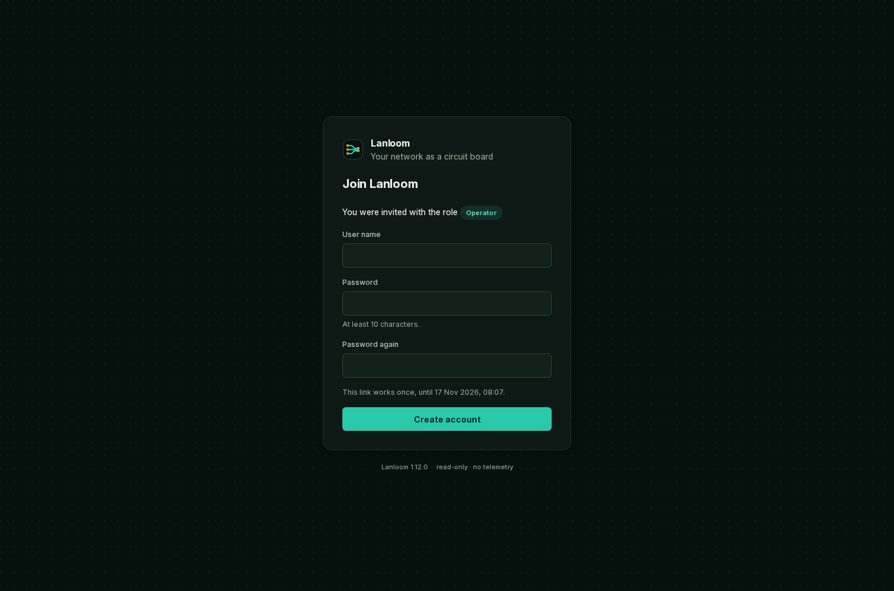
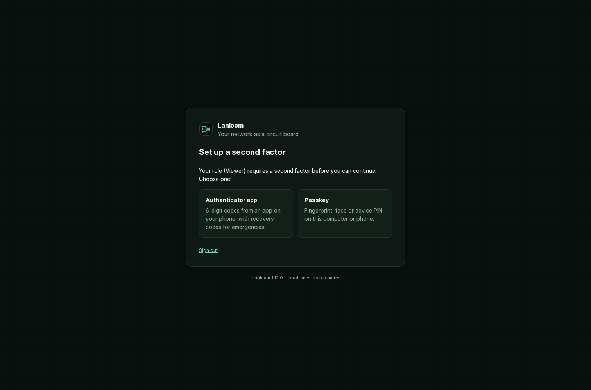

### Managing users

In *Settings → Users* an admin can change a role (effective immediately), disable an account (this ends its sessions) or delete it. At least one enabled admin must always remain, and you cannot disable or delete yourself.

## Two-step sign-in

Besides a password, an account can use a second step:

- **Authenticator app** (TOTP, RFC 6238: 6 digits, 30 seconds). A code is accepted one step before or after the current one and can be used only once.
- **Passkey.** A passkey also counts as a strong second factor.
- **Recovery codes.** Ten codes are shown once when you turn on the app; Lanloom stores only a keyed hash of them. Each code works once.

### Setting it up

Open *Settings → Account → Two-step sign-in*, scan the QR code with an authenticator app, type the first code and save the ten recovery codes somewhere safe.

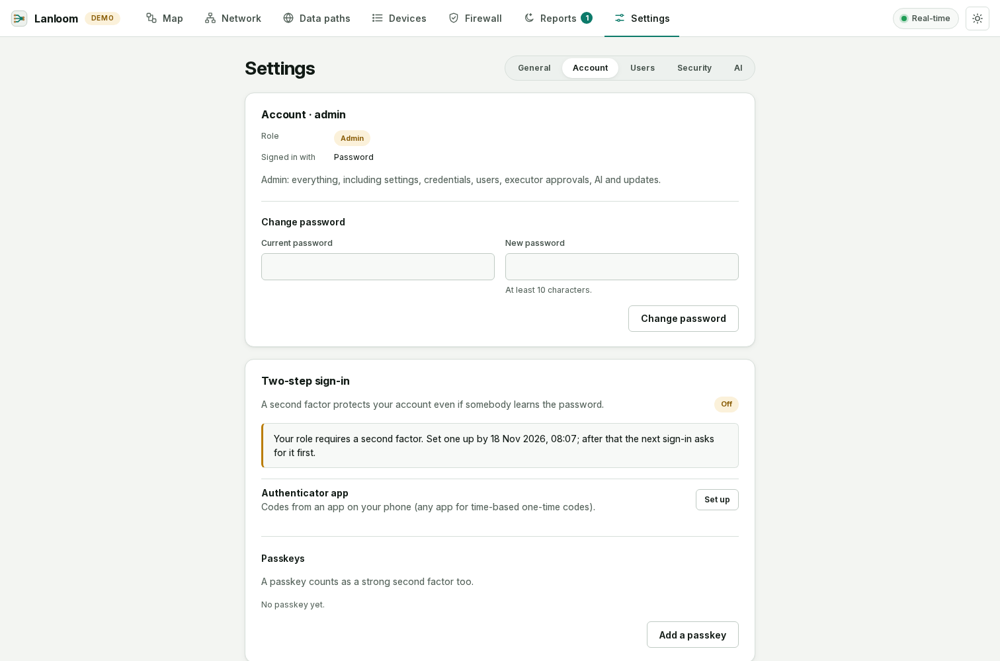
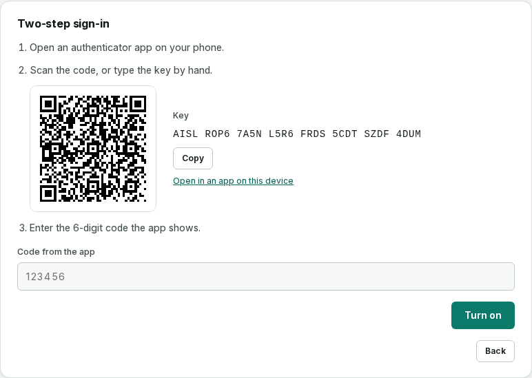

### Signing in

You enter the password first. If the account has a second factor, a second step asks for the app code, a recovery code or a passkey. A ticket for the second step expires after 5 minutes and allows 5 tries. Attempts are rate limited per client address and per account.

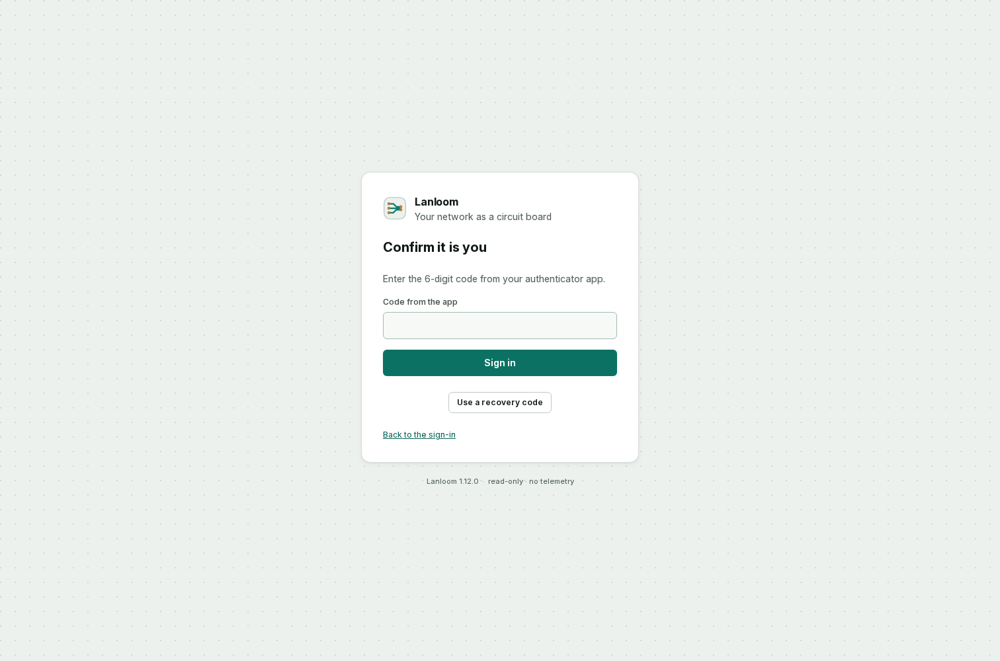

### Which roles need it

*Settings → Security* sets which roles must use a second factor. The default is **required for admins only**. After you change the setting, a grace period applies (default 48 hours; choices are 0, 24, 48, 72 hours, 7, 14 and 30 days). During it, the password alone works and the account page shows a note. Afterwards the next sign-in leads to a set-up page, and only the set-up is possible until a factor exists.

Sign-in through an authentication proxy is exempt: the proxy is responsible for the second step there.

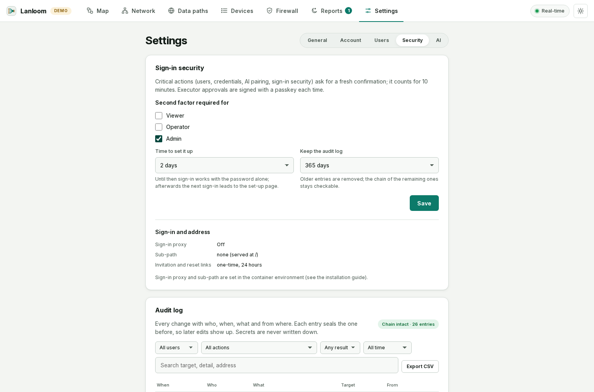

## Confirming critical actions

Some actions need a confirmation within the last 10 minutes (a fresh sign-in counts):

- users: invite, change, delete, create a reset link, sign out a user
- connections: save and delete
- sign-in security settings
- the AI pairing code
- your own passkeys, turning the authenticator app on or off, new recovery codes

You confirm with a passkey, an app code or a recovery code. The password is accepted only if the account has no second factor. Executor approvals stay different: they are passkey-signed every single time.

## Sessions and shared computers

*Settings → Account* lists your own sessions with the device ("Browser · System"), the address and the last activity. You can end single sessions or use **Sign out everywhere**. Admins can see and end the sessions of any user.

Tick **Public or shared computer** at sign-in and the session leaves no lasting cookie: it ends when the browser closes, after 8 hours at most, or after 30 minutes without use.

## Security notices

Lanloom shows a banner under the top bar (dismiss with "Got it") when:

- someone signs in from a new address. The notice says "new device" when the browser is new too. The same address with another browser is no news in a home network.
- an account is locked after repeated wrong attempts (shown to that user and to all admins)
- a recovery code was used
- a password was reset

Delivery of these notices outside the app will come with notification rules later; it does not exist yet.

## Lost password or lost phone

- **Password:** an admin creates a one-time reset link for the user (*Settings → Users*), valid for 24 hours. The admin can also choose to remove the second factor, for a lost phone. Using the link ends all sessions of that user and leaves a notice.
- **Only admin locked out:** if no admin can sign in, use the emergency way in [INSTALL.md](INSTALL.md#forgot-password). It resets everything.

## Audit log

*Settings → Security → Audit log* (admins) records every action that changes something: settings, connections, renaming, drafts, approvals, sign-ins, failed sign-ins, lock-outs, user management and changes to your own account. Each entry has who, role, when, what, target, result (done, refused or failed) and where from (address and "Browser · System").

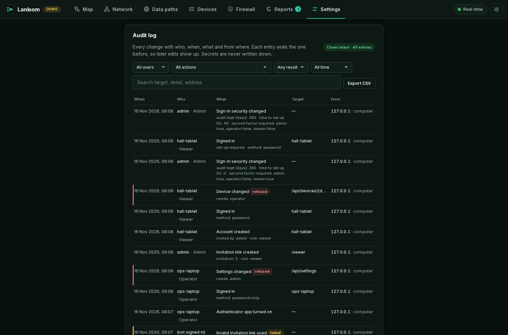

- **Filter** by user, action or group, result, period and text; **export CSV**. Cells that a spreadsheet would run as a formula are prefixed with `'`.
- **Retention** is adjustable: 30, 90, 180, 365 (default), 730, 1825 or 3650 days. Older entries are removed; the chain stays checkable from an anchor.
- **No secrets.** Only the names of changed fields are logged, never values of secret fields. A name typed into the sign-in form is logged only if such a user exists.

### What the chain proves

The log is append-only. Every entry carries an HMAC-SHA-256 over the previous entry's hash and its own content, keyed with a key derived from `secret.key`. Editing, inserting or deleting entries shows up as "Chain broken at entry N". The newest hash is stored separately, so cutting off the end is noticed too.

What it does not do: someone who has the database, `secret.key` and write access can rewrite the whole log consistently. The log is tamper-evident, not tamper-proof. Keep backups off the host if that matters to you.

## Sign-in through an authentication proxy

Off by default. If you already run a proxy that signs people in, Lanloom can trust it for the user name and groups.

| Variable | Meaning |
| --- | --- |
| `LANLOOM_AUTH_HEADER` | header carrying the user name, for example `Remote-User` |
| `LANLOOM_AUTH_GROUPS_HEADER` | header carrying the groups, separated by commas or spaces |
| `LANLOOM_AUTH_GROUP_ROLES` | map from group to role, for example `net-admins=admin,net-ops=operator,family=viewer`; the highest match wins |
| `LANLOOM_AUTH_DEFAULT_ROLE` | role for users without a matching group; empty means refused |
| `LANLOOM_TRUSTED_PROXIES` | addresses or networks of the proxy; the headers are believed only when the direct peer is listed here |

```yaml
environment:
  LANLOOM_TRUSTED_PROXIES: "172.18.0.0/16"
  LANLOOM_AUTH_HEADER: "Remote-User"
  LANLOOM_AUTH_GROUPS_HEADER: "Remote-Groups"
  LANLOOM_AUTH_GROUP_ROLES: "net-admins=admin,net-ops=operator,family=viewer"
  LANLOOM_AUTH_DEFAULT_ROLE: ""
```

- New proxy users are created automatically, without a password. A local account with the same name is the same person.
- The role follows the groups: it is synced on every request, and a change is logged.
- **The proxy must remove these headers from client requests** and set them itself. Otherwise anybody could claim to be anybody.

## Serving Lanloom below a path

The web page derives every address (API, live connection, map worker) from its own location, so a reverse proxy can serve Lanloom below a path such as `/lanloom/` and strip the prefix. Alternatively set `LANLOOM_BASE_PATH=/lanloom` and Lanloom accepts the prefix itself: requests without the prefix still work, and `/lanloom` redirects to `/lanloom/`. The AI set-up script for another computer includes the prefix.

## The nightly report

The [nightly report](NIGHTLY-REPORT.md) has an **Access** section: lock-outs, failed sign-ins (a point to look at when there are 20 or more), sign-ins from a new device or address, new accounts, changed users, removed second factors, changed sign-in security and a broken audit chain.

## Demo mode

Demo mode (`LANLOOM_DEMO=1`) shows two sample users (they cannot sign in), an open invitation and sample audit entries.

On a phone:

<table>
<tr>
<td>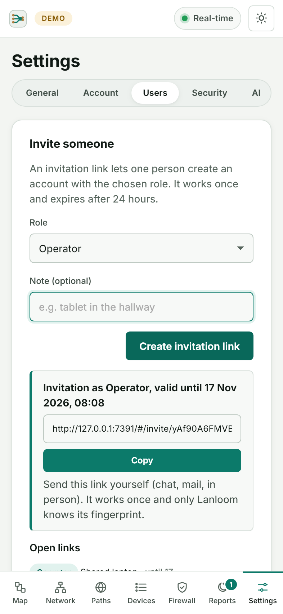</td>
<td>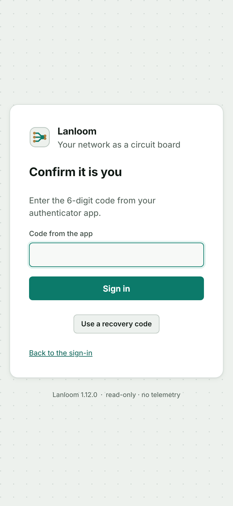</td>
</tr>
</table>
