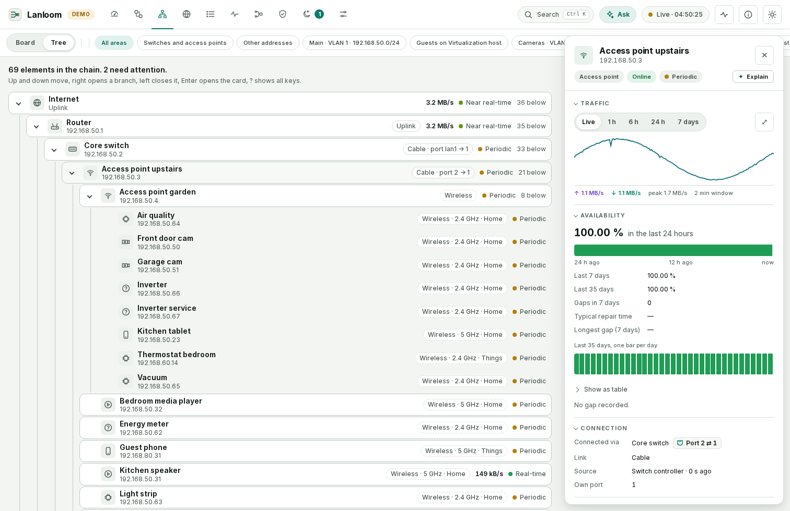
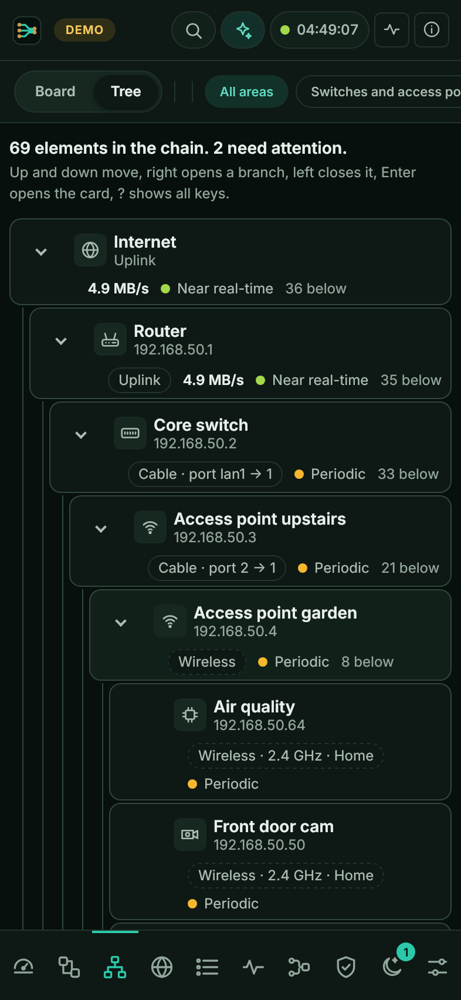
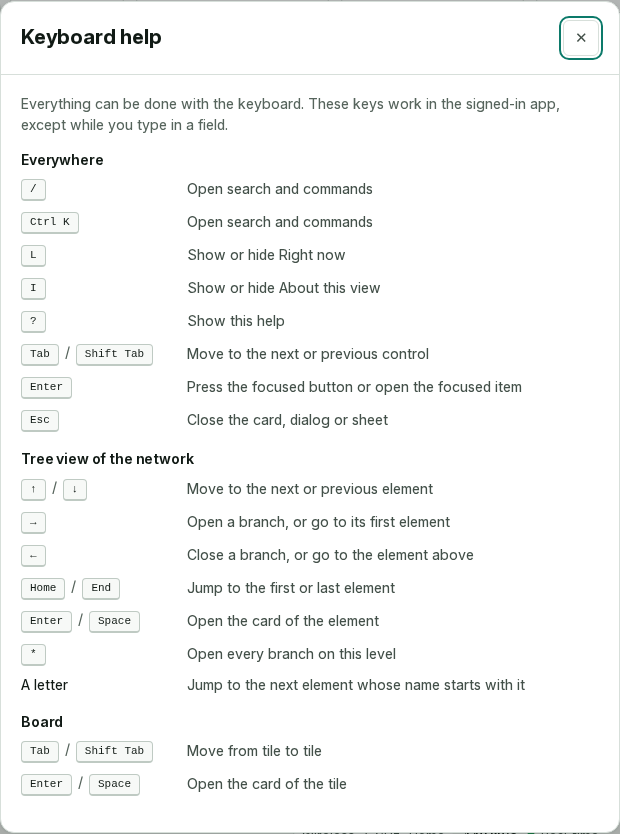

# Accessibility

Lanloom is meant to be usable without a mouse and without seeing the picture. The circuit board is a picture; the
**tree view** of the Network view says the same thing in words, and everything else in the app can be reached with the
keyboard.

- [The tree view](#the-tree-view) · [Keyboard](#keyboard) · [Screen readers](#screen-readers) · [Colours and contrast](#colours-and-contrast) · [How it is tested](#how-it-is-tested) · [Known limits](#known-limits)

## The tree view

In the *Network* view, the switch **Board | Tree | 3D** (left of the area chips) changes the face of the view. The choice is
kept in the browser; `#/network?v=tree` opens the tree directly.

The tree is the physical chain, read from the same links as the board: **Internet → gateway → switches and access
points → devices and guests**. Each line shows

- the **name** and the address (or the kind of device),
- the **link**: cable with the port on both ends, wireless with band and network name, or virtual (a guest on a host),
- the **live traffic** as a number, where it is measured,
- the **state** as a word (*Real-time*, *Periodic*, *Interrupted*, with *Offline* in front when a device is down), never only
  as a colour,
- for a branch, how many elements hang below it, and a hint when some of them need attention.

Branches fold and unfold; what you folded stays folded while the live data comes in and when you come back later.
Devices with no known link are listed under *Other addresses*. The area chips and *Problems only* work in the tree as
well and always keep the way up to the Internet.

On a phone the line wraps: name and address first, then link, traffic and state. Opening a line opens the same card as
on the board; closing the card with `Esc` or the button puts you back on that line.

## Keyboard

Everything can be done with the keyboard; press `?` anywhere in the signed-in app (or search for "Keyboard help") to see the list.

| Where | Keys |
|---|---|
| Everywhere | `Tab` / `Shift Tab` move, `Enter` or `Space` press, `Esc` closes the card, dialog or sheet and returns to where you were, `/` or `Ctrl K` search, `L` and `I` the side rails, `?` this help |
| First stop | *Skip to content* jumps over the navigation |
| Board | `Tab` goes from tile to tile (the tiles are buttons, named by what they show), `Enter` opens the card; while a tile has the focus, the chain of its partners is lit as it is for the mouse |
| 3D view | one tab stop: `←` `→` turn, `↑` `↓` tilt (with `Shift`: move), `+` `-` zoom, `0` the whole stack again, `Page Down` `Page Up` walk the chain (the element is read out), `Home` `End` jump to its ends, a letter jumps to the next name, `Enter` or `Space` opens the card |
| Tree | `↑` `↓` move, `→` opens a branch or goes to its first element, `←` closes it or goes to the element above, `Home` `End` jump to the first or last, `*` opens every branch of the level, a letter jumps to the next name that starts with it, `Enter` or `Space` opens the card |

The tree is a single tab stop: `Tab` enters it once and leaves it once; inside you use the arrows. The focus is always
drawn, in every colour theme.

## Screen readers

- The tree uses the standard *tree* pattern: `tree`, `treeitem`, level, position in the set, expanded or collapsed. The
  name of a line starts with the words that are on the line (so voice control can say them), then adds the kind and the
  state.
- Every button, tile, tab and field has a name that contains its visible text.
- The page has one landmark for the content that takes the focus when you move to another view; the page title follows the view.
- **Spoken status** goes through one polite status region: a device that stopped talking or is back, the overall grade, the
  live connection, and the change of the view. It is throttled: at most one announcement every few seconds, three items at
  most in one go (then "and 2 more changes"), and a device is announced again after a minute at the earliest, so a device
  that flaps cannot talk all day. The first data after opening the page is never announced.
- A picture of numbers has its numbers as a table: under the traffic plot and the availability bars of a card is **Show
  as table** (closed until you ask for it).
- The board itself is a picture with named buttons; the tree is its text alternative.

## Colours and contrast

Text and symbols meet the contrast of WCAG 2.2 level AA in the light and the dark theme, in every colour theme (Circuit, Aurora, SummerGlass and WinterGlass); for the glass themes the check includes every colour field behind the glass, composited under the pane. Nothing is shown by colour alone: states are words, links have a line style, problems
have a count. Calmer or past things are drawn in a quieter colour, not made see-through, so their text keeps its contrast.
The animation of the tree follows the system setting *Reduce motion*.

## Phones

Everything can be used with a finger. The rules, checked by a walk over every view and every layer in a phone browser (390 px wide, light and dark, administrator and read-only role):

- **Hit areas of 44 × 44 px.** A control that looks smaller (chips, icon buttons, close crosses, filters, small links) gets an invisible, larger hit area. Nothing looks different; the area never reaches further than half the gap to the next control, so two neighbours never fight over one fingertip. It is measured again for every control that appears later. Where the gap is too small, the layout itself makes room (taller buttons and filter chips, a port of a switch front is 44 px wide and a long row scrolls sideways).
- **The header is built from full-size controls.** Search, Ask, the live state and the panel buttons are capsules 44 px wide; the live capsule keeps its dot and time where there is room and shows only the dot when a site switcher or a long language needs the room. A control that is 44 px wide gets no invisible area to its sides.
- **Fields have at least 16 px of text.** Below that a phone browser zooms into the page when a field is tapped.
- **The keyboard hides nothing.** A phone shrinks only the visible part of the window when the keyboard opens. A layer that fills the screen (Ask, search, sheets, dialogs) follows the visible part, a focused field stays in sight, and in the Ask panel at least 120 px of the conversation stay above the field. An empty "Send" puts the cursor into the field instead of doing nothing.
- **Every tap does something visible, every layer has a way back.** A menu closes with a tap beside it.
- Controls that draw their own hit logic (the pan and zoom board of the map) are the one exception; every device on it is also a full-size row in the device list.

## How it is tested

Before a release the app runs against a demo network in a real browser (desktop width and phone width) and an automated
check (axe-core) looks at every view in the light and the dark theme and the colour themes Circuit and Aurora: **no serious or critical
finding is allowed**. Further checks walk the tree with the keyboard (move, fold, open, `Esc`, focus back, the fold state
after a redraw), check that every control has a name that contains its visible text, that nothing clickable is out of reach of the keyboard, that the page is not one big live
region, and that the spoken status is throttled. A machine finds about a third of the problems; if you meet one a
machine cannot, please open an issue and name the screen reader and browser you use.

## Known limits

- The board (the picture) is not itself navigable by arrow keys; use `Tab` between tiles or the tree view.
- Charts drawn on a canvas (traffic, availability, the world map) have their numbers in a table or a list next to them but
  cannot be explored point by point with the keyboard.
- Translations: the app is available in English, German, French, Spanish, Dutch and Italian (the language is set on the page element, so screen readers pick the right voice); the help texts of the integrations are English.
