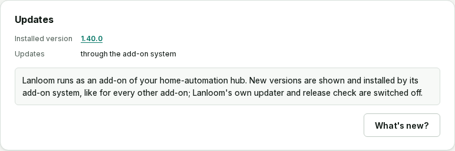

# Lanloom as an add-on

Lanloom can run as an add-on of a home-automation hub that has an add-on system with ingress (the hub shows the add-on
in its side panel and signs people in). It is the same signed image as the container install, with a small start
script on top. Everything Lanloom does stays the same; three things change: sign-in, updates and where the data lives.

## Installing

The add-on lives in [`addon/lanloom`](../addon/lanloom) of this repository. The folder [`addon`](../addon) is laid out as
an add-on repository (`repository.yaml` plus one folder per add-on).

**As a local add-on (works today):** copy the folder `addon/lanloom` into the `addons` folder of the hub (the share or
folder the hub offers for local add-ons), so that it ends up as `addons/lanloom/config.yaml`. In the add-on store, reload
the list (top right menu › *Check for updates*); *Lanloom* appears under *Local add-ons*. Install it, start it and open
it from the side panel.

The add-on system builds the add-on on the hub from `ghcr.io/robeertm/lanloom:<version>` (amd64 and arm64, the
multi-architecture image of the same release, signed like every release). Building takes a few seconds; it only adds the
start script.

## Sign-in through the side panel

People open Lanloom from the side panel and are signed in with their hub account - there is no second password and no
setup code. Lanloom believes the name the add-on system sends only from the fixed address of its ingress proxy inside
the add-on network (`172.30.32.2`); from anywhere else the same header is ignored. The first person to open it gets
the role from the option `ingress_role` (default `admin`; only administrators of the hub see the panel). A Lanloom
account with the same name is the same person. Roles, the audit log and every other part of
[users and roles](ACCESS.md) work as usual; people who sign in through the panel never need a second factor in Lanloom,
because the hub already signed them in.

The page is shown inside the hub's own page. Only in add-on mode does Lanloom allow being framed - and only by the same
origin (`frame-ancestors 'self'`, `X-Frame-Options: SAMEORIGIN`); a plain install keeps refusing every frame.

## Options

| Option | Default | What it does |
|---|---|---|
| `ingress_role` | `admin` | Role of people who open the side panel: `viewer`, `operator` or `admin`. |
| `direct_access` | `false` | Also answer requests from the network on port 7380 (sign-in with Lanloom's own accounts, created under *Settings › Users*). Off: everybody except the ingress proxy gets a short refusal, and only this host's own health check (loopback) is answered. |

## Network and privileges

The add-on uses the host network (`host_network: true`): Lanloom has to see the local network - the neighbour table,
multicast discovery (mDNS, SSDP, WS-Discovery) and this host's own connections. It asks for nothing else: no added
capabilities, no devices, no privileged mode, no access to the add-on system's API (only the MQTT service lookup, see
below, which every add-on may use when it declares the service). The start script runs as root only to create
`/data/lanloom` and hand it to the unprivileged user of the image (uid 10001); then it drops every privilege and
starts Lanloom.

Port 7380 of the host is used (the ingress port). If something else on the host already uses it, stop that first.

## Updates

The add-on system shows a new version and installs it, like for every other add-on (and can make a backup of the add-on
first). Inside Lanloom the release check and the one-click updater are switched off: no request goes to the
release feed, *Settings › Updates* says where updates come from, *What's new?* still shows the changes of the running
version from the changelog inside the image, and the notification *Update available* is not offered.

## Data and backups

Everything lives in `/data/lanloom` in the add-on volume, so the backups of the add-on system contain Lanloom's database,
key and settings. Lanloom's own backup ([BACKUP.md](BACKUP.md)) works too - for example to move from the add-on to a
plain container install or back.

## Sensors in the hub

The optional [MQTT output](MQTT-OUTPUT.md) publishes a few of Lanloom's figures as sensors through MQTT discovery. In
the add-on it can use the broker the add-on system offers: Lanloom asks the add-on system for the broker's address and
credentials each time it connects (`services: mqtt:want`), nothing to type in, nothing stored.

## Limits

- The local AI service (one click under *Settings › AI*) needs the updater sidecar of a container install; in the
  add-on, point Lanloom to an AI service that runs elsewhere ([AI](integrations/ai.md)).
- The optional firewall executor is a separate container and is not part of the add-on.
- Only amd64 and arm64 (aarch64) hubs; 32-bit hosts are not supported.

## Publishing the add-on repository

The folder `addon/` can be published as the root of a separate repository (`repository.yaml` and `lanloom/`); people
then add that repository's address in the add-on store instead of copying the folder. Version and image tag of
`addon/lanloom/config.yaml` and `build.yaml` follow `VERSION` (a test keeps them equal), so each release of Lanloom is
also a release of the add-on.
