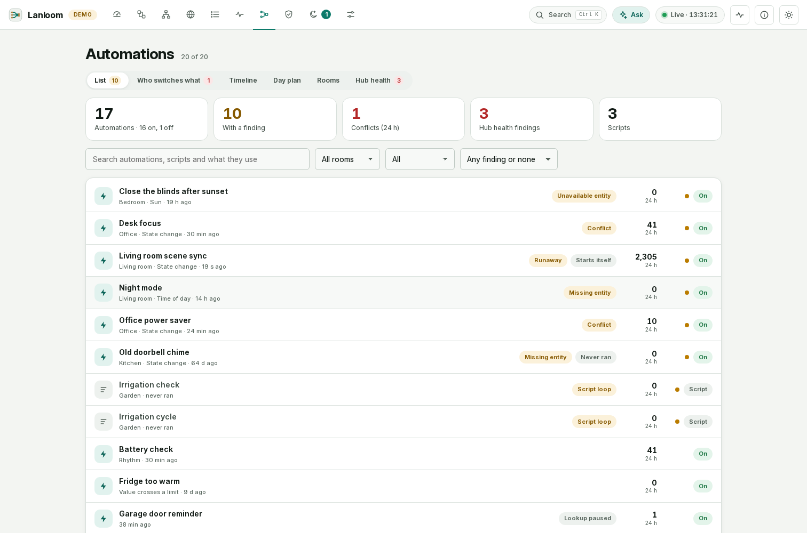
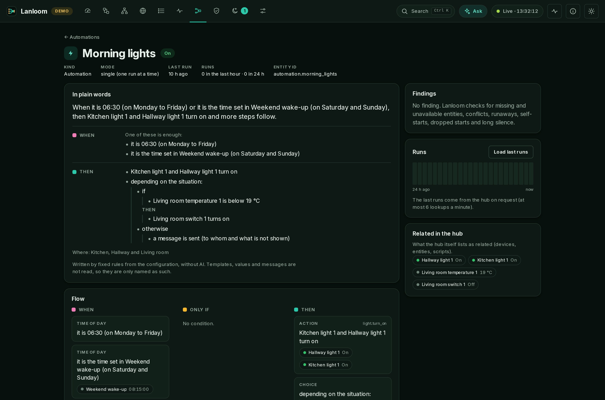
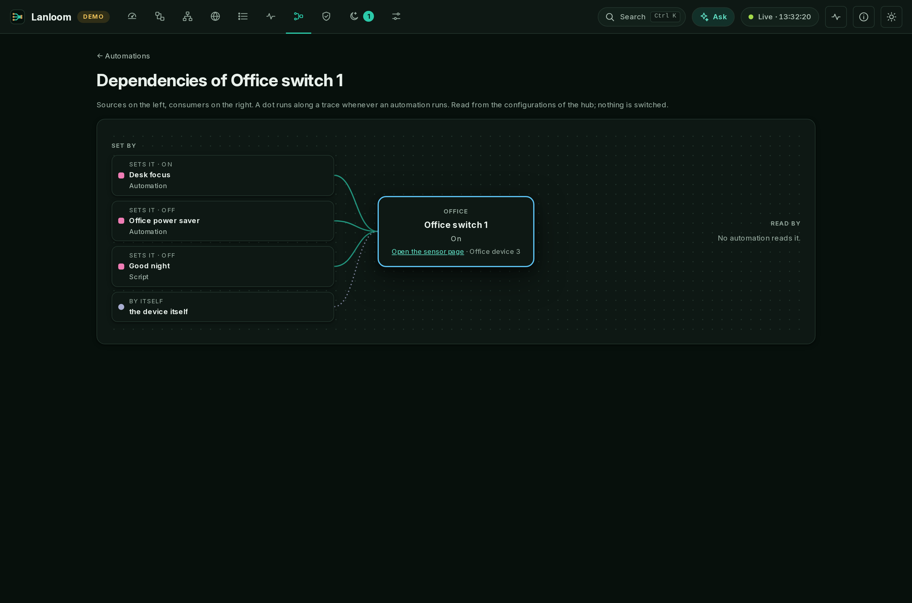
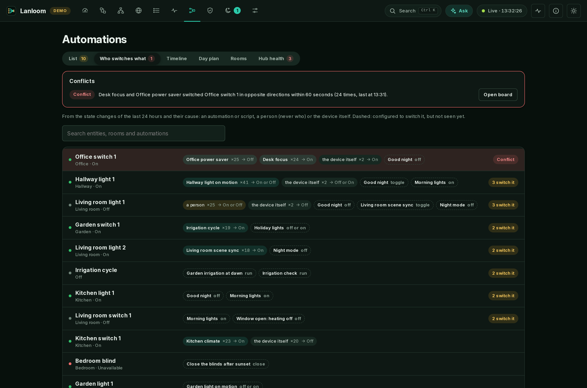
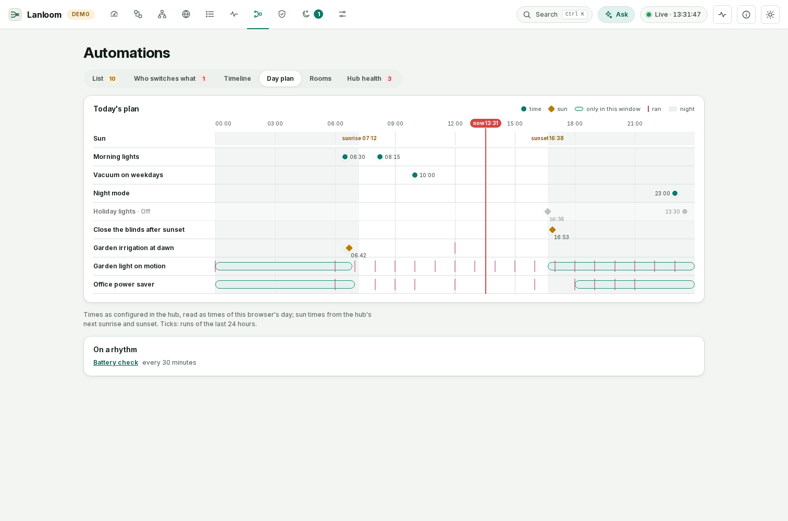

# Automations

The **Automations** tab shows what a connected home-automation hub does on its own: its automations and scripts, each
explained in plain words, checked by fixed rules, and drawn with what they depend on. Everything is **read only** -
Lanloom never runs, changes, reloads or repairs anything in the hub. The tab appears as soon as a hub is connected
(Settings › Connections, see [HUB-BRIDGE.md](HUB-BRIDGE.md)), on the phone too.

## What the tab needs

| Without admin mode | With admin mode on the connection |
|---|---|
| name, state, mode, last run and run counts | additionally the flow of every automation and script: plain words, findings, the dependency board, the day plan, *Who switches what* with the configured switchers |

Admin mode needs a token of an administrator on the hub and is still strictly read only: the bridge reads the
configurations within its budget (at most 30 a minute) and keeps only their **structure** - see [Privacy](#privacy).

## Parts of the tab

Six views sit under the title (`#/automations?view=…`); the badges count findings, conflicts and health findings.

### List

Five tiles (automations on/off, with a finding, conflicts in 24 hours, hub health findings, scripts) and one row per
automation or script: its rooms, the kinds of trigger, when it last ran, runs in 24 hours, the findings and the state.
Search covers the name, the id, the rooms and the names of every entity it uses; filters for room, state (on, off,
scripts) and finding. A tile filters or opens its view. Rows with a warning come first.

### One automation

`#/automations/<connection>/item/<entity id>`:

- **In plain words** - one sentence for the whole automation ("When it is 06:30 (on Monday to Friday), then Kitchen light
  turns on"), then *When* (one of them is enough), *Only if* (all must hold) and *Then*, with nested choices, waits and
  repeats as an indented list, and the rooms it switches. Written by fixed rules from the configuration, **without AI**,
  in every language of the app. Templates, values and messages are not read, so they are named only as such ("a
  calculated rule", "a message is sent").
- **Flow** - the same steps as cards in three columns (When → Only if → Then) with the kind of step, the action called
  (`light.turn_on`) and every entity with its live state; a missing entity is marked red. A click opens the entity's
  dependency board, or the automation a step calls.
- **Findings** - see [below](#findings).
- **Runs** - runs per hour over 24 hours; with admin mode, operators can load the last runs from the hub (start, length,
  result, last step, the step path of the newest run; at most 6 lookups a minute).
- **Dependency board** and what the hub itself lists as related.

### Dependency board

`#/automations/<connection>/board/<entity id>`, for any entity:

- **an automation or script** in the middle: what starts and checks it on the left, what it switches or reads on the right,
  who calls it;
- **any other entity** in the middle: what sets it on the left (automations and scripts with the verb they use, "by
  hand" and "by itself" when changes were seen that way) and the automations that read it on the right.

Traces join the pads like on the map; dashed for reading and checking, red for a missing or unavailable entity.
**Whenever an automation runs, a dot travels along its traces** (from the live frame; with reduced motion the trace
flashes instead). On a phone the columns stack and the traces run down the edge.

### Who switches what

Per entity: who switched it in the last 24 hours (an automation or script with the number of times and the states it
set, *a person* - never who - or *the device itself*) and, dashed, the automations configured to switch it that were not
seen yet. A **conflict** is two automations or scripts setting the same entity to opposite states (on/off, open/closed,
locked/unlocked …) within 60 seconds; a change by hand in between ends the pair. Conflicts are listed on top with a link
to the board, entities with several switchers are marked.

#### Chain: what led to a switch

Under the conflicts, *Effect chains* lists what an automation or script switched in the last 24 hours together with what
led to it, read back from the runs the hub stored: the entity that started the first run (a sensor, for example), the
automation or script runs that called one another, and the device with its new state and the time. Rules:

- every run in the chain started at most **one hour** before the switch, and a called run started no earlier than the run
  that called it (two seconds of clock jitter are allowed);
- at most **four** automations or scripts per chain; longer chains are cut and say so, a loop of callers ends the chain
  and says so;
- the start of a chain is shown only when the hub names an entity that started it and the bridge may show it (a person,
  tracker, zone, camera or calendar stays private: the chain then begins at the automation, with the note that the start
  is not known);
- per device at most three chains (different callers), the newest switch of each cause that has a run behind it.

The same chains appear in the **card of a hub device** (and the phone sheet) for the entities of that device, and on the
**page of an automation or script** for every chain it takes part in. Every step is a link: automations and scripts open
their page, entities their dependency board.

They come from the *run summary*: the hub's stored runs of all automations and scripts (one `trace/list` per domain, the
same two requests as the nightly report; see [HUB-BRIDGE.md](HUB-BRIDGE.md)), reduced inside the bridge to time, result,
the entity that started the run and the automation or script whose run called it - context ids are resolved there and
never leave it. Admin mode is required; without it the sections say so and nothing is asked. A view asks for a fresh
summary at most every five minutes (it also says how long ago the runs were read, and warns after an hour). The hub keeps
only a few runs per item, so older switches simply have no chain.

### Timeline

Who started what over the last 24 hours, newest first, grouped by hour: state changes with their cause and the runs of
automations. Filters for automations, people and devices, and a search. People are never named: a change by hand says
*a person*. Changes of plain number sensors appear only when an automation or a person caused them.

### Day plan

Today from 00:00 to 24:00 with a **now line** that moves on: time triggers (also from time helpers), sun triggers placed
with the hub's next sunrise and sunset (with their offset), the time spans of time and sun conditions as bands, night
shaded, and the runs of the last 24 hours as ticks. Automations on a rhythm (every 15 minutes) are listed apart, and
those whose time is not known (a time helper without a value, no sun times). Times are read as times of the browser's day.
On a phone the plan is an agenda sorted by time with the now divider.

### Rooms

One card per room of the hub: its devices with the live state of their entities (diagnostic and setting entities left
out), silent radio devices marked, a link to the network device when the device is also known on the network, and which
automations switch something there. A value opens its sensor page.

### Hub health

What the hub reports, bundled - **never healed**: integrations that cannot start, keep retrying, failed to migrate or to
stop; unavailable entities per domain (expand for the names, devices and rooms) and per integration; how many entities
report an unknown state; silent radio devices (link to *Sensors › On site*). Lanloom only reads; fix a finding in the hub.

## Findings

From Lanloom's own rules, per automation:

| Finding | Rule | Level |
|---|---|---|
| Missing entity | it names an entity the hub does not have (renamed or removed) | look at |
| Unavailable entity | an entity it uses is `unavailable` right now | look at |
| Runaway | it ran 60 times or more within one clock hour | look at |
| Conflict | it and another automation set an entity to opposite states within 60 seconds | look at |
| Script loop | scripts call each other in a loop (the bridge does not look them up) | look at |
| Mode conflict | from the stored runs (admin mode): `single` dropped starts, `restart` was stopped three times within an hour, `queued`/`parallel` found its maximum number of runs full | look at |
| Starts itself | it switches what also starts it | note |
| Drops starts | mode `single` with a wait or a delay of 30 seconds or more: starts during the wait are dropped | note |
| Never ran | switched on, but it has not run for 30 days | note |
| Lookup paused | the hub answered the bridge's lookup with an error | note |

## Nightly report

The section **Automations** (one per hub connection) appears when there is something to judge - flows, integration
states or unavailable entities. Points: automations naming a missing entity, conflicts of the night, runs that ended
with an error during the night, runs the hub dropped, stopped or queued out because of the mode of the automation, integrations with errors, unavailable entities per domain from three on. Notes: fewer
unavailable entities, automations that start themselves or drop starts, automations that have not run for 30 days. The
summary has counts only; the AI features see the section only as its summary. See [NIGHTLY-REPORT.md](NIGHTLY-REPORT.md).

**Only news.** A finding of the rules (missing entity, self trigger, `single` with waiting, bundle of unavailable
entities, integration with an error) is a point the first time it shows. The next report only says, in one calm line,
"still open since <date>: N findings". A finding that was gone for 36 hours is new again when it comes back; the first
report after an update (and the first one of a hub) takes what it finds as known and says so in one line. The small
register (finding, first and last seen) is stored with each report, per site, and goes with the archive. Events of the
night - conflicts, failed runs and mode conflicts - stay points every night.

**Failed runs.** Once per report (admin mode only) the bridge asks the hub for the stored run summaries of all
automations and scripts with one list per domain - never one request per automation - and counts the runs that ended
with an error between the last report and this one. Each automation is a point with the number of runs, the time of
the last one and a short error text; five are named, the rest is counted. The hub keeps only its last few runs per
automation, so the number is "at least". Entity ids in the text are replaced by display names (an id of a hidden
domain, an address, a link, a hardware address, an e-mail address or a long key becomes "…"); an error that came from a
template is counted but its text is never kept. When the hub cannot be asked (budget used up, no answer, an older hub
without the command) the section says so in one calm line; without admin mode nothing is asked. Each point links to the
automation in this tab.

**Mode conflicts.** From the same summary of runs (no extra request): per automation the runs the hub did not carry out
because of its mode between the last report and this one - `single`: starts dropped because a run was still going;
`restart`: a run stopped by a new start three times or more within one hour; `queued`/`parallel`: starts that found the
maximum number of runs full. Each automation is a point with the count, the time of the last one and a link; five are
named, the rest is counted. The numbers are "at least", because the hub keeps only its last few runs per automation. The
text names automations by their display names only; a summary that was not read within half an hour of the end of the
report window is not used.

## Search and commands

`Ctrl K`: *Go to Automations*, and typed: *Who switches what*, *Timeline*, *Day plan*, *Rooms*, *Hub health*, *Show effect chains*, *Show
automations with findings*. An automation hit has *Open in Automations*; automation and entity hits have *Show
dependencies* (the board).

## Privacy

The bridge keeps of a configuration only its structure, dropped and checked before anything is stored
([`sources/hub_flow.py`](../lanloom/sources/hub_flow.py)):

- kept: the kind of each step, entity ids (never private ones), state words from a fixed list (`on`, `open`, `locked`,
  `below_horizon` …; any other value becomes "some value"), times of day, numeric thresholds, durations, weekdays, sun
  events with their offset, the name of the action called (`light.turn_on`) and area ids of a target;
- dropped: aliases, descriptions, trigger ids, templates (only marked), service data (brightness, messages …), who a
  message goes to, event names and data, variables. A trigger or condition on a person becomes "someone arrives or
  leaves" without any id.

State changes carry their cause as the bridge already reports it: an automation or script id, the word `user`, or
nothing. Hub data stays in memory and never goes into backups. The sun's rise and set times (which say roughly where the
home is) never leave Lanloom.

## API

All read only, viewer role.

| Route | |
|---|---|
| `GET /api/hub/{id}/auto` | the list with tiles, counts and filters |
| `GET /api/hub/{id}/auto/item/{entity_id}` | one automation or script: plain words, flow, findings, runs per hour, related |
| `GET /api/hub/{id}/auto/board/{entity_id}` | the dependency board of any entity |
| `GET /api/hub/{id}/auto/who` | who switches what, conflicts |
| `GET /api/hub/{id}/auto/chain` | effect chains of the last 24 hours (`?entity=`, `?device=` a hub device id, `?item=` an automation or script; combinable) with `runs_summary` (`ok`, `waiting`, `admin_off`, `error`, `no_hub`; age; `stale` after an hour); asks the hub for a fresh summary at most every five minutes |
| `GET /api/hub/{id}/auto/timeline` | who started what over 24 hours |
| `GET /api/hub/{id}/auto/plan` | the day plan |
| `GET /api/hub/{id}/auto/rooms` | devices per room with live state |
| `GET /api/hub/{id}/auto/health` | integrations, unavailable entities, silent radio devices |

The live frame carries `autoruns` (`[connection, entity id, runs]` since the last frame) for the dots on the board.

## Demo

The sample network has a hub with 17 automations and 3 scripts that show every part: a conflict of two automations on
one plug, a runaway that starts itself, missing and unavailable entities, a script loop, a `single` automation that
drops starts, one that never ran, one switched off, a motion sensor that starts the hallway light automation, which calls a scene script that switches two lamps (a chain of four steps), a `single` automation that dropped starts, a `restart` automation stopped three times within an hour and a `queued` one whose queue was full, time, time helper, sun and rhythm triggers, choices and waits, two
integrations with errors and a day of switching with causes.
