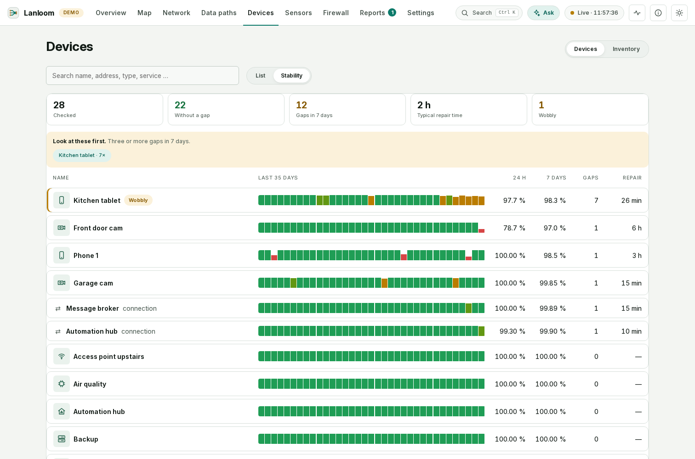
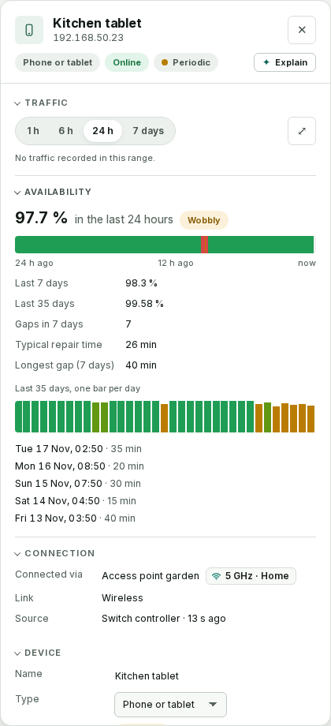
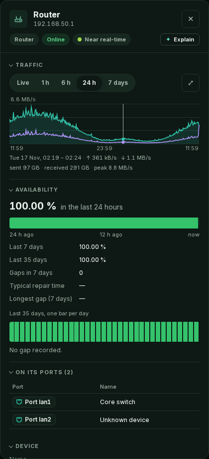
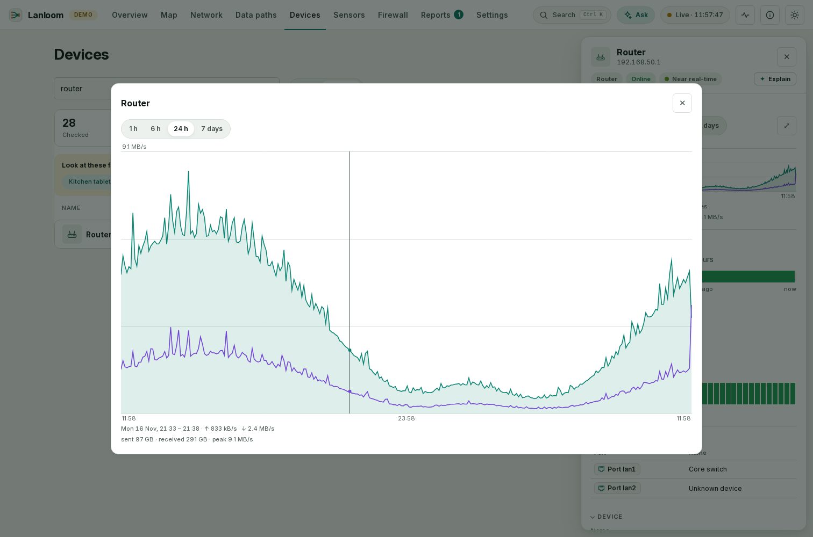
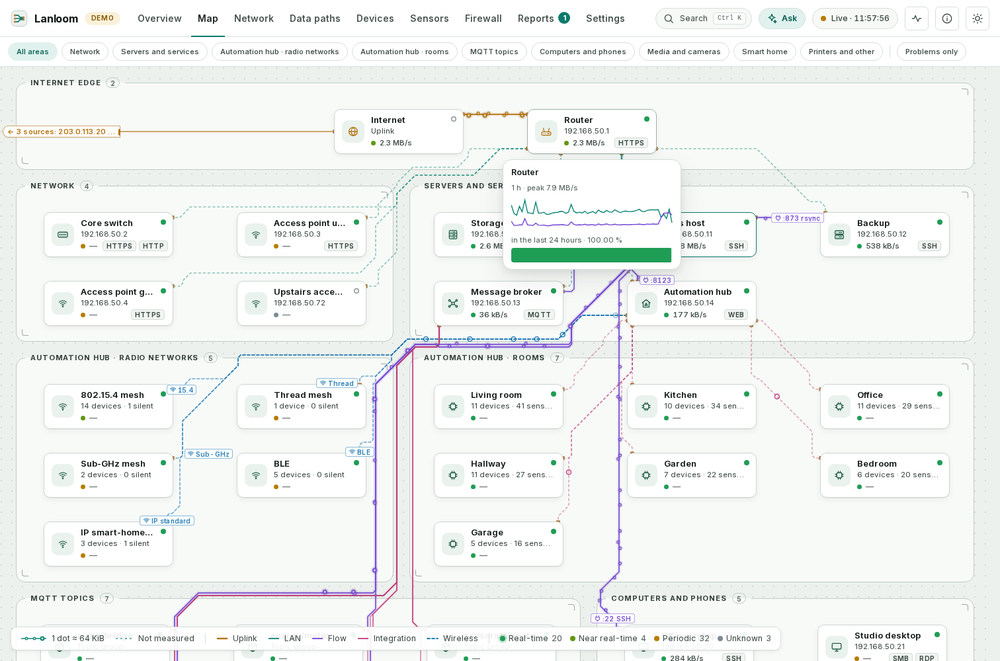

# Availability, stability and traffic over time

Lanloom keeps a history of how steady each device and each connection was, and of the traffic of every node of the map.
It answers "was it there last night?", "how often does the camera drop out?" and "what did this server send over the
last week?" without any extra setup. Everything is kept in Lanloom's own database and read from there; nothing is sent
anywhere.

## Availability in 5-minute slots

Once a minute Lanloom's watcher looks at every device (does it answer?) and every connection to a hub, broker,
controller or adapter (is it up?). The looks are booked into **5-minute slots**, kept for **35 days** (Settings ›
Storage › *Availability and events*: 35, 90, 180 or 365 days).

- A slot with only good looks is *up*, a slot with only failed looks *down*, a slot with both *partial*.
- A slot without a look is **unknown**. While Lanloom is not running, or still settling in after a start, it books nothing,
  so a gap in Lanloom's own history never turns into a fault of a device.
- When none of three or more devices answers at once, Lanloom's own network is the likelier cause than three faults at
  the same time: nothing is booked for that minute.
- A device that is hidden, and the host Lanloom runs on, are not tracked.
- The known services and web interfaces of the devices are looked at every 3 minutes and booked the same way (as
  `svc:<device>|<port>`, see [SERVICES.md](SERVICES.md)); the *Stability* list shows those with a history.

A **gap** (incident) is a run of slots with at least one failed look; two runs with only one good slot between them count
as one flapping gap. **Typical repair time** is the mean length of the gaps that ended. A device or connection with
**three or more gaps in 7 days** is *wobbly*: the first place to look at cable, power supply or radio.

## The Stability list

*Devices › Stability* (or `#/devices?view=stability`, or *Open Stability* in the search box) lists every device and
connection, the worst first: still unreachable, then wobbly, then by availability.

- Five figures on top: how many are checked, how many had no gap in 7 days, the gaps of 7 days, the typical repair time,
  and how many are wobbly; the wobbly ones are named in a bar of their own.
- One row each: 35 daily bars (green from 99.9 %, then lighter, amber below 99 %, red below 95 %; a thin grey line where
  Lanloom did not know yet), availability over 24 hours and 7 days, gaps and repair time. The search box filters the rows;
  a click opens the card of the device.
- On a phone each row shows the name, the share of the day and the bars.

## The card: availability, traffic, connections, maintenance

The card of a device has these sections; each folds with a click on its heading, and the choice stays while the page
updates and when you open another card.

- **Availability:** the last 24 hours as 288 blocks (point at a block for the time and the state), the shares over 24 hours,
  7 and 35 days, the gaps of the last 7 days, the typical repair time, the longest gap, the 35 daily bars and the last gaps
  with their time and length.
- **Traffic:** *Live* (the last minutes at one-second detail) and the ranges **1 h, 6 h, 24 h and 7 days**. Point at the plot
  for the exact values of a minute (or of 5 or 30 minutes in the longer ranges); the button at the right opens it full
  screen, `Esc` closes it. Sent and received are two lines, with the peak and the totals underneath. An empty range says so
  instead of drawing a flat line.
- **Connections:** who is at the other end of each connection of the node, by name, the kind (cable, radio, flow) and the
  live rate in both directions; a device at the other end links to its own card.
- **Simulate maintenance:** what would stop and what would only be impaired if this device were switched off, from the
  [failure chain](manual/failure-chain.md) (the devices below it, the hub devices, entities and automations that hang on
  it, Lanloom's own connections, the internet when it is the gateway). *Show on the map* colours the board: what stops red,
  what is only impaired yellow. Only simulated: nothing is switched off and nothing is sent.

## Hover window on the map

Rest the mouse on a tile of the map for half a second: a small window shows the traffic of the last hour and the
availability of the last 24 hours. On a touch screen use the card instead.

## Search and commands

*Open Stability* is a command. A device hit has the actions *Show availability*, *Show traffic history* and *Simulate
maintenance*; each opens the card at that section.

## In the nightly report

The section **Availability** appears once there is a history: how many devices and connections were without a gap over the
last 7 days, the gaps in all, the typical repair time, and every wobbly device as a point to look at. The single outages
of the night are in the *Devices* section; this one is the trend behind them.

## What is stored

| Table | Content | Size |
|---|---|---|
| `avail_day` | per device or connection and day 288 bytes (good and failed looks per slot), compressed | a few hundred bytes per subject and day |
| `traffic_min` | per connection of the map and day the bytes sent and received per minute, compressed; kept for 8 days | about 1 kB per busy connection and day, much less when quiet |

No addresses, host names or peers are stored here, only identifiers of devices and connections of your own network, counts
and times. The data goes into the backup with the rest of the database and is removed with a device when you forget the
device. Lanloom adds no outgoing connection for this feature.
