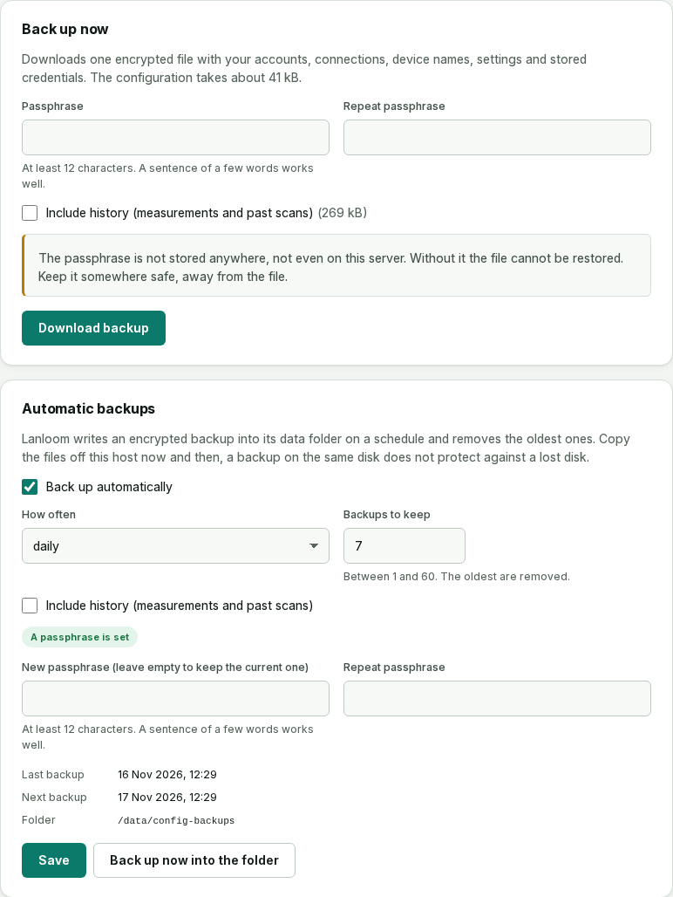
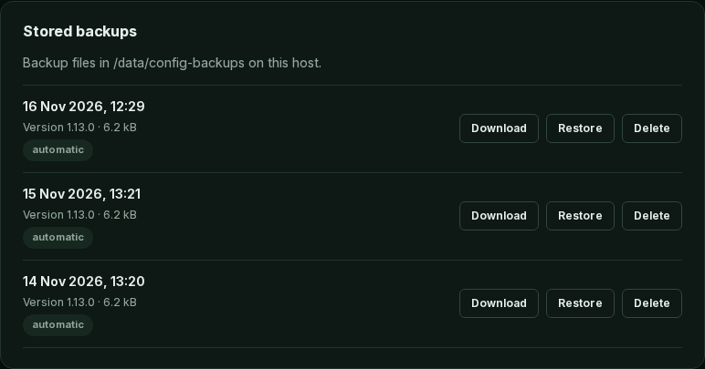
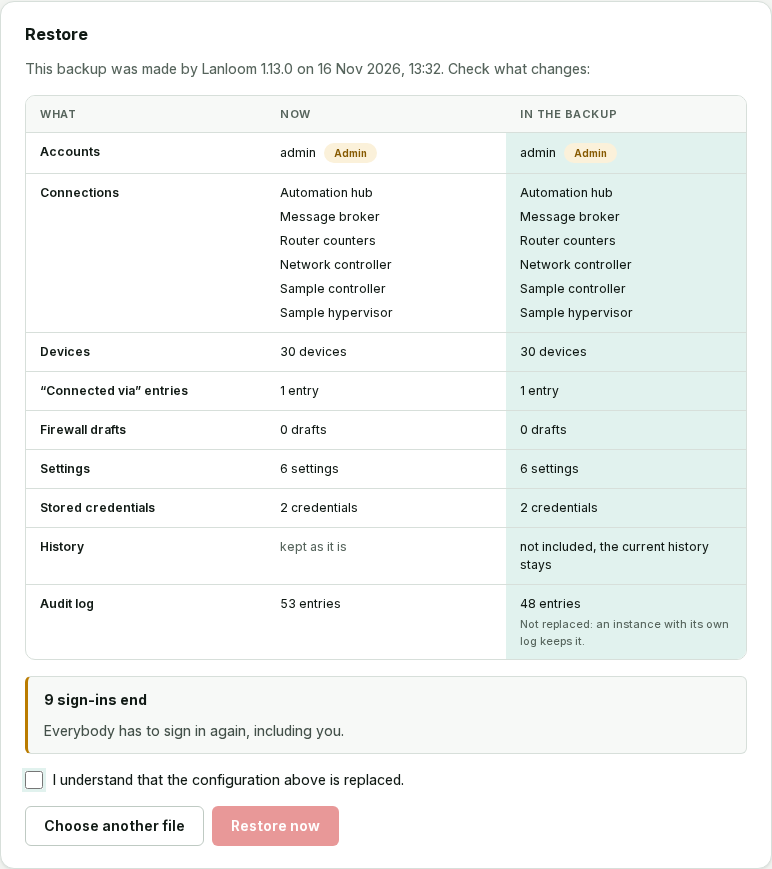
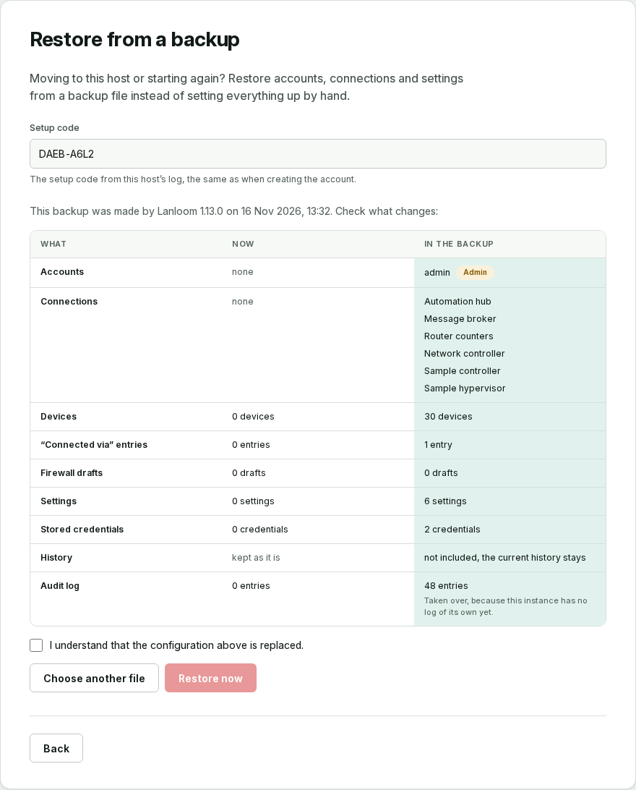

# Backup, restore and moving to another host

Lanloom saves its whole configuration into **one encrypted file**: accounts with their roles and second factors, every connection with its credentials, the inventory with all names and kinds you set by hand, the "connected via" entries, firewall drafts, settings and the audit log. History (scans, the event journal, nightly reports, data paths) can be added. You can restore the file on the same instance or on a new one, also on another processor architecture (amd64 ↔ arm64).

Everything is under **Settings › Backup** (admins only).

## Back up now

Enter a passphrase twice (at least 12 characters; a sentence of a few words works well), choose whether history goes in (its size is shown next to the box) and press **Download backup**. The browser saves a file named like `lanloom-20261116-101500-1.15.0.llbackup`.

- The passphrase is **not stored anywhere**. Without it the file cannot be restored. Keep it apart from the file, for example in a password manager.
- Exporting needs a fresh confirmation (passkey, app code or password), like other critical actions. The export is written to the audit log; the passphrase never is.

## Automatic backups

Switch on **Back up automatically**, choose how often (every 6 or 12 hours, daily, every 3 days, weekly), how many files to keep (1–60, the oldest are removed) and whether history goes in, and set a passphrase for automatic backups. Lanloom writes the files into `/data/config-backups` inside its data volume (folder `0700`, files `0600`).

- For automatic backups Lanloom keeps only a key **derived** from the passphrase (encrypted with the instance key), never the passphrase itself. Each file still opens with the passphrase alone, on any instance.
- A backup on the same disk does not protect against a lost disk. Copy the files away now and then, or include the data volume in your host's own backup.
- The stored files are listed with date, version, size and whether they contain history; each can be downloaded (with a fresh confirmation), restored or deleted.
- **Back up now into the folder** writes one file immediately with the automatic settings.
- The nightly report has a section **Backup**: the age of the newest backup, the files written that night, and a point to look at when automatic backups are on but the newest backup is older than twice the interval (at least 25 hours), or when the last automatic backup failed (for example a full volume).

## Restore

Restoring **replaces** the configuration of this instance with the one in the file. Before anything changes Lanloom shows what would happen:

1. Choose the file (or press **Restore** next to a stored backup). Lanloom reads what the file says about itself: the version that wrote it, when, and whether it contains history.
2. Enter its passphrase and press **Check backup**. A wrong passphrase, a damaged or changed file, or a file that is not a Lanloom backup is refused with a clear message, and nothing changes. Five wrong passphrases in a row lock further tries for a while.
3. The preview compares *now* and *in the backup*: accounts and roles, connections, devices and names set by hand, "connected via" entries, firewall drafts, settings, stored credentials, history and the audit log, and how many sessions will end.
4. Tick **I understand that the configuration above is replaced** and press **Restore now**. Restoring needs a fresh confirmation.

What happens then:

- Lanloom first takes a safety copy of the current database (`/data/config-backups/before-restore-<time>.db`; the two newest are kept).
- The configuration is replaced in one step. Credentials are encrypted again with the key of **this** instance.
- **Every session ends**, including your own. Sign in again with an account from the backup.
- History: if the backup contains history, it replaces the current history; if not, the current history stays.
- The audit log of an instance that already has its own log is **kept**: a restore cannot erase what happened. The restore itself is written to it, and every admin gets a notice in the app. On a new instance (restore from the first-start page) the log from the backup is taken over and continues there.
- Open invitations, the list of known sign-in places and in-app notices of the old accounts are removed; runtime state (update check, firewall simulation, AI pairing codes) stays as it is.

### Versions

| Backup made by | Result |
| --- | --- |
| the same version | restored as it is |
| an older version | restored and brought up to date (for example an account from before roles becomes an admin with 48 hours to set up a second factor, as after an update) |
| a newer version | refused: *This backup was made by Lanloom X, this instance runs Y. Update Lanloom to X or newer first, then restore.* |

## Move to another host

1. On the old host: **Settings › Backup › Back up now**, with history if you want to keep it. Note the passphrase.
2. On the new host: install Lanloom as described in [INSTALL.md](INSTALL.md). Any supported architecture works; a backup from an arm64 board restores on an amd64 server and the other way round.
3. Open the new instance. On the first-start page choose **Restore from a backup instead**, enter the setup code from the log (`docker logs lanloom 2>&1 | grep -i "setup code"`), the file and the passphrase, check the preview and restore.
4. Sign in with an account from the backup, with its password and second factor (authenticator codes and recovery codes keep working).

Good to know:

- The new host creates its **own instance key** (`secret.key`); the old key never leaves the old host and is not in the backup. Sessions of the old host are not valid on the new one.
- **Passkeys** are bound to the address under which Lanloom is opened. They keep working when the new host is reached under the same name (for example behind the same reverse proxy name); otherwise sign in with the password and the app code or a recovery code, and add the passkey again.
- Connections with a fixed address (controller, broker, hypervisor) are taken over as they are; if the new host sits in another network, check them under Settings › General › Connections.
- The local AI service (if you used the one-click setup) is a separate container and is not part of the backup. Set it up again on the new host with one click; the AI settings and cloud keys are restored.
- Switch the old instance off afterwards, so two instances do not scan and poll the same devices.

## What is in the file

| In the backup | Not in the backup |
| --- | --- |
| settings, language, scan schedule, report settings | the instance key `secret.key` |
| users, roles, password hashes, second factors, recovery codes, passkeys | sessions, open invitations, in-app notices |
| connections and their credentials, report delivery credentials, AI keys | the one-time setup code |
| inventory: devices, names, kinds and hidden devices you set, "connected via" | updater state, firewall simulation, runtime caches |
| firewall drafts, automatic backup settings | the local AI service and its models |
| the audit log | |
| optional: scans, event journal, nightly reports, data paths | |

## The file format

A Lanloom backup is a small header followed by the encrypted content:

- The header (readable without the passphrase) says only what the file is: format numbers, the Lanloom version that wrote it, when, whether history is inside, and the key-derivation parameters. It names no host, no user and no secret.
- **Argon2id** (64 MiB, 3 passes) turns the passphrase and a random salt into a 256-bit key. A random data key per file encrypts the content with **AES-256-GCM**; the data key is stored encrypted with the passphrase key. The whole header is authenticated together with the content, so any change to the file is detected and the file is refused as damaged.
- The content is compressed JSON. Credentials are inside the encrypted content only and are encrypted again with the instance key of the instance that restores them.

## Without the web page

The data volume itself remains a complete backup: stop the container and copy the volume, or copy `/data/lanloom.db` together with `/data/secret.key` (without the key, stored credentials cannot be decrypted). The updater also keeps a copy of the database from before each update in `/data/backups`.
