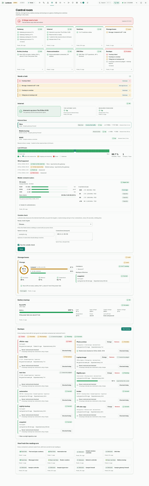

# Control room

One page for what keeps a home or a small office running: the **internet**, the **storage boxes**, the **battery backup** and the
**backups**, with a block each for the gateway, switches, home automation and the DNS filter. It only reads. Open it from the
*Control room* tab, `#/controlroom` (also `#/wan`, `#/nas`, `#/backups`) or the command palette (*Go to Control room*, *Go to
Internet*, *Go to Storage boxes*, *Go to Backups*). The manual page is [manual/controlroom.md](manual/controlroom.md).



Two rules hold everywhere. Every block says **how old its picture is**; a reading that went quiet for 15 minutes is dimmed and
counts as *unknown*, never as fine. And no state is a colour alone: each has a word and a sign.

## Internet: two axes

| Axis | Source | Used when |
|---|---|---|
| What the **gateway says** | the `wans` list of a controller family (link, carrying line, rates, role) or the operational state of the uplink port a router reports over SNMP | always, when a source has it |
| What is **measured** | an optional probe: one name lookup and up to four TCP connections to targets an administrator picks, every 20 seconds | when it has an answer younger than 90 seconds |

**The measurement counts.** When the probe is fresh it decides, and a gateway that disagrees is only noted ("the gateway says
down, but the internet answers"). Without targets nothing is probed - Lanloom connects to no host of its own choosing - and the page
says that only the gateway's word counts.

**Flap guard.** A change counts after 3 equal results in a row (down) or 2 (up). Four confirmed changes within ten minutes make the
state *flapping*; it stays so until ten quiet minutes and writes one history line, not twenty. If no axis has a fresh reading for five
minutes the state is *unknown*, not the old one.

**History.** A character per 15-minute slot for 35 days (up, up on the reserve line, flapping, down, unknown; the worst one wins),
shown as 24 hours of blocks, availability over 7 days, and a log of changes. A gateway that has an event stream of its own
(`wan_events` in the neutral state) is merged into the log.

**Reserve line.** A line with `role: backup` (for example a mobile router) is the reserve; `active` says which line carries traffic.
Switching to it is a point in the nightly report; so is a night on it.

### Mobile-router card

Read from the `cellular` list of a controller family, or from the entities of a home-automation hub whose names carry the usual
words (RSRP, RSRQ, SINR, RSSI, band, network type, operator, data used/limit). A router without any signal figure gets no card.

* **Signal quality** has one table (`SIGNAL` in `lanloom/controlroom/cellular.py`): the limits between excellent, good, fair, poor
  and bad for RSRP (-80/-90/-100/-110 dBm), RSRQ (-10/-15/-20/-25 dB), SINR (20/13/0/-5 dB) and RSSI (-65/-75/-85/-95 dBm). The card shows
  the worst measure. Poor is yellow, bad is red; an idle reserve line is never worse than yellow.
* **Bearer table** (`BANDS`): the bands in use with duplex mode, centre frequency and role - low bands carry coverage, high bands
  capacity.
* **Data volume** against the limit (yellow from 80 %, red at 100 %).
* Cell id, tracking area and position are **administrator data**: they are in the answer for administrators only.

## Storage boxes

For every device of kind *storage box* the card joins what the sources deliver anyway: the volumes (HOST-RESOURCES-MIB, host agent
mounts, hypervisor storage), processor, memory and temperature, containers (host agent), virtual machines (hypervisor on the same
box), the backup chains of the box and the battery backup that carries it. The ring shows the fullest volume (yellow from 85 %, red from
95 %); its colour is the worst of the volumes, the vitals and the freshness. A box without any reading says *no reading yet*.

## Battery backup (UPS)

Two ways in, both read only: the **Network UPS Tools protocol** (a *Battery backup (UPS)* connection: host, port 3493, optionally the
name of one UPS; the client sends `LIST UPS`, `LIST VAR`, `VERSION` and `LOGOUT` and nothing else - no login, no commands) and the
**UPS-MIB** (RFC 1628) of an SNMP agent that serves it. States: on mains, charging, on battery, low battery, replace battery,
overload, unknown. The remaining runtime is the UPS's own estimate: shown as "left on battery" while it runs on battery and as "about
38 min if the power fails now" otherwise. Every change of state is logged (35 days) for the nightly report.

## Backups

A **chain** is one thing that is backed up: a guest of a hypervisor, the backup of a home-automation hub, a timer of a host agent
(names with backup, snapshot, dump, restic, borg ...), or a chain you declare and whose script reports to Lanloom.

| Status | Meaning |
|---|---|
| Current | a success is known, younger than 1.5 times the expected interval, and the source of that knowledge is fresh |
| Overdue | the newest success is older than that |
| Failed | the newest attempt failed after the newest success |
| Running | a run is going on - the card shows **progress**, never a stopwatch |
| No backup | something that should be backed up is in no job at all |
| Cannot be judged | never reported, or the source has been silent for 15 minutes - Lanloom does not say *current* then |

**Progress** is exact when the script reports it (`POST /api/backups/chains/{id}/progress`), otherwise an estimate from the duration
and throughput learned from earlier runs (never 100 % before the run ends; a run that goes silent stops counting as running after an
hour). **Restore last checked on ...** is a date a person sets (a backup nobody restored is a hope); it is shown with a hint when it is
missing or older than 180 days and never changes a chain's state; a person can take the date back
(`POST /api/backups/restore-check/undo {chain}`).

**Not used.** A chain Lanloom found by itself (a hypervisor guest, the backup of a hub, a host-agent timer) can be set to *not used*
(`POST /api/backups/ignore {chain, ignored}`; the id is in the body because hypervisor ids may contain a slash). It is kept in the
list `ignored` of `GET /api/backups` (and `GET /api/v1/backups`), with its real state and the time it was set aside, and it is in no
summary, no point of the page, no nightly report, no storage card and no resilience grade. The choice is stored per chain id: it
survives a restart and a source that falls silent, and it never reverts by itself. Setting it back (`ignored: false`) counts the
chain again. A declared chain is deleted instead (`chain.err.declared`).

A script reports a run with one request (token scope *operate*, see [API.md](API.md)):

```
curl -X POST -H "Authorization: Bearer $LANLOOM_TOKEN" -H "Content-Type: application/json" \
     -d '{"ok": true, "size": 4294967296, "duration_s": 900}' https://lanloom.example/api/v1/backups/offsite/run
```

## Roles and the audit log

Everybody who sees the map reads. Operators declare, change and delete chains, report runs and note restore checks; administrators
pick the targets of the internet check. Every change is in the audit log (`chain.save`, `chain.delete`, `chain.report`,
`chain.progress`, `chain.restore_check`, `chain.restore_uncheck`, `chain.ignore`, `wan.probe`).

## Nightly report

One section, *Control room*, only when a source exists: an internet outage or flapping inside the night, a switch to the reserve
line, a UPS on battery, a backup that failed, is overdue, has none or cannot be judged. A calm night is one line.

## Data and outgoing connections

Tables: `wan_slots`, `wan_log`, `ups_log`, `backup_chains`, `backup_runs`, `backup_checks`, `backup_learn` (all inside Lanloom's own
database and its backup). The only connections the control room opens by itself are the optional internet check (to targets an
administrator picked; category `own-internet-check` in `security/egress.json`) and the connection to a UPS service you set up
(`configured-source`). Both are listed in the telemetry check, and there is no telemetry.

## Demo data

The sample network has two internet lines (fibre and a mobile reserve), a UPS, a storage box with a volume at 87 %, a week of history
with a short outage and a night on the reserve line, and backup chains in every state. The probe of the sample network is simulated.
