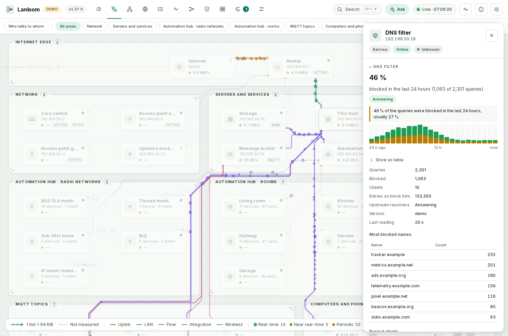
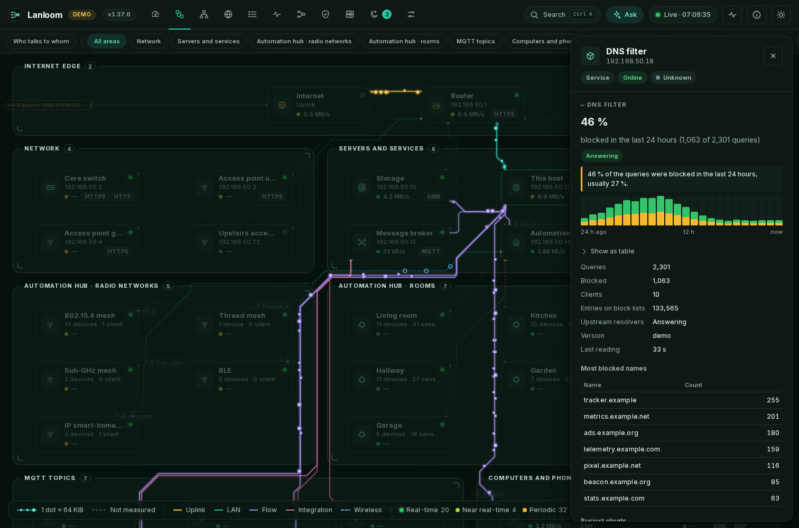
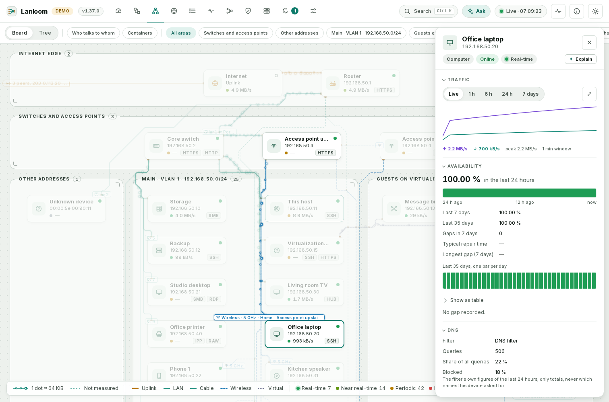
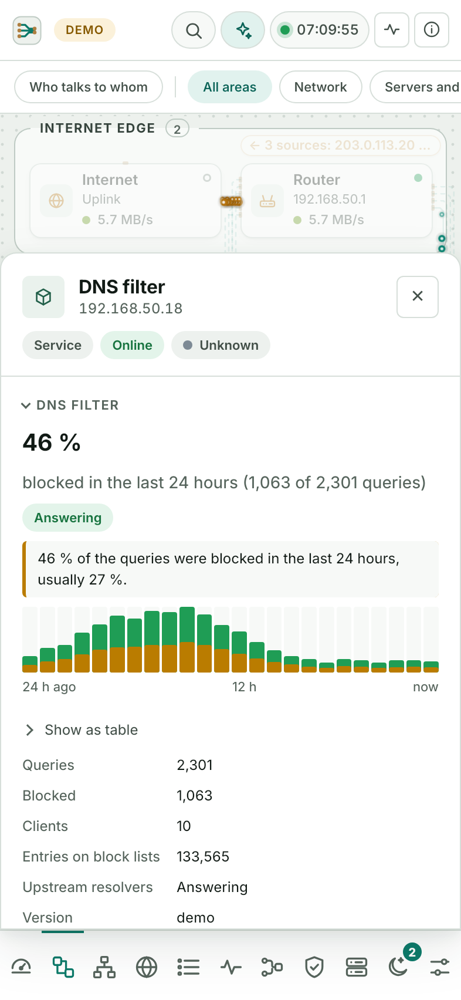

# DNS filters (read only)

A DNS filter is a name server in your network that blocks the names of trackers and advertising for every device that uses it. Lanloom reads one (several are possible) and shows what it does, without ever touching it. Families: see [COMPATIBILITY.md](COMPATIBILITY.md); each has its own guide for the access to create.

## What Lanloom reads - and what it does not

**Totals only.** Per reading: queries and blocked queries of the last 24 hours, per hour (or per day, when the filter only reports days), the clients that ask most, the most blocked names, the upstream resolvers with answer counts and times, the block lists with entries and last update, whether blocking is on and the server is running.

**Never single queries.** The read halves cannot ask for a query log: the paths are not on their allow-lists (checked by a static test), so not even a bug could fetch one. Which names a device asked for never reaches Lanloom.

**What is kept.** Per filter and hour two numbers (queries, blocked) for 35 days, per day the same sums for 400 days; deleting the connection deletes them. The top lists and the per-client counts exist only in memory, as the filter reports them for the last 24 hours, and are gone after a restart until the next reading. Nothing is sent anywhere.

## Where you see it

- **The filter on the map.** The device the filter runs on gets a *DNS* mark; a filter on an address no scan has found yet is a component of its own, with the blocked share under its name and the live grade of the connection. Its card has the section **DNS filter**: the blocked share, 24 hours as bars (queries, with the blocked part inside), the facts, plain findings, the most blocked names, the busiest clients (each linked to its device card), the upstream resolvers, the block lists and the last days. A table below the bars gives the numbers for screen readers.
- **A device's card.** A device that is among the filter's busiest clients gets the section **DNS**: how many queries it caused in the last 24 hours, its share of all queries and - where the filter tells - how many were blocked. Never which names.
- **Night report.** The section *DNS filter* appears while a filter is connected: the filter did not answer, blocking is switched off, the server is not running, the upstream resolvers do not answer, no query at all for three hours although there usually are some, an unusual blocked share (the last 24 hours against the median of the days before; needs five days of readings), block lists older than three weeks. Quiet nights say so in one line.
- **For the dashboard cards.** `GET /api/dns` (all filters in short: totals, blocked share, health, findings, the 24 hours) and `GET /api/dns/<connection id>` (one filter in full) for every signed-in role. Totals only, like everything above.
- **Command palette.** *Show the DNS filter* jumps to the card.

 

 

## Setting one up

The setup assistant recognises a filter's web page in the scan and suggests the connection with the address filled in, a four-step guide for the read access and the form. You can also add it under **Settings → Connections**. The *Test* button shows the version, the number of queries, the blocked ones and the clients.

Roles: viewers see everything above; creating, changing and removing a connection is for administrators, like every connection.

## Limits

- Stage A: reading only. Switching blocking on or off, editing lists or clients is not offered.
- A filter's own statistics window is the base: 24 hours at most per reading, so the first day after connecting has a partial picture of the days; the hours come at once.
- A client the filter names instead of an address cannot be matched to a device and shows under the filter's name.
