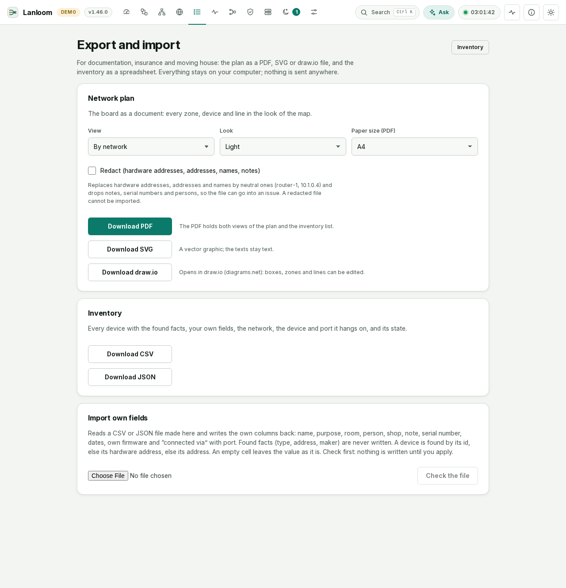
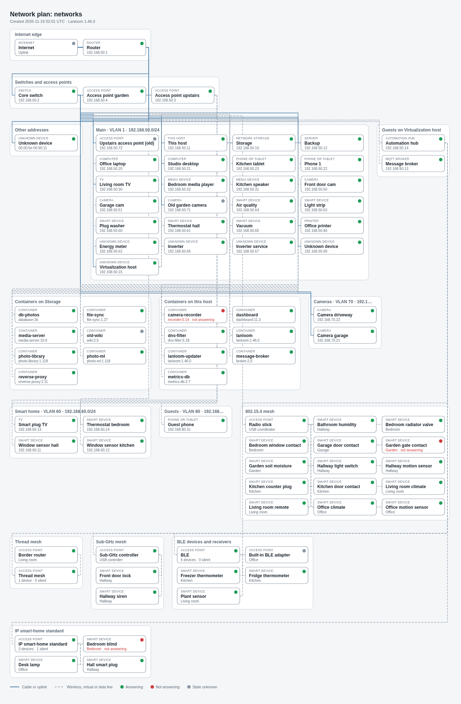
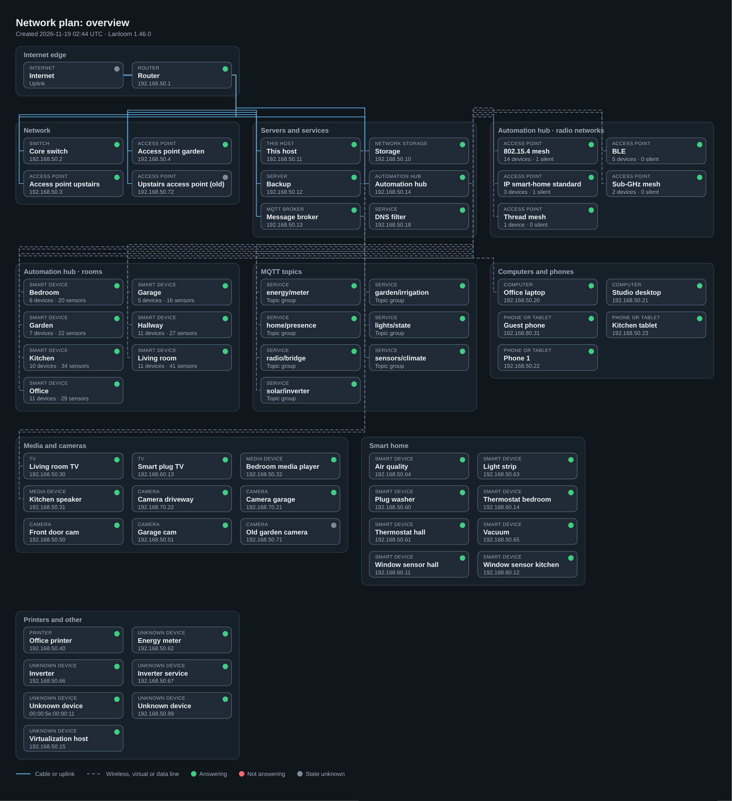
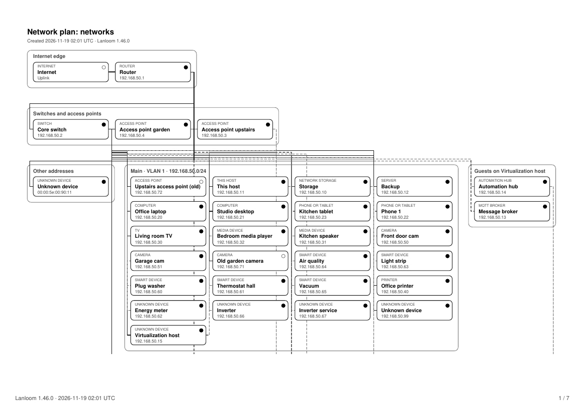
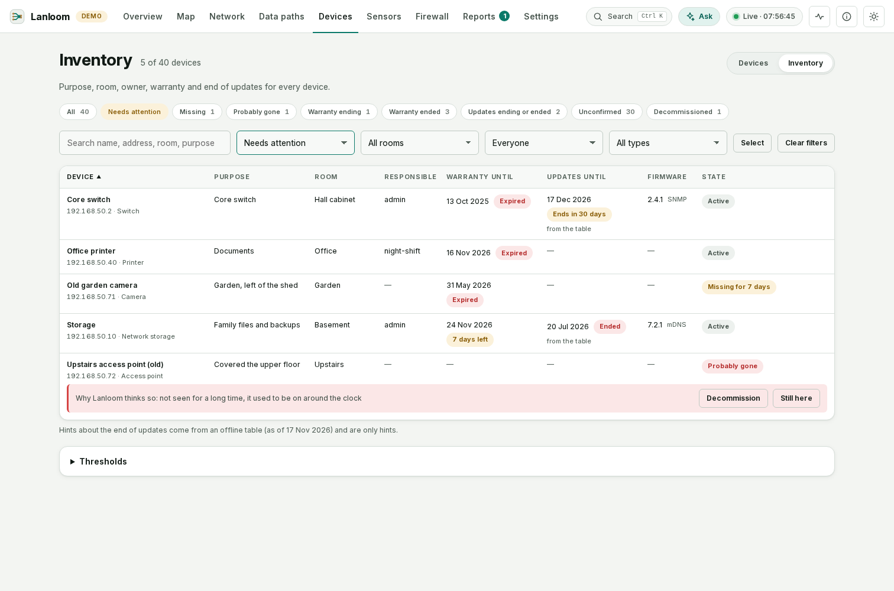
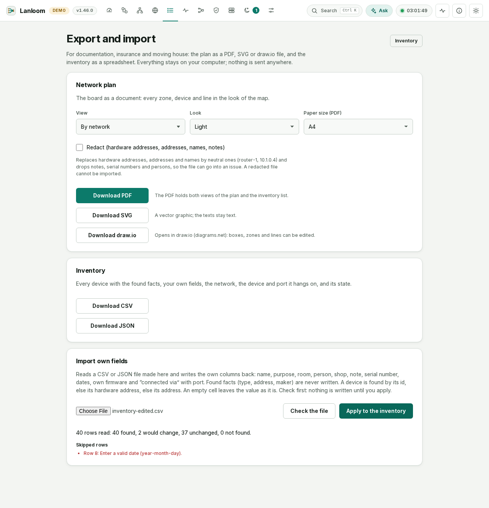

# Export and import

For documentation, insurance and moving house. Lanloom writes the **network plan** as a PDF, an SVG or a file for draw.io,
and the **inventory** as CSV or JSON. The own columns of the inventory (names, notes, "connected via" ...) can be read back
in. A **redact** option replaces everything that identifies the network, so a file may be attached to an issue.

Everything is built inside Lanloom, on your computer. Nothing is sent anywhere and no outside service is asked; the
download is saved by your browser. The page is *Devices › Inventory › Export* (`#/export`), the palette
(`Ctrl K`) has a command for each file.

## The network plan

The plan is the board of the map as a document: every zone is a board, every device a pad with its type, name, address
and state, and the lines run only in the gaps between the pads, never across one. Two views, like the map:

| View | Zones |
| --- | --- |
| **By network** | the internet edge, every network and VLAN with its devices, containers under their host, the radio networks of a hub |
| **Overview** | the internet edge, then by kind: network gear, servers and services, computers and phones, media, smart devices, other |

Folded tiles of the web page ("N quiet devices") are never folded in a file: every device is on the plan.

| File | What it is |
| --- | --- |
| **PDF** | A4 or A3, landscape. Both views, then the inventory list. A plan that stays readable on one sheet is one sheet; a large one is cut between rows of zones (never through a zone), with the page number in the footer. The texts are real text (searchable, copyable); fonts are the two standard PDF fonts, nothing is embedded. |
| **SVG** | One view as a vector graphic. Texts stay text, no bitmap, no script. Opens in every browser and drawing program. |
| **draw.io** | One view as an editable diagram (`.drawio`, uncompressed XML): a box for every zone and device, a line between connected devices that follows the box when you move it. |

Three looks: **Light**, **Dark** and **Print-friendly** (white paper, no fills; the state is also written in words and a
device that does not answer has a hollow mark, so a grey-scale printout is complete).

Line styles: solid is a cable or the uplink; dashed is a wireless, virtual or data line. The state dot is green (answers),
red (does not answer) or grey (unknown).

## The inventory

*CSV* (comma separated, UTF-8 with a byte order mark so spreadsheets read umlauts correctly) and *JSON* (one object
with `format`, `generator`, `redacted`, `columns` and `devices`) hold one record per device, decommissioned devices
included:

| Column | Meaning | Imported |
| --- | --- | --- |
| `id` | the device's id in Lanloom | match key |
| `name` | the shown name | yes (at most 48 characters) |
| `kind`, `ip`, `mac`, `network`, `vendor`, `model`, `firmware`, `serial_reported`, `state`, `first_seen`, `last_seen` | what Lanloom found | no (found facts are never written) |
| `firmware_own` | the firmware you wrote down | yes |
| `serial`, `purpose`, `room`, `owner`, `shop`, `note`, `purchase_date`, `warranty_until` | your own fields | yes |
| `eol_until` | end of updates (own date, else the table's) | yes (writes an own date) |
| `connected_via`, `connected_via_id`, `port`, `medium` | the device and port the device hangs on | yes (becomes a manual connection) |

A cell that a spreadsheet would run as a formula (it starts with `=`, `+`, `-` or `@`) is written with a leading
apostrophe; the import removes it again, so a round trip is exact.

## Import of own fields

*Import own fields* reads a CSV or JSON file made here and writes the own columns back. It is built for the round trip
*export, edit in a spreadsheet, import*: set rooms and persons for fifty devices in a minute.

- A device is found by its `id`, else its hardware address (`mac`), else its address (`ip`). A row that matches nothing
  is counted and ignored. Other columns can be left out; a CSV with `,`, `;` or tab as separator is read.
- **An empty cell leaves the value as it is** (nothing is ever cleared by import; clear a field in the inventory).
- **Check first.** *Check the file* only reports: rows read, found, would change, unchanged, not found, and every row with
  a wrong value (a date that is not `YYYY-MM-DD`, a person without an account, a connection that does not exist or
  would close a loop). Nothing is written until *Apply to the inventory*. A row with a wrong value is skipped as a whole;
  the other rows are applied.
- "Connected via" accepts the id of the device or its exact name (when the name is unique), plus the port and the
  medium (`wired`, `radio`, `virtual`).
- A **redacted** file is refused (JSON) or matches nothing (CSV): the pseudonyms are not your devices.
- At most 5000 rows and 2 MB.

## Redact

The option *Redact* (every file, also the plan and the PDF) replaces:

| Original | In the file |
| --- | --- |
| device names | type and counter: `router-1`, `camera-2` |
| addresses | `10.N.x.y`; one pseudonym network `10.N.0.0/24` per real network, so the structure is still readable |
| hardware addresses | `02:00:00:00:00:01` and on |
| device ids | `dev-0001` ... (the same in every file of one download) |
| persons, rooms | `person-1`, `room-1` |
| serial numbers (own and reported) | `REDACTED` |
| purpose, shop, note, own firmware, purchase date, warranty | left out |
| first and last seen | the day only |

Kept on purpose: type, maker, model, firmware as found and the end-of-updates date, because a support question needs them.
Names of the zones that came from a network or a host are replaced too. The files say *Redacted* in the header and the
footer. A test downloads every file redacted from a sample network with secrets in every field and searches for each of
them.

## Who may do what

| Action | Role |
| --- | --- |
| Download a plan or the inventory | viewer and up (they read the same on screen) |
| Import own fields | operator and up (it is the same as editing them one by one) |

Every download is an entry in the audit log (*Export downloaded*, with the kind of file, whether it was redacted, the
paper size): never the content. An import writes *Inventory import* with the number of rows and changes. In the sample
network (demo view) downloads work; the import does not (it is read only).

## The palette

`Ctrl K` finds: *Download PDF*, *Download network plan as SVG*, *Download network plan for draw.io*, *Download inventory
as CSV*, *Download inventory as JSON* and *Open Export and import*. The commands use the choices last made on the page
(view, look, paper size, redact), which are kept in this browser only.

## Limits

- The PDF carries Western European text (English, German, French, Spanish, Dutch and Italian); a character outside it becomes `?` in the PDF. SVG and
  draw.io carry every language.
- The layout is a fixed grid, not the live board: pads of one zone sit in columns, a network with several hundred devices
  makes a long plan (the PDF cuts it into pages).
- A line that leaves its zone runs along the gaps of the next zones; with many lines they lie close together.
- The plan shows the state at the moment of the download, not the history.

## Privacy

- **Read:** the device list, the inventory, the map model and the connections Lanloom already holds.
- **Stored:** nothing. A file is built on request, handed to the browser and forgotten. The choices on the page are kept
  in this browser only.
- **Sent:** nothing leaves Lanloom. The export adds no outgoing connection (the list of allowed destinations is
  unchanged).
- **Roles:** see above; the audit log never contains the content of a file.
