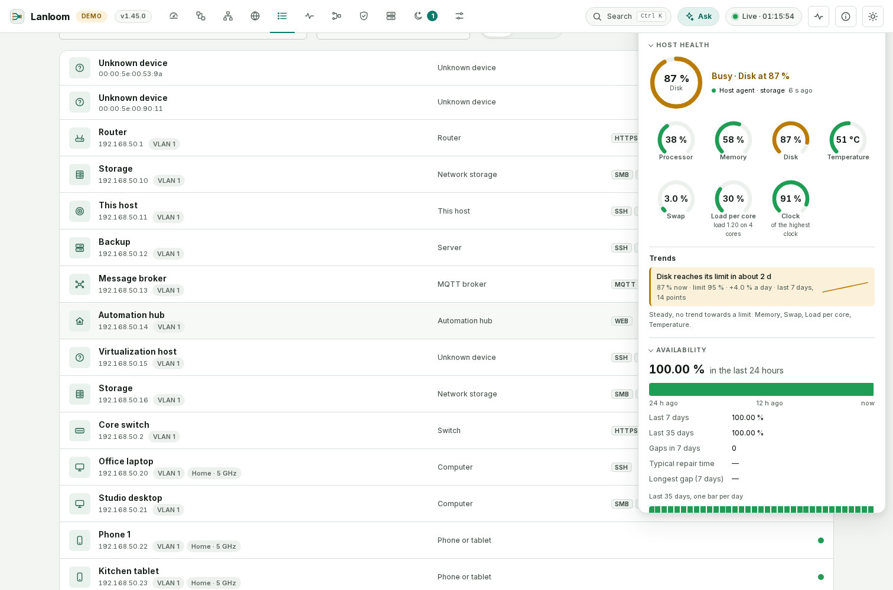
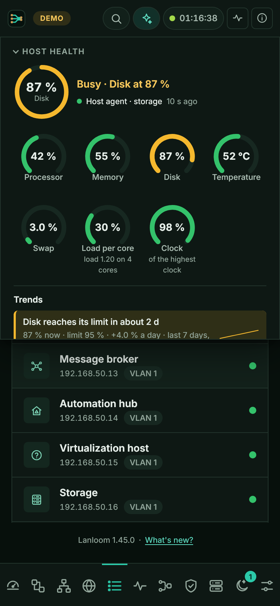
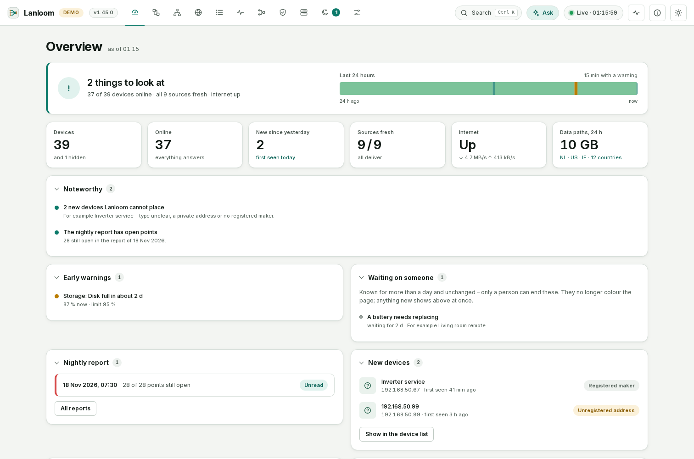

# Host health and early warnings

Lanloom shows how each host is doing right now and tells you early when something will run out: memory filling up, a
disk running full, swap growing, a host getting warmer week by week. It also keeps lasting conditions that only a person
can end ("waiting on someone") from drowning out new problems. Everything here only reads.

## Where the values come from

Lanloom uses what its sources already deliver; it asks nothing extra from your network for this.

| Source | What it gives | Needs |
|---|---|---|
| Host agent ([HOST-AGENT.md](HOST-AGENT.md)) | processor use, load, memory, swap, the fullest disk, processor temperature, throttling | the optional agent on that host |
| SNMP | processor, memory, swap and fixed disks (HOST-RESOURCES-MIB); load and temperature where the agent also serves the UCD and LM-SENSORS tables | an SNMP connection to that host |
| Hypervisor | processor, memory, swap, load and the node's storage | a hypervisor connection |
| Network controller | processor and memory of routers, switches and access points | a controller connection |
| Home hub | system sensors of the hub device that is merged with the network device (processor use, memory, swap, disk use, load, processor temperature) | the hub bridge; matched by unit and name only, a battery or a room temperature is never read as a host value |

**Memory over SNMP** counts what the system cannot hand out right now. On the common open-source agent the physical memory row of HOST-RESOURCES-MIB
says *total minus free*, so buffers and the page cache would count as used and a host with a large cache would look almost full.
Lanloom therefore uses, in this order: *MemAvailable* (UCD `memSysAvail`, newer agents), the UCD free memory plus buffers and
cache, or the physical memory row minus the *Memory buffers* and *Cached memory* rows the same agent lists.

The SNMP connection reads the host tables once a minute (they change slowly); an agent without those tables is asked
again after half an hour. Every five minutes the newest reading of each source is written as one sample
(`host_samples`, 35 days, part of the *Availability* storage area and of a backup with history).

## The host card

The card of every device with host values gets a **Host health** section:

- **Health ring** – the worst gauge, with its value and name, and a line such as *Busy · Disk at 87 %*.
- **Round gauges** – processor, memory, disk, temperature, swap, load per core (the 15-minute load divided by the cores)
  and the processor clock where throttling is measurable (*held back* when the firmware reports it).
- **Colours** – green below 70 %, yellow 70–90 %, red above 90 %. Temperature: yellow from 70 °C, red above 85 °C.
  Load per core: yellow from 70 %, red above 100 %.
- **Sources** – every source with the age of its last reading. A source that stopped delivering for 15 minutes is shown
  dimmed as *stale · 40 min ago*, never red: an old value is no alarm, but it is no longer true either.
- **Trends** – memory, swap, disk, load and temperature (see below): a warning row in calm yellow, slow trends in grey,
  and one line for everything that is steady.

On a phone the gauges sit four in a row and the card opens as a sheet.

## Early warnings: how the forecast works

For every series and two time spans (6 hours and 7 days):

1. The window is cut into equal parts (6 hours: 12 parts of 30 minutes; 7 days: 14 parts of 12 hours). The median of a
   part is its **support point**; a part counts only when at least half of its samples are there.
2. The **trailing monotone run** is the longest run of the newest support points (at least 3, and at least two thirds of
   the points there are) that rises or falls steadily: Kendall's tau of at least 0.7, most steps in one direction, no step
   back larger than 20 % of its span. A sawtooth (a cache that fills and is emptied, a nightly backup) never passes.
3. The **slope** is the median of all pairwise slopes of that run (Theil–Sen). It counts only when the change within the
   run is at least 1 % of the limit (0.2 % when the limit would be reached within a year).
4. **Time to the limit** = (limit − value now) / slope; the value now is the median of the last 30 minutes.

A **warning** needs a rising, steady, meaningful trend over at least 3 support points and the limit reached in **less
than 72 hours**. A warning from the 6-hour window also needs the 7-day window's consent (the value is above its highest
point, or it rises as well); otherwise it is a daily rhythm and stays calm. Other steady trends are shown as calm
*info*. Nothing sticks: every five minutes the forecast is calculated again.

| Value | Limit |
|---|---|
| Memory | 95 % |
| Swap | 100 % |
| Disk | 95 % |
| Load per core | 200 % (twice as many waiting tasks as cores) |
| Temperature | 85 °C |

A warning shows

- on the host card (Trends),
- on the overview, card **Early warnings** (one line per host value, with the time to the limit),
- in the nightly report, section **Early warnings** (a point to tick off), and
- as the notification event **Host value heading for its limit** (once while it lasts; see [NOTIFICATIONS.md](NOTIFICATIONS.md)).

The command palette has *Go to Early warnings*.

## Waiting on someone

Some conditions can only be ended by a person: an infrastructure device that is switched off, a connection whose
sign-in or certificate is refused, new devices nobody has named yet, batteries of radio devices that need replacing.
When such a row of the overview has been **unchanged for more than 24 hours** (same row, same level, same values; values
that change with the clock alone do not count), it moves to its own card **Waiting on someone**:

- it no longer sets the colour of the overview banner, so anything new stands out at once;
- it shows how long it has been waiting;
- any change – a second device, warning to danger, another reason – brings it back to *Noteworthy* in the same moment
  and starts the 24 hours again.

The memory survives a restart; after more than six hours without a check (Lanloom was stopped) "unchanged" is no longer
proven and the 24 hours start again.

## Privacy and roles

- Only numbers are kept: percentages, a load average, degrees, a clock share. No process names, no file names, no
  contents.
- `GET /api/hosthealth` (early warnings and waiting rows) and `GET /api/hosthealth/{device}` (the host card) are open to
  every signed-in role (viewer and up); there is nothing to change, so there is no audit entry.
- Nothing new leaves your network: the values come from sources you connected yourself.

## Limits

- A trend needs history: at least three support points (an hour and a half for the short window, a day and a half for
  the long one).
- Fixed limits suit most hosts; a host that runs at 96 % memory on purpose will show a full gauge, but no warning unless
  it keeps rising.
- The hub source depends on the hub's own sensor names and units; a hub without system sensors gives no host values.
- Temperature over SNMP needs the LM-SENSORS table; many network devices do not serve it.
