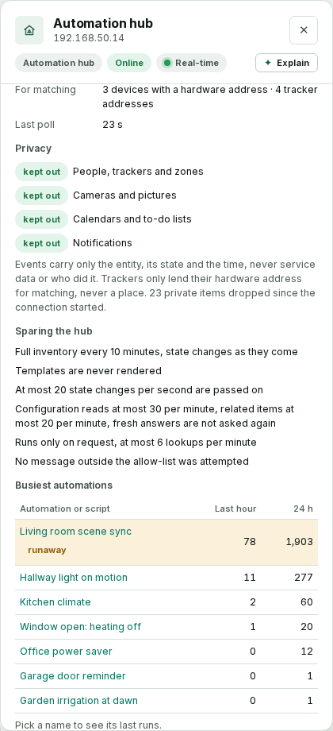
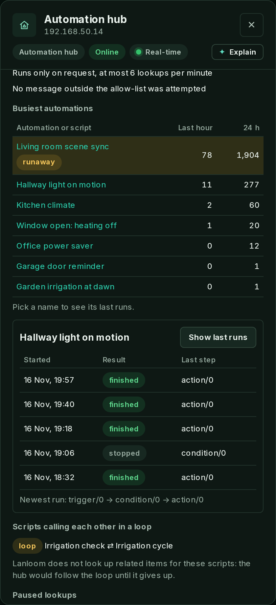
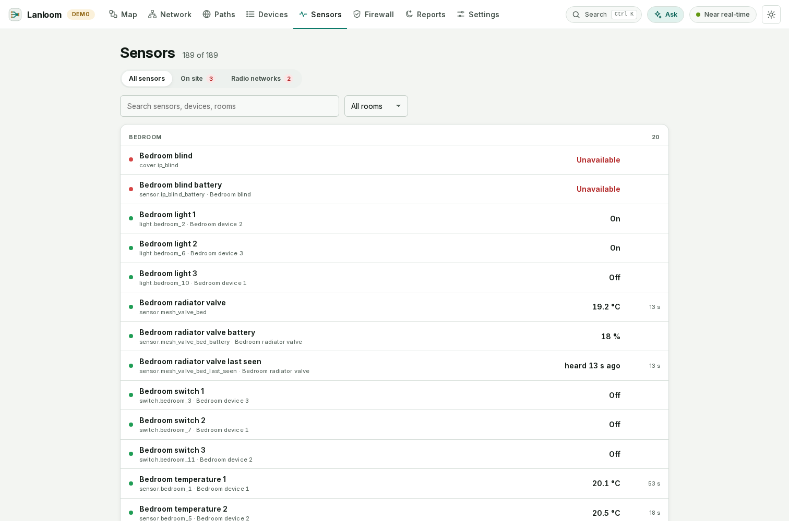
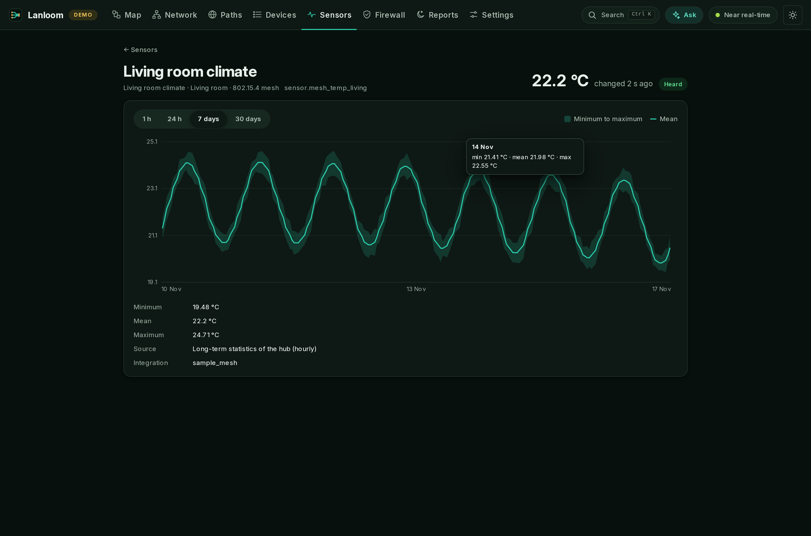

# Home-automation bridge

Lanloom reads a home-automation hub over its WebSocket API: devices, entities and areas for the map, state changes
for the live grade, and – in admin mode – which entities each automation and script uses and their last runs. It
never switches, changes or reloads anything, and it never runs code inside the hub (no add-on, no custom component).

## Setting it up

Settings › Connections › *Home-automation hub*: the hub's address (`http://…:8123` or `https://…`) and a
long-lived access token. A token of a normal (non-admin) user is enough for the map.

| Option | Default | What it does |
|---|---|---|
| Accept a self-signed certificate | off | For a hub with its own certificate on `https://`. |
| Admin mode | off | Also read automation and script configuration, their runs and related items. These requests need a token of an administrator on the hub. Still strictly read only. |
| Show people, trackers and zones | off | See [Privacy](#privacy). |
| Show cameras and pictures | off | |
| Show calendars and to-do lists | off | |
| Show notifications | off | |

The bridge appears on the component card of the hub (open its tile on the map).

## What is read

There is exactly one function that sends anything to the hub. It lets through only these message types, each with
exactly its fields, and checks every value:

| Message type | Fields | When |
|---|---|---|
| `auth` | access token | at connect |
| `get_states`, `get_config` | – | every 10 minutes, connection test |
| `config/device_registry/list`, `config/entity_registry/list`, `config/area_registry/list` | – | every 10 minutes |
| `config_entries/get` | – | every 10 minutes (which integration a device belongs to) |
| `subscribe_events` | `state_changed`, `automation_triggered` or `script_started` | at connect |
| `automation/config`, `script/config` | the entity id (only `automation.*` / `script.*`) | admin mode, within a budget |
| `search/related` | item type `automation`/`script` and its entity id | admin mode, within a budget |
| `trace/list`, `trace/get` | domain `automation`/`script`, item id, run id | admin mode, only on request |
| `history/history_during_period` | start and end time, exactly one entity id (never a private one), `minimal_response`, `no_attributes`, `significant_changes_only` (all `true`) | only when someone opens 24 h, 7 days or 30 days on a sensor page, at most 12 per minute |
| `recorder/statistics_during_period` | start and end time, exactly one entity id, period `5minute`/`hour`/`day`, types `mean`/`min`/`max`/`state` | the same, for numbers that have long-term statistics |

Anything else – service calls, firing events, template rendering, registry changes, reloads – cannot be sent; the
attempt is refused and counted ("No message outside the allow-list was attempted" on the card). Static tests check the
source code of the bridge for this on every build. A message type the hub does not know (an older version) is not
asked again in that session.

From configurations Lanloom keeps **only entity ids**, per role (trigger, condition, action; ids that only appear
inside a template are marked as weaker). Aliases, descriptions, templates, values and service data are discarded
right away. From traces it keeps the start and end time, the result, the last step and the step path of the newest
run – never variables, trigger descriptions or error texts (only "error: yes/no").

## Sparing the hub

- Full inventory every 10 minutes; state changes as they come, at most 20 per second passed on (the latest value of
  an entity wins).
- **Templates are never rendered** – rendering costs the hub work on every call.
- Configuration reads at most 30 per minute, related-item lookups at most 20 per minute, one at a time. Answers stay
  fresh for an hour (configuration) or two (related items), longer for big installations, spread so that not everything
  falls due at once. A changed configuration is read again earlier.
- Traces only when someone asks for the last runs of one automation, at most 6 lookups per minute.
- History only when someone opens a longer range on a sensor page: one entity per request, at most 12 per minute, an
  answer stays fresh for 5 minutes (24 h) to an hour (30 days). The hour range comes from Lanloom's own memory.
- **Scripts that call each other in a loop** (found with Tarjan's algorithm from the configurations) are never looked
  up: the hub would follow the loop until it gives up. Related items are only looked up after every configuration has
  been read once, so loops are known first; scripts are read before automations.
- An item the hub answers with an error is paused – 24 hours, then doubling up to a week; a changed configuration lifts
  the pause. Three timeouts in a row count as one error. The card lists paused lookups.

## Privacy

Off by default, dropped inside the bridge before anything is stored:

| Group | Entities |
|---|---|
| People, trackers and zones | `person.*`, `device_tracker.*`, `zone.*` |
| Cameras and pictures | `camera.*`, `image.*` |
| Calendars and to-do lists | `calendar.*`, `todo.*` |
| Notifications | `persistent_notification.*`, `notify.*` |

- A tracker only lends its hardware and IP address for matching hub devices with network devices – never its state
  ("home"), a place, coordinates or its name.
- Events carry the entity id, its state and the time. When an automation or script caused a change, the event names
  it; when a person did, it only says `user`. Service data, user ids and context ids never leave the bridge.
- Of attributes only the unit, the name and the device class (battery, timestamp, temperature, ...) are kept.
- Hub data lives in memory only. It is never written to the database, so backups never contain it.
- Every way out of Lanloom applies the filter again, whatever you switched on for the map: the AI features see the
  home-automation section of the nightly report only as its summary (counts), and "Explain" on one of its notes hides
  the automation's name. Exports and diagnostic files do not contain hub data today; when they do, they go through the
  same filter, which drops private domains and blacks out names.

## On the card

- Mode, inventory, automations and scripts, devices with a hardware address (for matching).
- Privacy: which groups are kept out and how many private items were dropped.
- Sparing the hub: the limits above and the refused-message counter.
- Busiest automations (last hour, 24 hours); **runaway** marks an automation or script that ran 60 times or more within
  one clock hour. In admin mode operators and admins can pick a name to see its last runs.
- Script loops and paused lookups.

## One component: network side and hub side

Many devices are known twice: the scan finds them on the network, the hub knows them as its own devices. Lanloom
draws them as **one component** with both sides. The evidence, strongest first:

| Evidence | Confidence | |
|---|---|---|
| hardware address from the hub's device registry equals the network device's (or one of its other interfaces) | 95 % | merged |
| the device's configuration page names an IP address and a tracker of the hub knows the hardware address behind it | 85 % | merged |
| the configuration page names the network device's IP address | 70 % | merged |
| the hub's device name equals the network device's name or host name (unique on both sides) | 45 % | only a suggestion |

Merged devices carry a **HUB** badge on the map. Their card starts with the *Automation hub side*: which evidence
decided, the name, model, firmware and room at the hub, the integration and the entities with their states (each one
opens its sensor page). *Show separately* takes a match apart for good; a suggestion has *Same device* and *Different
devices*. These choices need the operator role and go into the audit log (action `hub.match`).

## Radio networks

Radio devices have no network address; the hub knows them through its radio integrations. Lanloom reads which radio
network a device belongs to from the hub's device registry (connection types and integration domains) and shows five
kinds with neutral names:

| Kind | What it is | Lane starts at |
|---|---|---|
| 802.15.4 mesh | low-power mesh with a coordinator | the coordinator (stick or network bridge) |
| Thread mesh | IPv6 802.15.4 mesh | the network itself; its border routers are listed |
| Sub-GHz mesh | sub-GHz mesh with a controller | the controller |
| BLE | short-range radio, heard by adapters and radio proxies | the network itself; its receivers are listed |
| IP smart-home standard | devices over Thread or wireless LAN | the network itself |

On the **map** each network is one tile on a dashed lane from the hub (devices, silent devices). On the **network
view** each network gets a zone: the coordinator (or the network) with the radio devices behind it (`via`), dashed like
wireless links, with one radio mark per network; up to 36 devices are drawn, the rest share a "+N more" tile. A
coordinator or receiver that is also a network device is that network device.

**Radio freshness** follows one rule: a radio device is fresh while at least one of its entities is not
`unavailable`, and – when its integration reports a "last seen" time – while that time is younger than 24 hours. The
age of the last state update is never used: an update without a change, or a restart of the hub, would make every
device look fresh. Silent devices are drawn red. A network is *disturbed* when its coordinator is silent or half of
its devices are, *needs a look* with any silent device.

**Event rings**: every state change travels as a small ring along the lane of its radio network (or along the trace of
its room), a shape of its own next to the byte dots. The Sensors tab counts state changes per integration over the last
10 minutes.

## Sensors tab

The tab appears as soon as a hub is connected (also on the phone, in the bottom bar).

- **All sensors**: every entity the bridge keeps, grouped by room, with search (name, entity id, device, room,
  integration) and a room filter; time stamps read as "heard 3 min ago".
- **On site**: what needs a visit – *Now* (battery at most 10 % or reported low), *Soon* (at most 25 %), *Silent* (radio
  device unavailable or not heard for more than 24 hours) and *OK*, with a battery bar and when the device was last heard.
- **Radio networks**: one card per network with its health, coordinator, devices, silent devices and low batteries;
  the BLE receivers, the Thread border routers, the devices of the IP standard and the state changes per integration.
- **Sensor page** (pick any entity): the current value and a large chart for 1 hour (Lanloom's own live memory),
  24 hours (the hub's recorder), 7 and 30 days (the hub's long-term statistics, otherwise the recorder). Lanloom thins
  the answer out at the server: numbers into at most 240 buckets drawn as a minimum-to-maximum band with the mean as a
  line, states into a state bar with the share of each state. Hover shows the values of a point in time.

In the search (`Ctrl K`) *Go to Sensors* opens the tab, typing "on site" or "radio" offers its parts, and an entity hit
opens its sensor page first.

## Nightly report

The section *Home automation* (one per hub connection) appears when the hub is connected. It lists runaway
automations and script loops as points to look at, paused lookups and the busiest automations of the night as notes,
and – should it ever happen – messages the bridge refused to send. The summary has counts only. Run counts are kept in
memory in hourly buckets for 26 hours; after a restart the section covers the time since the start.

The section *Radio and batteries* (one per hub connection, only when the hub knows radio devices or batteries) lists
silent radio devices, batteries to change now, silent receivers and border routers and disturbed networks as points,
batteries that get low as notes. The summary counts radio devices and networks and how many hub devices are drawn
with their network device. Like the home-automation section, the AI features see it only as its summary.

## API

| Route | Role | |
|---|---|---|
| `GET /api/hub/{id}/bridge` | viewer | the card |
| `GET /api/hub/{id}/automations` | viewer | automations and scripts: mode, last run, runs in the last hour and day, reference counts, loop/pause flags |
| `GET /api/hub/{id}/traces/{entity_id}` | viewer | the last runs fetched for an automation (or `null`) |
| `POST /api/hub/{id}/traces/{entity_id}` | operator | ask the bridge for the last runs (admin mode; audit action `hub.traces`) |
| `GET /api/hub/{id}/sensors` | viewer | the Sensors tab: entities, rooms, devices, on site, radio networks, health, state changes per integration |
| `GET /api/hub/{id}/entity/{entity_id}?range=1h\|24h\|7d\|30d` | viewer | the sensor page: thinned-out numbers (`points`: time, min, mean, max) or states (`segments`: start, end, state), summary and source; longer ranges ask the hub within its budget (429 when it is used up) |
| `POST /api/hub/{id}/match` | operator | `{"device", "hub_device", "action": "split"\|"join"\|"reset"}`: take a match apart, confirm a suggestion, forget the choice (audit action `hub.match`) |
