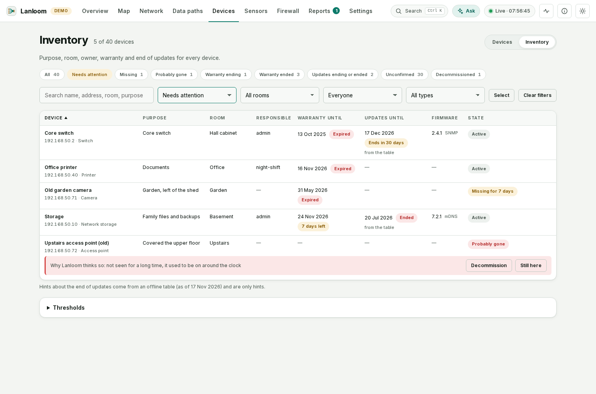
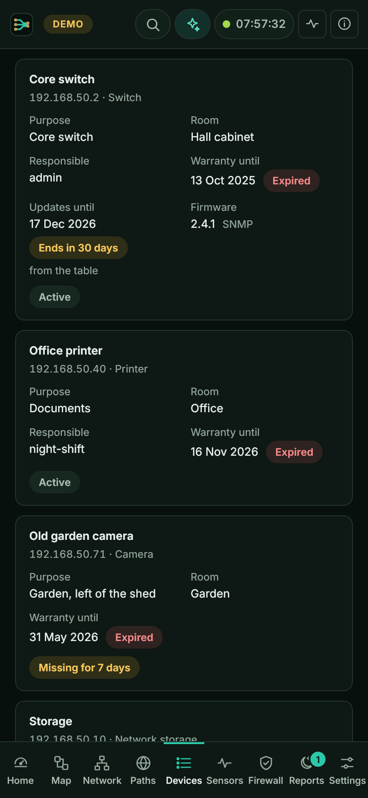

# Inventory and life cycle

Lanloom finds your devices on its own. The inventory adds what only a person knows - what a device is for, where it
stands, when it was bought, how long it is covered - and follows each device over its whole life: seen, missing,
probably gone, decommissioned. It is part of the device list: the *Devices | Inventory* switch at the top of the page.

## What is found and what is written down

| Found by Lanloom (read only) | Written down by people (own fields) |
| --- | --- |
| name, kind, address, hardware address | purpose, room or place |
| maker, model, firmware and where each value comes from | purchase date, warranty until, shop and note |
| serial number, where the device reports one (UPnP, DNS-SD) | serial number of your own, responsible person |
| last sign of life, first seen | own firmware, own end-of-updates date |

**Firmware** comes from, in this order: your own entry, the equipment list of a connected device-family adapter, the
home-automation hub's device registry (matched to the device), then what the device announced itself (UPnP, DNS-SD, the
SNMP system description). The source is shown beside the value. Serial numbers are never copied from adapters (they stay
inside their own sources); only what the device itself announced on the network is shown.

The **responsible person** is one of the accounts of Lanloom (see [ACCESS.md](ACCESS.md)). All text fields are cut to a
sensible length and cleaned of control characters; dates are checked (year-month-day, a purchase date cannot lie in the
future, a warranty cannot end before the purchase).

## States

| State | Meaning |
| --- | --- |
| **Active** | seen recently - or nothing is judged (see below) |
| **Missing** | no sign of life for *N* days (default 7); the list says how many days |
| **Probably gone** ("removed?") | missing, and the reasons below add up to at least one half |
| **Decommissioned** | retired by a person, with a date, a note and the device that replaced it; hidden from the map, kept here as history |

A *sign of life* is a scan that found the device, an answer to the gentle presence check, or traffic seen from it; signs
of life are remembered across restarts. **Nothing is judged** while Lanloom has not looked at the network for two days
(a stopped scan schedule would otherwise turn the whole list "missing"); the page says so.

### Why "probably gone"

| Reason | Weight | Meaning |
| --- | --- | --- |
| Long absent | 0.5 | missing for 30 days or more (setting) |
| Successor | 0.35 | a device of the same kind and maker first appeared within three days of its last sign of life; offered as the replacement |
| Port reused | 0.3 | the switch port it was last seen on is now used by another device |
| Always on | 0.2 | it ran for at least two weeks and is the kind of device that normally stays on (network gear, servers, printers, cameras, TVs) |

The list shows the reasons in plain words and two buttons: *Decommission* and *Still here*. *Still here* hides the
suggestion until the device shows up again and disappears once more. Lanloom never decommissions on its own.

### Automatic entries are provisional

An entry Lanloom made on its own is **provisional** until a person confirms it - with the *Confirm* button, or by
touching it: a new name or type, any own field, a manual connection, hiding it. A provisional entry that shows no sign of
life for **7 days** (setting, 0 = never, 3 to 90) is removed from the list once a day and noted in the nightly report, so
guests' phones and one-off devices do not pile up. The gateway, the computer Lanloom runs on, every device a connected
family or hub knows, and everything you confirmed are never removed this way. If a removed device comes back, it is
found again as a new device.

### Decommissioning

*Decommission* asks for a date (default today), the device that replaced it (optional) and a note. The device disappears
from the map and the device list but stays in the inventory under *Decommissioned*. If it answers again two days after
its date, the row shows *Back on the network* and the nightly report says so; *Put back in service* reverses everything
(a device you had hidden yourself stays hidden).

## Warranty and end of updates

- **Warranty:** a chip says *ok*, *ends in N days* (default: 30 days or less) or *expired*.
- **End of updates:** Lanloom ships an **offline table** (`lanloom/data/eol.json`, renewed with every release, never
  downloaded at run time): product or release → the date the vendor's regular updates end. The patterns are matched
  against the maker, model, firmware and system description a device reported (and the firmware you wrote down). A
  chip says *ok*, *ends in N days* (default: 180 days or less) or *ended*, and where the date came from (*table* or *own*).
  Your own end date always wins over the table. The table is **advisory** - it knows few products, so a missing chip means
  "unknown", not "supported" - and the page shows its date.
- **Your own table:** drop a file with the same format into the data directory (`<data>/eol/eol.json`); its entries are
  added, an entry with the same id replaces the bundled one. A bad entry is skipped and logged.

Entry format: `{"id": "example-os-1", "match": ["\\bexample os 1\\b"], "until": "2025-10-14"}` - `match` is a list of
regular expressions tested against the lower-cased text, `until` a date, `name` (optional) a label, `sample` (optional)
a text the patterns must match.

## The Inventory view

- **Quick filters** with counts: all, needs attention, missing, probably gone, warranty ending, warranty ended, updates
  ending or ended, unconfirmed, decommissioned. A chip is a link (`#/inventory?state=missing`), so you can bookmark it.
- **Search and filters:** free text over name, address, maker, model, firmware, serial numbers, purpose, room,
  person, shop and note; filter by state, room, person and kind. Click a column header to sort (empty values always last);
  on a phone use the sort list.
- **Edit:** click a row for the sheet with every field, the lifecycle buttons and the reasons. Viewers see the same
  without fields and buttons.
- **Edit many at once:** *Select* puts a check box on each row; the bar sets purpose, room, person, purchase date,
  warranty and shop for all selected devices (only the fields you fill in) and can confirm them. Name, type and serial
  number are per device and cannot be edited in bulk.
- **Phone:** the table becomes cards; the sheet fills the screen.
- **Thresholds** (admins, folded away): days until *missing*, until *probably gone*, until provisional entries disappear,
  and the warning times for warranty and end of updates.
- **Search and commands** (`Ctrl K`): *Open Inventory*, *Show devices that need attention*, *Show missing devices*, *Show
  warranties that end soon*, *Show devices whose updates end*; the device search also finds a device by its room,
  purpose, person or shop.
- The device card carries an *Inventory* block with the key facts and a link to the sheet.

## Roles and the audit log

Everyone who sees the device list reads the inventory. **Operators** change the own fields, confirm, decommission and
put devices back in service, and edit in bulk; **admins** also change the thresholds. Every change is in the audit log
(`inventory.change`, `inventory.lifecycle`, `inventory.bulk`, `inventory.settings`) with the names of the changed
fields - never their values, so notes and serial numbers stay out of the log.

## Nightly report

The section **Inventory** appears when there is news. A threshold is announced once, in the night it is crossed:

- a device became *missing* or *probably gone*; a retired device is back on the network;
- a warranty ends in 30 days (the setting), in 7 days, or has ended;
- updates end in 180 days (the setting), in 30 days, or have ended;
- provisional entries that were taken off the list (a note, not a point).

Everything but the last is a point to look at. See [NIGHTLY-REPORT.md](NIGHTLY-REPORT.md).

## API

`GET /api/inventory?state=&q=&room=&owner=&kind=&warranty=&eol=&provisional=1&sort=&dir=` (viewer),
`GET|PUT /api/devices/{id}/inventory`, `POST /api/devices/{id}/lifecycle` (`confirm`, `unconfirm`, `keep`, `decommission`,
`reactivate`), `POST /api/inventory/bulk` (operator), `GET|PUT /api/inventory/settings` (PUT: admin). Errors are
translation keys (`inventory.err.*`).

## Data and privacy

The own fields live in the database of the app (tables `inventory` and `device_alive`; an older version ignores them).
They are part of every backup (see [BACKUP.md](BACKUP.md)). Nothing leaves your network: the end-of-updates table is
part of the image and nothing is asked online. Serial numbers (yours and the reported ones) are hidden from texts that
go to an AI service by the privacy layer.
