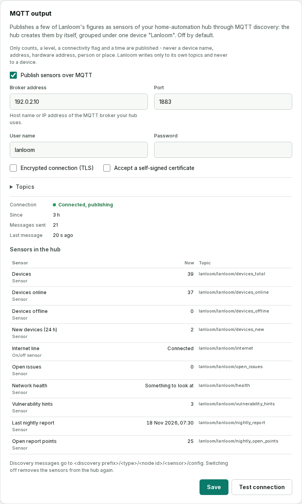

# MQTT output: sensors for your home-automation hub

Lanloom can publish a few of its own figures as sensors of a home-automation hub through **MQTT discovery**: the hub
creates them by itself, grouped under one device *Lanloom*. It is **off by default**; an administrator switches it on
under *Settings › MQTT output*.

## What is published

| Sensor | Type | Value |
|---|---|---|
| Devices | sensor | number of devices on the map (hidden ones not counted) |
| Devices online | sensor | devices that answer right now |
| Devices offline | sensor | devices that stopped answering |
| New devices (24 h) | sensor | devices seen for the first time since yesterday |
| Internet line | on/off sensor (connectivity) | `ON` up, `OFF` down, unknown when Lanloom cannot tell |
| Open issues | sensor | warnings and problems on the overview |
| Network health | sensor (enum) | `ok`, `info`, `warn` or `danger`, the level of the overview banner |
| Vulnerability hints | sensor | open [vulnerability hints](VULNERABILITIES.md) (not set aside) |
| Last nightly report | sensor (timestamp) | when the last [nightly report](NIGHTLY-REPORT.md) was made |
| Open report points | sensor | points of that report not ticked off yet |

The names follow the language of the Lanloom instance. Values are sent when they change (looked at every 30 seconds)
and once every ten minutes as a refresh.

**Never published:** device names, addresses, hardware addresses, people, places, trackers, cameras, calendars or anything
the hub itself sent to Lanloom ([privacy of the hub bridge](HUB-BRIDGE.md#privacy)). Only counts, a level, a flag and a
time leave Lanloom.

## Topics

| Topic | Content |
|---|---|
| `<discovery prefix>/<type>/<node id>/<sensor>/config` | discovery message (JSON, retained) |
| `<base topic>/<node id>/<sensor>` | value as plain text (retained) |
| `<base topic>/<node id>/status` | `online` / `offline` (retained; `offline` is also the last will) |

Defaults: the hub's default discovery prefix, base topic `lanloom`, node id `lanloom`. Change the node id when more than one
Lanloom publishes to the same broker.

## Setting it up

1. *Settings › MQTT output*, tick *Publish sensors over MQTT*.
2. Broker: address, port, user name and password of the broker your hub uses (TLS optional). In the
   [add-on](ADDON.md) you can pick *Broker of the add-on system* instead - nothing to type in.
3. *Test connection* connects and disconnects once without publishing anything. *Save* starts the output.

Switching off - or changing the node id or a prefix - removes the sensors again: Lanloom sends empty retained messages
to exactly the topics it used before.

## Only its own topics, never a device

The output has its own small MQTT client, separate from the read-only MQTT source:

- It sends only CONNECT, PUBLISH, PINGREQ and DISCONNECT. There is no SUBSCRIBE: nothing is read from the broker.
- Every PUBLISH topic must be one of the `1 + 2 × 10` topics computed from the settings for this node. Both rules are
  checked when a packet is built and again right before it is written; tests read the source to make sure no other
  write path exists.
- QoS 0, retained. Values are plain text, the discovery messages contain no templates and no command topics: the hub
  cannot send anything back.
- The password is stored encrypted and never shown again; the broker of the add-on system is asked for its
  credentials on every connect and they are not stored.
- The connection is one of the outbound places of the [no-telemetry check](SECURITY-MODEL.md#no-telemetry-checked)
  (category *configured channel*): it exists only after an administrator sets it up.

## When it does not connect

The card shows the state of the connection and the reason (broker not reachable, password refused, encrypted connection
failed, connection lost). After ten minutes without a connection the overview shows a note and the notification event
*MQTT output not connected* fires (with an all-clear when it is back). Lanloom retries with growing pauses up to five
minutes.

## API and roles

`GET /api/mqtt-out` (settings without the password, state, topics, sensors with the current value), `PUT /api/mqtt-out`
(change; audit `mqtt_out.change`), `POST /api/mqtt-out/test` (audit `mqtt_out.test`) - administrators only.
