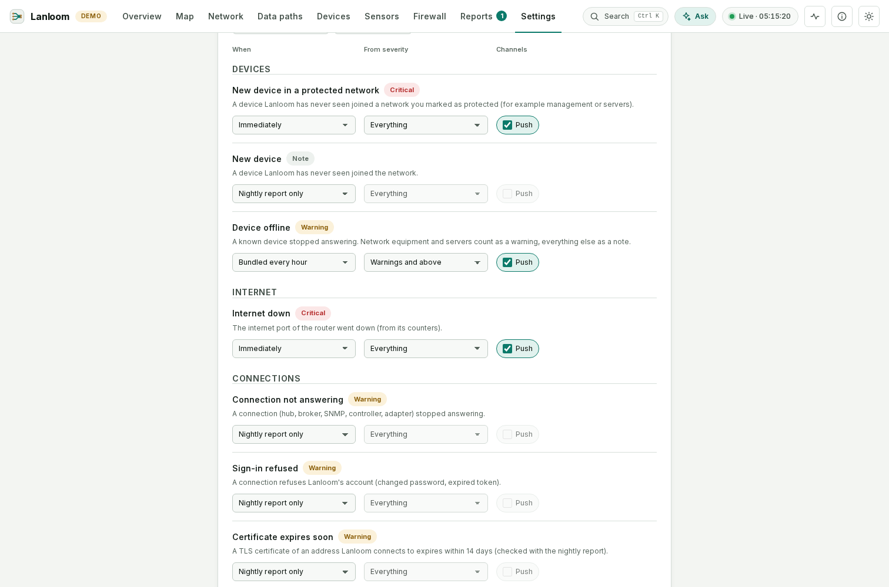
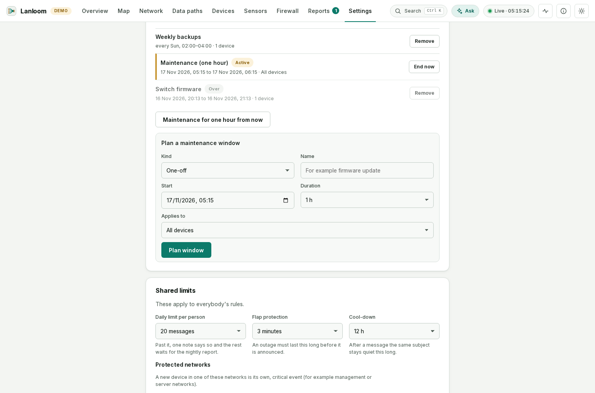
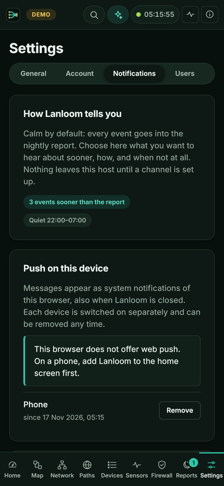

# Notifications

Lanloom is calm by default. It heals what it can and tells you about the rest in the [nightly report](NIGHTLY-REPORT.md). Notifications are for the few things you want to hear about sooner – and only you decide which, how and when. Nothing leaves the host until a channel is set up.

Open **Settings → Notifications**. Everybody (viewer, operator, admin) has their own rules; the page also shows the planned maintenance and the history.



## Events

| Event | Default severity | Waits (flap protection) | All-clear |
| --- | --- | --- | --- |
| New device in a protected network | critical | – | – |
| New device | note | – | – |
| Device offline (network equipment and servers: warning, others: note) | warning | yes | yes |
| Internet down (the router's internet port, from its counters) | critical | yes | yes |
| Connection not answering (hub, broker, SNMP, controller, adapter) | warning | yes | yes |
| Sign-in refused by a connection | warning | yes | yes |
| Certificate expires within 14 days (expired: critical) | warning | – | – |
| Backup too old | warning | – | – |
| Vulnerability hint (a published vulnerability matches a device's firmware; certain or exploited in the wild: warning, otherwise note; only with the [vulnerability hints](VULNERABILITIES.md)) | warning | – | – |
| Switch port unstable (three or more link drops or error episodes in 24 hours; only with a switch controller read) | warning | – | yes |
| Host agent silent (no report for 90 seconds; only with a [host agent](HOST-AGENT.md)) | warning | yes | yes |
| Failed service or timer on a host with an agent | warning | – | yes |
| Host value heading for its limit (memory, swap, disk, load or temperature reaches its limit within 72 hours; only once host values are sampled, see [HOST-HEALTH.md](HOST-HEALTH.md)) | warning | – | – |
| Container unhealthy or restarting (host agent or container source) | warning | yes | yes |
| Lanloom update available | note | – | – |
| Security notice for your account (only you get it) | warning | – | – |
| Controller change put back (only with the external executor; could not be put back: critical) | warning | – | – |

The three events about hosts (*Host agent silent*, *Service or timer failed*, *Container unhealthy*) are in the group **Hosts and containers** and are offered only once a host agent or container source exists. *Host value heading for its limit* is in the same group and is announced once per host value while the warning lasts. The name of the host and of the unit or container is in the message; nothing from inside a container ever is.

*Vulnerability hint* (group *Incidents*) comes from the [vulnerability hints](VULNERABILITIES.md): once per device and hint, a warning when the hint is certain or exploited in the wild, otherwise information. *Incident* is already in the register and appears as soon as the feature that reports it is there. New devices found by the very first scan are no news; neither are rows about the past.

**Protected networks** (administrators, *Shared limits*): a new device in one of these networks (for example management or servers) is its own critical event.

## Rules

For each event you choose:

- **When** – *Nightly report only* (default: nothing is sent), *Bundled every hour* (one message at the top of the hour with everything since the last one), *Immediately*, or *Off* (not even in your history).
- **From severity** – below it the event stays in the nightly report.
- **Channels** – *Push* (web push on your own devices) and the shared channels of the nightly report delivery: *E-mail*, *Webhook*, *Push topic* (ntfy-compatible), *Chat bot*. A shared channel can be used as soon as an administrator has set it up under *Settings → Nightly report → Delivery*, even when the nightly delivery itself is off. With your own e-mail address (optional) e-mail notifications go to you instead of to the report's recipients.

Two presets help: **All in the nightly report** and **Important sooner** (critical immediately, warnings bundled every hour, notes in the report – on push when you have it, else on the first ready channel).

A rule without a ready channel says so and keeps the event in the nightly report.

## Quiet hours

Per person, for example 22:00–07:00 in the report time zone. During quiet hours only events set to **Immediately** that are **critical** get through; everything else waits for the nightly report (an hourly bundle that falls into quiet hours is not sent either). All-clears are not sent during quiet hours.

## Planned maintenance

Operators and administrators plan them; everybody sees them.



- **One-off** (start and duration, up to 14 days) or **every week** (weekdays and a time, also across midnight – a Tuesday 23:00–02:00 window covers Wednesday morning).
- For **all devices** or **some devices**. Events without a device (the internet line, a connection) are only covered by a window for all devices.
- While a window is active, nothing is announced, the occurrence is marked as maintenance (incidents treat it as maintenance, not as a fault) and no all-clear follows. An outage whose hold time ends inside a window is maintenance, too.
- **Maintenance for one hour from now** is one click on the page or in the search (`Ctrl K`). The start page shows an active window.

## Flap protection, cool-down and limits

Administrators set these under *Shared limits*; they apply to everybody.

- **Flap protection** (default 3 minutes = three watch rounds): an outage must still be there after this time before it is announced. If it clears earlier it was a flap; the history shows it as *Flap* and nothing is sent.
- **Cool-down** (default 12 hours): after a message the same subject (the same device, the same line) stays quiet; a repeat goes into the nightly report.
- **All-clear** only after an announced outage, only to the people who were told, with the duration ("NAS is back (after 14 min)").
- **Daily limit** per person (default 20 messages): past it, one message says so and the rest waits for the nightly report.

## Push on your devices



Click **Switch on push for this device** and allow notifications. Each device (browser) is subscribed separately, listed with its last message, and can be removed at any time – also from another device. Messages appear as system notifications even when Lanloom is closed; tapping one opens the device or the page.

- Web push needs a **secure address** (HTTPS, for example behind your reverse proxy, see [INSTALL.md](INSTALL.md#behind-a-reverse-proxy)); `localhost` works for a test. Over plain HTTP the browser does not offer it.
- On a phone, add Lanloom to the home screen first (some phones offer push only to installed web apps).
- The messages are encrypted for each browser (RFC 8291) and signed with the VAPID key of your Lanloom (RFC 8292). The private key is created on first use and kept in the encrypted secret store; the push service only sees ciphertext. A browser that ended its subscription is forgotten automatically.

The same service worker is the **offline shell** of the installed app: when the network is gone, Lanloom still opens instead of an error page. It always asks the network first and never caches the API, so an update is never hidden behind an old copy. It is registered only where it is needed – on the notifications page, in the installed app and in a browser that already receives push; an open page is never taken over, the worker starts with the next page load.

## Heartbeat to the outside

Optional (administrators): Lanloom calls an address of yours every 1 to 60 minutes (default 5) – for example the push check of an uptime service. When the calls stop, that service tells you that Lanloom itself is down. The address is stored encrypted, never shown again and never logged; *Call now* tests it; a heartbeat that does not get through is a point in the nightly report.

## History and nightly report

The history lists every event of the last 30 days with what the rules did: *Sent*, *Bundled*, *Failed*, *Nightly report*, *Quiet hours*, *Maintenance*, *Flap*, *Cool-down*, *Daily limit*, *No channel*. Administrators also see the outcome per person (security notices without addresses).

The nightly report gets a section **Notifications** once anybody uses them: messages sent, events held back by quiet hours, events during maintenance (with the name of each window), flaps, repeats in the cool-down, events over the daily limit; failed deliveries and a failing heartbeat need a look.

## Privacy and what leaves the host

Nothing is sent before a channel is set up. Push messages go to the push service of the subscribed browser, the heartbeat to the address you entered, everything else through the channels of the nightly report. Messages carry names you gave and short texts, never device ids, passwords or tokens. Changes to rules, push devices, planned maintenance, limits and the heartbeat are written to the [audit log](ACCESS.md#audit-log).

## For developers

Events are registered in `lanloom/notify/events.py`; a later feature adds its own and announces it:

```python
from lanloom.notify import events

events.register(events.make("incident", "incidents", 50, "warning"))
core.notify.emit("incident", "incident:%d" % incident_id, {"title": title}, device=device_id)
core.notify.emit("incident", "incident:%d" % incident_id, resolve=True)     # cleared: all-clear if it was announced
```

`maintenance_at(t, device)` tells whether a time (and device) falls into a maintenance window. Message texts are the translation keys `notify.msg.<event>` (and `notify.back.<event>` for the all-clear). Webhook messages are JSON: `{"type": "notification", "event", "severity", "title", "text", "link", "time"}`.

API (signed in, rights as in [ACCESS.md](ACCESS.md)): `GET /api/notify`, `PUT /api/notify/prefs`, `GET /api/notify/history`, `POST /api/notify/push`, `DELETE /api/notify/push/{id}`, `POST /api/notify/test` (any role, own data); `POST /api/notify/maintenance`, `DELETE /api/notify/maintenance/{id}` (operator); `PUT /api/notify/settings`, `PUT /api/notify/heartbeat`, `POST /api/notify/heartbeat/test` (admin).
