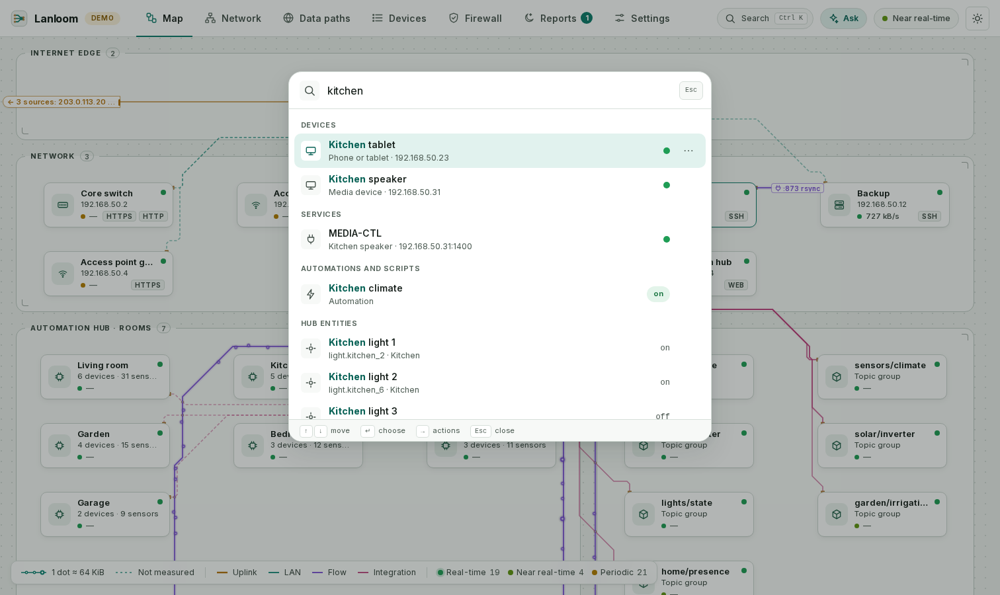
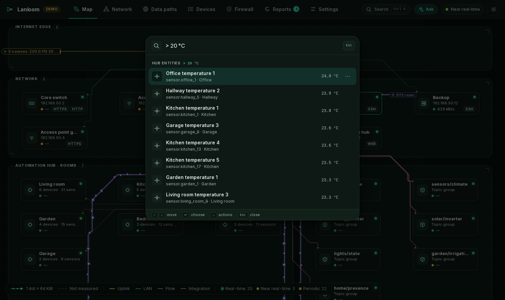
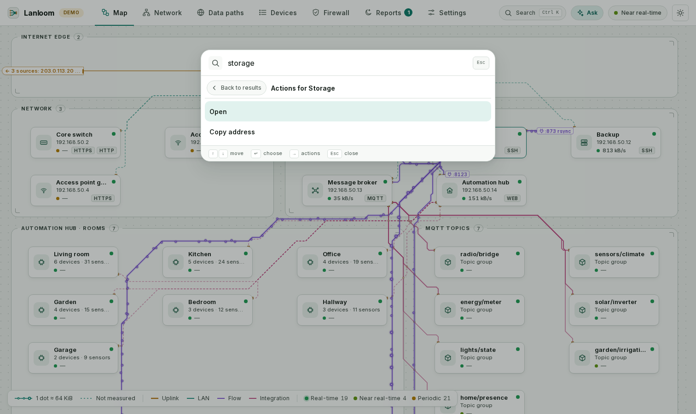
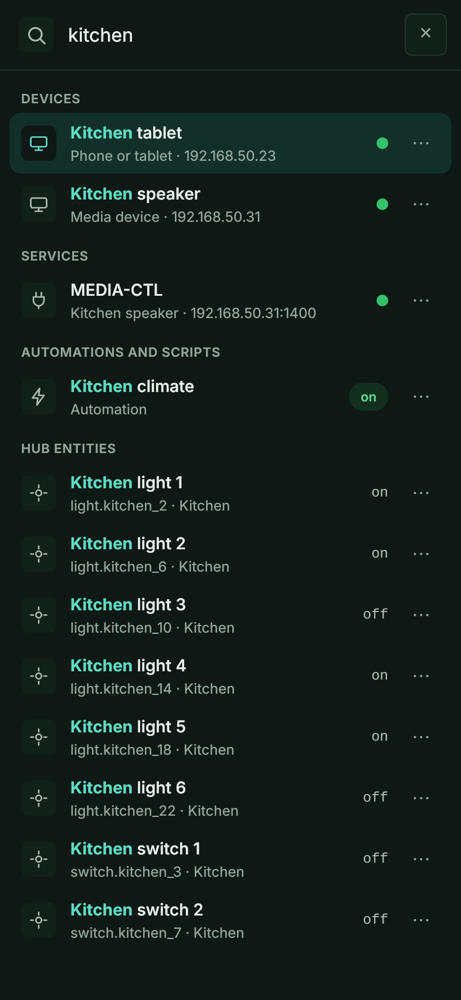

# Search and commands

One box for everything Lanloom knows and can do. It is read only: it finds things and takes you to them, and the few commands that change something (rate unit, update check) are the same ones the settings offer, with the same role.



## Opening it

| How | Where |
| --- | --- |
| `Ctrl K` (`⌘ K` on a Mac) | everywhere inside the app, pressing it again closes it |
| `/` | everywhere, when no text field has the focus |
| the **Search** button in the top bar | always; on a phone it is the magnifier |

It does not open on the sign-in or setup pages. `Esc` closes it and gives the focus back to where you were.

## What is searched

Type a few words; **every word has to match**. A word that starts a word of the name beats one inside a name, accents and capitals do not matter, and a typo is forgiven from four letters on (one edit, two for words of eight letters or more; two neighbouring letters swapped count as one edit): `kichen tablt` finds *Kitchen tablet*.

| Group | What | Where it is matched |
| --- | --- | --- |
| Views and commands | every view, the settings pages, light/dark, colour themes, rate unit, update check, *Change a device (network, name, fixed address) …*, *Change a guest (start, shut down, network card, firewall) …*, *Networks and VLANs*, *Port forwarding*, *Fixed addresses*, *Network plan*, *Zones of the firewall* (`#/firewall/zones`), *Change a switch port* (`#/firewall/ports`; opens the editor's *Switch ports* card in Change mode; operators and admins), *New firewall rule* (`#/firewall/rules/new`), *May one reach the other?* (the firewall question; `#/firewall/ask` opens the editor's card when no firewall is read), *Switch ports and front view*, *Open Stability*, *Go to Early warnings* (the overview card of [host health](HOST-HEALTH.md)), *Go to Automations* (typed: *Who switches what*, *Timeline*, *Day plan*, *Rooms*, *Hub health*, *Show automations with findings*), *Who talks to whom* (typed; the map with the conversation lines), *Open Running*, *Pair a host agent*, *Show the DNS filter* (jumps to the filter's card; only with a [DNS filter](DNS-FILTER.md) connected), *Show containers on the map* and *Hide containers on the map* (the last two unfold or fold the containers of every host on the map; see [HOST-AGENT.md](HOST-AGENT.md)), *Open Export and import*, *Download PDF*, *Download network plan as SVG*, *Download network plan for draw.io*, *Download inventory as CSV*, *Download inventory as JSON* (see [EXPORT.md](EXPORT.md)), *Open Inventory*, *Show devices that need attention*, *Show missing devices*, *Show warranties that end soon*, *Show devices whose updates end*, *Open Vulnerabilities*, *Show hints exploited in the wild*, *Show devices not checked for vulnerabilities* | in the page |
| Devices | name, address, hardware address, kind, host names, maker and model, and what you wrote down in the inventory (room, purpose, person, shop) | the server |
| Virtual machines and containers | name, id, addresses, host (from a hypervisor connection) | the server |
| Services | which device offers which service, with the port | the server |
| Automations and scripts | name and id (from the home-automation bridge) | the server |
| Hub entities | name, id and area of what the bridge delivered; the current state is shown | the server |

Hidden devices are never offered. Hub data comes only as the bridge delivered it, so what the privacy filter keeps out (people, trackers, cameras, calendars, notifications by default) cannot be found either.

With nothing typed, the box shows **Recent** (your last choices) and the views and commands. "Clear recent items" empties that list. It is kept in this browser only and never sent anywhere.

## The value filter

A comparison filters hub entities by their current value:

- `> 25 °C` – everything above 25 degrees, highest first
- `<= 40 %` – everything at or below 40 percent, lowest first
- `kitchen temp < 20` – the words narrow by name, the comparison by value

Operators: `>` `>=` `<` `<=` `=` (also `≥` and `≤`). A unit is compared when you type one (`°C`, `C`, `%`); without a unit every number matches. Entities whose state is not a number never match. A comparison asks about hub values only, so the other groups stay empty while it is in the box.



## Actions of a hit

`Enter` does the first action of a hit. `→` (at the end of the text) or the dots at the right of the row show all of them; `←`, `Esc` or "Back to results" return to the list.

| Hit | Actions |
| --- | --- |
| Device, virtual machine, service | Open (the card of the device), Copy address; for a device also *Move to … / change* (operators: opens the firewall editor with its sheet - network, name, fixed address), *Show availability*, *Show traffic history*, *Simulate maintenance*, *Show failure chain*, *What does it depend on?* |
| Entity | Open the sensor page, Show the hub card, Show dependencies (the board of the Automations tab), Copy ID, *Show failure chain*, *What does it depend on?* |
| Automation | Open in Automations, Show the hub card, Show dependencies, Copy ID, *Show failure chain*, *What does it depend on?* |

An action exists only when something registered it, so an action for a view Lanloom does not have yet is never shown.

**Commands in two steps.** *Show failure chain …*, *What does … depend on?* and *Simulate maintenance …* first ask for the
part: the box shows what the choice is for as a chip ("Failure chain of") and lists only devices, automations and entities;
`Enter` on a hit opens its [failure chain](manual/failure-chain.md).

**Commands that understand a time.** *Rewind to …* reads what you type after `rewind to` (or `zurückspulen auf`): a time
(`14:30`, `2:30 pm`), a day and a time (`yesterday 9:15`, `mon 8:00`) or a span back (`3 h`, `90 min`); the row shows the
time it understood and `Enter` opens the [rewind](manual/incidents.md) there. *Rewind the last 24 hours* and *Rewind the
last 7 days* start from the beginning; *Open Incidents*, *Show timeline & data state* and *Show the event chronicle* open
the [incidents](manual/incidents.md) page; *What happened?* on a device hit opens its card.



## Keyboard, screen reader, phone

`↑` `↓` move, `Home` and `End` jump (with an empty box), `Enter` chooses, `Tab` moves between the box and the close button. The box is a combobox with a listbox below it; the selected row is announced through `aria-activedescendant`, and the number of results is read out when it changes. On a phone the palette fills the screen and each row has room for a thumb.



## Roles and privacy

- `GET /api/search` needs a signed-in session, any role. It writes nothing and adds nothing to the audit log.
- A role only sees what it can see elsewhere: a viewer sees the same devices and hub entities as in the lists. Commands that change something (rate unit, update check) are offered to administrators only, and the server checks the role again.
- The query goes to your own Lanloom, never anywhere else. The list of recent choices stays in the browser.

## Speed

The hub entities are indexed once per snapshot and the devices are indexed until they change; a search over 3000 hub entities answers in well under 50 ms (the answer carries the time in `ms`), and `scripts/benchmark.py` measures the search over devices as `search_ms`. A typo costs a little more the first time a word is tried and is remembered after that.

## Adding a command or an action

Both are registered in the page (see `lanloom/web/js/app.js`):

```js
// a command: label and keywords are translation keys (or functions returning text)
Lanloom.registerCommand({ id: 'my-view', group: 'views', label: () => t('cmdk.go', { name: t('nav.mine') }),
  keywords: 'nav.mine.keywords', available: () => Lanloom.can('operate'), run: () => Lanloom.go('#/mine') });
// an action of a hit: kinds are device, guest, service, automation, entity
Lanloom.registerAction({ id: 'open.mine', kinds: ['device'], label: 'my.action', available: hit => !!hit.ip, run: hit => Lanloom.go('#/mine/' + hit.id) });
```

Texts go into every language file; the language test checks that. The matcher is `lanloom/web/js/fuzzy.js` (page) and `lanloom/palette.py` (server) with the same rules, and a test compares their scores.
