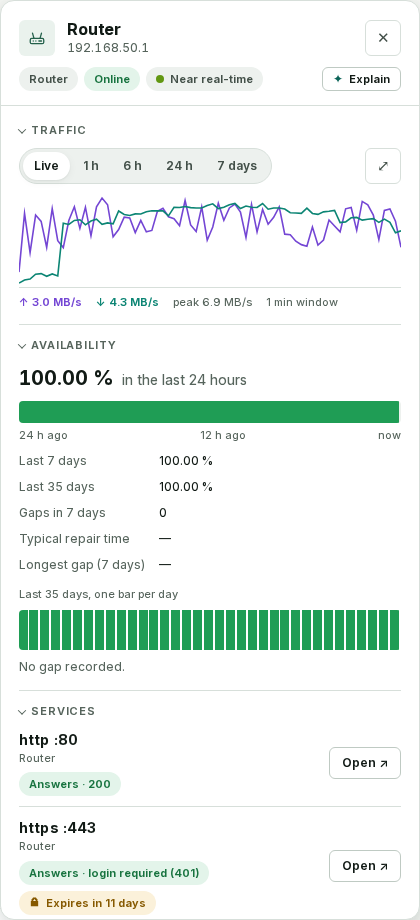
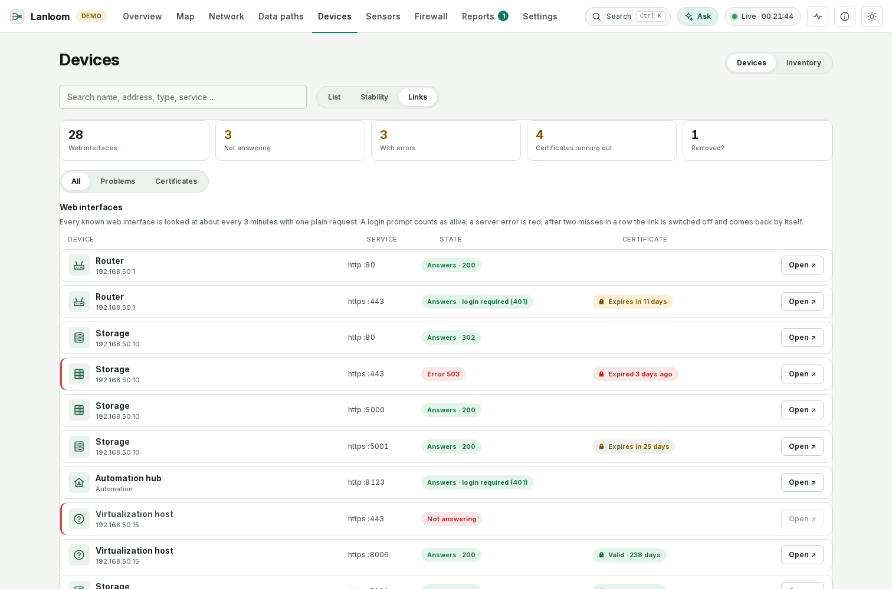
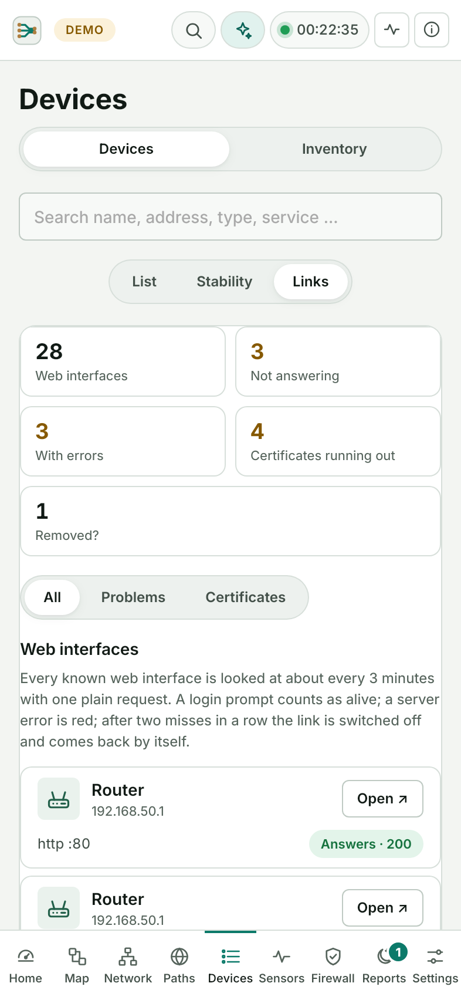
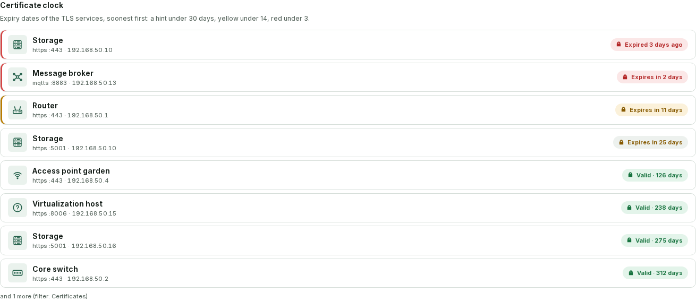

# Services, web interfaces and certificates

Lanloom lists what each device offers - the services behind its open ports and the web interfaces among them - and keeps
an eye on them: is the page still answering, is a server broken, does a certificate run out soon? Lanloom **only observes**.
It never logs in, never changes anything on a device and never repairs a service.

## What a device offers

For every device the list comes from what Lanloom already knows: the open ports of the scan, the page title and `Server`
header of the web banner, what the device announces itself (DNS-SD, UPnP) and the adapters. Per service:

- **name, port and protocol** (`https :8443`, `ssh :22`);
- the **version, where the device names it itself** (a `Server` header such as `product/1.2`, a version in a DNS-SD text
  record, the product line of the UPnP announcement). Nothing is guessed from a port number;
- whether it is a **web interface** (the page answered, or the device announced `_http._tcp` / `_https._tcp`).

The list is the **Services** section of the device card.

## The Links view

*Devices › Links* (or `#/devices?view=links`, or *Go to Links* in the search box) lists every web interface of the network
with the state of its probe, as a button that opens it in a new tab.

| State | Meaning |
| --- | --- |
| **Answers** (200, 302, 404, ...) | the page answered; any answer that is not a server error counts as alive |
| **Answers · login required (401/403)** | alive: the page wants a login, which is what a healthy protected page does |
| **Error 5xx** (red) | the page answers, but with a server error. The link stays usable |
| **No answer** | one look without an answer; the link is still clickable |
| **Not answering** | two looks in a row without an answer: the link is **switched off** (greyed out, not clickable). It comes back **by itself** with the next good answer, with no message and nothing to click |
| **Removed?** | the service stayed away for 24 hours of probing while its device answered: probably switched off on purpose. It is no longer booked as an outage and looked at only once an hour; an operator can *Forget* it |
| **Device offline** | the device itself does not answer. That is the device's business, nothing is probed |
| **Not probed (protected)** | a device of the [scan protection](DISCOVERY.md#scan-protection) list |

Filters: *All*, *Problems* (not answering, errors), *Certificates*. Services without a web page (SSH, message broker,
file shares, ...) are under *Other services*.

## How the probe works

- **Every 3 minutes**, on **known** services only: the services of the inventory. Lanloom never sweeps for new ones; that
  is the job of the scan.
- A **web interface** gets one plain `GET /` (redirects are not followed - a redirect is an answer). Any other service gets
  one TCP connection that is closed right away; for ports that speak TLS from the first byte the handshake is made.
- **Only private addresses** are probed. Devices of the protection list keep their rules: printers are never touched on
  the raw printing ports, industrial hosts only on 80 and 443, passive hosts not at all.
- When **none of three or more services answers at all**, Lanloom's own network is the likelier cause than all of them at
  once: nothing is booked and no state changes.
- It is switched off under *Settings › General › Look at known services and web interfaces* (administrators). Then the
  list shows what the last scan found, without state.
- Every look is booked into the [availability](AVAILABILITY.md) slots as `svc:<device>|<port>`: the *Stability* list shows
  the services that have a history, and the nightly report names the wobbly ones. A 5xx counts as a failed look, a 401/403 as
  a good one.

## The certificate clock

For every TLS service Lanloom reads the **expiry date** of its certificate, also of a self-signed one, at most every six
hours (one handshake without verification; nothing is sent).

| Days left | Shown as |
| --- | --- |
| 30 or more | green, *Valid* |
| fewer than 30 | hint |
| fewer than 14 | yellow |
| fewer than 3 | red |
| expired | red, *Expired N days ago* |

The tooltip of the chip tells the issuer or *Self-signed* and the date. The soonest-to-expire certificates are listed at
the end of the Links view. They also appear in the [nightly report](NIGHTLY-REPORT.md) (section *Certificates*, a point
to look at under 14 days) and in the [notification rules](NOTIFICATIONS.md) (*certificate expiring*, once a day each).

## Roles and the audit log

Everybody who sees the map reads the list. *Forget* (for a service marked *Removed?*) needs the operator role and is
written to the audit log (`service.forget`). A newer scan that lists the service again brings it back.

## What it costs

One request or one connection per known service every 3 minutes, four at a time with a short pause, with a timeout of
3 seconds; the state of a few hundred services takes about 100 KB. See [PERFORMANCE.md](PERFORMANCE.md). Every connection
is listed in `security/egress.json`: the probes go to addresses in the local network only.
