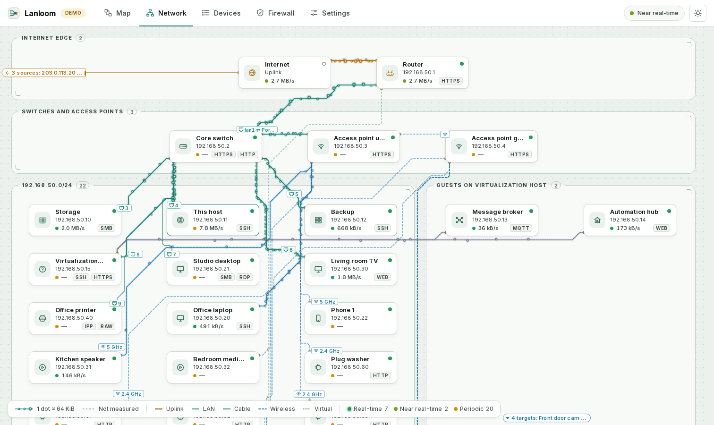
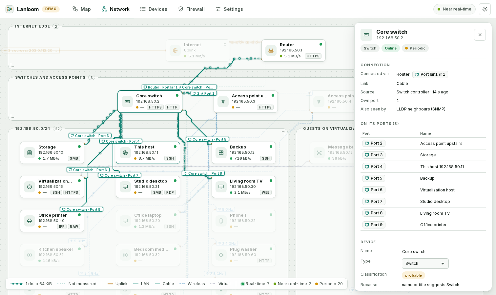

# Physical topology

The **Network** view can show the real cabling: which device hangs on which switch port, which clients use which access point, and which guests run on a virtualization host. Cables are drawn as solid traces, wireless links as dashed traces with a radio mark, and guests on a host as dotted traces. The port number (or the wireless band and network name) sits at the device end of the trace.

Everything here is **read-only**. Lanloom asks the devices that already know the answer and never changes anything on them.

## Where the data comes from

| Source | What it knows | What you need |
|---|---|---|
| **Manual entry** | anything you set on the component card | nothing |
| **Switch controller** | client → switch port or access point (with band and network name), switch and access point uplinks | a local controller application with a view-only account |
| **LLDP over SNMP** | which switch, access point or router is on which port of a device | SNMP read access, LLDP switched on |
| **Address table over SNMP** | which hardware address was learned on which switch port | SNMP read access to a managed switch |

When two sources disagree, a **fixed order of precedence** decides: manual entry, switch controller, LLDP, switch address table. The component card shows the winner, which sources agree, and what the others say ("Switch controller says Core switch · Port 10. Manual entry has priority."). Unknown values stay empty; nothing is guessed.

Without any of these sources the Network view looks as before: the gateway and one zone per subnet.

## Manual entry ("connected via")

Open a device on the map and scroll to **Connected via (manual)**. Choose the device it is plugged into, optionally the port, and the link type (cable, wireless, or virtual for a guest on a host). Save. A manual entry always wins over the other sources, so it is also the way to correct a wrong automatic result. **Remove** goes back to the automatic sources.

Use it for devices that no source can see, for example a consumer access point in access-point mode, an unmanaged switch, or a printer behind a wall socket. Setting the access point once is enough: every device that a switch reports on the same port is then shown behind that access point.

## Switch controller

Many switch and access point product lines are managed by a local controller application. Lanloom reads two lists from it every minute: the clients (with switch port or access point) and the devices (with their uplinks).

1. In the controller, create a **local** account with **view-only** (read-only) rights. Do not use an owner or administrator account, and do not use a cloud account that needs two-factor sign-in.
2. In Lanloom open **Settings → Connections → + Switch controller** (or the *Connect* step of the setup wizard).
3. Enter the address of the controller, for example `https://192.168.1.2` or `https://192.168.1.2:8443`, the user name and the password. Leave *Site* empty unless your controller manages several sites. Tick *Accept a self-signed certificate* if the controller uses its own certificate.
4. Leave *Login style* on **Automatic**. Lanloom tries the console login first and the classic one when that is refused (HTTP 401, 404 or 405), so a self-hosted controller works without any setting; the credentials count as rejected only when both ways refuse. Pick **Console** or **Classic** only to force one way.
5. **Test connection** shows how many clients and devices the controller reported. **Save**.

What Lanloom sends: one sign-in request with the user name and password, then only `GET` requests to the two list endpoints (`…/api/s/<site>/stat/sta` and `…/stat/device`; on a console the same paths below `/proxy/network`). One code path performs all requests and refuses everything else; a test checks this. The password is stored encrypted and never shown or logged again.

### Device-family adapters

A device-family adapter that reads a controller (see [COMPATIBILITY.md](COMPATIBILITY.md)) reports clients and devices in exactly the same form and with the same rank as the switch controller above. Its observations merge with manual entries, LLDP and the address table by the same rules. When the adapter only has an API key and no view-only account, it knows the access point or switch a client uses but not the port number; the card then shows the device without a port.

## LLDP and the address table over SNMP

If your switches, access points or router speak SNMP, the existing **Router or switch (SNMP)** integration reads the topology as well, about once a minute, in addition to the interface counters:

- **LLDP neighbours** (LLDP-MIB): which device is on which local port, with the remote port name. Lanloom works out which end is nearer to the gateway and draws that one as the parent.
- **Address table** (BRIDGE-MIB and Q-BRIDGE-MIB): which hardware addresses were learned on which port. A port with exactly one address is a direct connection. The port that leads to the gateway is the switch's own uplink. Ports with an LLDP neighbour belong to that neighbour.

Steps:

1. Switch on SNMP (v3 with authentication and encryption if possible, otherwise v2c with a read-only community) and LLDP on the device. Many managed switches have LLDP on by default.
2. Add one **Router or switch (SNMP)** integration per device. An agent without these tables simply contributes nothing; the interface counters keep working.

Only Get, GetNext and GetBulk requests are used.

## How shared ports are read

A switch port often has more than one device behind it:

- **Exactly one of them is a switch or access point** (or has devices of its own): the others are shown **behind** it. This is how wireless clients end up under a consumer access point that only the switch can see.
- **Clients behind an access point** are shown as **wireless** (dashed) when no source knows the link type, because an access point has no cable ports for clients. A link type that a source reported, and every manual entry, keeps its value; switches and routers are never assumed to be wireless. The component card says why.
- **Guests of a virtualization host**: hardware addresses that hypervisors and container engines give to virtual network cards are recognised. If they share a port with exactly one ordinary device, they are shown as **guests on that host**, in their own zone next to it, with dotted traces.
- **Very many addresses and no switch among them** (12 or more, address table only): this is a trunk to somewhere else. Nothing is assigned from it.
- Otherwise every device on the port is kept there, with a note that the port is shared.

## Live traffic along the cabling

This host's measured traffic now also travels along the physical links in the Network view: traffic to the storage server, for example, runs up from this host to the switch and down to the storage server, and internet traffic runs up to the router. Where no cabling is known, the old direct traces stay.

## Troubleshooting

- **A device is in the wrong place.** Open its card: *Source* says who placed it there and the warning box lists what other sources say. Set a manual entry to override.
- **Nothing changes after adding the controller.** The first lists arrive within a minute. Check the integration status in Settings; *Credentials were rejected* usually means the account is not local or lacks view rights.
- **Devices the controller reports are missing.** Only devices that are also in Lanloom's device list are placed (run a scan); the card of a switch counts the other addresses per port.
- **Raw data for a bug report.** `GET /api/topology` (signed in) returns the resolved links, virtual nodes, trunks and unknown addresses as JSON. It contains hardware and IP addresses of your network, so check it before you share it.

## Not yet

- A three-dimensional look of the board.
- Guest lists read directly from a virtualization host's API.
