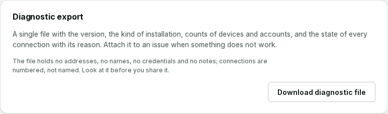

# Troubleshooting

Start here when something does not work. The page is ordered the way problems usually show up: first how to read what Lanloom tells you, then one section per source or adapter, then scanning, sign-in and the host.

- [Read the status of a source](#read-the-status-of-a-source)
- [The diagnostic export](#the-diagnostic-export)
- [This host](#this-host) · [SNMP](#snmp) · [Battery backup (NUT)](#battery-backup-nut) · [MQTT broker](#mqtt-broker) · [Switch controller](#switch-controller) · [Home-automation hub](#home-automation-hub)
- [Device-family adapters](#device-family-adapters) · [DNS filter](#dns-filter) · [AI services](#ai-services) · [Host agent and container source](#host-agent-and-container-source)
- [Data paths and NetFlow](#data-paths-and-netflow)
- [Scanning and devices](#scanning-and-devices)
- [Sign-in and access](#sign-in-and-access)
- [Install, update and backup](#install-update-and-backup)
- [Still stuck?](#still-stuck)

## Read the status of a source

Every connection (Settings > General > Connections, and the *Sources* card on the [overview](manual/overview.md)) shows a calm state and, when it fails, a reason.

| State | What it means | What to do |
|---|---|---|
| Fresh | data arrives in its usual rhythm | nothing |
| Source waiting | just started, nothing has arrived yet | wait a minute; a hub takes up to ten minutes for its first full inventory |
| No data yet | connected for a while, but nothing reported | the connection works but the device sends nothing Lanloom reads; check the account's rights |
| Stale | data stopped coming | the device is off, rebooted, or the network path changed; Lanloom reconnects on its own with a growing pause of up to one minute |
| Connection fails | the connection does not work; the reason is shown | find the reason in the section of the source below |
| Off | switched off in the settings | switch it on again |

The reasons share one vocabulary across the sources:

| Reason | Usual cause | Fix |
|---|---|---|
| Settings incomplete or invalid | an address, port or field is empty or malformed | open the connection and fill every required field; the *Test* button names what is missing |
| Not reachable | wrong address or port, device off, a firewall between Lanloom and the device | test from the Lanloom host, not from your own computer; with host networking the container uses the host's routes |
| Connection refused | the address answers but nothing listens on that port | check the port and that the service is switched on |
| No answer (timeout) | packets are dropped silently, or the device is very busy | check firewall rules between the networks; for SNMP also the allowed addresses of the agent |
| Credentials were rejected / Account was rejected / token or key rejected | wrong secret, expired token, the account is not a local account | create a new token or account; secrets are never shown again, so enter them anew |
| Access denied | the account is valid but lacks the rights to read | give it the view-only role of the device; never an administrator role |
| TLS / certificate problem | the device uses its own certificate | tick *Accept a self-signed certificate* for that connection, or use a certificate your system trusts |
| Unexpected answer | the address belongs to another kind of service, or the firmware answers in a form Lanloom does not know | check that the family and port fit the device; open an [adapter request or test report](../.github/ISSUE_TEMPLATE/adapter_request.yml) with the firmware version |
| Connection closed | the device ended the session (restart, idle limit, too many sessions) | usually heals by itself; if it repeats, look at the session limits of the device |

## The diagnostic export

*Settings > General > Diagnostic export* (administrators) downloads one JSON file, `lanloom-diagnostics.json`, that you can attach to an issue.

**What is in it:** Lanloom's version, the kind of installation (Python version, system, processor type, container yes or no), the switches of the configuration as on or off, counts (devices per kind and per state, accounts per role, reports), each source's family, state, reason key and a coarse age of its last sign of life, the last scans in numbers, the counters of events of the last day, and the state of the backup and of the update check.

**What is not in it:** hardware and IP addresses, host, device, user, network, source and site names, controller or hub addresses, credentials, tokens, keys, notes, report texts. Sources are numbered ("snmp-1"), not named.

**How it is kept clean:** the export only collects numbers, switches and fixed vocabulary. A second pass then replaces anything that still looks like a hardware address, an IP address, a mail address or a web address, and drops every text that is not a single plain word (letters, digits and a few signs); the number of such replacements is part of the file (`redaction.replaced`, normally `0`). The download is written to the audit log. Please still open the file before you share it.



An example of the shape:

```json
{
  "format": "lanloom-diagnostics/1",
  "version": "1.30.0",
  "runtime": { "python": "3.12.4", "machine": "aarch64", "in_container": true },
  "devices": { "total": 42, "per_kind": { "ap": 3, "router": 1, "unknown": 5 } },
  "sources": [
    { "source": "host", "state": "fresh", "reason": "", "last_sign_of_life": "under_1_min" },
    { "source": "snmp-1", "family": "snmp", "state": "failed", "reason": "source.snmp.timeout", "last_sign_of_life": "never" }
  ],
  "redaction": { "replaced": 0 }
}
```

## This host

The built-in source that measures the TCP flows and interface counters of the host the container runs on. It needs no account.

| Symptom | Cause and fix |
|---|---|
| *Running without byte counters* | the kernel's socket diagnostics are not available to the container; flows show without bytes. Use host networking, see [INSTALL.md](INSTALL.md#platforms) |
| *Not available on this system* | no netlink socket diagnostics (for example a desktop container runtime). Run on a server with host networking; the rest of Lanloom still works |
| Nothing moves in the map although traffic exists | only measured bytes are animated; with a bridge network the container sees none of the host's traffic. Use host networking |

## SNMP

Reads the system group and the interface counters of a router or switch every ten seconds. Read-only: only Get, GetNext and GetBulk requests exist in the code.

| Reason | Cause and fix |
|---|---|
| No answer (timeout) | the agent is switched off, or it only answers listed addresses: allow the address of the Lanloom host; check that UDP port 161 passes the firewall |
| Credentials were rejected | wrong community (v2c), or for v3 a wrong user, authentication or privacy passphrase, or a security level the user does not have. Lanloom supports MD5, SHA and SHA-256 authentication and AES-128 privacy; **DES is not supported**, change the user on the device |
| Unexpected answer | the address is not an SNMP agent, or the version does not match |
| The internet line shows no rates | Lanloom takes the router's counters from the SNMP connection of the gateway; connect the router itself, not only a switch behind it |
| Nothing at all, although the agent answers | Lanloom does not try the default community `public` during a scan unless you tick the option in the scan dialog; enter your community in the connection |

## Battery backup (NUT)

Reads the variables of every battery backup (UPS) a Network UPS Tools server offers, every 15 seconds. Read-only: the only commands in the code are the list of UPS names, the list of variables of one UPS, the version and the logout. There is no login, no switching of outlets and no battery test.

| Reason | Cause and fix |
|---|---|
| Address or port invalid | enter the host name or address of the NUT server and its port (default 3493); a UPS name, if you set one, may only contain letters, digits and `_ . @ -` |
| No answer (timeout) or not reachable | the server is off, or `LISTEN` in its `upsd.conf` only covers the loopback address; allow the address of the Lanloom host and let TCP port 3493 pass the firewall |
| The server refused the request | its access list (`upsd.users`, `ACL` in older versions) does not let this host read; reading needs no user |
| Unexpected answer | the address is not a NUT server, a line was too long, or the server offered more variables than Lanloom reads |
| The server offers no UPS | the driver of the UPS is not running; `upsc -l` on the server lists what it offers |
| The card says *unknown* although the connection is fine | the UPS reported no status word, or its last reading is older than 15 minutes |

## MQTT broker

Counts messages and bytes per topic group; payloads are read off the socket and discarded, and nothing can be published (no PUBLISH packet can be built).

| Reason | Cause and fix |
|---|---|
| Not reachable / Connection refused | address or port wrong (1883 plain, 8883 TLS by convention); the broker listens only on localhost |
| Credentials were rejected | user name or password wrong; give the account read access only |
| Access denied | the broker's access list does not let this account subscribe to everything; allow subscribing to `#` (the root of all topics) for the account, or Lanloom sees nothing |
| TLS / certificate problem | tick *Accept a self-signed certificate*, or fix the broker's certificate chain |
| Connected but no topics | the account may subscribe but nothing is published right now, or retained messages only: those are counted apart from new traffic |

## MQTT output

The optional output that publishes Lanloom's figures as sensors of a hub ([MQTT-OUTPUT.md](MQTT-OUTPUT.md)). Its state is
on its card under *Settings › MQTT output*.

| Reason | Cause and fix |
|---|---|
| The broker cannot be reached | address or port wrong (1883 plain, 8883 TLS by convention), or the broker listens only on localhost |
| The broker refused the user name or password | wrong credentials, or the account is not allowed to connect |
| The encrypted connection failed | tick *Accept a self-signed certificate*, or fix the broker's certificate chain |
| The connection to the broker was lost | the broker restarted or dropped the client; Lanloom reconnects with growing pauses (up to five minutes) |
| The add-on system offers no broker | in the add-on, install and start a broker add-on, or enter an address |
| Connected, but no sensors in the hub | the hub listens on another discovery prefix (*Topics*), MQTT discovery is switched off in the hub, or the broker's access list does not let the account publish to `<discovery prefix>/#` and `<base topic>/#` |

## Switch controller

Reads which client sits on which switch port or access point through a local JSON API with a view-only account. See [TOPOLOGY.md](TOPOLOGY.md).

| Symptom | Cause and fix |
|---|---|
| Credentials were rejected | the account is not a local one, or it lacks view rights. Leave *Login style* on *Automatic*: Lanloom tries the console login first and the classic one when that is refused |
| Access denied | the role cannot read the network application; use a view-only role of that application |
| Nothing changes after adding it | the first lists arrive within a minute |
| Devices the controller reports are missing | only devices that are also in the device list are placed; run a scan |
| A device is in the wrong place | open its card: *Source* says who placed it there; a manual entry overrides every source |

## Home-automation hub

The bridge to a hub's WebSocket API; strictly read only. See [HUB-BRIDGE.md](HUB-BRIDGE.md).

| Symptom | Cause and fix |
|---|---|
| Credentials were rejected | the long-lived access token is wrong or deleted; create a new one |
| Access denied | the token lacks the rights for what you switched on. *Admin mode* needs a token of an administrator on the hub |
| TLS / certificate problem | `https://` with the hub's own certificate: tick *Accept a self-signed certificate* |
| Spared: too many requests | the bridge keeps its own budgets so it never loads the hub; it resumes by itself |
| A lookup is paused | the hub answered an item with an error; it is retried after 24 hours, doubling up to a week. A changed configuration lifts the pause |
| The hub does not support a request | an older hub version; the bridge does not send that request again in this session |
| People, cameras, calendars are missing | they are dropped before anything is stored, unless you switch the group on; see the privacy section of [HUB-BRIDGE.md](HUB-BRIDGE.md#privacy) |

## Device-family adapters

The adapters of device families (controller, hypervisor, firewall; the list is in [COMPATIBILITY.md](COMPATIBILITY.md)) share one set of reasons. The guide of each family, linked from the compatibility page, has its own table with the exact menu names of that product.

| Reason | Cause and fix |
|---|---|
| API key was rejected / API token was rejected | the key or token is wrong, deleted or expired; create a new one and enter it anew (secrets are never shown again) |
| Account was rejected | user name or password wrong, or the account is not a local one |
| The controller does not know this controller ID | the ID entered next to the application is wrong; clear the field so the controller's own announcement is used |
| The router answers nothing on its management port / Unexpected answer | the local interface of the router is switched off (allow access for applications in its home network settings) or the address is not the router |
| Sign-in paused for a while after repeated attempts | Lanloom stops trying for about 15 minutes after repeated refusals so it cannot lock the account; check the secret first, then wait |
| This account can change settings | Lanloom refuses an account that is able to write where it can check it; use a view-only role or a token with only read rights |
| Access denied for this account | the role lacks the right to read; set every area to read-only, not to none |
| The firewall does not accept API requests from this address | add the address of the Lanloom host to the API's allowed addresses on the device |
| The API is switched off | switch the API on in the device's own settings |
| Not reachable | check address and port; the Lanloom host must be allowed to reach the management interface (a firewall zone may only allow it from some networks) |
| TLS / certificate problem | tick *Accept a self-signed certificate*, or bind the connection to the device's certificate fingerprint where the family offers it |
| Devices are missing on the map | only devices that are also in Lanloom's device list are placed; run a scan and include the device's network |
| Rules show a zone "?" | the account may not read zones; rules still show, zone names are missing |
| A change through the executor is refused | by design: guests that keep the network running, wired clients (their network follows the switch port) and accounts that cannot write are refused; see the *Firewall* manual page |

## DNS filter

A [DNS filter](DNS-FILTER.md) is a device-family connection; its reasons are the ones in the table above, and the guide of the product has the exact menu names.

| Symptom | Cause and fix |
|---|---|
| The card says *No recent reading* or *Not answering* | the filter did not answer for 15 minutes (off, rebooted, address changed); Lanloom keeps trying and the night report says it |
| *Sign-in paused for a while after repeated attempts* | the password was refused; check it in the connection, then wait 15 minutes (a wrong password never locks the account because Lanloom does not retry in between) |
| The share of blocked queries looks wrong right after connecting | the filter's own window is 24 hours at most; the hours are complete at once, the days fill up over the following days |
| A busy device is missing under *Busiest clients* or shows the filter's name for it | the filter reports a client by name when it has one, or the device uses another resolver; only addresses can be matched to devices |
| *No query at all for three hours* in the night report | devices no longer use the filter as their name server (a router handing out another one, a changed lease), or the filter lost its network; check the DHCP settings |

## Host agent and container source

The optional [host agent](HOST-AGENT.md) on another host, and a container source added in *Settings > Agents*. Start with `docker exec lanloom-agent python -m lanloom.agent once` on the host: it prints what the agent would send and sends nothing, and `docker logs lanloom-agent` says why it is waiting.

| Symptom | Cause and fix |
|---|---|
| The log says *not paired* and nothing arrives | the agent was started without a code, or the code was used up or has expired (30 minutes, one use). Create a new code in *Settings > Agents > Pair a host agent* and start the agent again with it |
| *Pairing failed* / the code is refused | wrong or already used code; several wrong tries lock the address out for a while. Create a new code |
| *Lanloom cannot be reached from the agent* | the address in `LANLOOM_AGENT_SERVER` is wrong for that host, a firewall blocks the port, or an HTTPS address with `LANLOOM_AGENT_PIN` presents another certificate. Reports wait in the buffer (up to two hours) and arrive when the line is back |
| The host shows *Offline* | no report for 90 seconds: the host is down, the agent container stopped, or Lanloom cannot be reached from there. The agent that was *revoked* (entry removed) stops and waits; pair it again with a new code |
| The agent stopped after the entry was removed | the token is revoked on purpose; it drops its token and waits quietly. Give it a new code, or stop and delete the container |
| *Units not available* | the system bus socket is not mounted (`/run/dbus/system_bus_socket`), the host has no service manager on that bus, or the agent is not run as the host's super user id |
| *Containers not available* / no container runtime socket | the runtime socket is not mounted, `LANLOOM_AGENT_CONTAINERS` points to the wrong place, or a socket proxy in between refuses the request: it must allow `GET` on the containers and the version |
| Containers listed, but no bytes per container | the agent needs `pid: host` (it reads each container's network counters through the process view), and a container on the host network has no counters of its own |
| Services show *unknown process* | the same: `pid: host` is missing, or the process is not visible |
| No flows or bytes at all | the agent is not on the host network (`network_mode: host`), or the kernel offers no socket diagnostics |
| *Update* next to the agent | the agent runs another version than Lanloom. Pull the image with Lanloom's exact version tag and recreate the container; the agent never updates itself |
| *This agent speaks another protocol version* | the same, with a larger gap |
| Containers are missing from the list | containers that lived under 10 minutes are hidden (the page says how many); a source shows at most 400 containers per host |
| The test of a container source fails | check the address form (`unix:///path.sock`, `http://host:port` or `tcp://host:port`, no user name or password), that Lanloom can reach it, and that the proxy lets `GET` through |

## AI services

The keys of the messages (`lan_unreachable`, `auth`, `daily_limit`, `privacy`, ...) and what to do are listed in [integrations/ai.md](integrations/ai.md#troubleshooting).

## Data paths and NetFlow

See [DATA-PATHS.md](DATA-PATHS.md#setting-up-netflow--ipfix).

| Symptom | Cause and fix |
|---|---|
| Only the host's own connections show | NetFlow is off by default; set it up under *Settings > NetFlow / IPFIX from your router* |
| The receiver cannot be switched on | it needs at least one allowed exporter address; packets from any other address are dropped and counted |
| No flows arrive | the router must export to the Lanloom host's address and the port (UDP 2055 by default); allow the port in a host firewall; with a bridge network publish `2055:2055/udp` |
| Every device looks like the router | the router exports after address translation; export from the LAN side, before translation |
| Long downloads appear late and in one piece | set the router's active timeout to about 60 seconds |
| "Records wait for a template" | NetFlow v9 and IPFIX send the record description every few minutes; until it arrives, records cannot be read |

## Scanning and devices

| Symptom | Cause and fix |
|---|---|
| The scan finds nothing, or only the host | a desktop container runtime runs in bridge mode and cannot see the local network: there is no neighbour table, no mDNS, no SSDP. Run on a server with host networking ([INSTALL.md](INSTALL.md#platforms)). In bridge mode only TCP probes of a range you type in work |
| A range is "never scanned" | public, carrier-grade NAT, larger than a /22, loopback and multicast ranges are refused, with the reason in *Settings > Network*. A network behind a router is only scanned after an administrator allows it |
| Devices from another VLAN are missing | Lanloom only scans networks it can reach and that an administrator allowed; list them under *Settings > Network* |
| Many devices are "unknown" | classification uses what a device reveals; open the card to see the reasons, then name or re-type the device yourself |
| Phones appear with a different address every day | the device uses a private (random) hardware address; the overview calls it so under *New devices* |
| A scan ends with *The scan stopped with an internal error.* | up to 1.41.0 a device that had been stored once without its hardware address and then came back with an already known one stopped the scan; update to 1.41.1 or later (the two rows are merged, and one device never costs the whole scan). If it persists, `docker logs lanloom` names the cause; attach the [diagnostic export](#the-diagnostic-export) to a report |
| A device appears twice | it has two interfaces, or a wireless repeater rewrote its hardware address; join them on the card (*One device, several interfaces* in [DISCOVERY.md](DISCOVERY.md#one-device-several-interfaces)) or forget the old entry on its card |
| IPv6 devices are missing | scanning is IPv4 only; IPv6 neighbours are learned only where a source tells |
| The scan seems slow | probing is rate-limited on purpose (about 40 new connections per second, 4 per host); a /24 takes 10 to 60 seconds |

## Sign-in and access

| Symptom | Cause and fix |
|---|---|
| "The request came from another site and was blocked" behind a reverse proxy | set `LANLOOM_TRUSTED_ORIGINS` to the public origin and `LANLOOM_TRUSTED_PROXIES` to the proxy's address ([INSTALL.md](INSTALL.md#behind-a-reverse-proxy)) |
| Everybody is locked out after one person's wrong passwords | without `LANLOOM_TRUSTED_PROXIES` all sign-ins through a proxy share the proxy's address |
| Passkeys cannot be added | passkeys need HTTPS (or `localhost`) and the same host name the browser uses |
| Forgot the password | ask an admin for a reset link (*Settings > Users*); see [INSTALL.md](INSTALL.md#forgot-password) |
| Lost the phone with the authenticator | use one of the ten recovery codes, then set the app up again ([ACCESS.md](ACCESS.md)) |
| A page or button is missing | the role decides what is shown; the *About this view* rail and [ACCESS.md](ACCESS.md) list what each role may do |

## Install, update and backup

**Add-on:** the side panel stays empty or shows a refusal - open Lanloom from the side panel, not by the host address
and port 7380 (that answers only with `direct_access` on). Updates come from the add-on store; *Settings › Updates*
has no update button in the add-on. See [ADDON.md](ADDON.md).

| Symptom | Cause and fix |
|---|---|
| Permission error when starting | run with `sudo` or add your user to the container runtime's group |
| Data folder not writable (bind mount) | the folder must be writable by uid 10001; or keep the named volume |
| Compose starts an older version after an update | an updater sidecar from before 1.17 left `:latest` on an older image; renew it once with `docker compose pull && docker compose --profile updater up -d` |
| The Update button is missing | the updater sidecar is not running (`docker compose --profile updater up -d`) or the update check is switched off in the settings |
| A backup cannot be restored: "made by a newer version" | update Lanloom to that version or newer first, then restore ([BACKUP.md](BACKUP.md#restore)) |
| The nightly report did not come | Lanloom was off at the report time; it is made at the next start and says so ([NIGHTLY-REPORT.md](NIGHTLY-REPORT.md)) |
| Everything is slow on a small host | see [PERFORMANCE.md](PERFORMANCE.md); lower the retention under *Settings > Storage* |

## A view shows "Data stale since ..."

Every view that shows its own data remembers when it last received a good state. If that is more than three refresh cycles ago (at least three minutes), a calm band says *Data stale since HH:MM – refreshing by itself* and the content is dimmed; the view asks again every 15 seconds and the band goes away with the next good state. The header can still say *Live* – the live channel is separate and only carries changes. Typical causes: the laptop was asleep, the network changed, a reverse proxy in front of Lanloom stopped answering, or the container is overloaded. Every request has a deadline of 20 seconds (120 seconds for AI, update, backup, export and scans) and ends with "The request took too long and was stopped" instead of waiting for ever. When the tab becomes visible again or the network is back, views older than 30 seconds fetch at once. If the band stays, check `docker logs` of the container and the reverse proxy timeouts.

## Still stuck?

Open an issue with the matching form (bug, wish, adapter request or test report) and attach the diagnostic file. **Never post secrets**: no passwords, tokens, API keys, setup codes, passkeys or recovery codes. See [CONTRIBUTING.md](../CONTRIBUTING.md) and, for security problems, [SECURITY.md](../SECURITY.md).
