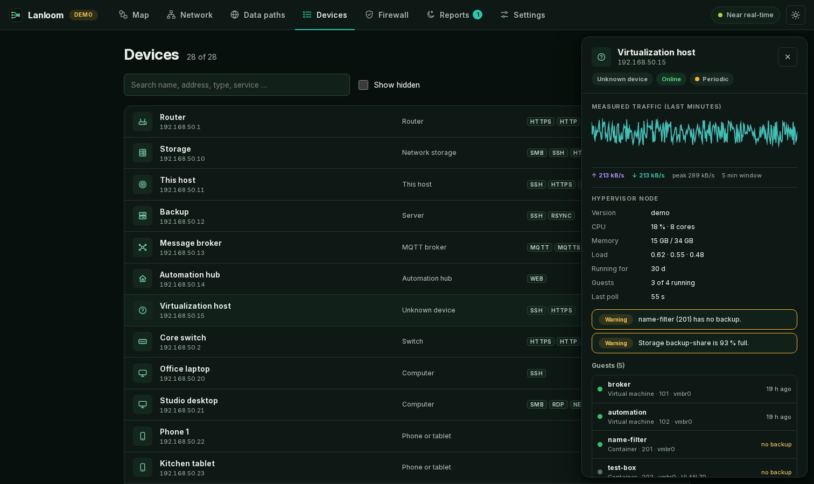

# Proxmox VE (local API): read adapter and guest changes

Lanloom reads a Proxmox VE host or cluster over its local API with an **API token that can only read**; a token that could change anything is refused. Changing guests (start, clean shutdown, network card bridge and VLAN, guest firewall and its rules) is a separate, optional step: it runs only in the [executor](../FIREWALL-EDITOR.md#turning-on-the-external-executor) with a token of its own, after the gate and your passkey signature - see [Changing guests](#changing-guests-stage-b) below.

What you get:

- **Guests on the map:** every virtual machine and container hangs below the node it runs on (link *virtual*), with the bridge and VLAN of its network card. This uses the hardware addresses of the guests' network cards, so it is exact even when a switch learns all of them on the node's port. Manual entries still win (see [TOPOLOGY.md](../TOPOLOGY.md)).
- **Component card of a node:** version, cluster, processor and memory use, load, uptime; the guests on it (state, number, kind, VLAN, newest backup); storage with its fill level; bridges and bonds; findings.
- **Component card of a guest:** node, state, processor and memory, addresses (from the guest agent of a virtual machine, or the container's interfaces), network cards (bridge, VLAN tag or trunks, firewall flag, rate limit), newest backup (age, verified, part of a backup job, failed backups), traffic now and during the last hour, its firewall.
- **Firewall tab, live and read only:** the firewall at datacenter, node and guest level (options, rules in order, security groups, aliases, IP sets), all guest network cards in one table, bridges, bonds and the software-defined network (zones, VNets with tags and subnets).
- **Findings** in plain words: a node offline, storage almost full (90 %, 95 %), a running guest without any backup, a newest backup older than seven days, a failed backup task in the last 48 hours, a network card on a bridge that does not exist, a VLAN tag outside the VLANs a VLAN-aware bridge allows, a guest firewall that cannot work because the datacenter firewall is off, and - together with a controller adapter that reads switch ports - a guest VLAN that the node's switch port does not carry.
- **Night report:** the family contributes its own section (guests stopped or added since the last report, a guest firewall switched off or on, network cards moved to another bridge or VLAN, guest rules changed, failed backups, findings); it appears only when this connection exists.



Never read or kept: passwords, keys and secrets of guests (cloud-init password, SSH keys), notes and descriptions, storage credentials. Guest and object ids become opaque ids; hardware addresses of network cards leave the adapter only as a hash and are used to match devices on the map.

## Create a read-only API token

The rule is a separate user with the built-in **PVEAuditor** role and a token with privilege separation.

1. **Datacenter → Permissions → Users → Add**: user `lanloom`, realm *Proxmox VE authentication server* (`lanloom@pve`). A password is not needed for the token.
2. **Datacenter → Permissions → API Tokens → Add**: user `lanloom@pve`, token ID `read`, keep **Privilege Separation** ticked. Copy the secret; it is shown only once.
3. **Datacenter → Permissions → Add → API Token Permission**: path `/`, token `lanloom@pve!read`, role **PVEAuditor**, *Propagate* ticked.

On the command line of a node the same is:

```
pveum user add lanloom@pve
pveum user token add lanloom@pve read --privsep 1
pveum acl modify / --tokens 'lanloom@pve!read' --roles PVEAuditor
```

Then in Lanloom: **Settings → Connections → + Proxmox VE (local API)**.

Lanloom checks the token's own permission list (`/access/permissions`) when you test or save the connection. If the token holds any privilege other than the audit ones (`*.Audit`, `Sys.Syslog`), it is **refused** ("This account can change settings"). Tokens of the superuser (`root@pam`) are always refused. Do not use your own administrator token.

Addresses of virtual machines come from the guest agent. Releases with the audit privilege for the guest agent (`VM.GuestAgent.Audit`) answer an auditor token; older releases ask for `VM.Monitor`, which can do more than read. Lanloom never asks for that: without it, the agent request is simply refused and the guest is matched by the hardware address of its network card instead (containers report their addresses either way).

## Settings

| field | meaning |
|---|---|
| Address | `https://<address of one node>:8006` (port 8006 is the default when you leave it out) |
| API token ID | `user@realm!name`, for example `lanloom@pve!read` |
| Token secret | the secret shown when the token was created; stored encrypted, never shown again |
| Accept a self-signed certificate | needed unless the node has a certificate your system trusts (a fresh installation uses its own) |

One connection reads the whole cluster through the node you enter. For a stand-alone host, enter that host.

## What Lanloom sends

The app: exactly one code path sends requests, through an allow-list that is checked before anything leaves the app: `GET` on the read endpoints listed in `lanloom/integrations/proxmox/read.py` (`GET_PATHS`) and nothing else. There is no sign-in; the token travels in the `Authorization` header. The app cannot start, stop, change or delete anything.

The executor (only when set up for this family): the requests in the table under [Changing guests](#changing-guests-stage-b), through the field-exact allow-list in `lanloom/integrations/proxmox/write.py` (`ALLOW`), and only to the node in its options file (connection guard).

Cadence: cluster status and resources (guest state, load, traffic counters) every minute; everything else every five minutes, with a request budget per poll for very large clusters. A node that does not answer, a feature that is not installed (software-defined network, guest agent) or an area the token may not read is skipped; the rest is still read, and the capability list says what was missing.

## Changing guests (stage B)

With the executor set up for this family, the Firewall tab gets a **Guests** card in *Change* mode (the sample hypervisor of the simulation has the same card, so you can rehearse first):

| what | how | needs its own confirmation |
|---|---|---|
| Network card: bridge, VLAN tag, firewall flag | `PUT …/config` with only that card's value changed (hardware address, model and every other key stay) and the host's config `digest` | no |
| Guest firewall on/off | `PUT …/firewall/options` (`enable` only) | yes |
| Guest firewall rule: switch on/off, change direction, action, protocol, ports, source, comment | `PUT …/firewall/rules/<position>` | no |
| New guest firewall rule | appended at the end, comment marked `lanloom:` | no |
| Remove a guest firewall rule | only rules marked `lanloom:` (the ones Lanloom created) | no |
| Start | `POST …/status/start`, followed until the host's task has ended | yes |
| Shut down | `POST …/status/shutdown` with a time limit and `forceStop=0`, followed until the task has ended | yes |

Lanloom never pulls the plug: a guest that does not shut down within the time limit keeps running, the task counts as failed and the plan is rolled back. A network card change that the running guest can only take after a restart is reverted at once (Lanloom never restarts a guest on its own). Rules with a macro, a security group, a destination, a source port or an interface can only be switched on or off.

Never, whatever a plan says: host networking (bridges, bonds - stage C, refused in this release), the datacenter or node firewall, aliases and IP sets, creating, cloning, migrating or removing guests, disks, snapshots, backups, a hard stop or reset, accounts and permissions. The executor's allow-list does not contain those requests.

**Guests that keep the network running stay as they are.** Lanloom does not stop such a guest, move its network card, switch its firewall on or change its rules (starting it and switching its firewall off stay possible). A guest counts as such when

- it runs Lanloom or the executor (one of its addresses or the hardware address of a network card belongs to the app or the executor),
- it is the network's name server or gateway, or the hub, controller or broker Lanloom reads,
- it carries the tag `lanloom-protect`, or it is listed in the executor's `protect_guests` / `protect_addresses`.

The app checks this when it builds the preview (with the addresses it knows: its own, gateway, name servers, connections), and the executor checks it again right before it writes (with what it sees: its own addresses, the app's address, its name servers and gateway, its neighbour table). Templates, guests locked on the host (backup, migration, snapshot), guests protected on the host and guests whose start and stop belong to the cluster's high-availability manager are never changed. Run the executor with host networking (as in the compose file) so it recognises the guest it runs on.

Before every write the executor reads the object fresh and compares it with what the plan expected; the host's `digest` makes a write fail instead of overwriting a change made on the host meanwhile. One plan changes at most 10 objects; a new or removed rule is the only rule change of its guest in that plan. Backup and way back as for every family: the objects are saved before the first write, and a failed step, a failed host task or a watch check that fails twice puts back every object a step reached (objects no step reached are left alone).

### Create the write token (executor only)

Use a second token, never the read-only one, and give it only what stage B needs - on a **pool** that holds the guests Lanloom may change:

```
pveum role add LanloomOperator --privs "VM.Audit,VM.PowerMgmt,VM.Config.Network,SDN.Use,Sys.Audit"
pveum pool add lanloom-managed                     # then add the guests Lanloom may change to this pool
pveum user token add lanloom@pve write --privsep 1 --expire <date>
pveum acl modify /pool/lanloom-managed --tokens 'lanloom@pve!write' --roles LanloomOperator
pveum acl modify /sdn/zones --tokens 'lanloom@pve!write' --roles PVESDNUser     # only when cards move to SDN virtual networks
pveum acl modify /nodes --tokens 'lanloom@pve!write' --roles PVEAuditor          # to follow start/shutdown tasks
```

The executor refuses tokens of the superuser (`root@pam`) and warns when the token could change much more (system settings, permissions, guest creation). Without `VM.PowerMgmt` or `VM.Config.Network` it does nothing.

Executor options file (`LANLOOM_EXECUTOR_ADAPTER=proxmox`, `LANLOOM_EXECUTOR_ADAPTER_OPTIONS=<path>`, mode 0600, owned by the executor's user):

```json
{"url": "https://192.168.1.10:8006", "write_token_id": "lanloom@pve!write", "write_token_secret": "…",
 "cert_sha256": "<SHA-256 of the node's certificate>",
 "protect_guests": [100, 101], "protect_addresses": ["192.168.1.53"],
 "shutdown_timeout_s": 120}
```

`cert_sha256` binds the connection to the node's own certificate (`openssl s_client -connect <node>:8006 </dev/null | openssl x509 -outform der | sha256sum`); `allow_self_signed: true` alone works too, but without that binding. Arming, passkey keys and the rest of the executor set-up: [FIREWALL-EDITOR.md](../FIREWALL-EDITOR.md#turning-on-the-external-executor).

## Releases

| release | reads | changes (executor) |
|---|---|---|
| Proxmox VE 8.x and 9.x | everything above | guests as above (checked against the published API schema of 8.2 and 9.2) |
| Proxmox VE 7.x | everything above except container interfaces (container addresses come from their static configuration only) | not tested |

Tested versions are listed in [COMPATIBILITY.md](../COMPATIBILITY.md).

## Troubleshooting

| status | what to do |
|---|---|
| API token was rejected | token ID or secret wrong, or the token was deleted or has expired |
| This account can change settings | remove other roles from the token (and its user, when privilege separation is off); give it PVEAuditor on `/` only |
| Not reachable | check address and port 8006; the node must be reachable from the Lanloom host |
| TLS / certificate problem | tick *Accept a self-signed certificate* |
| Guests are missing on the map | only devices that are also in Lanloom's device list are placed (run a scan); a guest in another network needs that network in the scan |
| A guest change is refused: "keeps the network running" | the guest runs Lanloom, the executor, the name server, the gateway or a hub/controller, or is tagged/listed as protected - by design; change it on the host if you must |
| A card change was put back: "needs a restart" | the guest cannot take the change while running (hot-plug of network cards off); change it on the host and restart the guest yourself |
| Shutdown failed | the guest did not shut down within the time limit (no guest agent / ACPI handling); it keeps running - shut it down from inside the guest |

---

Product names are used only to identify compatible products. No affiliation or endorsement: Lanloom is not affiliated with, endorsed or sponsored by their owners; all trademarks belong to their owners.
