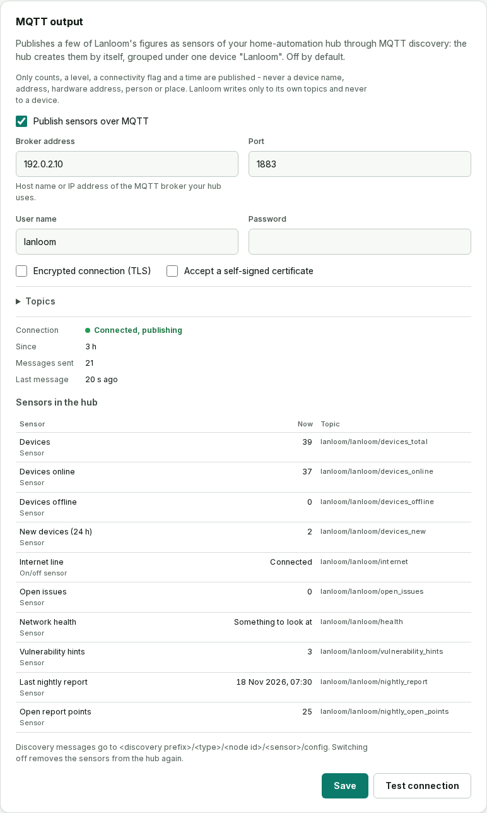
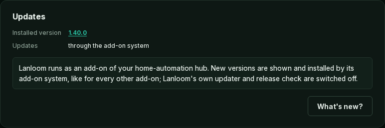
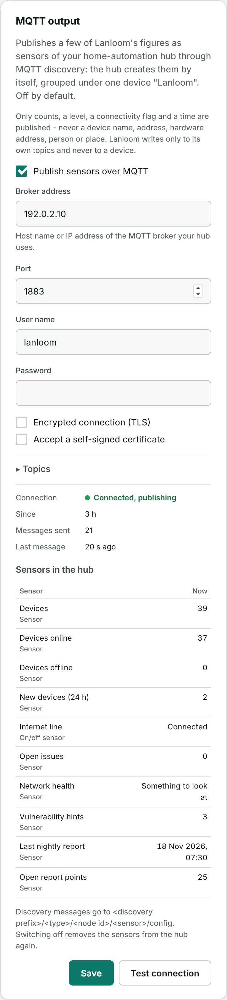
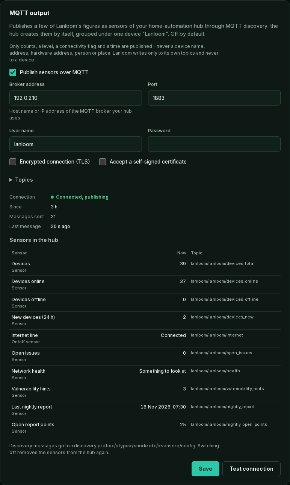

# Add-on and MQTT output

[Manual](README.md) · [Overview](overview.md) · [Map](map.md) · [Network](network.md) · [Devices](devices.md) · [Inventory](inventory.md) · [Vulnerabilities](vulnerabilities.md) · [Firewall](firewall.md) · [Data paths](data-paths.md) · [Nightly report](nightly-reports.md) · [Automations](automations.md) · [Running](running.md) · [Sites](sites.md) · Add-on and MQTT output · [Updating](updating.md) · [Settings](settings.md) · [AI](ai.md)

## Purpose

Bring Lanloom to where many home networks are already managed: run it as an **add-on** of a home-automation hub (opened
from the hub's side panel, signed in with the hub account, updated by the add-on system), and show a few of its figures
as **sensors in the hub** over MQTT discovery - devices online, new devices, the internet line, open issues, the overall
health, vulnerability hints and the nightly report - for the hub's own dashboards and automations.

## What you see

- **In the add-on:** Lanloom in the side panel of the hub, full width, with every view as usual. There is no sign-in
  page: you are the person the hub signed in. *Settings › Updates* says that updates come through the add-on system
  and still opens *What's new?*.
- **Settings › MQTT output** (administrators): the switch, the broker (address, or in the add-on the broker of the add-on
  system), the topics (folded), the state of the connection with the time since and the number of messages sent, and the
  table of sensors with the value each would carry right now and its topic.
- **In the hub:** a device *Lanloom* with ten sensors, named in the language of the Lanloom instance.
- **When it does not connect** for ten minutes: a note on the overview and the notification event *MQTT output not
  connected* (with an all-clear).

<table><tr>
<td width="50%"> MQTT output in the settings</td>
<td width="50%"> In the add-on, updates come from the add-on system</td>
</tr><tr>
<td width="50%"> The same card on a phone</td>
<td width="50%"> Dark theme</td>
</tr></table>

## How to use it

**Install the add-on.** Copy the folder `addon/lanloom` of the repository into the hub's folder for local add-ons, reload
the add-on store, install *Lanloom*, start it and open it from the side panel. The first person should be an
administrator of the hub. Details, options and the network: [ADDON.md](../ADDON.md).

**Options of the add-on.** `ingress_role` sets the Lanloom role of people who open the panel (default admin);
`direct_access` also answers the network on port 7380 with Lanloom's own accounts (default off).

**Publish sensors.** *Settings › MQTT output*: tick the switch, pick the broker (in the add-on: *Broker of the add-on
system*; otherwise address, port, user name and password, TLS optional), *Test connection*, *Save*. The hub creates
the sensors by itself. Change the node id under *Topics* when more than one Lanloom uses the same broker. Untick the
switch to remove the sensors from the hub again.

**On a phone.** The add-on works in the hub's app like every other panel. The MQTT card stacks its fields; the table
keeps sensor and value and leaves out the topic.

## Limits

- The add-on needs a hub with an add-on system and ingress, on amd64 or arm64.
- In the add-on, the one-click updater, the update channels, holding a version and going back are switched off (the
  add-on system does that), and the local AI service needs a container install; a remote AI service works.
- The MQTT output publishes ten fixed figures; it does not publish devices one by one, and it never subscribes - the
  hub cannot send anything back to Lanloom.
- MQTT 3.1.1 brokers, QoS 0, retained messages.

## Privacy

- **Add-on sign-in:** the name of the signed-in person is believed only from the add-on system's ingress proxy, never from
  the network. Lanloom creates a Lanloom account with that name and the role from the option.
- **Sent by the MQTT output (only when switched on):** counts, a level, a connectivity flag and a time. Never device names,
  addresses, hardware addresses, people, places, trackers or anything the hub sent to Lanloom. Only Lanloom's own
  topics are written; never a topic of another program, never a device.
- **Stored:** the MQTT settings, the password encrypted with the instance key; the broker of the add-on system is asked
  for its credentials on each connect and they are not stored.
- **Roles:** only administrators see and change the MQTT output; changes and tests are written to the audit log
  (`mqtt_out.change`, `mqtt_out.test`, never the password).

## See also

- [ADDON.md](../ADDON.md) - the add-on in detail: installing, sign-in, options, network, updates, data
- [MQTT-OUTPUT.md](../MQTT-OUTPUT.md) - sensors, topics, payloads, the write rules, API
- [HUB-BRIDGE.md](../HUB-BRIDGE.md) - the other direction: what Lanloom reads from the hub
- [ACCESS.md](../ACCESS.md) - users, roles and sign-in through a proxy
- [Updating](updating.md) - updates of a container install
