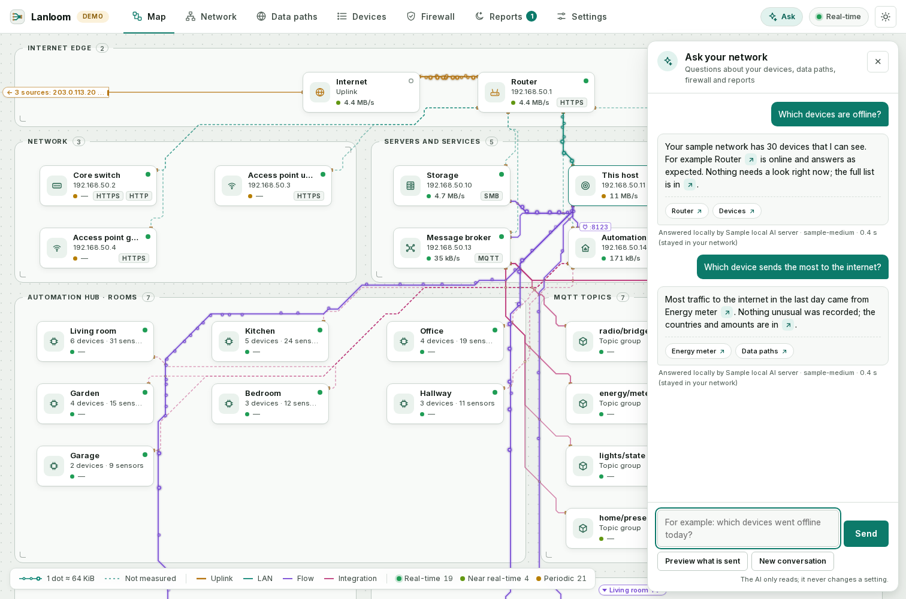
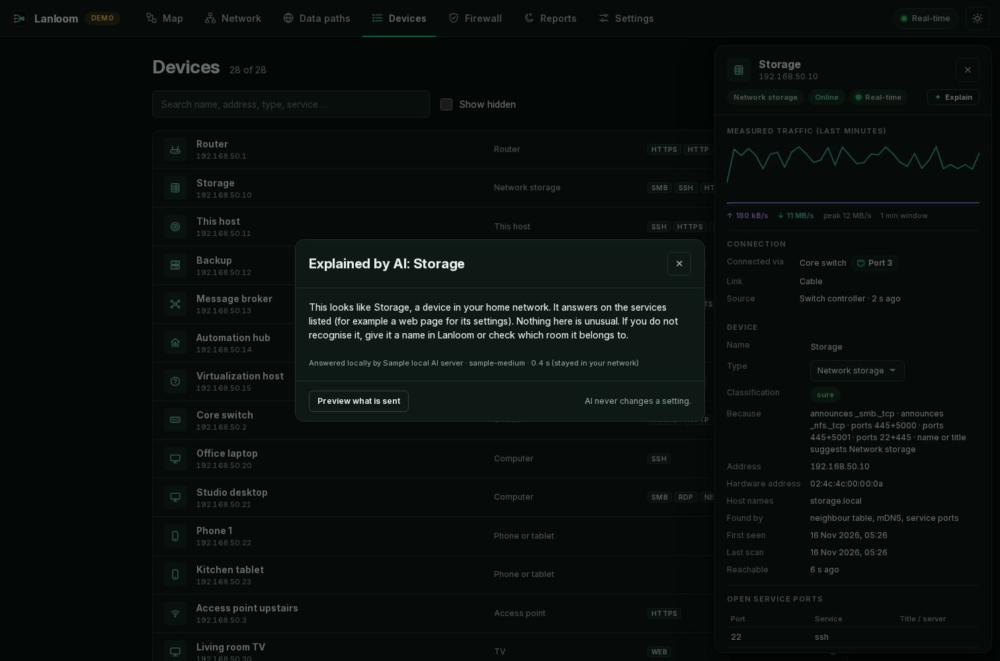
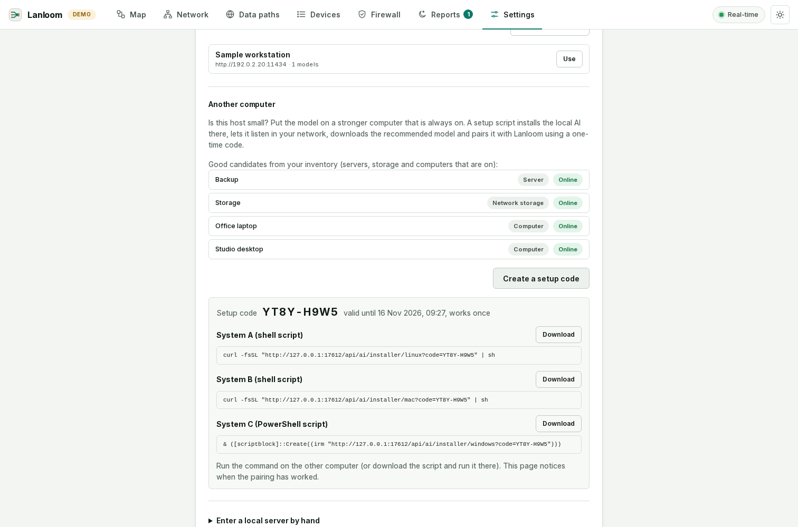
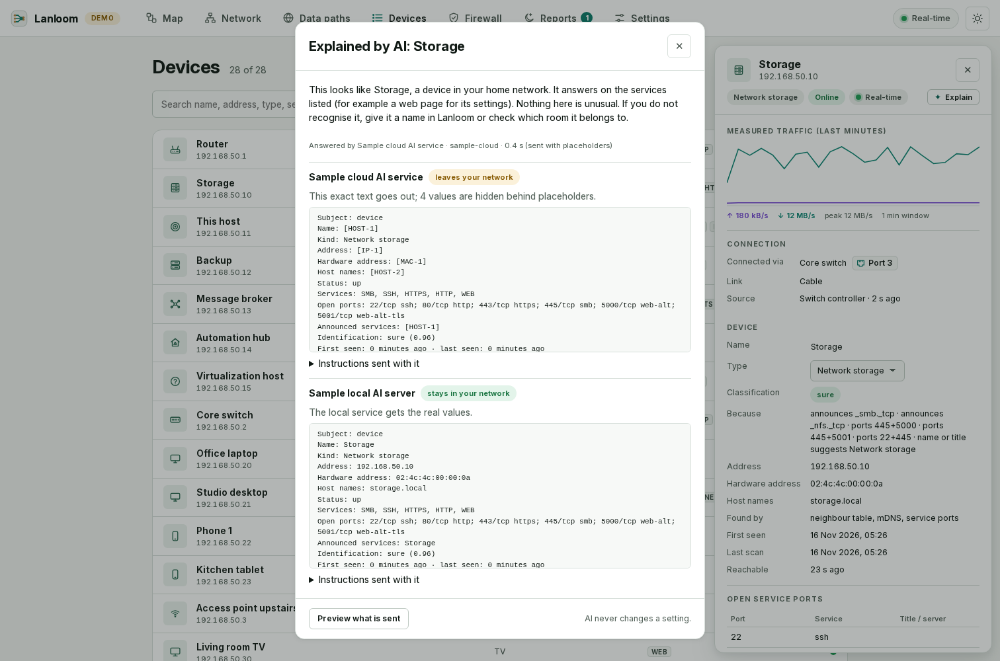

# AI

[Manual](README.md) · [Overview](overview.md) · [Map](map.md) · [Network](network.md) · [Devices](devices.md) · [Inventory](inventory.md) · [Firewall](firewall.md) · [Data paths](data-paths.md) · [Nightly report](nightly-reports.md) · [Automations](automations.md) · [Settings](settings.md) · AI

## Purpose

Lanloom can let an AI explain things in plain words: a device on the map, a note of the nightly report, a firewall rule.
There is no AI page of its own; the features appear where they help (an **Explain** button, the **Ask** button in the top
bar, a paragraph in the report, suggestions on a device card and in the firewall editor), and the setup lives under
**Settings > AI**. The AI only reads and explains. It never changes a setting, never writes configuration and never calls
the executor. AI is **off by default**.

## What you see

Once an AI is set up (**Settings > AI**, administrators), these appear for operators and administrators; viewers do not see
them:

- **Explain** on a device, a note of the nightly report or a firewall rule: a short answer in the language of the app.
- **Ask your network.** The **Ask** button in the top bar (an icon on narrow screens; on a phone the panel fills the
  screen) opens a conversation: "Which devices are offline?", "What sends the most to the internet?", "Is anything
  unusual today?". The answer names devices and views as links; a reference that does not exist is dropped.
- **In plain words** - a short paragraph above each nightly report. The rule-based report below stays the reference; if
  the AI does not answer within four minutes, the paragraph is simply missing.
- **Ask AI what this is** on the card of a device Lanloom is not sure about: one of Lanloom's kinds with a short reason,
  waiting for your **Confirm** or **Dismiss**.
- **AI suggestions** in the firewall editor: moves the editor itself would allow, which join the draft only when you
  choose *Take over as draft*.
- **Preview what is sent** next to the buttons: the exact text and instructions that would go out, how many values are
  hidden, and whether the service is inside or outside your network.

## How to use it

1. **Choose where it runs.** Local (a computer in your network; the real text goes there, nothing leaves) or cloud
   (a service on the internet with your own key; placeholders instead of addresses and names). You can set up both and
   choose which is asked first.
2. **Set up a local AI** under *Settings > AI > Local AI*: one click on this computer (needs the updater sidecar), the
   installer option, another computer paired with a one-time setup code, or an existing model server.
3. **Set up a cloud AI** under *Settings > AI > Cloud AI*: pick the service, paste the key, load the models, test the
   connection, tick the functions the cloud service may be used for (nothing is allowed by default), set the daily limit
   (default 50) and switch the card on.
4. **Use it.** Press *Explain*, *Ask* or *Ask AI what this is*; use *Preview what is sent* first if you want to see the
   text.

## Limits

- The answer is a help, not a fact. Explanations and suggestions can be wrong; a confirmed device suggestion counts only
  as a weak clue and a kind you choose yourself always wins.
- A local model on a small computer can be slow; with under 4 GB of memory no local AI is offered. Time limits are
  generous for local services (up to 150 seconds to the first answer) and shorter for the cloud (45 seconds).
- A cloud request is refused when an address pattern survived the placeholders (fail closed), when no key or permission
  exists, or when the daily limit is reached.
- A "local" address that leads to the internet counts as a cloud service.
- Ask answers use Lanloom's own data of the moment (devices, availability of the last 24 hours, data paths of the last day,
  firewall configuration); it cannot look at anything Lanloom does not hold.
- Nothing the AI says is applied: every change still goes through the preview and your confirmation.

## Privacy

- **Read:** only the facts Lanloom builds for the one request, from its own data. The question and answer are not
  written to the audit log; the action is.
- **Sent to a local service:** the real text, to a computer in your network.
- **Sent to a cloud service:** only after you set it up with your key and allow the function, and only with
  placeholders instead of IP addresses, hardware addresses, host and device names, wireless network names, serial numbers
  and site names. Before sending, a final check refuses when an address pattern survived. The answer is translated back
  on your host.
- **Stored:** keys encrypted like other credentials, never shown again and never in answers, logs, exports or reports.
  The conversation of the Ask panel is kept in the browser session only. Downloaded models stay in the volume
  `lanloom-ai` until you delete it.
- **Roles:** administrators set up and pair AI services. Operators and administrators use the features. Viewers do not.
  Pairing endpoints used by the script on another computer work without a session but need the one-time setup code, are
  rate limited and accept only private peer addresses.

## See also

- [integrations/ai.md](../integrations/ai.md) - local or cloud, the four ways to set up, the privacy layer, hardware, troubleshooting keys, what the AI can do
- [COMPATIBILITY.md](../COMPATIBILITY.md#ai-services) - supported AI services
- [SECURITY.md](../../SECURITY.md) - AI is read-only and keyed
- [FIREWALL-EDITOR.md](../FIREWALL-EDITOR.md) - suggestions for the firewall
- [Settings](settings.md#ai) - the settings page
