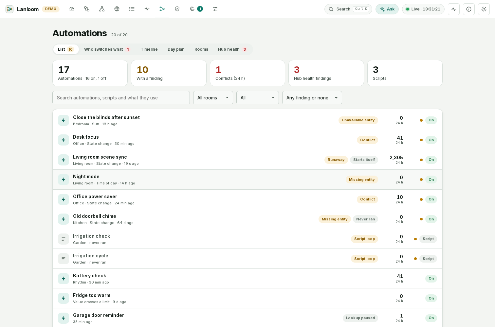

# Automations

[Manual](README.md) · [Overview](overview.md) · [Map](map.md) · [Network](network.md) · [Devices](devices.md) · [Inventory](inventory.md) · [Vulnerabilities](vulnerabilities.md) · [Firewall](firewall.md) · [Data paths](data-paths.md) · [Nightly report](nightly-reports.md) · Automations · [Running](running.md) · [Sites](sites.md) · [Updating](updating.md) · [Settings](settings.md) · [AI](ai.md)

## Purpose

What a connected home-automation hub does on its own. Every automation and script of the hub is explained in plain
words, checked by fixed rules and drawn together with what it depends on. The tab appears as soon as a hub is
connected. Everything is read only: Lanloom never runs, changes, reloads or repairs anything in the hub, and no AI is
involved in the plain words.

## What you see

Six views sit under the title (`#/automations?view=list|who|timeline|plan|rooms|health`); the badges count findings, conflicts and health findings. One automation and the dependency board open from the list.

- **List.** Five tiles (automations on or off, with a finding, conflicts in 24 hours, hub health findings, scripts) and
  one row per automation or script: its rooms, the kinds of trigger, when it last ran, runs in 24 hours, findings and
  state. Rows with a warning come first.
- **One automation.** *When*, *Only if* and *Then* in plain words, its flow with the live state of every entity, its
  findings and its last runs.
- **Dependency board** (from an automation or an entity, *Show dependencies*). Sources on the left, consumers on the right, a dot travels when an automation runs.
- **Who switches what.** Which automation sets which entity, with conflicts (opposite states within 60 seconds).
- **Timeline.** Who started what in the last 24 hours (people only as "a person").
- **Day plan.** The day with a now line: times, sun events and rhythms.
- **Rooms** and **Hub health.** Devices per room with live state; integrations with errors, unavailable entities and
  silent radio devices.

## How to use it

1. Connect the hub under *Settings > Connections*. Without admin mode you get names, state, mode, last run and run
   counts. With *Admin mode* on the connection (a token of an administrator on the hub) you also get the flows, the
   board and the day plan.
2. Search the list by name, id, room or the name of any entity an automation uses; filter by room, state or finding. A
   tile filters the list or opens its view.
3. Open an automation to read it; *Show dependencies* opens the board of any entity. A finding says where to look; the
   fix is made in the hub.
4. `Ctrl K` has *Go to Automations* and the typed commands *Who switches what*, *Timeline*, *Day plan*, *Rooms*,
   *Hub health* and *Show automations with findings*.

## Limits

- It needs a hub connection; the flows need admin mode, which stays read only and stays within the bridge's budget of at
  most 30 configuration reads a minute.
- The plain words are written by fixed rules from the structure of a configuration. A very unusual configuration may be
  shown in more general words.
- Findings are hints from Lanloom's own rules, not a verdict. Nothing is healed or switched off for you.
- Hub data stays in memory and is not part of backups.

## Privacy

Of a configuration the bridge keeps only its structure, and drops the rest before anything is stored: aliases,
descriptions, templates, service data (such as brightness or messages), who a message goes to, event names and variables
are dropped; a trigger on a person becomes "someone arrives or leaves" without any id. The sun's rise and set times,
which say roughly where the home is, never leave Lanloom. Every role that sees the map can open the tab. Details:
[AUTOMATIONS.md](../AUTOMATIONS.md#privacy).

## See also

- [AUTOMATIONS.md](../AUTOMATIONS.md) - the parts, all findings with their rules, API, demo
- [HUB-BRIDGE.md](../HUB-BRIDGE.md) - setting up the bridge, admin mode, sparing the hub
- [NIGHTLY-REPORT.md](../NIGHTLY-REPORT.md) - the *Automations* section of the report
- [TROUBLESHOOTING.md](../TROUBLESHOOTING.md#home-automation-hub) - connection problems
