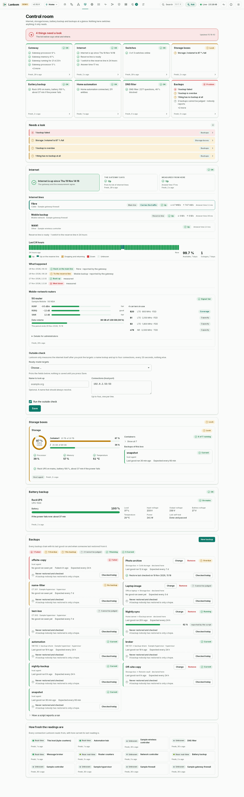
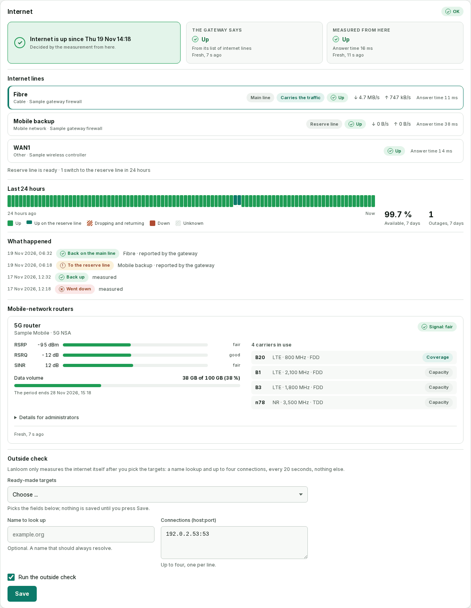
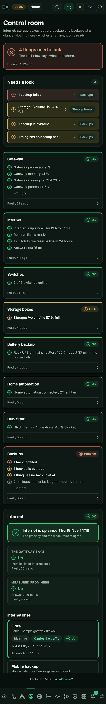

# Control room

[Manual](README.md) · [Overview](overview.md) · [Map](map.md) · [Network](network.md) · [Devices](devices.md) · [Running](running.md) · Control room · [Nightly report](nightly-reports.md) · [Settings](settings.md)

## Purpose

What keeps the network and the house running, on one page: the **internet** (what the gateway says and what Lanloom
measures itself), the **storage boxes**, the **battery backup** and the **backups**. Everything here only reads; the
control room never switches, starts or changes anything on a device.

Two rules hold on every block. It says **how old its picture is**, and a reading that went quiet is dimmed and counts as
*unknown*, never as fine. And every state has a **word and a sign** next to its colour.

## What you see

The same page in the dark theme: [controlroom-dark.png](../screenshots/controlroom-dark.png).

- **The sentence on top**: *All calm*, *N things need a look*, or *Not enough fresh readings*.
- **Blocks** for the gateway, the internet, switches, storage boxes, battery backup, home automation, the DNS filter
  and backups: a state, the lines that matter and *fresh / a bit late / no fresh reading, last seen ... ago*. A block
  only appears when its source exists, so a small network sees a small page. Pressing a block jumps to its part of the
  page (or to Network or Sensors).
- **Needs a look**: every yellow or red line of the blocks, worst first.
- **Internet**: the state in words, the two readings side by side (*the gateway says* and *measured from here*) with a
  note when they disagree (the measurement counts), the lines (main and reserve, which one carries the traffic, rates),
  the last 24 hours as blocks of 15 minutes, availability and outages of 7 days, what happened, and one card per
  mobile-network router (signal quality of RSRP, RSRQ and SINR, bands with their role, data volume; the cell, tracking
  area and position only for administrators).

  

- **Storage boxes**: a ring for the fullest volume, every volume with a bar, processor, memory and temperature,
  containers and virtual machines, the backups of the box, the battery backup that carries it ("about 37 min if the
  power fails") and how fresh each source is.
- **Battery backup**: state, charge, runtime (if the power fails now / left on battery), load and voltages.
- **Backups**: every chain with its status, the last good run, the progress of a running one and *Restore last
  checked on ...*.

- **How fresh the readings are**: every connection Lanloom reads from, with its grade and age.
- `#/wan`, `#/nas` and `#/backups` open this page at their part; the command palette has *Go to Control room*, *Go to
  Internet*, *Go to Storage boxes* and *Go to Backups*. When something needs a look, the overview shows a card for it.
- *Resilience and scenarios* (top right) opens the [resilience](resilience.md) page: score, weak spots, emergency
  scenarios and the layers the network rests on.

On a phone the blocks sit in one column, with what needs a look first:

## How to use it

**Outside check of the internet** (administrators): until you pick targets, only the gateway's word counts and a wrong
gateway cannot be caught. Under *Internet > Outside check* pick a ready-made set or type a name to look up and up to four
`host:port` connections; Lanloom then makes one lookup and a few connections every 20 seconds, nothing else.

**Backups** (operators): *New backup* declares a chain (name, what, where, how often it should run). A script reports
every run with one request to the API; the token comes from *Settings > API*. A long run can report its progress and the
page shows a bar. Backups of a hypervisor or a host agent appear by themselves. *Checked today* notes that you restored
from a backup and looked at the result: a backup nobody restored is only a hope, and the page says so when the last
check is missing or older than 180 days. *Take back* next to the date removes it again (a click by mistake): the backup is
"never restored and checked" again.

**Not used** (operators, backups Lanloom found itself: a guest of a hypervisor, the backup of a home-automation hub, a timer of a
host agent): if you save that thing another way - say through the hypervisor, and a script reports it - press *Not used* on its
card. It leaves every count: the warnings, the sentence on top, the nightly report, the storage cards and the resilience grade. It
moves to the list *Not used* below the cards, where it stays with the date, never comes back by itself (not after a restart, not
when the source falls silent) and can be used again with *Use again*. A backup you declared yourself is removed instead.

**Battery backup**: connect a UPS monitoring service under *Settings > Connections > Battery backup (UPS)* (host and
optionally the name of one UPS; port 3493). Lanloom reads only; it sends no login and no commands.

## Limits

- The internet is judged from the gateway's lines and, if set up, the outside check. Without either it is *unknown*.
- Signal quality, data volume and the cell details need a mobile router that reports them over SNMP or its controller.
- A backup chain declared here is only as good as the reports of its script; without reports it shows *Cannot be judged*
  rather than *Current*.

## Privacy

- The outside check connects only to the targets an administrator typed; no target is set by default.
- Cell id, tracking area and position of a mobile router are in the answer for administrators only.
- Declaring, changing and removing backups, noting a restore check and changing the targets are written to the audit log.

## See also

[Resilience](resilience.md) · [Network](network.md) · [Nightly report](nightly-reports.md) · [Settings](settings.md) · [API](api.md)
