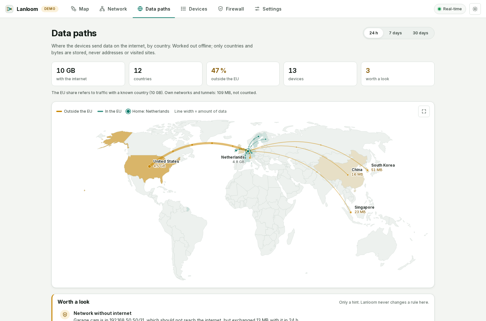
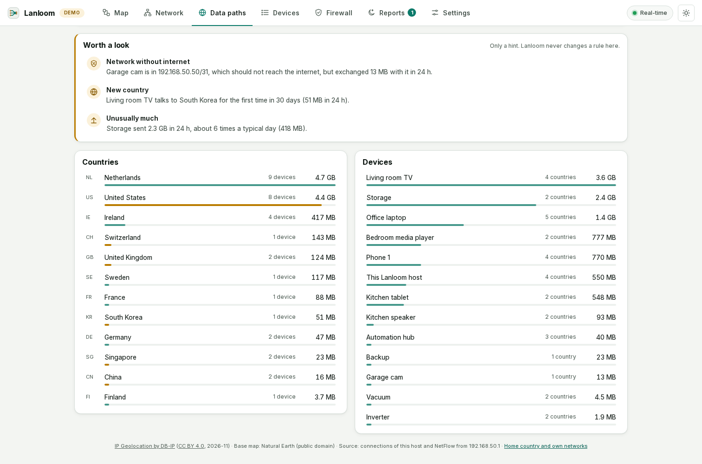
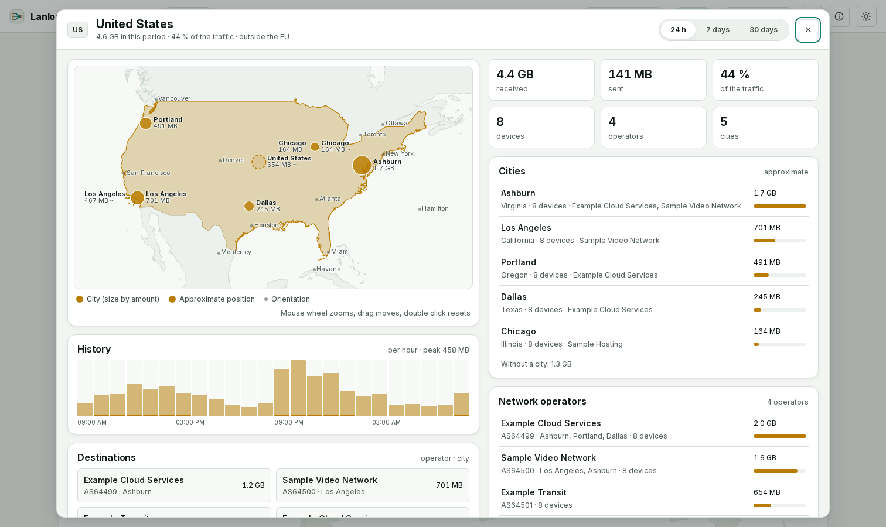
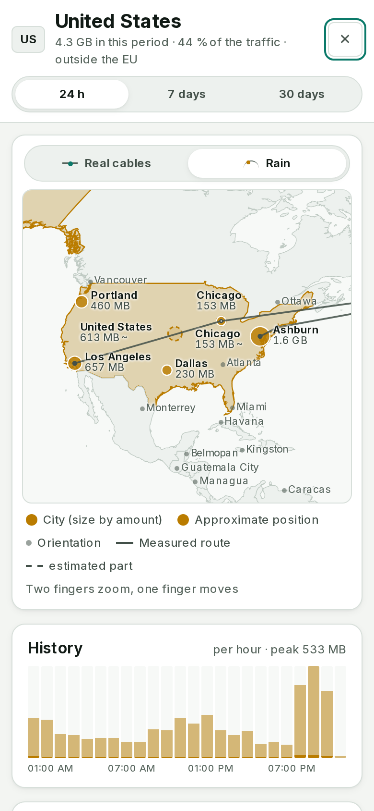
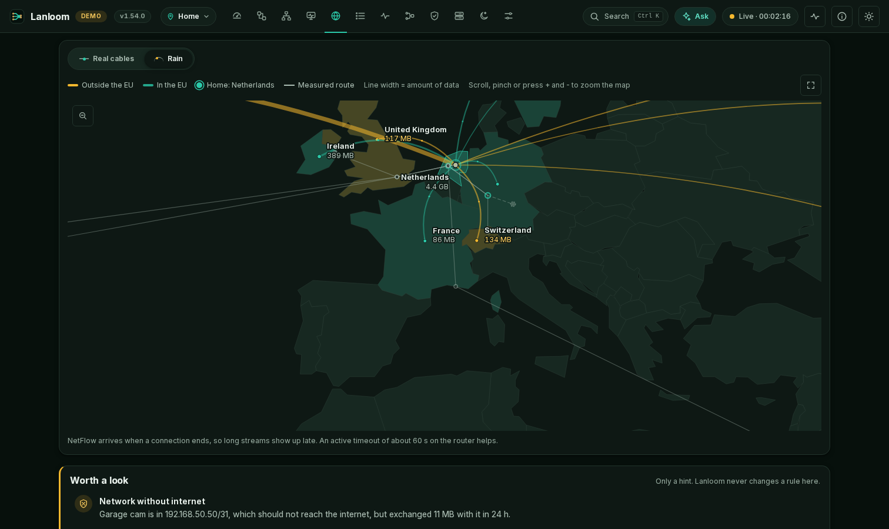
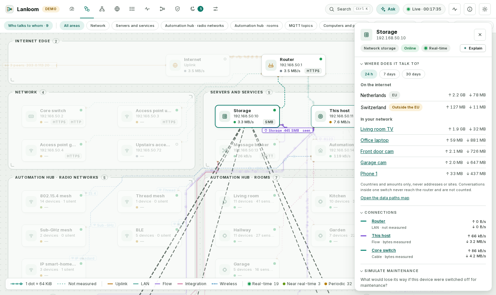

# Data paths

[Manual](README.md) · [Overview](overview.md) · [Map](map.md) · [Network](network.md) · [Devices](devices.md) · [Inventory](inventory.md) · [Vulnerabilities](vulnerabilities.md) · [Firewall](firewall.md) · Data paths · [Nightly report](nightly-reports.md) · [Automations](automations.md) · [Running](running.md) · [Sites](sites.md) · [Updating](updating.md) · [Settings](settings.md) · [AI](ai.md)

## Purpose

Where your data went: which countries the devices of your network exchange data with, over 24 hours, 7 or 30 days,
shown on a calm world map. It helps you notice a device that talks to a country it never did before, or that uploads
unusually much.

## What you see

- **Arcs** from your home country to every destination country. The width follows the bytes of the chosen period.
  Destinations outside the EU are amber, those in the EU teal. Dots travel along the arcs in the direction of most of
  the traffic.
- **Period:** 24 hours (hourly sums), 7 days or 30 days (daily sums).
- **Key figures:** data exchanged with the internet, number of countries, share outside the EU, number of devices,
  number of hints.
- **Lists** of countries and devices. Click a country (on the map or in the list) to open its country detail, see
  below; click a device to see its countries.
- **Hints**, calm and never changing anything: *New country* (first time in 30 days, at least 1 MB in 24 hours),
  *Unusually much* (at least three times the typical day and at least 200 MB in 24 hours), *Network without internet*
  (a device in a network you listed as having none exchanged data with the internet).
- **Footer** naming the source of the numbers.

### Country detail

Click a country and a large sheet opens: the country zoomed on a finer map, **bubbles** for the places the devices talk
to, key figures (received, sent, share, devices, operators, cities), the history, the **cities**, the **network
operators**, the **devices** and the **destinations** (operator and city). Esc, the × button, a click beside the sheet and
the back gesture close it; on a phone it fills the screen. The address is `#/paths/<country code>`, so you can bookmark it.

- **The bubbles always add up** to the figure at the top: traffic without a known city is drawn as a dashed bubble
  (*approximate position*), at the largest known city of the same operator in that country or in the middle of the country.
- Sizes use the unit that fits (B to TB) in the number format of your language. The mouse wheel or two fingers zoom up to
  64 times; places for orientation appear with every zoom step.
- **Cities and network operators are an option, off by default** (*Settings > General*, administrators). Switching it on
  makes Lanloom fetch exactly two public files (about 90 MB to download; at most one check a day, a new file once a
  month) and keep a compact file of about 90 MB. Without it the sheet shows everything about the country and says
  that cities are off. *Check now* asks at once, *Delete files and stored figures* removes everything and switches it off.
  The cities are approximate: the source assigns whole networks to one place, often the seat of a data centre.

## How to use it

- Select a country or a device; the map follows the selection. `Esc` or the x on the chip clears it.
- **Full screen:** the button at the top right of the map; `Esc`, the close button and the back key close it.
- **Magnify:** mouse wheel at the pointer (up to 16 times), drag to move, double click or the reset button to show the
  whole world; on a phone, pinch with two fingers. With the keyboard, Tab to the map, then `+`, `-` and `0`.
- **Per-device figures.** The default source is the connections of the Lanloom host itself. For every device of the
  network, set up NetFlow / IPFIX export on your router and switch on the receiver under *Settings > General > NetFlow /
  IPFIX from your router* (administrators); see [DATA-PATHS.md](../DATA-PATHS.md#setting-up-netflow--ipfix).
- **Where does it talk to?** Every device card has this section: the countries it talks to (EU or outside) and the devices
  of your network it talks to, with the bytes in each direction and a period switch. The card of the *Internet* tile lists
  which devices talk to the internet and how much.
- In *Settings > General* administrators set the home country and list their own networks and tunnels and the networks that
  should have no internet access.

## Limits

- Every partner beyond your local network falls into exactly one bucket: a country, *own networks and tunnels*,
  *anycast (nearest location)* or *without a country*. The share outside the EU refers only to traffic with a known
  country; if there is none, it shows **no data** instead of 0 %.
- Anycast networks (a large content delivery network, public DNS resolvers, time services) answer from the nearest of
  many locations, but the country database only knows where their addresses are registered. Lanloom therefore lists
  them as one line of their own instead of a country, and leaves them out of the share outside the EU.
- Without NetFlow only the host's own connections are counted. With NetFlow, an address no device is known for is booked
  as *Unknown device*, and traffic between two local devices is not counted.
- Country data is offline and approximate (a database that ships with each release). A country lights up with its main
  area only.
- Conversations between devices (the map's *Who talks to whom* and the card's *In your network*) come from the router's
  flows. Devices that talk inside one switch never reach the router and do not appear; a device that is not known never
  becomes a line.
- The controller adapters count bytes per client but not per destination, so the figures by country come only from the
  host's connections and from NetFlow (see [DATA-PATHS.md](../DATA-PATHS.md#what-the-adapter-statistics-can-and-cannot-do)).
- Hints never create a firewall rule and never block anything.
- NetFlow receives only from the exporter addresses you allow; packets from any other address are dropped and counted.

## Privacy

- **Read:** the TCP connections of the host (kernel socket diagnostics) and, if you switch it on, NetFlow / IPFIX
  records from the exporters you allow. Nothing is looked up online and Lanloom never contacts the destinations.
- **Stored:** only country, device id and bytes per hour (49 hours) and per day (31 days), plus the first and last day a
  device talked to a country, and for a conversation between two devices the two ids and the bytes per direction. With the option for cities and network operators also the city (of the peer, approximate) and the operator. No peer addresses, ports, host names or visited sites are kept; NetFlow records are read in
  memory and dropped. Retention is adjustable under *Settings > Storage*.
- **Sent:** nothing, unless an administrator switches on cities and network operators: then the request for two public files from *download.db-ip.com* (no address, no name, nothing about the installation).
  The country data, the base maps and the places ship with the image.
- **Roles:** every role looks. Admins set up NetFlow, own networks, the networks without internet and the city data.

## See also

- [DATA-PATHS.md](../DATA-PATHS.md) - buckets, hints, NetFlow set-up, privacy, country data and map
- [PERFORMANCE.md](../PERFORMANCE.md#counter-check) - the counter check against the router's uplink
- [NIGHTLY-REPORT.md](../NIGHTLY-REPORT.md) - the *Data paths* section
