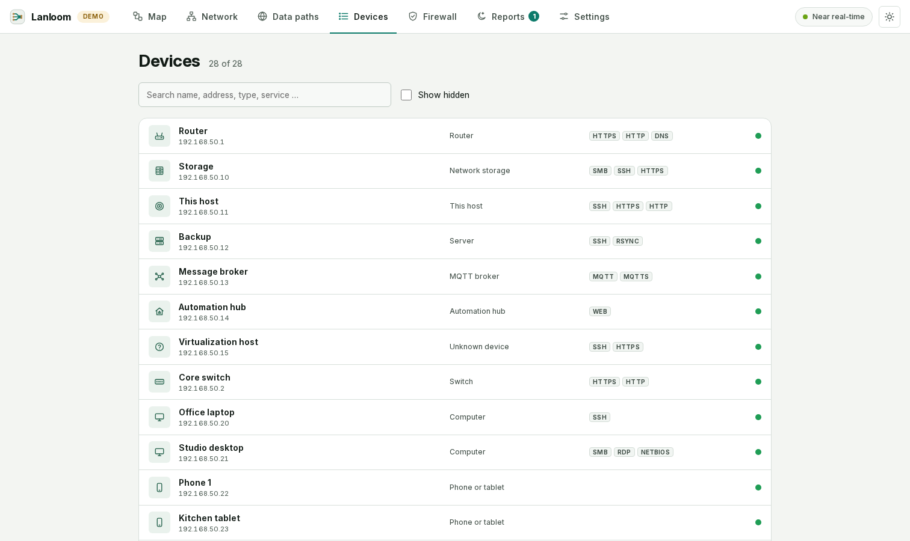
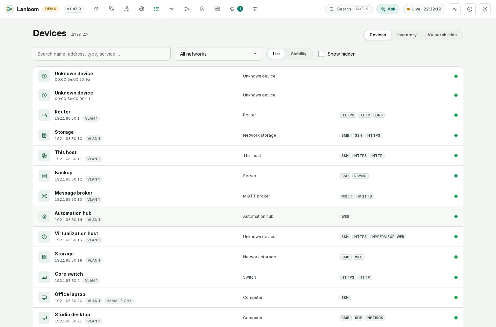
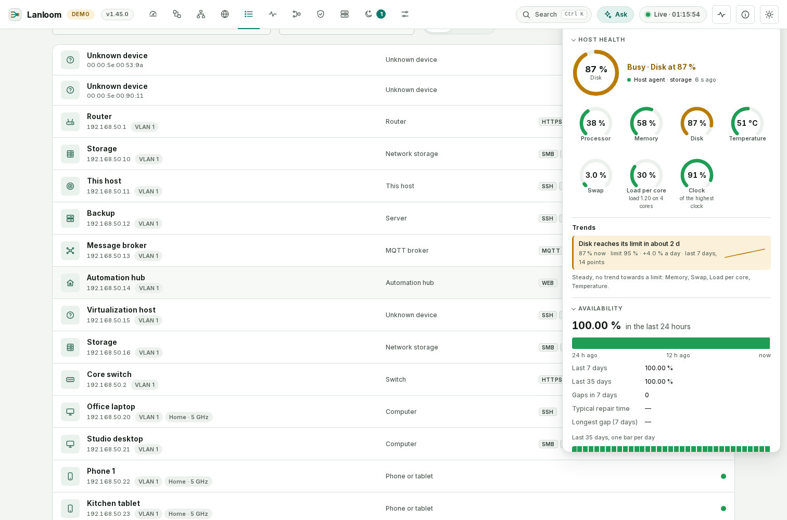

# Devices

[Manual](README.md) · [Overview](overview.md) · [Map](map.md) · [Network](network.md) · Devices · [Inventory](inventory.md) · [Vulnerabilities](vulnerabilities.md) · [Firewall](firewall.md) · [Data paths](data-paths.md) · [Nightly report](nightly-reports.md) · [Automations](automations.md) · [Running](running.md) · [Updating](updating.md) · [Settings](settings.md) · [AI](ai.md)

## Purpose

Every device Lanloom found, in a list: what it is, how sure Lanloom is, who made it and which services it offers. It is
the place to search for a device, to correct what Lanloom guessed, and to see how steady each device has been.

## What you see

- **The list.** One row per device with type, certainty, maker, model and services. Search by name, address, maker or
  service.
- **Tags and filter.** Each row names the network (*VLAN 60*) and, for a wireless device, the wireless network and band
  (*Things · 2.4 GHz*) as small tags; the menu next to the search box shows one network or wireless network, or only
  wired devices (`?net=` in the address). It works with the search and the other filters.
- **The card of a device** (click a row): name, type, **address origin** (registered maker, private or random address,
  unregistered address, only an IP address), model and firmware where the device tells them, IPv6 addresses, NetBIOS
  name, the reasons for its type, the *Can be connected* section, the *Inventory* block and the *Vulnerabilities* block.
- **Host health section.** The card of a host whose values Lanloom reads (host agent, SNMP host tables, hypervisor,
  network controller or the system sensors of a home hub) shows a health ring with the worst value, round gauges for
  processor, memory, disk, temperature, swap, load per core and the processor clock (where throttling is measurable),
  green below 70 %, yellow 70–90 %, red above 90 %, every source with the age of its last reading (a source that stopped is
  dimmed as *stale · 40 min ago*, never red), and the **trends** of memory, swap, disk, load and temperature: a calm yellow
  row when a limit will be reached within 72 hours. See [HOST-HEALTH.md](../HOST-HEALTH.md).

  
- **Host agent section.** The card of a host that runs an optional [host agent](../HOST-AGENT.md), or is read through a container source, adds the version, the last report, the system values, the counts of containers and failed units, a link to [Running](running.md) and a button to show or hide its containers on the map. The card of a container shows its state, image, ports, networks and live traffic.
- **Devices | Inventory | Vulnerabilities** switch at the top: opens the [inventory](inventory.md) of the same devices, or
  the [vulnerability hints](vulnerabilities.md) for their firmware.
- **List | Stability | Links** switch under the search box: how steady each device and connection was instead of what it is, or every web interface with the state of its probe.
  Five key figures (checked, without a gap, gaps in 7 days, typical repair time, wobbly), the wobbly candidates, and
  one row each with 35 daily bars, availability over 24 hours and 7 days, gaps and repair time, the worst first
  (`#/devices?view=stability`).

- **Links** (`#/devices?view=links`): every web interface with the state of its probe (answers, login required, error,
  not answering), a button that opens it in a new tab (greyed out while it does not answer, back by itself when it does),
  the certificate clock (a hint under 30 days, yellow under 14, red under 3) and, under *Other services*, the services
  without a web page. See [SERVICES.md](../SERVICES.md).

- **On the card:** the *Services* section (ports, versions, state, certificate), availability (288 blocks for the last 24 hours), traffic plot (1 h, 6 h, 24 h, 7 days, full screen),
  connections with live rates, and *Simulate maintenance*. Its sections fold and keep their state.

## How to use it

- From the start page the list opens filtered: `#/devices?show=new`, `?show=unsure`, `?show=offline`. The chip above
  the list removes the filter.
- **Correct what Lanloom guessed** (operators): rename the device, choose its type, hide it from the map, or join two
  interfaces of one device. A suggestion of 30 to 60 % shows *Same device* and *Different devices*; *Show separately*
  undoes an automatic grouping. Your choice is kept until you change it.
- **Hidden devices** stay in the list: tick *Show hidden* and open the row to see the card, show the device on the map
  again or forget it.
- **Forget device** (operators): on the card of a hidden or offline device. The entry, its history and what you
  entered for it are removed for good, after a confirmation. A device that still answers is found again by the next
  scan, as a new entry. This host and the gateway cannot be forgotten.
- **Protect a device from scanning** (operators): choose *Printer*, *Industrial*, *Passive only*, *No protection* or
  back to *Automatic* on the card.
- **Connect it** (admins): the *Can be connected* section offers *Connect* with the address filled in.
- With an AI set up, *Ask AI what this is* on the card of an uncertain device sends the clues for a suggestion; you
  confirm or dismiss it (see [AI](ai.md)).
- Use *Show availability*, *Show traffic history* and *Simulate maintenance* from the search (`Ctrl K`).

## Limits

- A maker is assigned only from a registered hardware address or from what the device says itself. Private (random)
  addresses never get a maker.
- The type comes from fixed rules and is shown with its certainty; an AI suggestion counts only as a weak clue and never
  overrides your choice.
- A slot without a look is *unknown*, not a fault: while Lanloom is off or settling in after a start, it books nothing.
  When none of three or more devices answers at once, nothing is booked (probably Lanloom's own network).
- Hidden devices and the host that runs Lanloom are not tracked for availability.
- A device with **three or more gaps in 7 days** is called wobbly: a hint to look at cable, power or radio, not a verdict.

## Privacy

- **Read:** the scan results described in [DISCOVERY.md](../DISCOVERY.md): neighbour table, mDNS, SSDP, WS-Discovery,
  well-known service ports, NetBIOS, LLMNR, and (off by default) SNMP system values. Everything is local; nothing is
  looked up on the internet, and the maker register ships with the image.
- **Stored:** devices, your own names and choices, the availability slots (35 days by default) and the traffic per
  minute (8 days) in Lanloom's database on the host, included in backups.
- **Sent:** only to an AI service, and only after you set one up and switch it on (see [AI](ai.md#privacy)).
- **Roles:** viewers read the list and the stability list. Operators rename, retype, hide, group, protect and forget
  devices and run scans. Every change is in the audit log.

## See also

- [DISCOVERY.md](../DISCOVERY.md) - what a scan sends, who a device is, one device with several interfaces, scan protection
- [HOST-HEALTH.md](../HOST-HEALTH.md) - host gauges, early warnings, waiting on someone
- [AVAILABILITY.md](../AVAILABILITY.md) - slots, the stability list, the card sections
- [INVENTORY.md](../INVENTORY.md) - the same devices with purpose, room and warranty
- [PALETTE.md](../PALETTE.md) - search and commands
