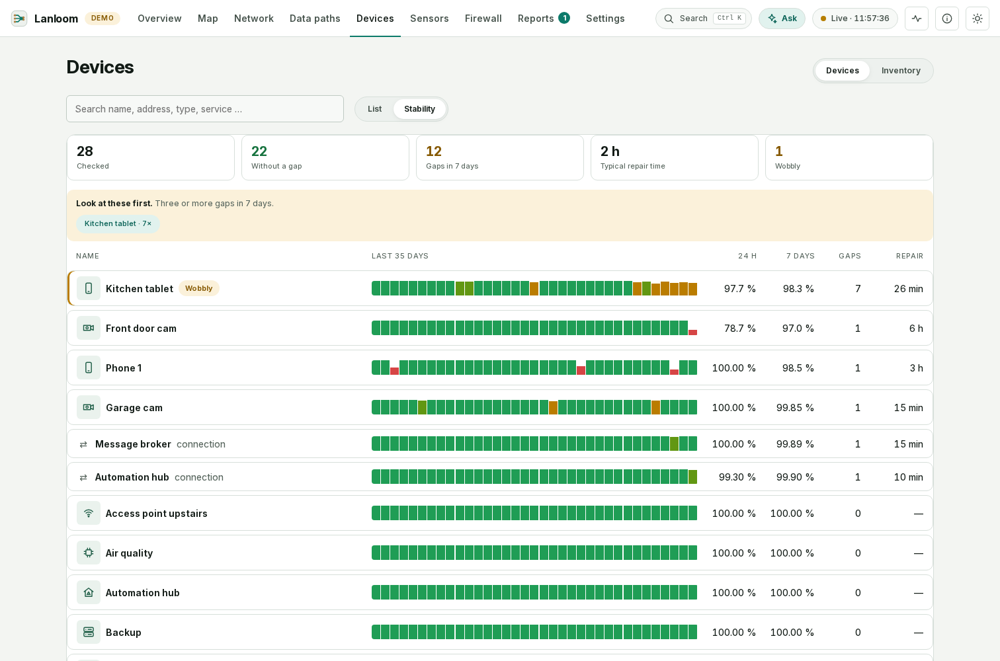
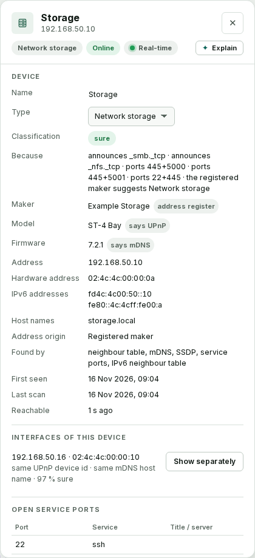

# Devices

[Manual](README.md) · [Overview](overview.md) · [Map](map.md) · [Network](network.md) · Devices · [Inventory](inventory.md) · [Firewall](firewall.md) · [Data paths](data-paths.md) · [Nightly report](nightly-reports.md) · [Automations](automations.md) · [Updating](updating.md) · [Settings](settings.md) · [AI](ai.md)

## Purpose

Every device Lanloom found, in a list: what it is, how sure Lanloom is, who made it and which services it offers. It is
the place to search for a device, to correct what Lanloom guessed, and to see how steady each device has been.

## What you see

- **The list.** One row per device with type, certainty, maker, model and services. Search by name, address, maker or
  service.
- **The card of a device** (click a row): name, type, **address origin** (registered maker, private or random address,
  unregistered address, only an IP address), model and firmware where the device tells them, IPv6 addresses, NetBIOS
  name, the reasons for its type, the *Can be connected* section, and the *Inventory* block.
- **Devices | Inventory** switch at the top: opens the [inventory](inventory.md) of the same devices.
- **List | Stability** switch under the search box: how steady each device and connection was instead of what it is.
  Five key figures (checked, without a gap, gaps in 7 days, typical repair time, wobbly), the wobbly candidates, and
  one row each with 35 daily bars, availability over 24 hours and 7 days, gaps and repair time, the worst first
  (`#/devices?view=stability`).

- **On the card:** availability (288 blocks for the last 24 hours), traffic plot (1 h, 6 h, 24 h, 7 days, full screen),
  connections with live rates, and *Simulate maintenance*. Its sections fold and keep their state.

## How to use it

- From the start page the list opens filtered: `#/devices?show=new`, `?show=unsure`, `?show=offline`. The chip above
  the list removes the filter.
- **Correct what Lanloom guessed** (operators): rename the device, choose its type, hide it from the map, or join two
  interfaces of one device. A suggestion of 30 to 60 % shows *Same device* and *Different devices*; *Show separately*
  undoes an automatic grouping. Your choice is kept until you change it.
- **Hidden devices** stay in the list: tick *Show hidden* and open the row to see the card, show the device on the map
  again or forget it.
- **Forget device** (operators): on the card of a hidden or offline device. The entry, its history and what you
  entered for it are removed for good, after a confirmation. A device that still answers is found again by the next
  scan, as a new entry. This host and the gateway cannot be forgotten.
- **Protect a device from scanning** (operators): choose *Printer*, *Industrial*, *Passive only*, *No protection* or
  back to *Automatic* on the card.
- **Connect it** (admins): the *Can be connected* section offers *Connect* with the address filled in.
- With an AI set up, *Ask AI what this is* on the card of an uncertain device sends the clues for a suggestion; you
  confirm or dismiss it (see [AI](ai.md)).
- Use *Show availability*, *Show traffic history* and *Simulate maintenance* from the search (`Ctrl K`).

## Limits

- A maker is assigned only from a registered hardware address or from what the device says itself. Private (random)
  addresses never get a maker.
- The type comes from fixed rules and is shown with its certainty; an AI suggestion counts only as a weak clue and never
  overrides your choice.
- A slot without a look is *unknown*, not a fault: while Lanloom is off or settling in after a start, it books nothing.
  When none of three or more devices answers at once, nothing is booked (probably Lanloom's own network).
- Hidden devices and the host that runs Lanloom are not tracked for availability.
- A device with **three or more gaps in 7 days** is called wobbly: a hint to look at cable, power or radio, not a verdict.

## Privacy

- **Read:** the scan results described in [DISCOVERY.md](../DISCOVERY.md): neighbour table, mDNS, SSDP, WS-Discovery,
  well-known service ports, NetBIOS, LLMNR, and (off by default) SNMP system values. Everything is local; nothing is
  looked up on the internet, and the maker register ships with the image.
- **Stored:** devices, your own names and choices, the availability slots (35 days by default) and the traffic per
  minute (8 days) in Lanloom's database on the host, included in backups.
- **Sent:** only to an AI service, and only after you set one up and switch it on (see [AI](ai.md#privacy)).
- **Roles:** viewers read the list and the stability list. Operators rename, retype, hide, group, protect and forget
  devices and run scans. Every change is in the audit log.

## See also

- [DISCOVERY.md](../DISCOVERY.md) - what a scan sends, who a device is, one device with several interfaces, scan protection
- [AVAILABILITY.md](../AVAILABILITY.md) - slots, the stability list, the card sections
- [INVENTORY.md](../INVENTORY.md) - the same devices with purpose, room and warranty
- [PALETTE.md](../PALETTE.md) - search and commands
