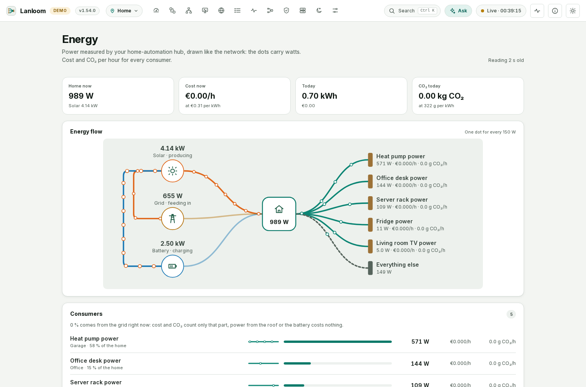
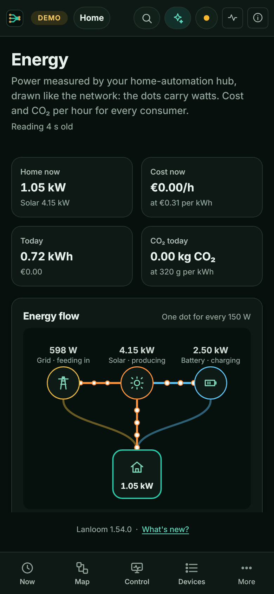

# Energy

[Manual](README.md) · [Overview](overview.md) · [Map](map.md) · [Network](network.md) · [Devices](devices.md) · [Control room](controlroom.md) · [Now](now.md) · Energy · [Settings](settings.md)

## Purpose

The power your home-automation hub measures, drawn like the network. Grid, solar and battery feed the home, the home feeds
its consumers, and the dots on every trace carry **watts instead of bytes**. Every consumer with its own power sensor is a
lane with its watts, its **cost per hour** and its **CO₂ per hour**. The page only appears with a hub that has power
sensors; without one, nothing in Lanloom shows energy.

## What you see

- **Key figures**: the home now, the cost now (what the grid supplies times the price), today's energy with its cost and
  today's CO₂.
- **Energy flow**: solar, grid and battery on the left, each with its watts and what it does (producing, drawing,
  feeding in, charging, supplying), the home in the middle, the consumers on the right. One dot for every 150 W; all dots
  move at the same pace, so a busy trace is a dense trace. With *reduce motion* in the system the dots stand still.
- **Consumers**: every power sensor that is not grid, solar, battery or the home total, with its area, share of the
  home, watts, cost per hour and CO₂ per hour (only the share the grid supplies right now: power from the roof or the
  battery costs nothing); a consumer that is also a network device links to its device card.
  *Everything else* is the power no sensor of its own explains.
- **Control room**: a block *Energy* with the power now, solar, the cost and the CO₂ of today.
- **Nightly report**: a section with yesterday's energy, cost, CO₂ and the solar share.

On a phone the sources sit in a row above the home, and the consumers follow as a list, each with its own small trace:

## How to use it

- **Price and CO₂** (operators): a sensor of the hub with a price per kWh (for example a dynamic tariff) or a CO₂
  intensity is found by itself. A number entered under *Price and CO₂* wins over a found sensor; the feed-in tariff is
  subtracted from today's cost for the energy fed into the grid. Without anything, CO₂ uses an average of 400 g per kWh
  and cost is not shown.
- Sensors are sorted by their name and unit: a sensor whose name says grid, mains or import is the grid (negative values
  are feeding in), solar, PV or inverter is solar, battery or storage with watts is the battery. Rename a sensor in the
  hub if it lands in the wrong place.
- The command palette has *Go to Energy* (only with power sensors).

## Limits

- Lanloom shows what the sensors report. A consumer without a power sensor is part of *Everything else*.
- Today's energy comes from a daily energy sensor of the hub when there is one; otherwise Lanloom adds up the power
  itself from the moment it runs (gaps of more than ten minutes are not filled).
- Cost is an estimate from one price per kWh; time-of-use tariffs are only right with a price sensor that follows them.

## Privacy

- Lanloom reads the power, energy, price and CO₂ sensors the hub connection already lets through; nothing is asked from
  the hub for this page alone.
- Nothing leaves this device: there is no price or CO₂ service on the internet behind this page.
- Changing price and CO₂ needs the operator role and is written to the audit log; everybody who sees the map reads.

## See also

- [Control room](controlroom.md) · [Now](now.md) · [Nightly report](nightly-reports.md) · [Automations](automations.md)
- [ENERGY.md](../ENERGY.md): data source, rules and settings in detail
