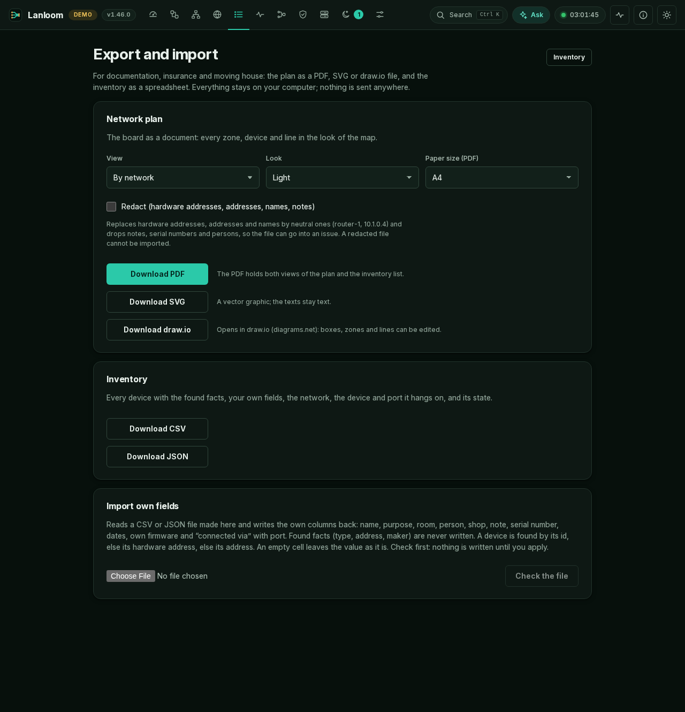
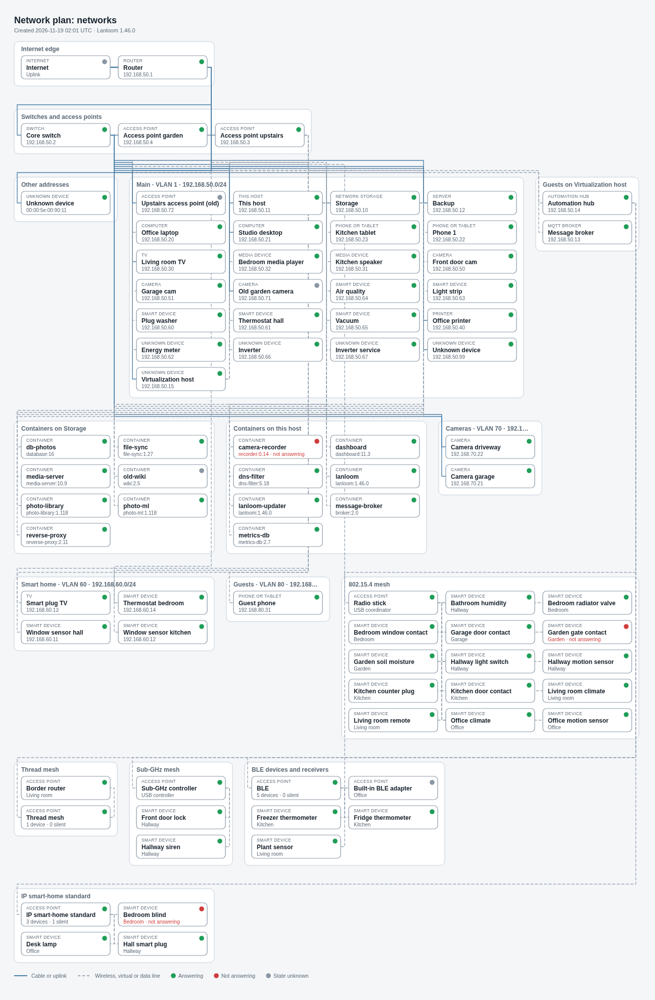
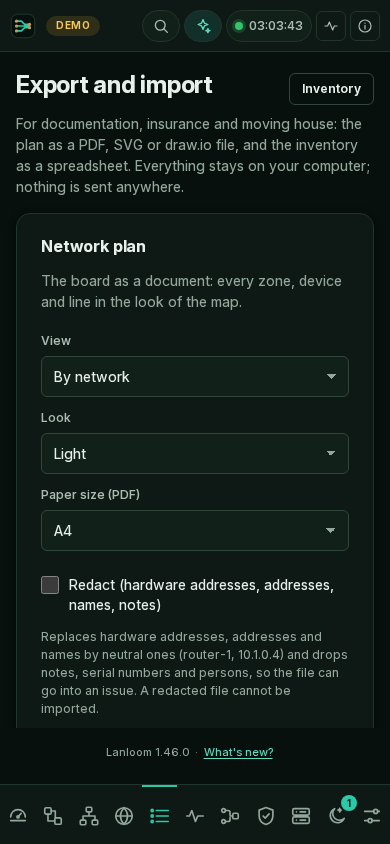
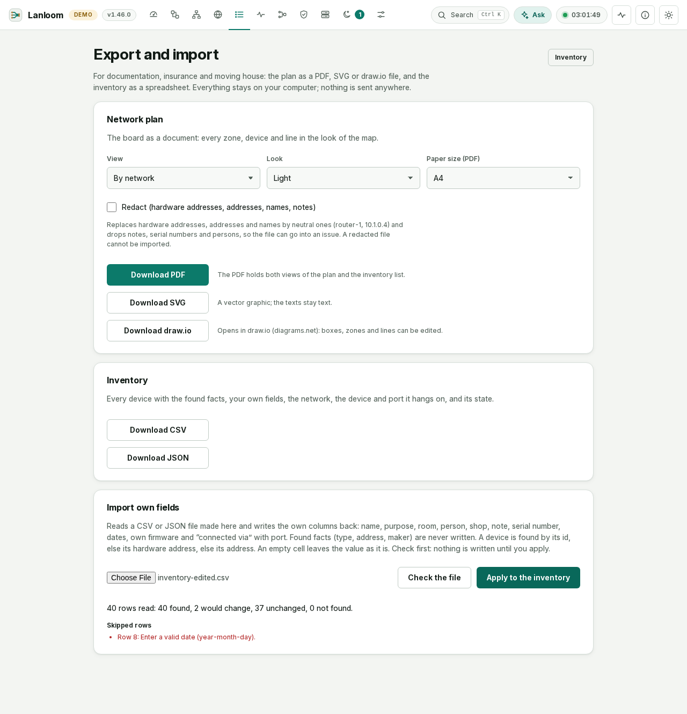

# Export and import

[Manual](README.md) · [Overview](overview.md) · [Map](map.md) · [Network](network.md) · [Devices](devices.md) · [Inventory](inventory.md) · [Vulnerabilities](vulnerabilities.md) · [Firewall](firewall.md) · [Data paths](data-paths.md) · [Nightly report](nightly-reports.md) · [Automations](automations.md) · [Running](running.md) · [Updating](updating.md) · [Settings](settings.md) · [AI](ai.md)

## Purpose

For documentation, insurance and moving house: the network plan as a PDF, an SVG or a draw.io file, and the inventory as
CSV or JSON. The own columns of the inventory can be read back in. Everything is built in Lanloom and saved by your
browser; nothing is sent anywhere. The page is `#/export`, reached from the *Export* button on the
[inventory](inventory.md) page and from the search (`Ctrl K`).

## What you see

- **Network plan:** the view (*By network* or *Overview*), the look (*Light*, *Dark*, *Print-friendly*), the paper size
  (A4 or A3, for the PDF), the *Redact* check box and the buttons *Download PDF*, *Download SVG*, *Download draw.io*.
  The PDF holds both views and the inventory list.
- **Inventory:** *Download CSV* and *Download JSON*: one record per device with the found facts, your own fields, the
  network, the device and port it hangs on, and its state.
- **Import own fields** (operators): choose a CSV or JSON file made here, *Check the file* (nothing is written), then
  *Apply to the inventory*.

On a phone the options and buttons stack and the download goes to the phone's downloads.

## How to use it

- **Hand over a plan:** pick *By network*, *Print-friendly*, A4 or A3, *Download PDF*. A large network is cut between
  rows of zones, never through one.
- **Edit in a drawing program:** *Download draw.io* (or SVG); every box and line can be moved.
- **Write down rooms and persons in bulk:** *Download CSV*, fill `room`, `owner`, `purpose` ... in a spreadsheet, save as
  CSV, *Import own fields*, check, apply. An empty cell changes nothing.
- **Share in an issue:** tick *Redact* before every download. Names, addresses, hardware addresses, persons, rooms, serial
  numbers and notes are replaced by neutral ones; type, maker, model and firmware stay.
- **From the keyboard:** `Ctrl K` and type *download*: PDF, SVG, draw.io, CSV, JSON; the commands use the choices last
  made on the page.

## Limits

- The PDF carries English and German text; any other character becomes `?` there. SVG and draw.io carry every language.
- The plan is a fixed grid of the state at the moment of the download, not the live board.
- A redacted JSON cannot be imported; a redacted CSV matches nothing.
- At most 5000 rows and 2 MB per import; a wrong row is skipped, the rest is applied.

## Privacy

- **Read:** the device list, the inventory and the connections Lanloom already holds.
- **Stored:** nothing; a file is built on request. Your choices on the page stay in this browser.
- **Sent:** nothing; the export adds no outgoing connection.
- **Roles:** everyone who is signed in may download; importing needs the operator role. The audit log records each
  download (kind, redacted or not) and each import (rows, changes), never the content.

## See also

- [EXPORT.md](../EXPORT.md) - columns, redaction table, import rules, limits
- [INVENTORY.md](../INVENTORY.md) - the fields the export carries
- [PALETTE.md](../PALETTE.md) - the commands
- [ACCESS.md](../ACCESS.md) - roles and the audit log
