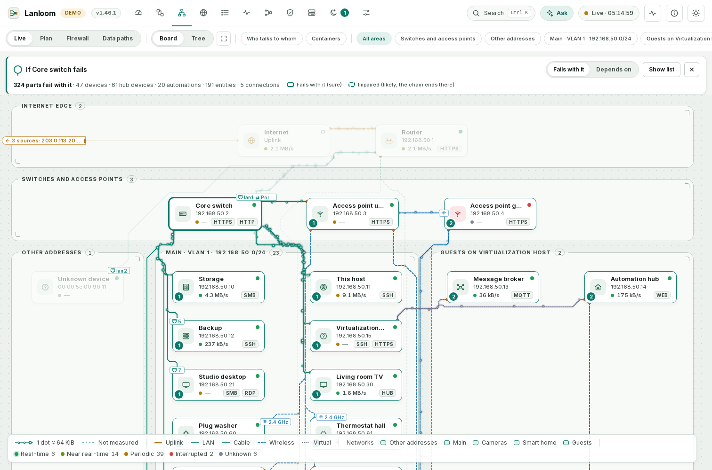
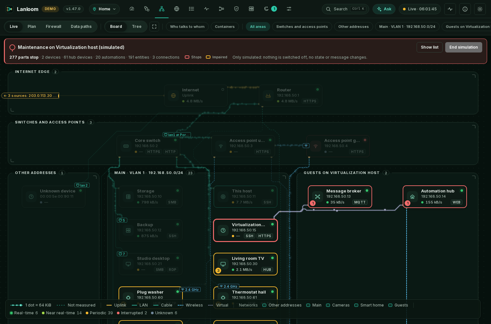
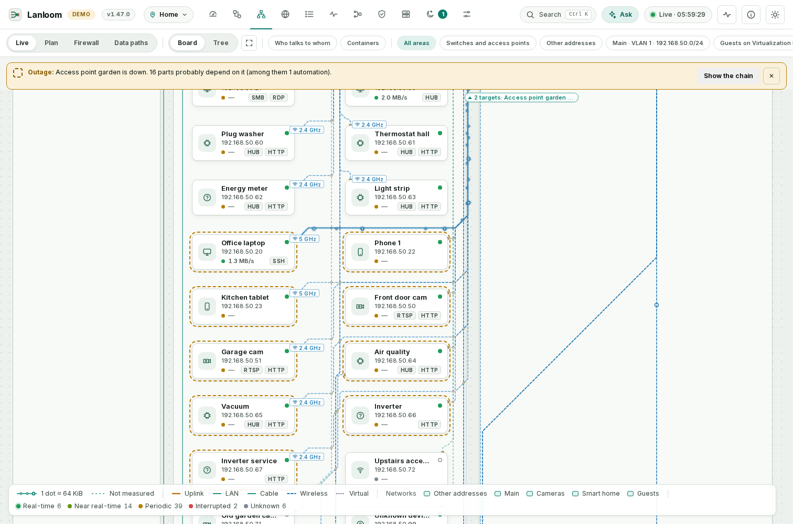
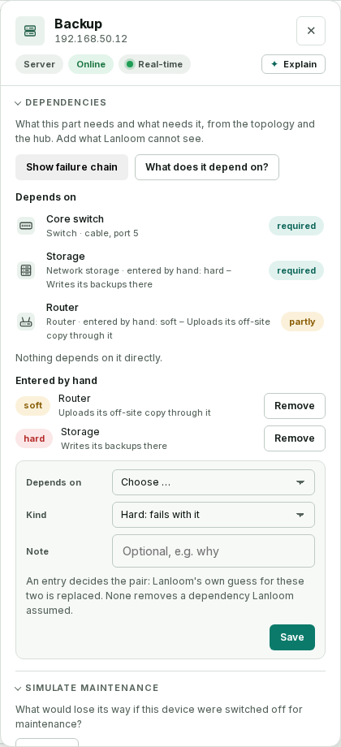
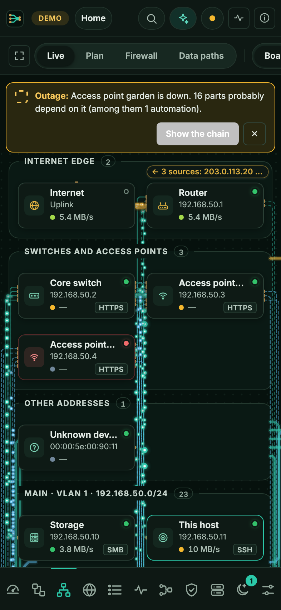
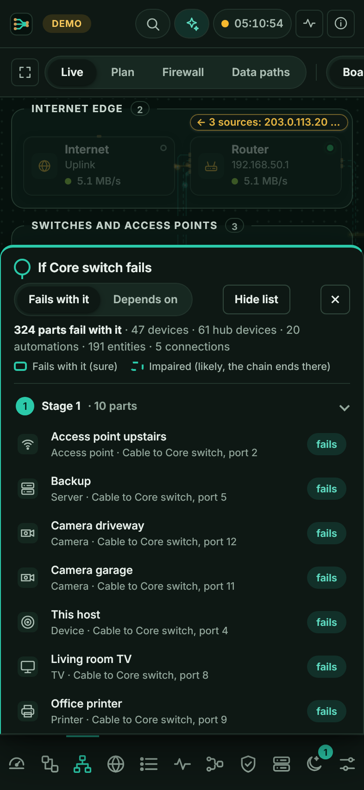

# Failure chain and outages

[Manual](README.md) · [Overview](overview.md) · [Map](map.md) · [Network](network.md) · [Devices](devices.md) · [Automations](automations.md) · Failure chain · [Rewind and incidents](incidents.md) · [Nightly report](nightly-reports.md) · [Settings](settings.md)

## Purpose

Answers three questions about any part of your network and home automation: **What fails if this fails?**, **What does
this depend on?** and **What would stop if I switched it off for maintenance?** When a device really goes down, the
**outage automatic** marks what probably hangs on it - devices, hub devices, entities and automations - without you asking.

Everything is worked out from what Lanloom already knows: the physical topology (switch ports, access points, guests on a
host), the gateway, the containers of a host, Lanloom's own connections, and - with a home-automation hub connected - its
devices, entities and automations. Nothing is guessed, nothing is switched.

## What you see

- **The bar above the board** names the question ("If Core switch fails", "What Core switch depends on"), how many parts
  fail with it or are only impaired, and how they split into devices, hub devices, automations, entities and connections.
  *Fails with it | Depends on* switches the direction, *Show list* opens the list, the cross (or `Esc`) closes the chain.
- **On the board** the root is framed and every part of the chain carries a **stage mark**: 1 hangs directly on the root,
  2 on a part of stage 1, and so on. Only the traces between parts of the chain stay lit; everything else steps back.
  A part that is only impaired has a dashed frame.
- **The list by stages** gives every part with its kind and the reason: "Cable to Core switch, port 5", "Radio via
  Access point garden", "Runs as a guest on Virtualization host", "Started by Hallway motion", "Switches Hallway light",
  "Needs Storage (entered by hand)".
- **Sure and likely.** Over a sure link the part fails with the one before it and the chain goes on (it hangs on its
  port, runs on it, is started by it). Over a likely link the part is only impaired and the chain **ends there** - an
  automation that checks a sensor still runs when the sensor is gone, just not as intended. Without that rule one broken
  bulb would colour the whole home.
- **Simulate maintenance** colours the same chain by what would happen: what stops is red, what is only impaired is
  yellow, the view gets a red frame and the bar says *simulated* until you press *End simulation*. Nothing is switched off,
  no state and no message changes.
- **The outage note.** When a device is down that was up before, a note above the board names it and says how many parts
  probably depend on it ("Access point garden is down. 14 parts probably depend on it (among them 1 automation)").
  The parts it reaches get a calm dashed outline on the board, their cards say "Probably affected: Access point garden is
  down", and the *Automations* tab marks the automations it reaches. *Show the chain* opens it; the cross hides the note
  until the outage changes. Long names wrap; nothing is cut off.
- **Hovering a tile** with the mouse shows only the traces that tile needs: its way up through cables, radio, guests and
  hub rooms to the gateway and the internet, plus what you entered by hand.

### Dependencies on the card

Every card that Lanloom knows dependencies of has a section **Dependencies**: *Show failure chain*, *What does it depend
on?*, the parts it depends on directly (each with the reason and *required* or *partly*), how many parts depend on it
directly, and the dependencies **entered by hand**.

 

## How to use it

- **From a card:** open a device and press *Show failure chain* or *What does it depend on?* in *Dependencies*; in
  *Simulate maintenance* press *Simulate*, then *Show on the map*.
- **From the search** (`Ctrl K` / `⌘ K`): *Show failure chain …*, *What does … depend on?* and *Simulate maintenance …*
  ask for the part in a second step (a device, an automation or an entity). The same actions sit in the menu of a hit
  (`→` or the dots).
- **Enter what Lanloom cannot see** (operators and admins): in *Dependencies › Entered by hand* choose what the part
  depends on, the kind and an optional note:
  - **Hard** - it fails with the other (a backup server that writes to a storage server).
  - **Soft** - it is only impaired (a host that keeps copies of its disk images on a storage server).
  - **None** - there is no dependency, although Lanloom assumed one (a device with its own uplink that Lanloom placed on a
    switch).
  An entry decides the pair: Lanloom's own guess for these two is replaced, in both directions. *Remove* takes it back.
- **On a phone** the bar is a sheet above the tab bar with the list open; the cross closes it.
- **Where an outage reaches automations,** open *Automations*: the marked rows are the ones to look at first.

## Limits

- The chain is only as good as the topology. A device without a known port is taken to hang behind the gateway; connect
  a switch controller or switch counters, or set *connected via* on the card, for the real way.
- Phones and computers come and go; they never start the outage automatic. Hidden devices neither.
- A hub device that is one component with a network device (the same tile on the board) is shown as impaired, not failed,
  when only the hub fails: the device itself keeps running.
- Automations are linked through what their configuration names (what starts, checks, reads and switches them). Without the
  admin mode of the hub bridge Lanloom only knows that they run in the hub.
- The chain looks at most 12 stages deep (8 by default); the list shows up to a few hundred parts per kind and counts the
  rest.

## Privacy

- Everything is computed on the Lanloom host from data it already keeps; nothing is sent anywhere and nothing is switched.
- Dependencies entered by hand are stored in Lanloom's database with their note and are part of the backup. Keep the note
  free of secrets.
- Everyone who sees the map reads chains, outages and dependencies; entering or removing one needs the operator role and
  is written to the audit log ("Dependency entered by hand").
- When a device goes offline, the notification adds how many parts probably depend on it; the nightly report has a
  section **Failure chains** for the outages of the night and for entries that point at something Lanloom no longer knows.

## See also

- [Network view](network.md) and [map](map.md) - where the chain is drawn
- [Topology](../TOPOLOGY.md) - where the physical links come from
- [Automations](automations.md) and [hub bridge](../HUB-BRIDGE.md) - where automations and their references come from
- [Availability](../AVAILABILITY.md) - gaps and repair times behind the outages
- [Nightly report](nightly-reports.md) and [notifications](../NOTIFICATIONS.md)
- [Search and commands](../PALETTE.md)
