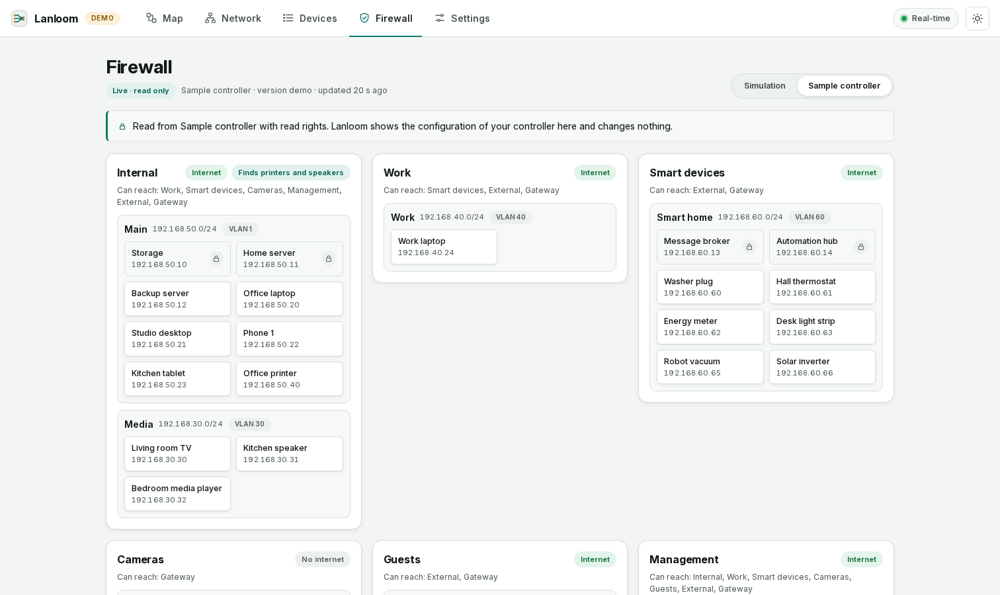
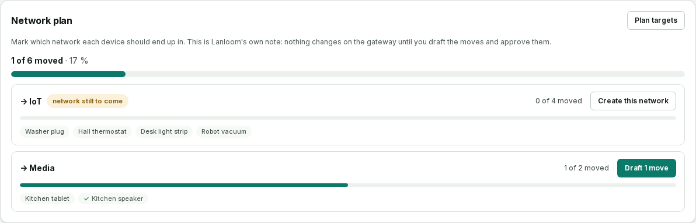
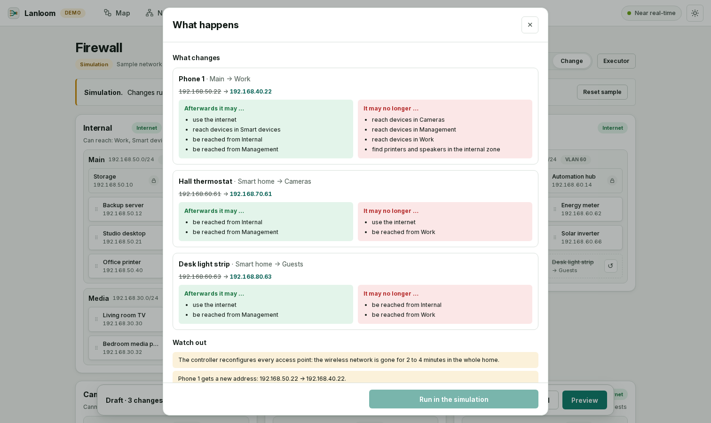
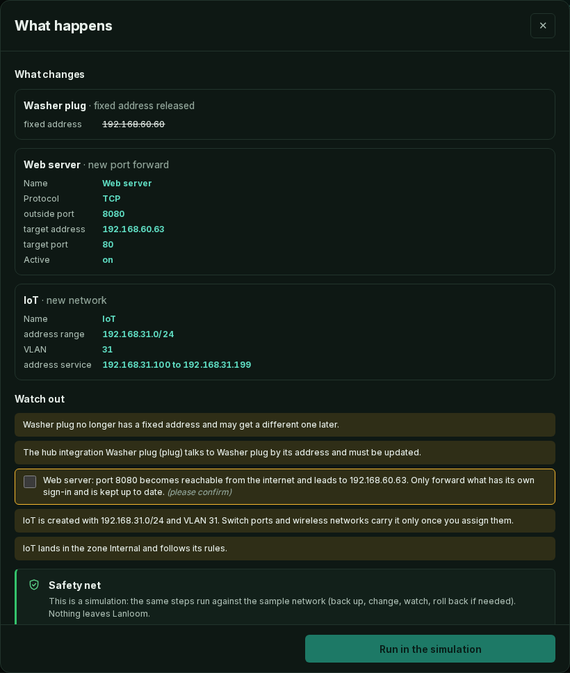
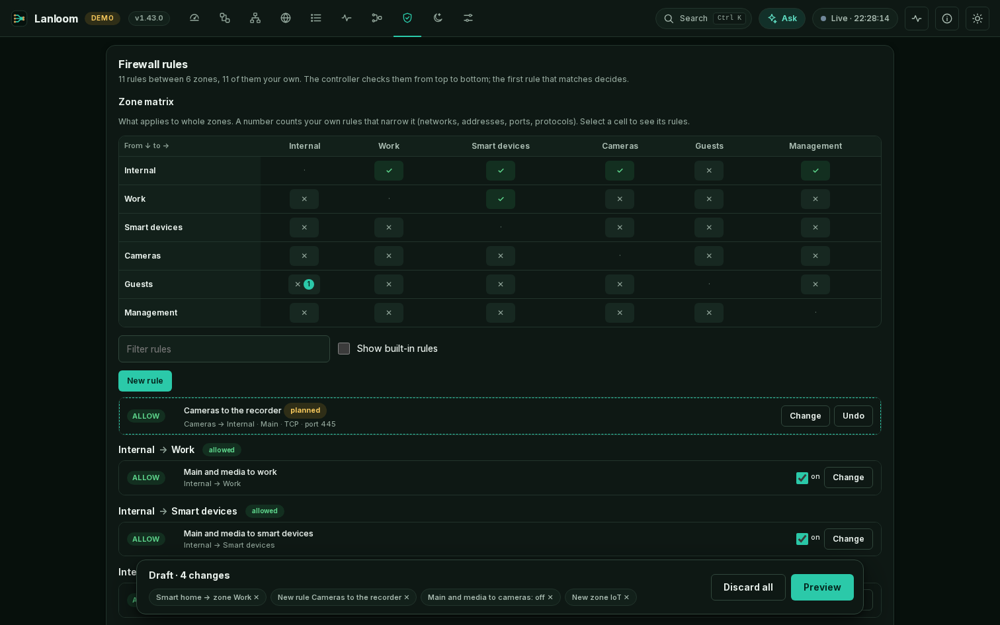
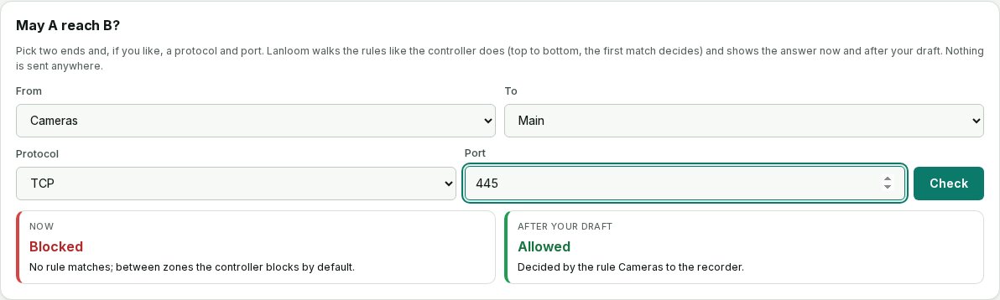
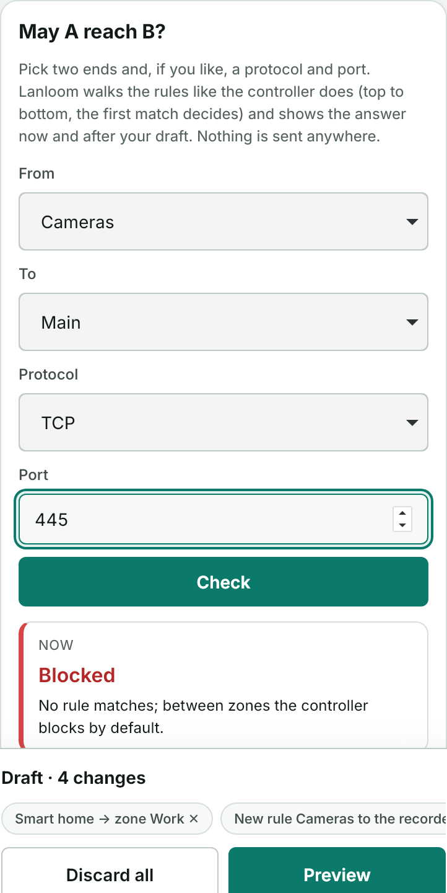

# Firewall

[Manual](README.md) · [Overview](overview.md) · [Map](map.md) · [Network](network.md) · [Devices](devices.md) · [Inventory](inventory.md) · [Vulnerabilities](vulnerabilities.md) · Firewall · [Data paths](data-paths.md) · [Nightly report](nightly-reports.md) · [Automations](automations.md) · [Running](running.md) · [Updating](updating.md) · [Settings](settings.md) · [AI](ai.md)

## Purpose

Shows which zone and network every device sits in and what each zone may reach, read from your controller. In **Change**
mode you can draft a change (move a device to another network, give it a fixed address or a new name, create a network
with a VLAN of its own, change an address service, reserve or release a fixed address, add or switch off a port forward,
start or shut down a hypervisor guest; with a zone firewall also zones and rules), see in plain words what it would do, and apply it as one signed change. A
**network plan** keeps the target network of each device and shows how far the move has come. By default nothing is
written anywhere: the editor is a simulation.

> Read [FIREWALL-EDITOR.md](../FIREWALL-EDITOR.md) before you let it write to a real controller. Changes on a
> controller can interrupt connections, moving a wireless client can reconfigure every access point, and a wrong move
> can lock you out. Keep local console access. Use at your own risk.

## What you see

- **Sources.** The simulation (a built-in sample network), the external executor (when set up) and, when a
  device-family adapter reads your controller, the **live configuration** - which is read only.
- **Zones** with their networks and the devices in them; a pin marks a fixed address.
- **Live configuration** (read only): the controller's real zones and networks, the clients in each network, the rules
  in the controller's order with filters and hit counters, a zone matrix, port forwarding, wireless networks and the
  network equipment with its ports. A zone firewall adapter adds plain checks (management open on the internet side,
  rules that let everything in) and a table of internet connections, VPN, fixed addresses, source NAT, static routes and
  rule groups. A hypervisor adapter adds findings, the firewall at datacenter, node and guest level, every guest
  network card and the bridges of each node.
- **Draft bar** (Change mode): one chip per device; **Preview** shows every field old to new, the warnings and what
  blocks.
- **Guests** card (Change mode, with a hypervisor behind the editor): start, shut down, move a network card, switch the
  guest firewall and its rules.
- **Network plan**: the target network of each device (an existing one, or one still to come such as *IoT*), the
  progress (*5 of 12 moved*), one row per target with its devices, and a mark *→ IoT* on every device tile that still
  has to move. *Create this network* opens *New network* with the name filled in; *Draft N moves* puts the moves that
  are possible now into the draft. The plan is Lanloom's own note and works with a read-only connection too.
- **Networks**, **Fixed addresses** and **Port forwarding** cards (Change mode, when the executor can change the
  gateway): every network with VLAN, address service, zone and what uses it; *New network* from a template (IoT,
  Cameras, Work, LAN) with a free address range and VLAN filled in; reserve and release fixed addresses; add, change,
  switch on or off and delete port forwards.

## How to use it

1. Switch to **Change**. Drag a device onto another network, or tap or click it to open its sheet: *Move to ...*,
   *Name*, *Fixed address*, and *Uses it by its address* (hub integrations, presence trackers, automations and Lanloom's
   own sources that reach the device by its address). Gateway changes start from the *Networks*, *Fixed addresses* and
   *Port forwarding* cards. Only what the connected controller can change is offered.
2. Collect changes in the draft bar and press **Preview**.
3. Read the preview; tick the marked points (private address, your own device, quiet hours, every new or changed
   port forward) that need an explicit confirmation.
4. An admin applies the plan. In the simulation that is one click and nothing is written. With the external executor it
   is a passkey signature over the plan, then the executor checks, backs up, writes, watches and rolls back on its own
   if the network turns unhealthy. A successful change can be undone for 24 hours.

More:

- **Plan a segmentation:** *Plan targets* on the *Network plan* card: choose a target network (or *A new network, by
  name …*), tick the devices, save. Once the network exists and a device can go there, *Draft N moves* drafts them -
  at most 10 objects per change, so a large plan moves in a few rounds.
- **On the phone** the sheet opens from the bottom; *Move to ...* leads to the list of networks.
- **From the search** (`Ctrl K`): *Change a device (network, name, fixed address) ...*, a device hit then offers *Move to
  ... / change*; *Change a guest (start, shut down, network card, firewall) ...* opens the *Guests* card; *Networks and
  VLANs*, *Port forwarding*, *Fixed addresses* and *Network plan* open their cards; *Zones of the firewall*, *New
  firewall rule* and *May A reach B?* open the zone cards and the rule dialog.
- **Deep links:** `#/firewall/device/<address>` opens change mode with the sheet of that device,
  `#/firewall/pick` a searchable list of the devices that can be changed, `#/firewall/networks`,
  `#/firewall/forwards`, `#/firewall/reservations`, `#/firewall/zones`, `#/firewall/rules/new`, `#/firewall/ask` and `#/firewall/plan` (`#/firewall/plan/edit` with the plan
  dialog open) their cards.
- **AI suggestions** (optional, operators): *AI suggestions* proposes moves the editor itself would allow; they join the
  draft only when you choose *Take over as draft* (see [AI](ai.md)).

### Zones

The **Zones** card (Change mode, when the executor can change the zone firewall) lists every zone with its networks and how many networks and rules refer to it. Built-in zones carry a *built-in* chip, zones Lanloom created *created by Lanloom*.

1. Press **New zone**, type a name, add it to the draft.
2. **Rename** works for zones that are not built in.
3. **Remove** is offered only for zones Lanloom created and only when no network and no rule is in them any more; otherwise the card says *empty it first*. The controller would delete the rules of a removed zone without a word, so Lanloom refuses.
4. To move a network, use the select **Move to zone ...** on its row: into a zone of its own or back into the internal zone. The management network and the system zones (external, gateway, VPN, hotspot, DMZ) are never offered.

On a phone every control is finger-sized and the zone select wraps below the row.

### Changing rules

In Change mode each changeable row of the rule list has an **on** checkbox, **Change**, up and down arrows and, for rules Lanloom created, **Remove**. **New rule** sits above the list; planned new rules appear above the list marked *planned*.

1. **New rule** or **Change** opens a dialog: name, action (allow, block, reject), *From* zone and optionally one network, *To* zone and optionally one network, protocol (any, TCP, UDP, TCP and UDP), ports (a list or ranges, only with TCP or UDP) and *Allow answers back* (return traffic).
2. The arrows move a rule within the own rules of its zone pair - one move per pair and plan.
3. The **on** checkbox switches a rule off or on.
4. Press **Preview**. Every zone and rule change is shown field by field, old to new, with warnings which zone pairs open or close.

A rule that lets traffic in from the internet or from another zone into the management zone needs its own confirmation tick.

Only rules whose every setting Lanloom can carry over are changeable; rules with schedules, connection-state filters, address, region, app or domain matches, source ports, an IPsec match or an ICMP type stay read-only, and built-in rules of the controller are never changed. Lanloom refuses a blocking rule that involves the management network, the management zone or the gateway, and a plan after which you, Lanloom or the executor could no longer reach the gateway or the controller; the refusal names the path and nothing is sent.

### May A reach B?

The **May A reach B?** card works on every configuration that shows zones and rules, also on read-only live configurations.

1. Pick *From* and *To*: the internet, the gateway itself, a zone, a network or a device.
2. Optionally choose a protocol and a port.
3. Read the answer: **Allowed**, **Blocked**, **Depends** or **Unknown**, with the deciding rule or the default (traffic within one zone is allowed; between zones the controller blocks when no rule matches). *Depends* names the rules that apply only for some ports or protocols or match something Lanloom cannot evaluate, and shows what is allowed or blocked otherwise.
4. In the editor the answer is shown *Now* and *After your draft*.

Nothing is sent anywhere. Viewers may use it.

## Limits

- **Checks.** A fixed address must lie inside the device's network, must not be the network's own address or its
  gateway and must not belong to another device. A device connected by cable cannot be moved by a client setting (its
  network follows the switch port), and a device whose network is unknown while it is offline can only be renamed.
- **The gate.** At most 10 objects per change; protected devices (gateway, network equipment, servers others depend on,
  the host that runs Lanloom) never move; management networks are no target; the state must still match the plan.
- **Networks.** A new network is an internal one with a VLAN of its own (2 to 4094, not used by another network) and
  a private IPv4 range between /16 and /29 that overlaps no other network; its address service range lies inside it and
  leaves out the gateway address. A network that holds devices keeps its range and VLAN, and its address service stays
  on while devices take dynamic addresses there. Only networks Lanloom created and nothing uses any more can be
  deleted. The management network, internet uplinks, VPN and guest-portal networks are never changed.
- **Port forwards.** The target is a private address inside a local network, never the gateway, the controller or
  network equipment; an outside port is used by one forward only. Every new forward and every change other than its
  name needs its own confirmation; switching one off never does. Only forwards Lanloom created can be deleted.
- **Guests.** Guests that keep the network running (name server, gateway, Lanloom itself, hub or controller, or tagged
  `lanloom-protect`) show a lock and the reason and offer no stop, card or rule changes. A stop is always a clean
  shutdown; creation, removal, migration, snapshots, backups and host networking are not part of any change.
- **What Lanloom never writes:** firmware, restarts, accounts, keys, remote access, VPN and WAN settings, port
  mirroring and factory resets.
- Real writes need a separate executor service, a built-in adapter for your controller family with write support
  (see [COMPATIBILITY.md](../COMPATIBILITY.md)), the phrase `LANLOOM_EXECUTOR_ARM=I-UNDERSTAND` and a file created by
  hand. All of this is off by default.

## Privacy

- **Read:** your controller or hypervisor through a built-in read-only adapter with a read-only account; the devices
  and networks Lanloom already knows.
- **Stored:** drafts and the network plan (target per device, by its opaque id) in Lanloom's database (part of the
  backup). The executor keeps its own backups and a protocol
  without addresses or secrets. Read credentials are encrypted in the app; write credentials live only in the
  executor's options file.
- **Sent:** the app never writes to a network device. Only the optional executor does, to its controller, after a
  passkey signature. With AI suggestions on a cloud service, addresses and names are replaced by placeholders first
  (see [AI](ai.md#privacy)).
- **Roles:** viewers look. Operators prepare drafts and previews and undo drafts. Admins apply plans; with the external
  executor each change needs a passkey signature. Operators also keep the network plan. Every draft, plan change,
  approval and undo is in the audit log, and changes on a real controller appear in the nightly report under *Changes
  written*; the progress of the network plan has a section *Network plan* and the zone pairs that opened or closed a section *Zone matrix*. Viewers may use *May A reach B?*.

## See also

- [FIREWALL-EDITOR.md](../FIREWALL-EDITOR.md) - modes, the gate, backup and rollback, turning on the executor
- [COMPATIBILITY.md](../COMPATIBILITY.md) - device families with read and write support
- [SECURITY-MODEL.md](../SECURITY-MODEL.md) - what the executor can and cannot do
- [COMPATIBILITY.md](../COMPATIBILITY.md) - the supported device families, each with its own guide
