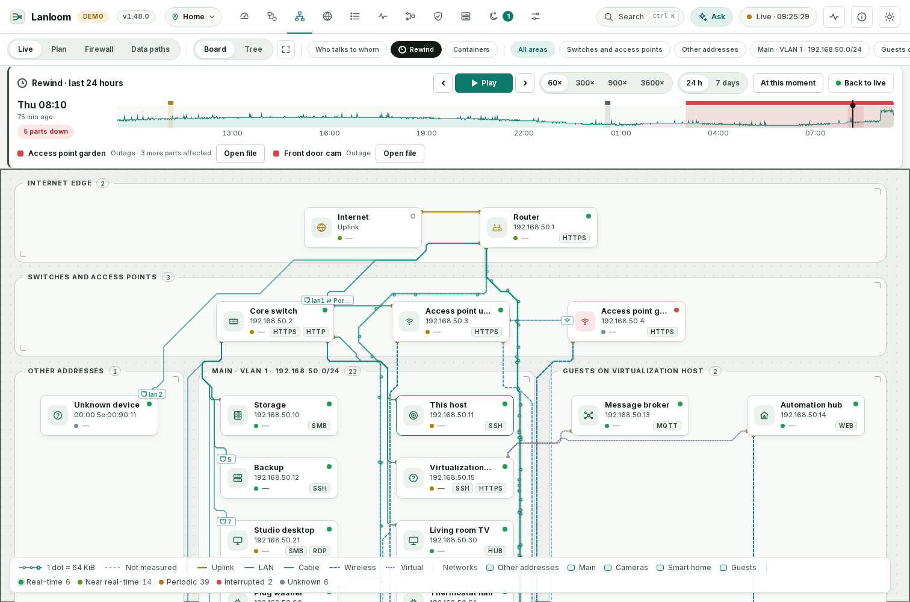
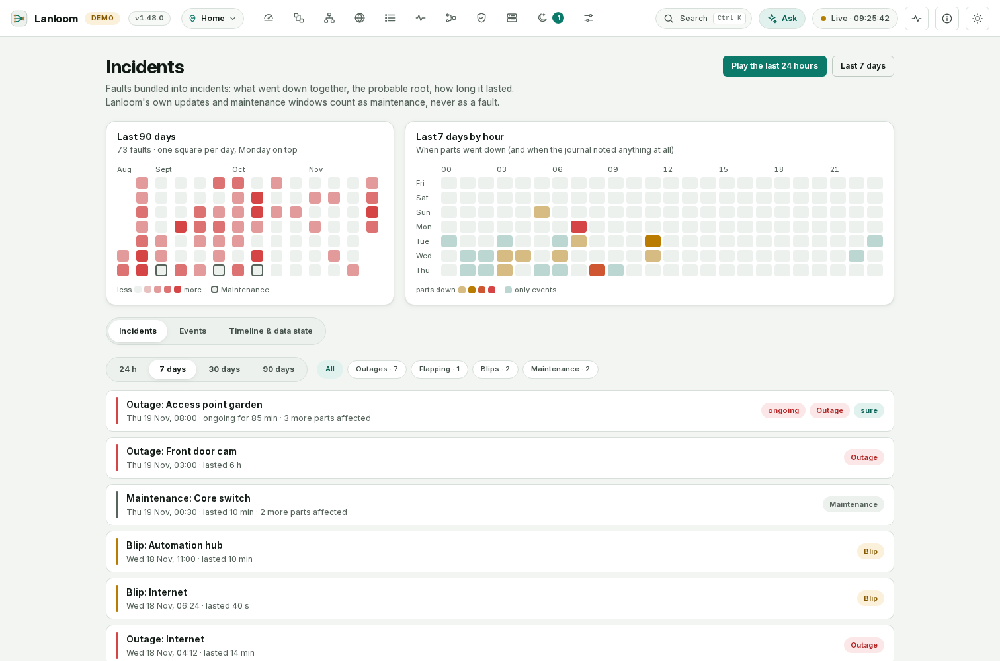
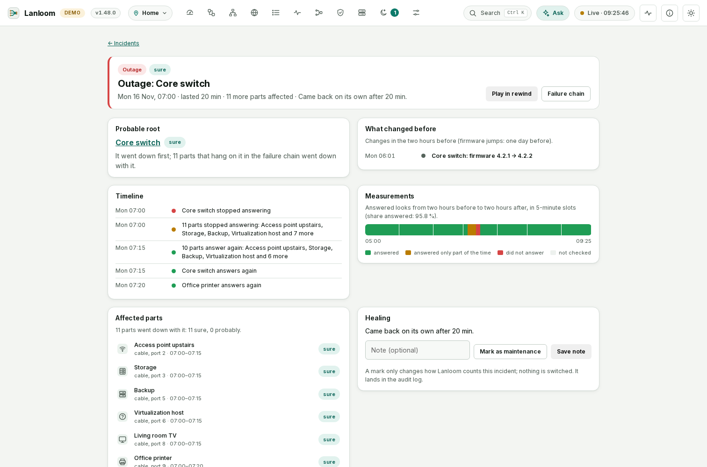
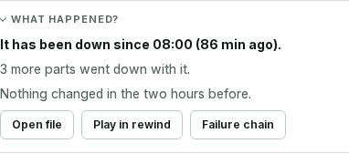
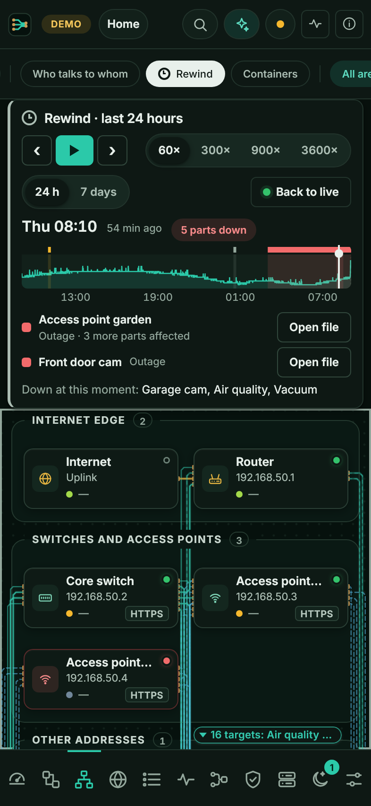
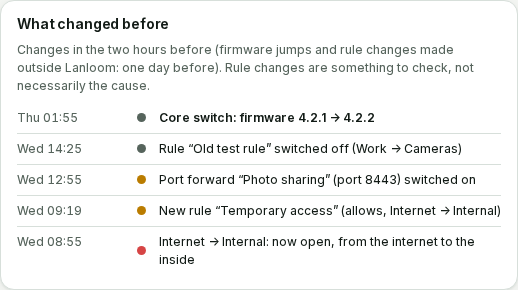

# Rewind and incidents

[Manual](README.md) · [Overview](overview.md) · [Map](map.md) · [Network](network.md) · [Devices](devices.md) · [Failure chain](failure-chain.md) · Rewind and incidents · [Nightly report](nightly-reports.md) · [Settings](settings.md)

## Purpose

Two ways to look back. The **rewind** plays the last 24 hours (or the last 7 days) on the map: the dots carry the traffic
of that moment, the tiles show which devices were down. The **incidents** page bundles faults into **incident files**:
what went down together, which part probably took the others with it, how long it lasted, what changed before and how it
healed. A calendar of 90 days, a heatmap of the last week, the event chronicle and the *Timeline & data state* answer
"when does this happen?" and "what changed lately?".

Everything comes from Lanloom's own history: the availability slots (one look at every device and connection a minute,
kept in 5-minute slots), the bytes per minute of every trace, the event journal and the failure chain. Nothing is guessed
and nothing is switched.

## What you see

- **The rewind bar** above the board: play / pause, one step back or forward, the speed (60×, 300×, 900×, 3600×), the range
  (24 hours, 7 days) and *Back to live*. Under it the **time line**: the activity (the busiest connection per step), the
  incidents as coloured bands on top (outage red, flapping and blips yellow, maintenance grey) and hatched stretches where
  Lanloom itself was not running. The read-out says the time of the cursor, how long ago that was and how many parts were
  down. *At this moment* names the incidents running at the cursor with a link to their file.
- **The board in the past.** Tiles take the state of that moment (down red, answered only part of the time yellow, not
  checked grey); their live figures stay empty, the dots carry the traffic of that minute (7 days: of those five minutes).
  The outage note of *now* rests while the rewind is open.
- **The incidents page** (`#/incidents`): the calendar of the last 90 days (one square per day, darker means more faults,
  a framed square only maintenance), the heatmap of the last 7 days by hour (when parts went down, light where the journal
  only noted something), then three tabs - *Incidents*, *Events* and *Timeline & data state*.

- **The list** names each incident with its kind and probable root ("Outage: Core switch", "Outage, probably at Access
  point upstairs"), when it started, how long it lasted, how many more parts went with it, and whether it is still going.
- **An incident file** (`#/incidents/<id>`): the **probable root** with its certainty and reason, **what changed before**
  (new devices, own updates, changes written to a controller, a connection that failed, a changed internet line in the two
  hours before, and firmware jumps and [rule changes made outside Lanloom](#rule-changes-made-outside-lanloom) of the day before), the **timeline** (parts that went down or came back together are one
  line), the **measurements** (the availability of the root from two hours before to two hours after) and the **affected
  parts** with how each hangs on the root.

- **Kinds.** *Outage* - a part went down. *Flapping* - it dropped out three or more times with only minutes in between.
  *Blip* - one short drop-out of at most ten minutes that healed on its own. *Maintenance* - inside a
  [maintenance window](settings.md), Lanloom's own update, or marked as maintenance by a person; never counted as a fault.
- **Sure and probably.** Devices that go down within ten minutes of each other are looked at together. A part that hangs
  on another one in the [failure chain](failure-chain.md) is listed under it - *sure* over a sure link, *probably* over a
  likely one. When several parts went down while the part they all hang on kept answering (or is not watched), that part is
  named as the **probable root**. Phones and computers come and go: they never start an incident on their own.
- **What happened?** on the card of a device that is down, or was down in the last 24 hours: since when, the probable root,
  how many parts went with it and the latest change before, with *Open file*, *Play in rewind* and *Failure chain*.

- **Timeline & data state** keeps what is worth remembering for more than a year: firmware and software versions that
  changed, Lanloom's own updates, devices seen for the first time and outages longer than an hour. Lanloom collects it once
  a day by itself (after the nightly report).
- **The start page** has the key figure *Incidents* (running ones, otherwise the last 7 days) and the card *Incidents of
  the night* with *Play the night*; on a phone that card is the quickest way in.

## How to use it

1. On the *Map* or *Network* view press **Rewind** in the row above the board (or the key `R`). The last 24 hours start to
   play from the beginning.
2. Keys while the rewind is open: `Space` play / pause · `←` `→` one step (with `Shift`: one hour, in 7 days one day) ·
   `1`-`4` the speed · `W` 24 hours / 7 days · `R` from the start of the range · `Esc` back to live. A click or drag on the
   time line moves the cursor; a double click on an incident band opens its file.
3. The command palette (`Ctrl K` / `⌘ K`) understands *Rewind the last 24 hours*, *Rewind the last 7 days* and a time:
   type `rewind to 14:30`, `rewind to yesterday 9:15`, `rewind to mon 8:00` or `rewind to 3 h` (German words work as well; in French, Spanish, Dutch and Italian the English words are the ones to type).
4. Open *Incidents* from the palette, the start page or a nightly report. Filter by range (24 hours to 90 days) and kind;
   a day of the calendar shows only that day.
5. In a file, *Play in rewind* opens the map a quarter of an hour before the incident; *Failure chain* shows what hangs on
   the root today.
6. Operators can mark an incident as maintenance (it then counts as maintenance in the calendar, the list and the nightly
   report) and add a short note; *Not maintenance* takes the mark back.

## Limits

- The rewind reaches back as far as the minute log: 7 days (8 days are kept). The incident list and the calendar reach 90
  days; the slots behind a file are kept 35 days (*Settings > Storage*), older files keep what was found then.
- One look a minute in 5-minute slots: an outage shorter than a minute can be missed, and times are exact to the minute
  only where the event journal has them.
- A slot without a look is *unknown*, never "down": while Lanloom itself does not run, nothing is counted against a device.
  An incident followed only by such slots stays open until a look finds the device again.
- The probable root is only as good as the topology Lanloom knows. Enter dependencies by hand on the card where it does not
  know them ([failure chain](failure-chain.md)).
- The traffic in the rewind is what the board measured per trace; a step is exact to about a fifth.

## Privacy

Everything stays on the Lanloom host: slot states, byte counts per trace, journal rows with device names, versions and
the incident files. No addresses of the outside world are kept for this, nothing is sent anywhere, and the AI is not
involved. Every role that sees the map may use the rewind and read incidents; marking an incident as maintenance needs the
operator role and lands in the [audit log](settings.md) (action `incident.mark`).

## See also

- [Failure chain and outages](failure-chain.md) - the dependency graph the bundling uses
- [Availability and stability](../AVAILABILITY.md) - the 5-minute slots
- [Nightly report](../NIGHTLY-REPORT.md) - the section *Incidents of the night*
- [Notifications](../NOTIFICATIONS.md) - planning a maintenance window
- [Command palette](../PALETTE.md) - *Rewind to …*

## Rule changes made outside Lanloom

Whoever changes a rule on the device, or in the controller's own interface, does not tell Lanloom. So Lanloom compares: every
time a connection reads the configuration of a controller it keeps a small state - the zones, which network lies in which
zone, the rules (name, action, from and to as zones, on or off, position, and a fingerprint of what the rule does), the port
forwards (name, outside port, on or off), the zone pairs that may talk and the mode of the intrusion detection. **No address
is ever in it**: of what a rule does only a fingerprint stays, a forward's destination is not kept, and a name that contains
an address is made unreadable.

- **Two reads in a row.** A new state counts only when two reads in a row agree, so a configuration that was read halfway
  does not show up as "rule gone" and a moment later as "rule new". The first state of a connection is the base state and
  says nothing. Hit counters and times never change the state.
- **Your own changes are not told twice.** A change the [firewall editor](../FIREWALL-EDITOR.md) wrote - or was writing at that
  moment - is already in the journal as *written to the controller*; a hand change in the same few minutes goes along with it.
- **What is noted** (event kind `fw_drift`): a zone pair now open (danger when from the internet to the inside or the
  gateway), partly open or closed; a rule new, removed, switched off or on, moved or acting differently (new action
  against the old); a port forward new, removed, switched or on another port; the intrusion detection switched (a controller
  that does not tell is never "off"); a network in another zone; a zone new or removed. A rule that moved is one line, not
  one for every rule that moved down. The rules a controller makes itself count only ("2 automatic rules changed").
- **Where it shows.** In the list of recent changes of the overview and the phone's *Now*, in the *Events* tab, in the
  [nightly report](nightly-reports.md) (section *Changed outside Lanloom*; what *Zone matrix* or the device family's own rule
  section already says is left out), and in an incident file: the rule changes of the site in the 24 hours before the start,
  danger first, at most six, with the controller named when the site has several - as something to check, not necessarily the
  cause.

Each site keeps its own state and its own events. Nothing is sent anywhere and nothing is written to a controller.
