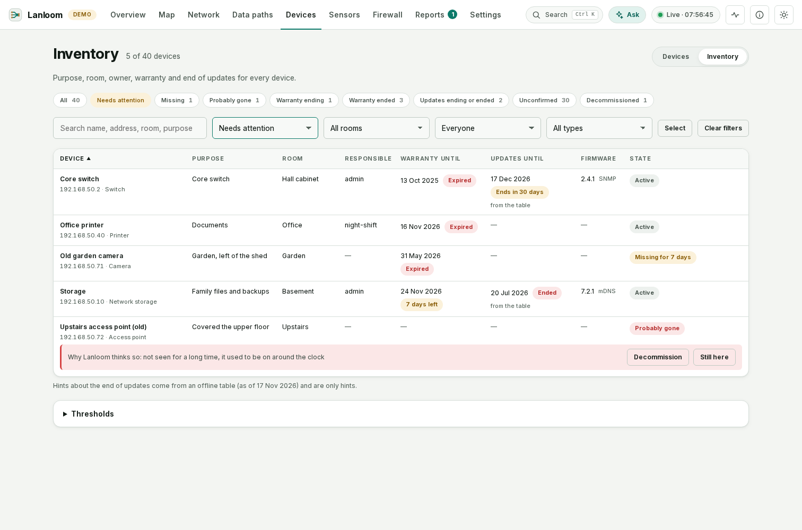
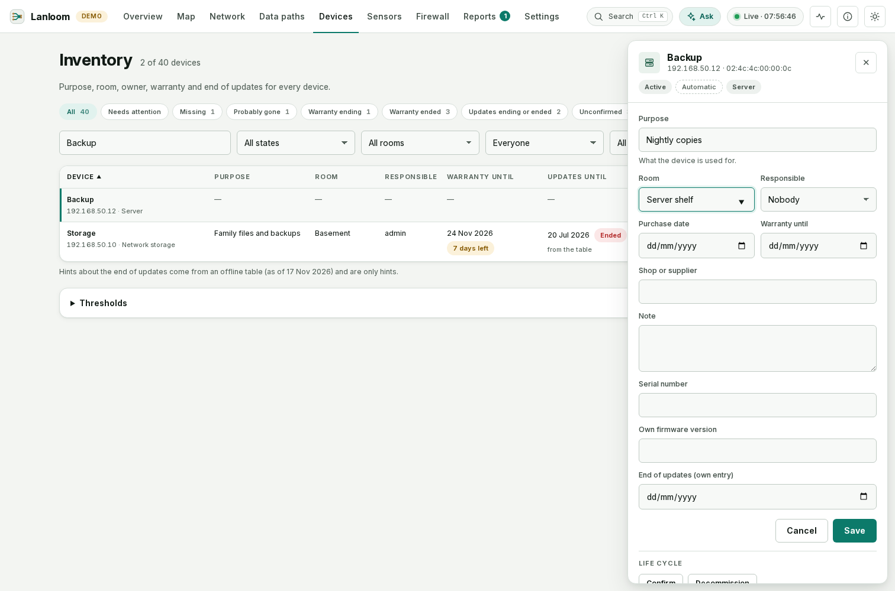

# Inventory

[Manual](README.md) · [Overview](overview.md) · [Map](map.md) · [Network](network.md) · [Devices](devices.md) · Inventory · [Firewall](firewall.md) · [Data paths](data-paths.md) · [Nightly report](nightly-reports.md) · [Automations](automations.md) · [Updating](updating.md) · [Settings](settings.md) · [AI](ai.md)

## Purpose

Lanloom finds your devices on its own. The inventory adds what only a person knows - what a device is for, where it
stands, when it was bought, how long it is covered - and follows each device over its whole life: seen, missing,
probably gone, decommissioned. It is part of the [device list](devices.md): the *Devices | Inventory* switch at the top
of the page (`#/inventory`, with filters such as `#/inventory?state=missing`).

## What you see

- **Quick filters** with counts: all, needs attention, missing, probably gone, warranty ending, warranty ended, updates
  ending or ended, unconfirmed, decommissioned. A chip is a link, so you can bookmark it.
- **A table** with a search over every field; sort by clicking a column header (empty values always last).
- **Found by Lanloom (read only)** next to **written down by people (own fields)**: name, kind, address, maker, model,
  firmware (with its source), last sign of life, first seen - and purpose, room, purchase date, warranty, shop, serial
  number of your own, responsible person, own firmware, own end-of-updates date.
- **States:** *Active*, *Missing* (no sign of life for N days, default 7), *Probably gone* (missing and the reasons
  add up to at least one half), *Decommissioned* (retired by a person; hidden from the map, kept as history).
- **Chips** for the warranty and the end of updates (from an offline table, advisory) in calm colours.
- On a phone the table becomes cards.

## How to use it

- **Click a row** to edit it (operators); viewers see the same without fields and buttons.
- **Select** puts a check box on each row and edits many devices at once: purpose, room, person, purchase date,
  warranty and shop (only the fields you fill in). Name, type and serial number are per device.
- **Probably gone** rows give the reasons and offer *Decommission* and *Still here*. Lanloom never decommissions on its
  own. *Decommission* asks for a date, the device that replaced it (optional) and a note; *Put back in service*
  reverses it.
- **Automatic entries are provisional** until someone confirms them (*Confirm*, or by touching them). A provisional
  entry without a sign of life for 7 days (setting; 0 = never) is removed once a day and noted in the nightly report.
  The gateway, the computer Lanloom runs on, every device a connected family or hub knows, and everything you confirmed
  are never removed this way.
- **Thresholds** (admins, folded away): days until missing, until probably gone, until provisional entries disappear,
  and the warning times for warranty and end of updates.
- Search (`Ctrl K`): *Open Inventory*, *Show devices that need attention*, *Show missing devices*, *Show warranties that
  end soon*, *Show devices whose updates end*.

## Limits

- Nothing is judged while Lanloom has not looked at the network for two days; the page says so.
- The end-of-updates table is **advisory**: it knows few products, so a missing chip means "unknown", not "supported".
  Your own end date always wins.
- Serial numbers are shown only when the device announced them itself; they are never copied from adapters.
- Text fields are cut to a sensible length and cleaned of control characters; dates are checked (a purchase date cannot
  lie in the future, a warranty cannot end before the purchase).

## Privacy

- **Read:** the scan data and the equipment lists of connected sources; the end-of-updates table is part of the image
  and nothing is asked online.
- **Stored:** your own fields in Lanloom's database (tables `inventory` and `device_alive`), included in every backup.
- **Sent:** nothing leaves your network. Serial numbers (yours and the reported ones) are hidden by the privacy layer
  from any text that goes to an AI service.
- **Roles:** everyone who sees the device list reads the inventory. Operators change own fields, confirm, decommission,
  put back in service and edit in bulk; admins also change the thresholds. The audit log records the names of the
  changed fields, never their values.

## See also

- [INVENTORY.md](../INVENTORY.md) - states, reasons, warranty and end-of-updates table, roles, API
- [DISCOVERY.md](../DISCOVERY.md) - what is found
- [NIGHTLY-REPORT.md](../NIGHTLY-REPORT.md) - the *Inventory* section
- [BACKUP.md](../BACKUP.md) - the own fields are part of every backup
