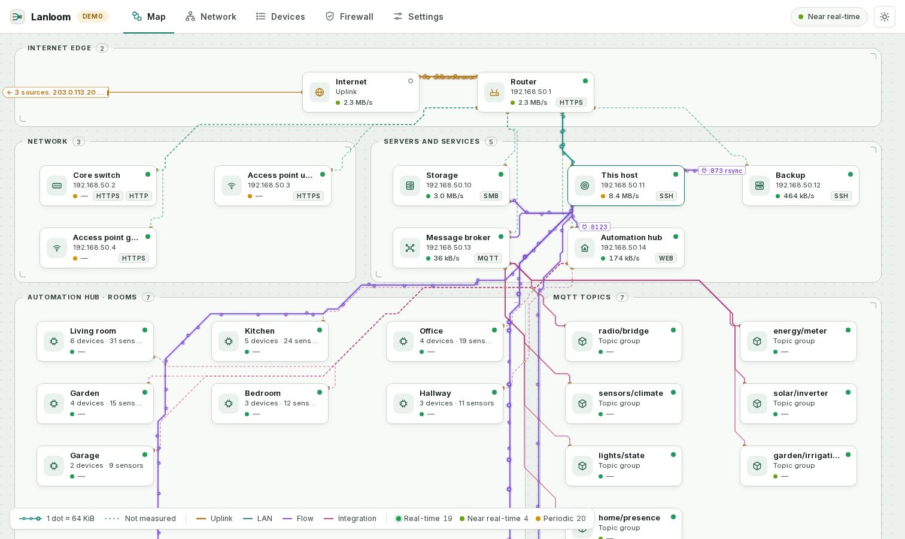
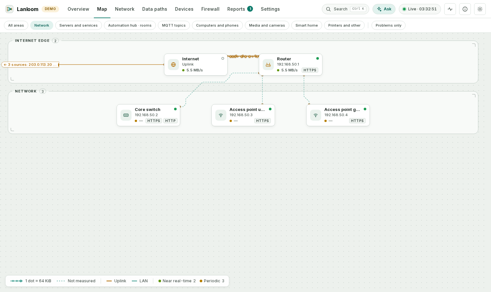
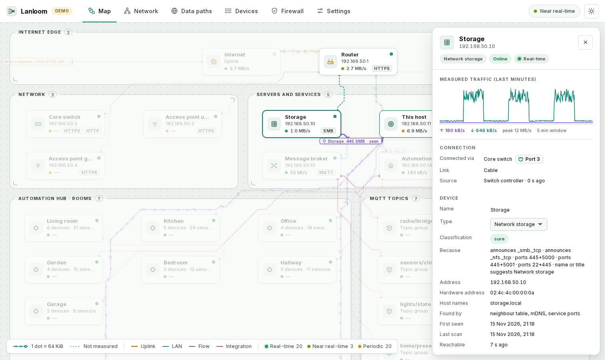
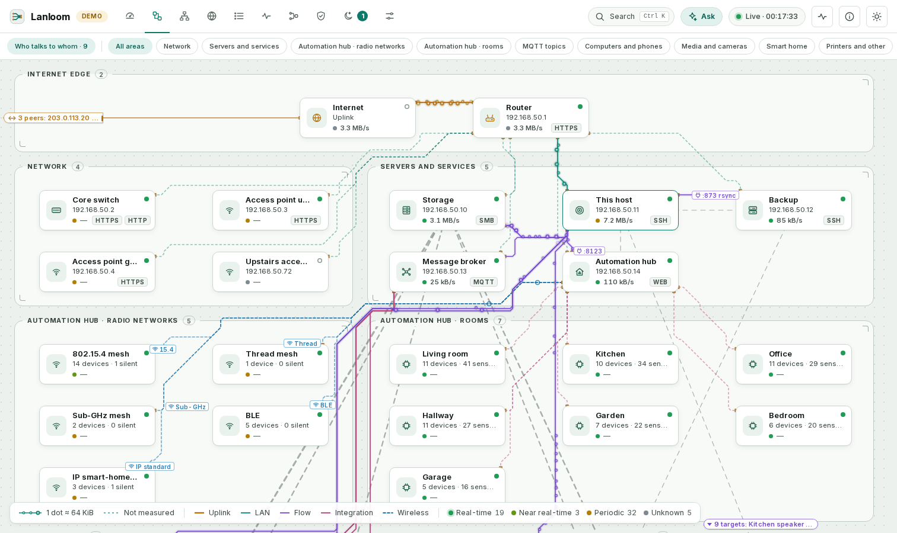

# Map

[Manual](README.md) · [Overview](overview.md) · Map · [Network](network.md) · [Devices](devices.md) · [Inventory](inventory.md) · [Vulnerabilities](vulnerabilities.md) · [Firewall](firewall.md) · [Data paths](data-paths.md) · [Nightly report](nightly-reports.md) · [Automations](automations.md) · [Running](running.md) · [Sites](sites.md) · [Updating](updating.md) · [Settings](settings.md) · [AI](ai.md)

## Purpose

Your network drawn like a circuit board: every device is a component, every connection a trace. It shows what is
there, what talks to what, and what is down, in one picture.

## What you see

- **Components** for devices, hubs, controllers and the internet edge; the dot at a component is its live grade (see
  the pill at the top right).
- **Traces** for connections. Moving dots are measured bytes; nothing is animated that was not measured. The line
  styles tell the kind of link (cable, radio, service, flow, integration, uplink).
- **Zones** are the areas of the board, one per network or VLAN, titled with its name, VLAN number and range.
- **Containers** of a host that reports to Lanloom (an optional [host agent](../HOST-AGENT.md) or a container source) are drawn as small components **folded into the host**. Open one host with the button on its card, or all of them with the **Containers** chip; the state is kept in this browser. See [Running](running.md).
- **Dashed "talks to" lines** join a host that runs an agent and the devices it exchanges measured traffic with; they fade a few minutes after the traffic ends.
- **The legend** at the bottom names the line styles. Each line style in it is a switch: a click hides that kind of
  line on the whole board (with its dots, port marks and end marks), a second click shows it again, *Show all* brings
  every kind back. A hidden kind is greyed and struck through; each board remembers its own choice in this browser.
- **Chips above the board** filter by **area** (one zone of the board; the internet edge stays for orientation) or
  show **problems only** (components that are down or whose data stopped).
- **Hover window.** Rest the mouse on a tile for half a second: the traffic of the last hour and the availability of
  the last 24 hours.
- **Card.** A click on a component opens its card with identity, status, services, availability, traffic and what can be changed
  (operators).

## How to use it

- Click a component to open its card; the address follows (`#/map/<component>`), so the card can be shared and the
  back key closes it.
- Click *Wireless*, *Cable*, *Flow* or another line style in the legend to hide it, for example to see only the
  wireless links or only the flows of a busy network; click it again (or *Show all*) to bring it back.
- Use the area chips to look at one network or one cabinet at a time (`#/map?zone=<area>`), or *Problems only*
  (`#/map?only=problems`).
- **Who talks to whom** (the first chip, `#/map?talk=1`) draws dashed lines in the air between devices that talk to each
  other in the last 24 hours, width by bytes. It needs NetFlow from your router (see [Data paths](data-paths.md)); the
  lines of the open card light up. The card's *Where does it talk to?* lists the same conversations by name, plus the
  countries on the internet.
- Magnify the board with the mouse wheel or two fingers.
- Search (`Ctrl K`) finds components and devices and offers actions such as *Show availability* or *Show traffic
  history*.
- On the card, operators can rename a device, correct its type, hide it from the map, join two interfaces of one
  device, set a protection class for the scan, and set a manual connection.
- The card sections (availability, traffic, connections, *Simulate maintenance*) fold and keep their state while the
  page updates.

## Limits

- Dots show measured bytes only. A trace without measurement stays still; it does not mean there is no traffic.
- Where no cabling is known, traces run from this host's point of view directly; the [Network](network.md) view shows
  the physical order when sources for it exist.
- Large networks are drawn with many traces bundled into trunks; the animation steps down on weak graphics (see
  *Map animation* under [Settings](settings.md#general)).
- The dashed lines are conversations seen by the router, not cables, and traffic inside one switch is not seen.
- *Simulate maintenance* is a simulation read from the known topology; nothing is switched off.

## Privacy

- **Read:** the device list, the live traces of the last minutes, the availability history, the topology Lanloom has
  resolved.
- **Stored in the browser:** the map animation setting, theme and palette, and the line styles you hid in the legend
  (one list per board, this browser only).
- **Sent:** nothing outside your Lanloom. Zooming, filtering and the hover window are computed locally or from Lanloom's
  own database.
- **Roles:** every role looks at the map and its cards. Operators change names, types, hidden state, manual connections,
  protection classes and groupings; every change is written to the audit log. Admins also see the location fields of
  the site.

## See also

- [DISCOVERY.md](../DISCOVERY.md) - how devices are recognised and grouped
- [AVAILABILITY.md](../AVAILABILITY.md) - availability, traffic plots, hover window and *Simulate maintenance*
- [Running](running.md) and [HOST-AGENT.md](../HOST-AGENT.md) - containers and "talks to" lines
- [DNS-FILTER.md](../DNS-FILTER.md) - the card of a DNS filter and the *DNS* section of a device
- [TOPOLOGY.md](../TOPOLOGY.md) - where the traces come from
- [PERFORMANCE.md](../PERFORMANCE.md#the-map-in-the-browser) - the frame budget of the map
- [PALETTE.md](../PALETTE.md) - search and commands
