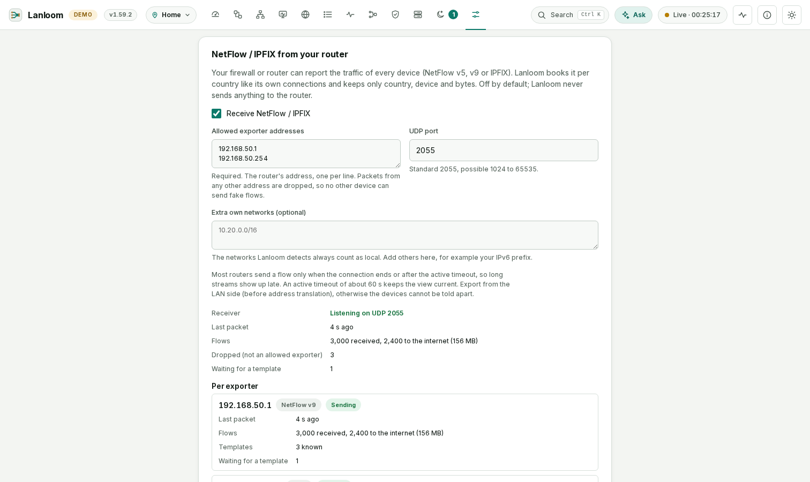
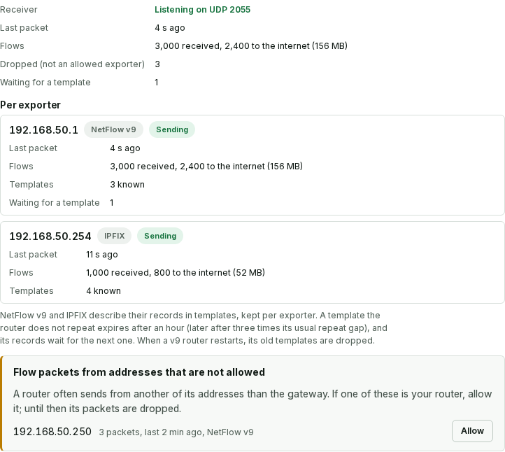
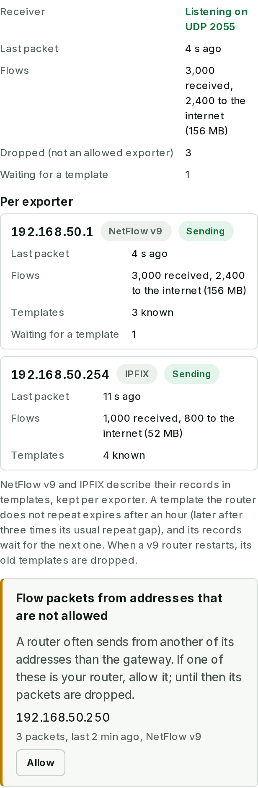

# NetFlow / IPFIX from your router

## Purpose

Without help Lanloom only sees the connections of the computer it runs on. Your firewall or router sees the traffic of
every device on the network and can report it as flow records: **NetFlow v5**, **NetFlow v9** or **IPFIX**. Lanloom
receives them, books the bytes per device and country into the [Data paths](data-paths.md), draws who talks to whom on
the [Map](map.md) and compares the sum with the router's uplink counter in the nightly report. The receiver is part of
Lanloom; no second container or script is needed.

## What you see

*Settings > General > NetFlow / IPFIX from your router* (administrators):

- **Receive NetFlow / IPFIX**, **Allowed exporter addresses** (required, up to 8, one per line; while the field is empty a
  button offers the gateway Lanloom detected), the **UDP port** (2055 by default) and **Extra own networks**.
- **Receiver**: the port it listens on (or why it cannot), the last packet, flows received and how many of them went to the
  internet with their bytes, packets dropped because they came from an address that is not allowed, records waiting for
  a template and unreadable packets.
- **Per exporter**: one block for every allowed address with its protocol (*NetFlow v5*, *NetFlow v9* or *IPFIX*), its
  state (*Sending*, *Quiet for* how long, or *Nothing received yet*), the last packet, flows and bytes, the templates it
  sent (with how many expired and how many restarts were seen), and its own waiting and unreadable counts.
- **Flow packets from addresses that are not allowed**: when flow packets arrive from an address that is not on the list
  (a router often sends from another of its addresses than the gateway), the address is listed with the number of packets,
  when the last one came and its protocol, and an **Allow** button. Nothing is added on its own; the last 8 senders of the
  past 24 hours are shown.

## How to use it

1. Enter the router's address under **Allowed exporter addresses**, keep port 2055 or pick another from 1024 to 65535,
   tick **Receive NetFlow / IPFIX** and save.
2. On the router or firewall, turn on flow export (also called flow monitoring or traffic accounting) to the address of
   the Lanloom host and that port. Export from the **LAN side, before address translation**, set the **active timeout to
   about 60 seconds**, and on firewalls that export per rule, enable logging on the rule from the LAN to the internet.
3. Within a minute the exporter's block should say *Sending*. NetFlow v9 and IPFIX first send a description of their
   records (a template); records that arrive before it are counted under *Waiting for a template* and stop once it
   arrives.
4. If the block stays at *Nothing received yet* but an address shows up under *Flow packets from addresses that are not
   allowed*, the router sends from that address: press **Allow** next to it (it is added to the list and saved).

Details and every router setting: [DATA-PATHS.md](../DATA-PATHS.md#setting-up-netflow--ipfix).

## Limits

- Templates are kept per exporter, protocol and observation domain, so two routers using the same template numbers never
  mix. A template that the router does not repeat expires after one hour, later after three times the longest gap seen
  between two repeats (at most six hours); its records then wait for the next template instead of being read with a
  layout that may have changed.
- When a NetFlow v9 router restarts (its uptime jumps back), its old templates and its sampling rate are dropped before
  the packet is read; the restart is counted in its block. IPFIX has no uptime in its header, there the lifetime applies.
- Options templates and their records describe the exporter, not traffic; they are skipped. Only a sampling rate
  announced in them (1 of N packets) is used to scale up the bytes of that exporter.
- Up to 8 exporters, 512 templates per exporter and 128 fields per template; anything larger is refused and counted.
- NetFlow v5 carries IPv4 only; v9 and IPFIX carry IPv4 and IPv6. Vendor-specific fields are read past, never used.
- Flows of the Lanloom host itself are skipped (the host source counts them exactly), traffic between two local devices
  is a conversation, not a data path.
- Most routers export a flow when the connection ends or the active timeout runs out, so traffic appears with that delay.

## Privacy

- **Read:** flow records from the allowed exporters only; packets from any other address are dropped and counted, and
  for flow packets the sender address is shown to administrators so it can be allowed.
- **Stored:** only country, device id and bytes per hour and day, and for conversations between two devices the two ids
  and the bytes, as in [Data paths](data-paths.md#privacy). Peer addresses, ports, protocols and interface names of the
  records are read in memory and dropped. Templates, counters and the list of refused senders live in memory only and
  are gone after a restart.
- **Sent:** nothing. Lanloom never sends anything to the router.
- **Roles:** administrators set up the receiver and see its state; the receiver belongs to the home site.

## See also

- [Data paths](data-paths.md) - the view the flows feed
- [DATA-PATHS.md](../DATA-PATHS.md#setting-up-netflow--ipfix) - set-up on the router, how flows are booked
- [TROUBLESHOOTING.md](../TROUBLESHOOTING.md#data-paths-and-netflow) - when no flows arrive
- [Settings](settings.md) - where the card lives
