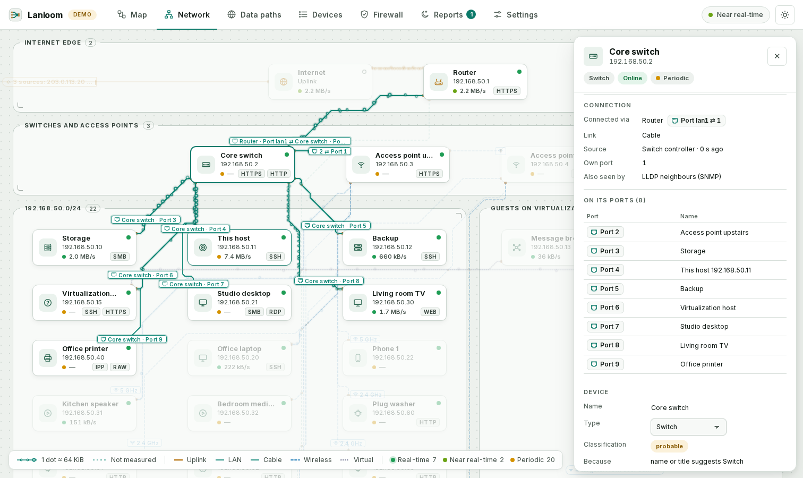

# Network

[Manual](README.md) · [Overview](overview.md) · [Map](map.md) · Network · [Devices](devices.md) · [Inventory](inventory.md) · [Firewall](firewall.md) · [Data paths](data-paths.md) · [Nightly report](nightly-reports.md) · [Automations](automations.md) · [Updating](updating.md) · [Settings](settings.md) · [AI](ai.md)

## Purpose

The same devices as on the [map](map.md), ordered by how they are physically connected: which switch port or access
point each one hangs on, and which guests run on which virtualization host. It answers "where is this device plugged
in?".

## What you see

- **Cables** as solid traces, **wireless links** as dashed traces with a radio mark, **guests on a host** as dotted
  traces. The port number (or the wireless band and network name) sits at the device end of the trace.
- **Zones** per network or VLAN, with the same area chips as on the map.
- **Cards** of switches and access points list the devices on their ports.
- **The deciding source.** The card of a device says which source placed it, which others agree and what the rest say
  ("Switch controller says Core switch - Port 10. Manual entry has priority.").
- **Live traffic** along the cabling: traffic to a storage server runs up to the switch and down again; internet
  traffic runs up to the router.

### Board or tree

The switch **Board | Tree** above the view changes its face. The **tree** shows the same chain as a list that folds:
Internet, gateway, switches and access points, then devices and guests, each line with the link (cable and port,
wireless band and network name, or virtual), the live traffic as a number and the state as a word. It is also the text
alternative of the picture for screen readers and can be walked with the arrow keys (`?` lists the keys). Your choice is
kept in the browser. See [Accessibility](../ACCESSIBILITY.md).

## How to use it

- Open a device and read *Source* to see who placed it; the warning box lists what other sources say.
- To correct a placement, open the device and scroll to **Connected via (manual)**: choose the device it is plugged
  into, optionally the port, and the link type (cable, wireless, virtual). A manual entry always wins; *Remove* goes
  back to the automatic sources.
- To get more of the picture, add sources: a switch controller or device-family adapter with a read-only account, a
  hypervisor adapter with a read-only token, or SNMP with LLDP and the address table (*Settings > General >
  Connections*, see [Settings](settings.md#general)).
- The sources are read in a fixed order of precedence: manual entry, hypervisor, switch controller, LLDP, switch address
  table. Unknown values stay empty; nothing is guessed.

## Limits

- Without any of the sources the view shows the gateway and one zone per subnet, as the map does.
- Only devices that are also in Lanloom's device list are placed; run a scan if a reported device is missing.
- A port with 12 or more addresses and no switch among them (address table only) is treated as a trunk to somewhere
  else: nothing is assigned from it.
- Where a port has several devices behind it, the rules for shared ports apply (a switch or access point behind the
  port takes the others, hypervisor guests are shown as guests); otherwise every device stays on the port with a note.
- Everything here is read-only. Lanloom never changes a switch, controller or hypervisor from this view.

## Privacy

- **Read:** from your own devices only, once a minute: client and device lists of a switch controller (`GET` requests
  only, after one sign-in), LLDP and address tables over SNMP (Get, GetNext, GetBulk only), node and network card lists
  of a hypervisor.
- **Stored:** the resolved links in Lanloom's database on the host (part of the backup); credentials of connections
  encrypted with the instance key. Nothing leaves your network.
- **Raw data:** `GET /api/topology` (signed in) returns the resolved links as JSON. It holds hardware and IP addresses
  of your network, so check it before you share it.
- **Roles:** every role looks. Operators set manual connections. Admins add and remove connections and their credentials.

## See also

- [ACCESSIBILITY.md](../ACCESSIBILITY.md) - the tree view, the keyboard, screen readers
- [TOPOLOGY.md](../TOPOLOGY.md) - sources, precedence, manual entry, shared ports, troubleshooting
- [COMPATIBILITY.md](../COMPATIBILITY.md) - which device families can be read
- [DISCOVERY.md](../DISCOVERY.md#networks-and-vlans) - networks, VLANs and what is scanned across routers
- [INTEGRATIONS.md](../INTEGRATIONS.md) - how adapters are built
