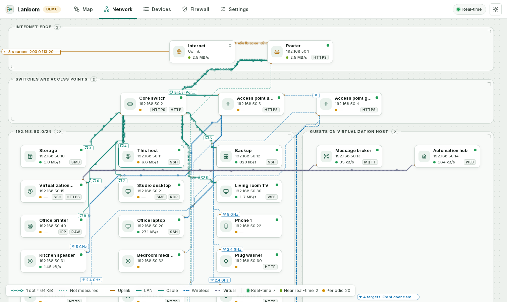
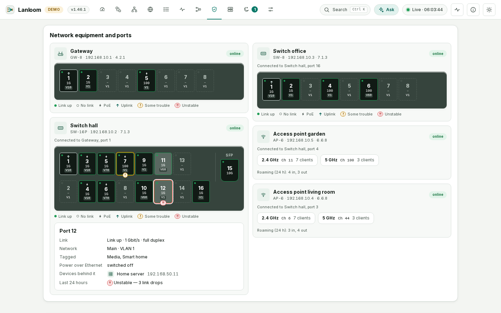
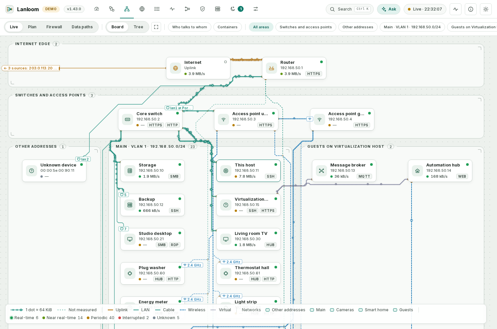
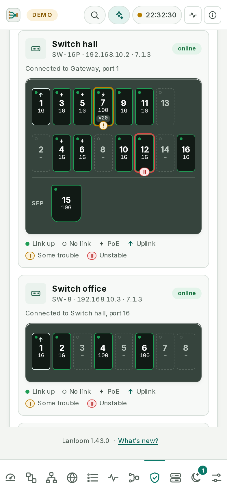
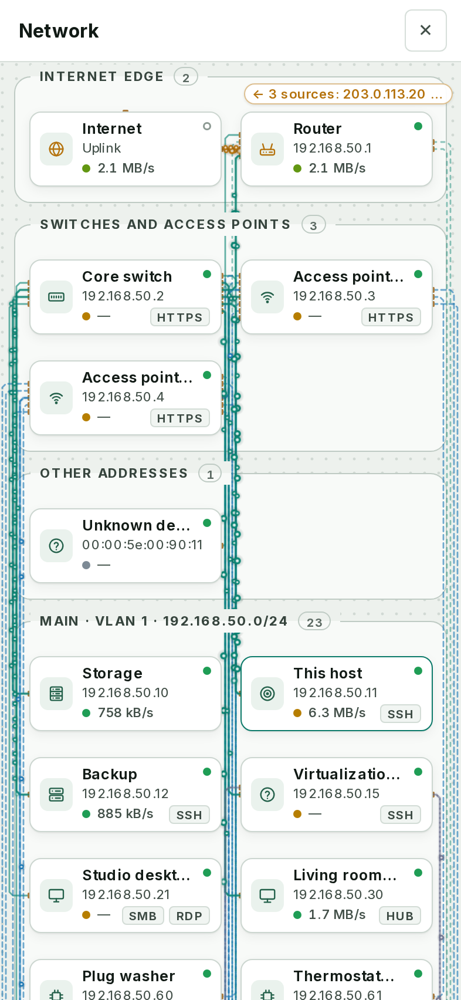
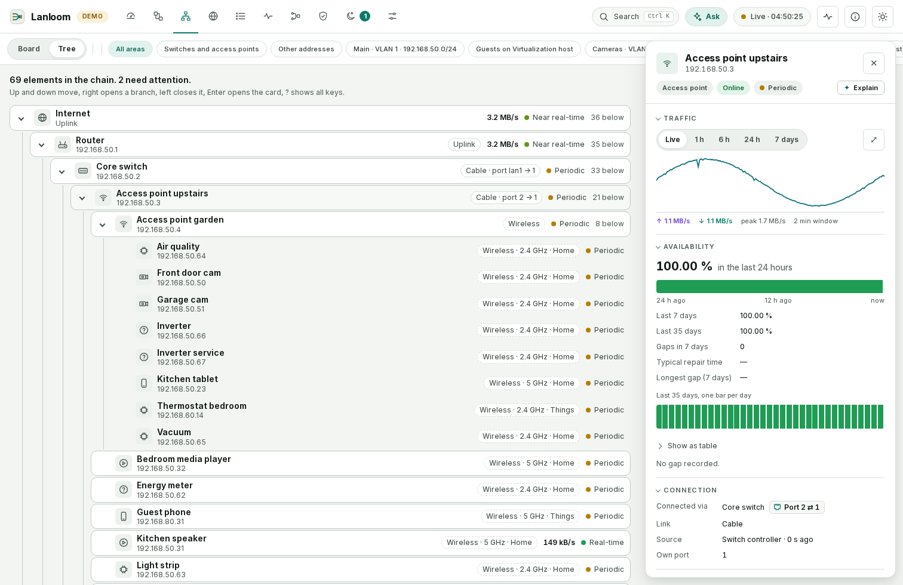
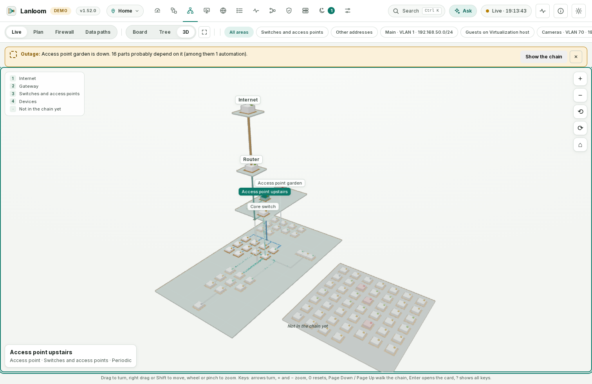
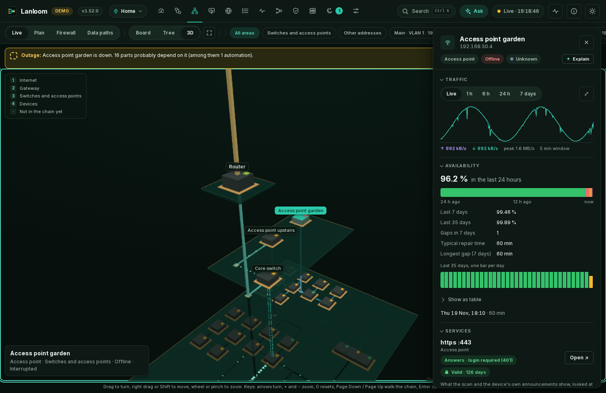
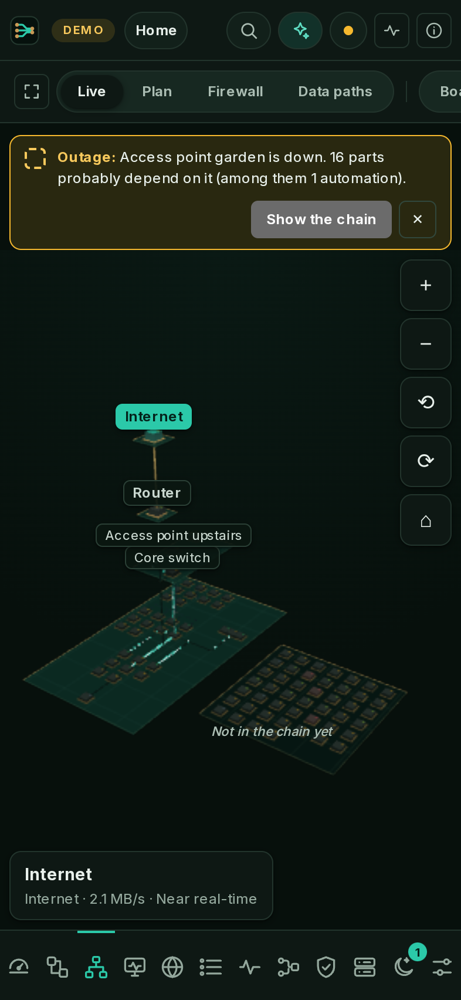

# Network

[Manual](README.md) · [Overview](overview.md) · [Map](map.md) · Network · [Devices](devices.md) · [Inventory](inventory.md) · [Vulnerabilities](vulnerabilities.md) · [Firewall](firewall.md) · [Data paths](data-paths.md) · [Nightly report](nightly-reports.md) · [Automations](automations.md) · [Running](running.md) · [Sites](sites.md) · [Updating](updating.md) · [Settings](settings.md) · [AI](ai.md)

## Purpose

The same devices as on the [map](map.md), ordered by how they are physically connected: which switch port or access
point each one hangs on, and which guests run on which virtualization host. It answers "where is this device plugged
in?".

## What you see

- **Cables** as solid traces, **wireless links** as dashed traces with a radio mark, **guests on a host** as dotted
  traces. The port number (or the wireless band and network name) sits at the device end of the trace.
- **Zones** per network or VLAN, with the same area chips as on the map.
- **Legend switches** as on the [map](map.md#what-you-see): click *Cable*, *Wireless* or *Virtual* to hide that kind of
  link; the network view keeps its own choice, apart from the map.
- **Cards** of switches and access points list the devices on their ports and, when a switch controller is read, show the
  **front panel**: every port as it sits on the hardware (odd numbers above, even below, SFP cages apart) with link, speed,
  power over Ethernet (also when it is switched off), uplink, VLAN, the port profile, the tagged networks (all networks,
  none, or the names of a choice), the devices behind it, and how often the link dropped or counted errors in the last
  24 hours (none: fine, one or two: some trouble, three or more: unstable - always with a symbol and a word, not only a
  colour). A port opens a detail line with the live rate. An access point shows its radios with channel and clients now,
  and how often devices moved to or from it in 24 hours. The same panels are in the equipment card of the
  [Firewall](firewall.md) tab.
- **Exact traffic on cables.** Where one device sits alone on a switch port, the dots on its cable follow the counters of
  that port instead of the host's own flows. Optional: *Settings > General > Appearance* can take the background noise out
  of these counters (what every device of one network receives anyway - broadcasts and multicast - is subtracted when at
  least three ports of the network are measured).
- **Quiet devices.** A network with more than 12 devices folds the ones that idle by nature (smart devices, printers,
  media players) into one tile *N quiet devices*; a click unfolds them (remembered per network). A device that is down or
  interrupted never folds, and a card opened by address or from the search unfolds its network.
- **Mode switch** *Live | Plan | Firewall | Data paths* at the start of the filter row, and a **legend** that holds the
  line styles and the networks in one strip: a network in the legend filters the board like its chip.
- **Full screen** (the button after the *Board | Tree | 3D* switch) opens the board over the whole window; on a phone it uses
  the compact layout. *Esc*, the close button and the back gesture close it.
- **The deciding source.** The card of a device says which source placed it, which others agree and what the rest say
  ("Switch controller says Core switch - Port 10. Manual entry has priority.").
- **Containers** of a host with a [host agent](../HOST-AGENT.md) hang below that host, folded as on the [map](map.md) (the *Containers* chip or the button on the host card unfolds them), next to the guests of a virtualization host.
- **Live traffic** along the cabling: traffic to a storage server runs up to the switch and down again; internet
  traffic runs up to the router.

To change a port (name, profile, networks, power) use the firewall editor: see [Switch ports](firewall.md#switch-ports).

 

### Board, tree or 3D

The switch **Board | Tree | 3D** above the view changes its face. The **tree** shows the same chain as a list that folds:
Internet, gateway, switches and access points, then devices and guests, each line with the link (cable and port,
wireless band and network name, or virtual), the live traffic as a number and the state as a word. It is also the text
alternative of the picture for screen readers and can be walked with the arrow keys (`?` lists the keys). Your choice is
kept in the browser. See [Accessibility](../ACCESSIBILITY.md).

### The network in 3D

The third face, **3D**, shows the same chain as a stack of circuit boards: the Internet on top, then the gateway, then
switches and access points, then the devices, one board per step. Every component is a chip on its board with its status
light, every cable a copper trace with a via down to the board below (wireless links dashed, guests on a host dotted),
and the live traffic runs along the traces as dots, as on the flat board. Devices that sit in no chain yet get a board
of their own beside the device board, labelled *Not in the chain yet*.

- **Turn, tilt and zoom:** drag with the mouse or one finger; right drag or *Shift* + drag moves the stack; the wheel or
  two fingers zoom. The buttons on the right zoom, turn and go back to the whole stack.
- **Keyboard:** the scene is one tab stop. Arrows turn and tilt (*Shift* + arrows move), `+` and `-` zoom, `0` goes back
  to the whole stack, `Page Down` / `Page Up` walk the chain element by element (the camera follows, the element is
  read out and named in the corner), `Home` and `End` jump to its ends, a letter jumps to the next name that starts with
  it, `Enter` or `Space` opens the card.
- **Pointer and focus light the chain:** the way of the element up to the Internet and its direct children stay bright,
  the rest steps back.
- **Graphics acceleration is required.** The 3D view draws with the graphics card of the device. A browser that only has
  a software renderer (some small single-board computers, virtual machines, remote desktops) or no WebGL at all gets a
  short note and the flat board instead, so the processor is never spent on the picture. *Try anyway* stores the choice
  in this browser; the view then draws fewer frames and dots and says so.
- **Frame budget:** nothing is drawn while nothing changes; the frame rate follows *Settings › Appearance › Map
  animation* (*Off* shows no moving dots), steps itself down when frames take too long and rests while the tab is hidden
  or the view is out of sight. With reduced motion in the system settings the traces only glow.
- `#/network?v=3d` opens the 3D view directly; the command palette has *Go to 3D view of the network*.

 

## How to use it

- Open a device and read *Source* to see who placed it; the warning box lists what other sources say.
- To correct a placement, open the device and scroll to **Connected via (manual)**: choose the device it is plugged
  into, optionally the port, and the link type (cable, wireless, virtual). A manual entry always wins; *Remove* goes
  back to the automatic sources.
- To get more of the picture, add sources: a switch controller or device-family adapter with a read-only account, a
  hypervisor adapter with a read-only token, or SNMP with LLDP and the address table (*Settings > General >
  Connections*, see [Settings](settings.md#general)).
- The sources are read in a fixed order of precedence: manual entry, hypervisor, switch controller, LLDP, switch address
  table. Unknown values stay empty; nothing is guessed.

## Limits

- Without any of the sources the view shows the gateway and one zone per subnet, as the map does.
- Only devices that are also in Lanloom's device list are placed; run a scan if a reported device is missing.
- A port with 12 or more addresses and no switch among them (address table only) is treated as a trunk to somewhere
  else: nothing is assigned from it.
- Where a port has several devices behind it, the rules for shared ports apply (a switch or access point behind the
  port takes the others, hypervisor guests are shown as guests); otherwise every device stays on the port with a note.
- Everything here is read-only; ports are changed in the [firewall editor](firewall.md#switch-ports). Lanloom never changes a switch, controller or hypervisor from this view.

## Privacy

- **Read:** from your own devices only, once a minute: client and device lists of a switch controller (`GET` requests
  only, after one sign-in), LLDP and address tables over SNMP (Get, GetNext, GetBulk only), node and network card lists
  of a hypervisor.
- **Stored:** the resolved links in Lanloom's database on the host (part of the backup); credentials of connections
  encrypted with the instance key. Nothing leaves your network.
- **Raw data:** `GET /api/topology` (signed in) returns the resolved links as JSON. It holds hardware and IP addresses
  of your network, so check it before you share it.
- **Roles:** every role looks. Operators set manual connections. Admins add and remove connections and their credentials.

## See also

- [ACCESSIBILITY.md](../ACCESSIBILITY.md) - the tree view, the keyboard, screen readers
- [TOPOLOGY.md](../TOPOLOGY.md) - sources, precedence, manual entry, shared ports, troubleshooting
- [Failure chain and outages](failure-chain.md) - what fails if a switch or access point fails, simulated maintenance, the outage automatic
- [COMPATIBILITY.md](../COMPATIBILITY.md) - which device families can be read
- [DISCOVERY.md](../DISCOVERY.md#networks-and-vlans) - networks, VLANs and what is scanned across routers
- [INTEGRATIONS.md](../INTEGRATIONS.md) - how adapters are built
