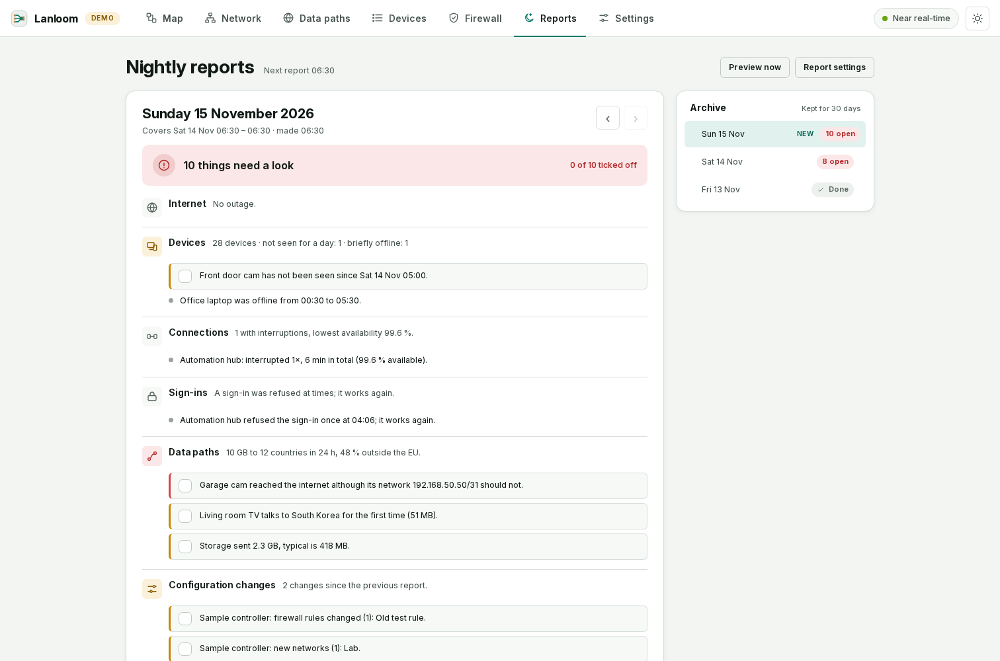
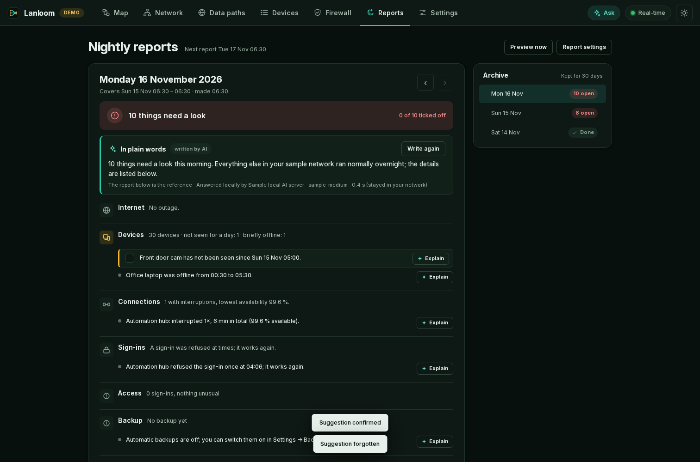
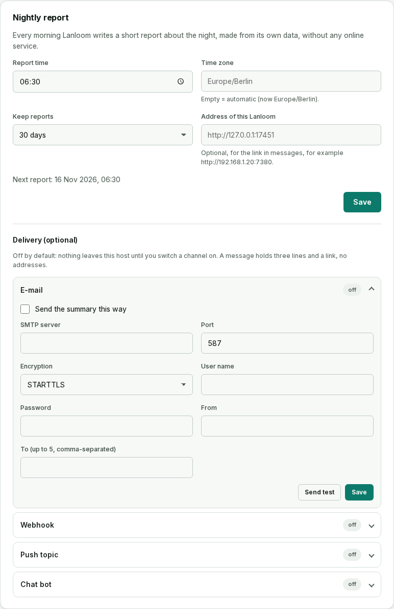

# Nightly report

[Manual](README.md) · [Overview](overview.md) · [Map](map.md) · [Network](network.md) · [Devices](devices.md) · [Inventory](inventory.md) · [Vulnerabilities](vulnerabilities.md) · [Firewall](firewall.md) · [Data paths](data-paths.md) · Nightly report · [Automations](automations.md) · [Running](running.md) · [Sites](sites.md) · [Updating](updating.md) · [Settings](settings.md) · [AI](ai.md)

## Purpose

Every morning Lanloom writes a short report about the night: what happened in your network since the previous report,
in plain words, with points to tick off. It is Lanloom's quiet way to tell you what it could not heal on its own, so
that you do not have to watch the screen. The report is made from Lanloom's own data by fixed rules; no AI and no online
service is involved in making it.

## What you see

- **The headline:** "All quiet", or "N things need a look".
- **One section per source**, shown only when the source exists: internet outages, devices (new, gone, back), connections,
  availability, early warnings (host values that reach their limit within 72 hours), switch ports (links that dropped or counted errors, devices that moved between access points), sign-ins, counter check, data paths, home automation, controller configuration, changes written,
  device families, certificates, API, AI, storage, inventory, backup, notifications, access, and Lanloom itself. The table of
  sections with what makes each one "need a look" is in [NIGHTLY-REPORT.md](../NIGHTLY-REPORT.md#what-is-in-it).
- **Points to tick off.** Things that need a look can be ticked; the mark is stored with the report and shown with the
  time.
- **Archive** of older reports (kept for 30 days by default; 7, 14, 30, 90 or 365 days), each with its own address
  (`#/reports/2026-11-16`).
- **Badge** on the Reports tab, on the map and in the phone tab bar while a report is unread.
- **In plain words** (optional, with an AI set up): a short paragraph above the report, written after the report is made
  and never part of it.

## How to use it

- The newest report opens first; the back key returns to the one you read before.
- Opening a report marks it read; tick the points you have dealt with (operators).
- **Preview now** shows how the next report would look at this moment. It is neither saved nor sent.
- **Delivery (optional, administrators).** Under *Settings > General > Nightly report* switch on e-mail, a webhook, a
  push topic or a chat bot. Each sends a short version (title, headline, two lines, an optional link), once a morning.
  **Send test** sends a sample message. A failed delivery is retried up to three times, every 15 minutes.
- The time (default 06:30) and the time zone are set in the same card.
- Notification rules (see [Settings](settings.md#notifications)) decide what you hear about sooner than the next morning.

## Limits

- If Lanloom was not running at report time, the report is made at the next start and says so in one line; after several
  mornings off, one report covers the whole time.
- Short interruptions, a phone that sleeps at night or a 40-second flap are listed as notes, not as things that need a
  look.
- The first report comes on the first morning after installation.
- A section reports only what its source can see: without a router connection there is no internet section.
- Delivery is a short summary only; device ids and other internal values are never sent.

## Privacy

- **Read:** Lanloom's own data (event journal, device list, connections, history). To read certificate expiry dates,
  Lanloom opens one TLS handshake per morning to the addresses of your own connections and nothing else.
- **Stored:** reports and your ticks in Lanloom's database on the host (retention in the report settings and under *Settings > Storage*), included
  in backups when you choose to include history.
- **Sent:** nothing, unless an administrator switches on a delivery channel. Then a short summary goes to the address
  you entered, once a morning. Passwords, tokens, the webhook address and the push topic are stored encrypted and never
  logged; failures are shown as reason codes without the address. The *In plain words* paragraph goes into a delivery
  only if you allow it; with a cloud AI the privacy layer replaces addresses and names first.
- **Roles:** every role reads reports. Operators tick points, mark reports read and set the time zone for the report.
  Admins set the time, retention and delivery, and send test messages.

## See also

- [NIGHTLY-REPORT.md](../NIGHTLY-REPORT.md) - every section, timing, delivery channels, adding a section
- [NOTIFICATIONS.md](../NOTIFICATIONS.md) - hearing about things sooner, quiet hours, planned maintenance
- [AVAILABILITY.md](../AVAILABILITY.md#in-the-nightly-report) - the availability section
- [integrations/ai.md](../integrations/ai.md#what-the-ai-can-do) - the paragraph in plain words
