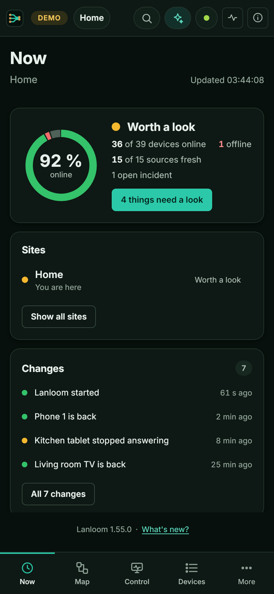
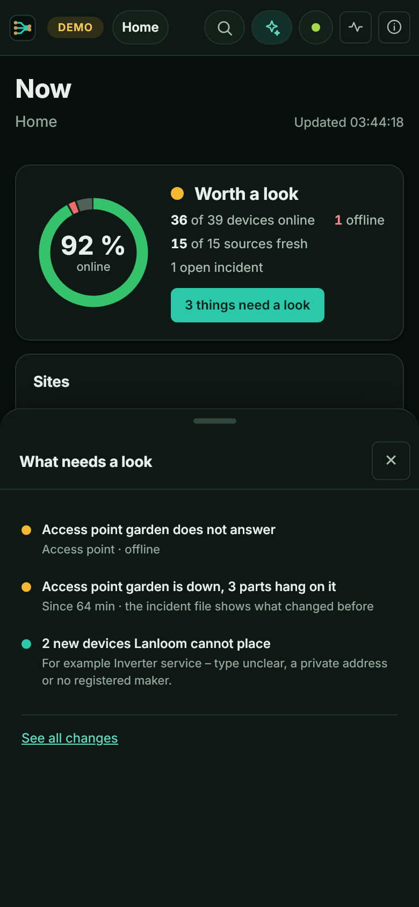
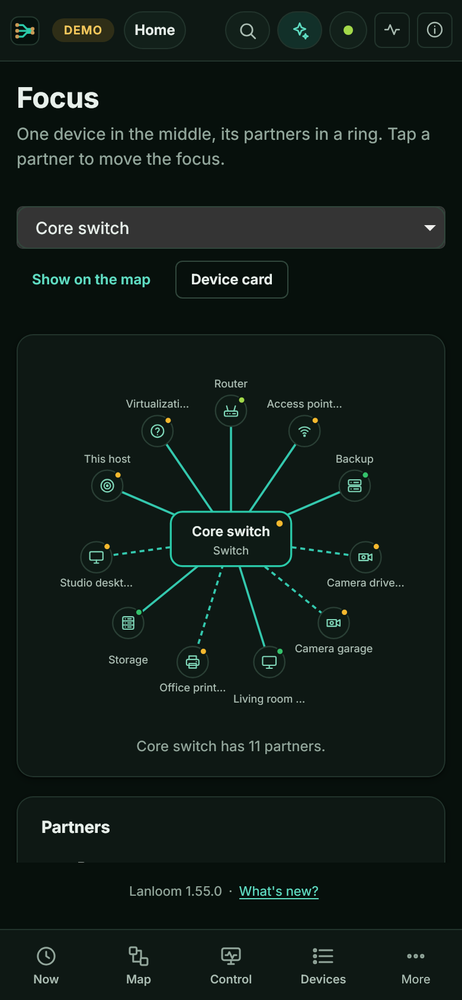
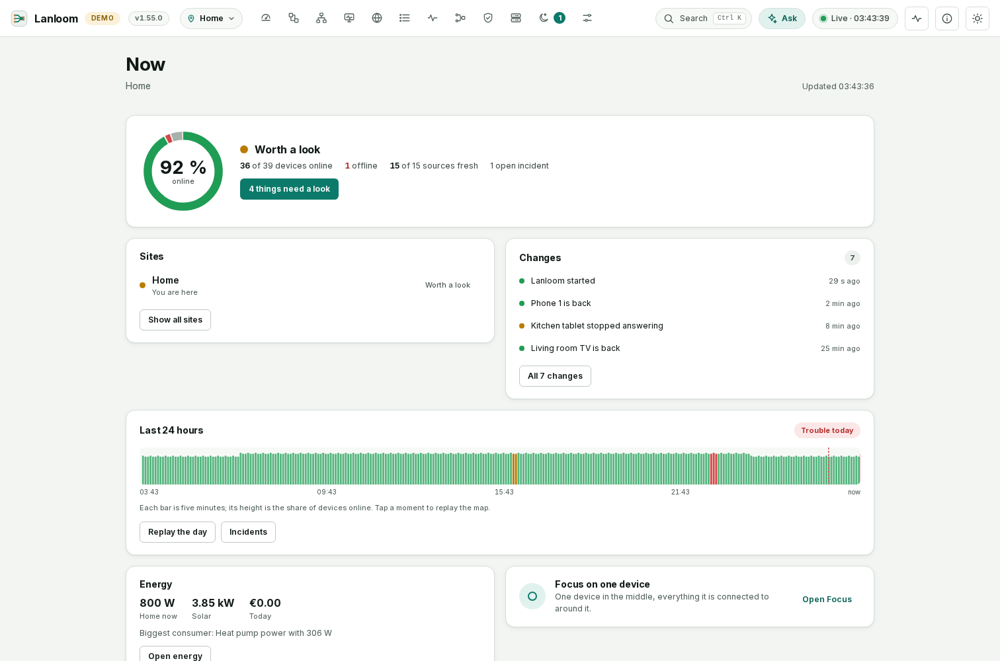

# Now and Focus (phone)

[Manual](README.md) · [Overview](overview.md) · [Map](map.md) · [Network](network.md) · [Devices](devices.md) · [Control room](controlroom.md) · Now · [Energy](energy.md) · [Settings](settings.md)

## Purpose

The start into the network on a phone. **Now** answers "is everything all right?" in one look and shows what changed;
**Focus** puts one device in the middle and everything it is connected to around it. Both pages work on a wide screen as
well, but they are made for one hand and a small screen. Everything here only reads.

## What you see

<table>
<tr>
<td width="33%"> Now: health ring, sites, changes</td>
<td width="33%"> A sheet: drag it up or down</td>
<td width="33%"> Focus: one device, its partners in a ring</td>
</tr>
</table>

- **Health ring**: the share of devices online (green), offline (red) and without a reading (grey), the overall word
  (*All calm*, *Worth a look*, *Needs attention*), how many sources are fresh and how many incidents are open. *N things
  need a look* opens them in a sheet.
- **Sites** (only with [several sites](sites.md)): the site you are at with its state; *Show all sites* opens every site
  released for you with its state in a sheet, and a tap switches to it. Other sites are named only once you ask for the list.
- **Changes**: devices that came, went or came back, sources that failed, the internet line, the last six hours.
- **Last 24 hours**: one bar every five minutes, its height the share of devices online, its colour the state; a dashed
  line marks the start of an incident. A tap on a moment opens the [rewind](incidents.md) of the map at that moment.
- **Energy** (only with a hub that has power sensors): the power of the home now, solar and the cost of today; see
  [Energy](energy.md).
- **Focus**: the centre is the selected device with its live figure; the partners sit in a ring, each with the colour of
  its trace on the map (internet line, cable, radio, virtual) and a small light for its live state. A dashed line is a
  link Lanloom assumes. The list under the ring says the same in words.

The page on a wide screen:

## How to use it

- **Phone bar**: *Now*, *Map*, *Control room* and *Devices* are always there, the open view comes in addition, and
  *More* opens every other view as a sheet.
- **Sheets**: drag the handle up for the whole sheet, down to the half height, further down to close; or tap the handle.
  A link from one sheet to another (for example *See all changes*) keeps the way back: the back key returns to the sheet
  before, the forward key opens the next one again, and the address carries the sheet, so a reload opens it again.
- **Pull to refresh**: pull the page down at its top and let go.
- **Install**: in the browser menu choose *Add to home screen* (or *Install*). The installed app opens on *Now*, the
  status bar takes the colour of the theme (light or dark), and the home-screen symbol fits the round and square masks
  of the phone. When the network is gone the installed app still opens and says so.
- The command palette has *Go to Now* and *Go to Focus*.

## Limits

- The look back starts with the first reading after a start; the first hours are short.
- Focus draws up to twelve partners in the ring; a switch with more lists the rest below.
- The partners are the links of the map (*Network* view); a device Lanloom cannot place has no partners yet.

## Privacy

- Now and Focus read what the overview, the map and the sites list already show; nothing new is collected or sent.
- Which sites appear depends on the sites released for your account.

## See also

- [Overview](overview.md) · [Map](map.md) · [Rewind and incidents](incidents.md) · [Sites](sites.md) · [Energy](energy.md)
- [The parts around the views](views.md): Right now, About this view, deep links and keys
