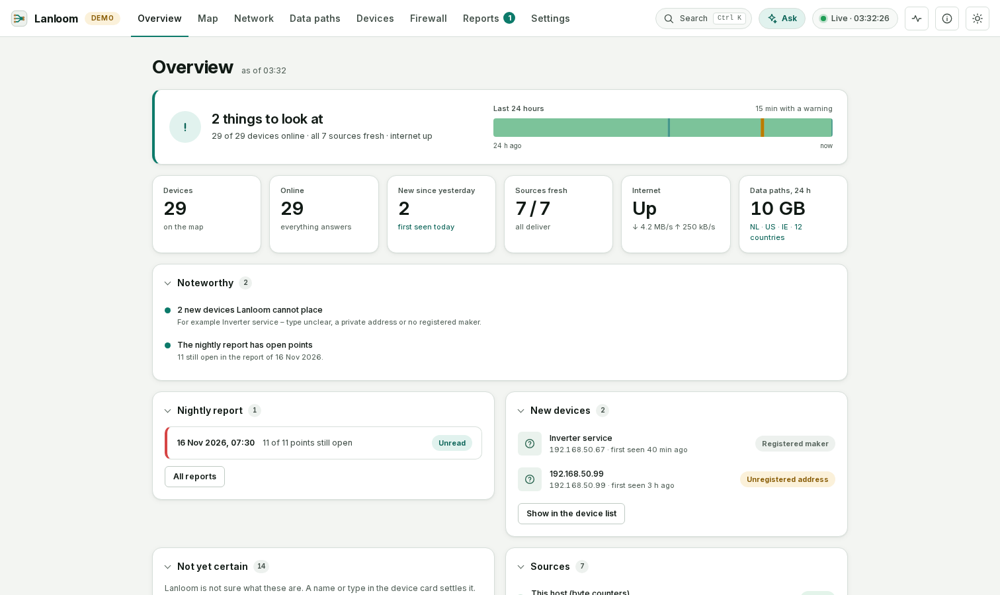
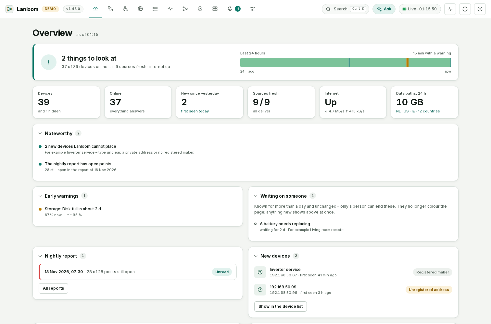
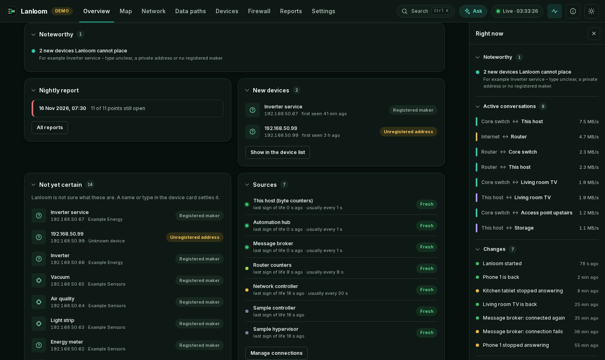
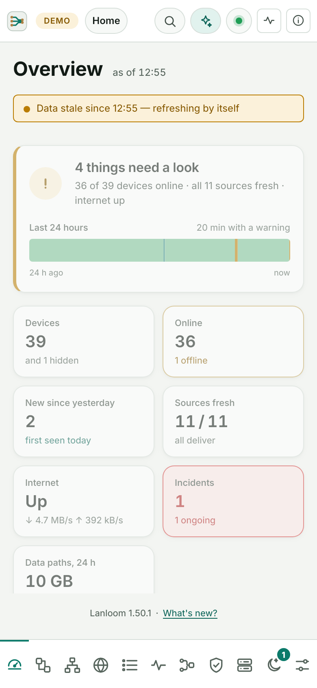

# Overview

[Manual](README.md) · Overview · [Map](map.md) · [Network](network.md) · [Devices](devices.md) · [Inventory](inventory.md) · [Vulnerabilities](vulnerabilities.md) · [Firewall](firewall.md) · [Data paths](data-paths.md) · [Nightly report](nightly-reports.md) · [Automations](automations.md) · [Running](running.md) · [Sites](sites.md) · [Updating](updating.md) · [Settings](settings.md) · [AI](ai.md)

## Purpose

The start page. It answers one question in three seconds: how is the network doing? Everything on it is a summary of
what the other views show in detail, and every figure is a link to the place where you can look further.

## What you see

- **Health banner.** "All good", "One thing to look at", "N things need a look" or "Something is down", with one line
  of counts (devices online, sources fresh, internet). The level is the most serious entry of the *Noteworthy* list.
- **Last 24 hours.** One strip with a five-minute step: green is calm, blue a hint, amber a warning, red a fault. Hover
  a coloured part to see when it began. Lanloom keeps this look back in memory; after a restart it fills up again over
  the day.
- **Key figures.** Devices on the map, devices online (offline ones are linked), new since yesterday, fresh sources,
  the internet line (state, measured rates or the last outage) and the data paths of the day (bytes and the top
  countries). Each figure is a link: devices, the device list filtered to new or offline devices, the live grade dialog,
  the internet component on the map, the data paths view.
- **Cards.** *Noteworthy* (one line and one sub line per issue, each linked to where it can be looked at),
  *Nightly report* (the latest report, open points, unread reports), *New devices* (with "first seen" and the origin of
  the address: registered maker, private or random address, unregistered address, only an IP address), *Not yet certain*
  (devices whose type Lanloom guesses), *Sources* (every connection with its calm state, its last sign of life and its
  usual rhythm).
- **Early warnings** (only when there is one): a host value that will reach its limit within 72 hours – memory, swap,
  disk, load or temperature – with the time to the limit and the value now; each line opens the device. How the forecast
  works: [HOST-HEALTH.md](../HOST-HEALTH.md#early-warnings-how-the-forecast-works).
- **Waiting on someone** (only when there is one): rows that only a person can end – an infrastructure device that is off,
  a connection whose sign-in is refused, new devices nobody has named, batteries to replace – and that have been unchanged
  for more than 24 hours. They move here from *Noteworthy*, say how long they have been waiting, and no longer colour the
  banner, so anything new stands out. Any change brings a row back at once.

### Calm states of a source

A source never shows an error text just because it has nothing yet:

| State | Meaning |
|---|---|
| Fresh | data arrives in its usual rhythm |
| Source waiting | just started, nothing has arrived yet |
| No data yet | connected for a while, but it has not reported anything |
| Stale | data stopped coming (older than its rhythm allows) |
| Connection fails | the connection does not work; the reason is shown |
| Off | switched off in the settings |

### What counts as noteworthy

- the internet line is down (router counters);
- a router, switch, access point, server, storage, hub or broker that used to answer does not answer any more;
- a connection fails, or stopped delivering;
- devices that joined since yesterday and that Lanloom cannot place (type unclear, private or random address, no
  registered maker);
- the latest nightly report has open points and is unread.

Features add their own entries (for example open incidents) through `lanloom.overview.register_note`; the start page
adds figures and cards through `Lanloom.registerOverviewTile` and `Lanloom.registerOverviewCard`.

## How to use it

- Read the banner first. If it is green, nothing else is needed.
- Click a figure or a *Noteworthy* line to go straight to the devices, the map component, the report or the data
  paths behind it.
- Click the live pill in the header for the live grade dialog (see [Around the views](views.md#live-state-and-live-grade)).
- The page redraws itself every ten seconds. Whatever you folded or unfolded - a card, "Show more" - stays as you left
  it while the page is open.
- Key `L` opens the *Right now* rail with the same noteworthy list, the active conversations and the latest changes
  (see [Around the views](views.md#right-now)).

### When the data is old

If the start page (or any other view) has not received a good state for more than three refresh cycles, at least three
minutes, a calm band *Data stale since HH:MM – refreshing by itself* appears above it and the content is dimmed. The
header may still say *Live*: the live channel is separate. The page asks again by itself, and back from sleep or after a
network change it fetches at once. See [Troubleshooting](../TROUBLESHOOTING.md).

## Limits

- The 24-hour strip and the figures reflect what Lanloom has measured since it started; a fresh start or restart has
  an empty look back for a while.
- A figure is only as good as its source: "internet" needs a router connection that delivers counters, and the data
  path figure needs the sources described in [Data paths](data-paths.md#limits).
- Devices that Lanloom cannot place are listed as *Not yet certain*; Lanloom guesses their type and says so. It never
  claims more certainty than it has.
- The page does not change anything; it only reads.

## Privacy

- **Read:** the device list with status, the state of every connection, the latest nightly report, the data-path sums
  of the day. Everything comes from Lanloom's own database and memory on the host.
- **Stored in the browser:** which cards you folded (for the current browser session) and whether the rails are open
  (this browser). No device data is stored in the browser.
- **Sent:** nothing. The page makes no request outside your Lanloom.
- **Roles:** every role (viewer, operator, admin) sees the whole page. Location fields of the site are shown to admins
  only.

## See also

- [DISCOVERY.md](../DISCOVERY.md) - how devices are found and why some are "not yet certain"
- [HOST-HEALTH.md](../HOST-HEALTH.md) - host gauges, early warnings, waiting on someone
- [AVAILABILITY.md](../AVAILABILITY.md) - the history behind the "offline" and stability figures
- [NIGHTLY-REPORT.md](../NIGHTLY-REPORT.md) - the report card
- [PERFORMANCE.md](../PERFORMANCE.md) - what the start page costs on a small host
- [Around the views](views.md) - Right now, live state, keys
