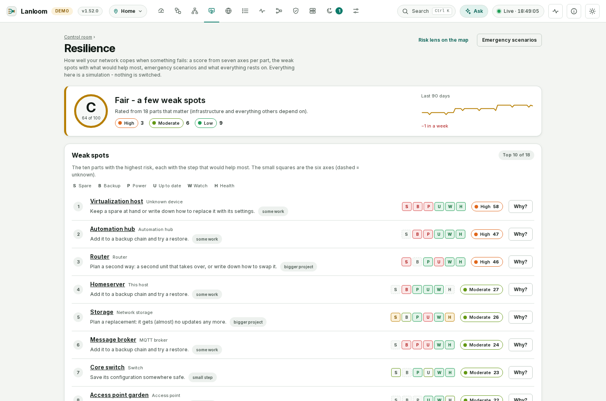
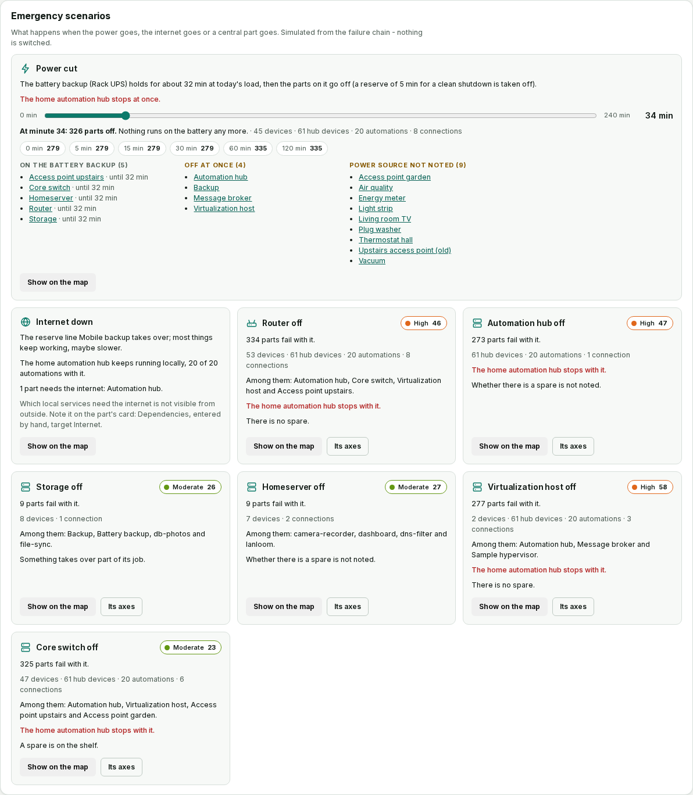
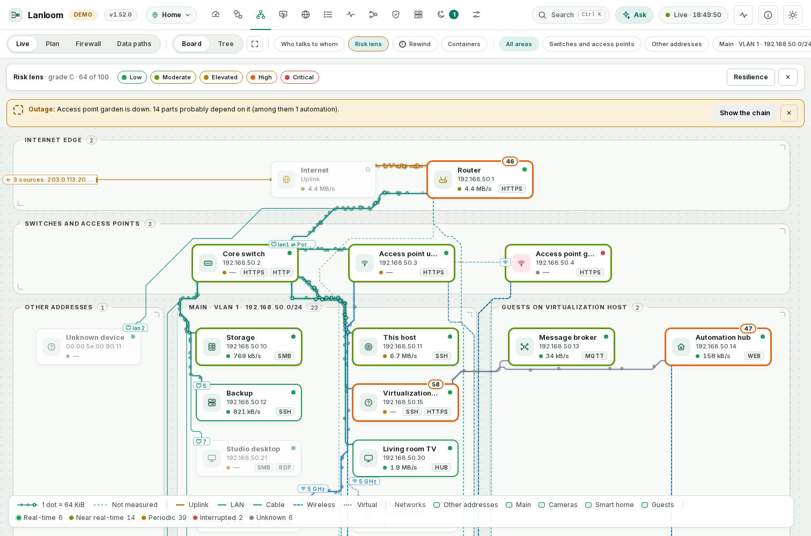
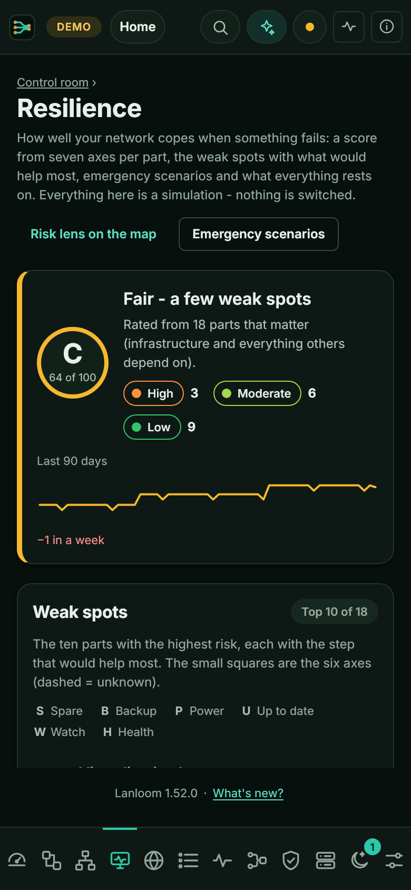

# Resilience

[Manual](README.md) · [Control room](controlroom.md) · [Failure chain](failure-chain.md) · [Map](map.md) · [Network](network.md) · Resilience · [Nightly report](nightly-reports.md)

## Purpose

How well the network copes when something fails, in one place: a **score** with a grade from A to F, the **weak spots**
with the step that would help most, **emergency scenarios** (power cut, internet down, a central part off) and **what the
network rests on**, layer by layer. The page is a part of the [control room](controlroom.md) (`#/resilience`); the **risk
lens** colours the map by the same risks.

Everything is computed from what Lanloom already knows - the [failure chain](failure-chain.md), the battery backup, the
backups, availability, vulnerability hints and certificates. Nothing is switched and nothing is sent anywhere: every
scenario is a simulation.

## What you see

- **The score**: a grade (A to F), the score of 100, how many important parts are at which risk level, and the last
  90 days (one value per day) with the change of the last week.
- **Weak spots**: the ten parts with the highest risk. Each row shows the step that would help most and how big it is
  (*small step*, *some work*, *bigger project*), six small squares for the six axes (green good, yellow weak, red
  missing, dashed unknown, faint: does not count here) and the risk level as a word with its number. *Why?* opens the
  seven axes with their reasons and, for operators, the fields *Power source*, *Spare* and *Note*.
- **Emergency scenarios**:
  - *Power cut* with a slider from 0 to 240 minutes: what is off at once (mains only), what runs on the battery backup and
    until when (the live runtime of the UPS minus the reserve for a clean shutdown), when the home automation hub stops,
    how many parts are off at each minute, and the parts whose power source nobody noted.
  - *Internet down*: whether a reserve line takes over, how many automations keep running locally and which parts are
    noted as needing the internet.
  - *... off* for the gateway, storage boxes, servers, the hub host and the parts with the highest impact.
  *Show on the map* opens the scenario in the bar above the board, like a simulated maintenance with several roots.
- **What the network rests on**: the layers from services down to power. Each says how many parts it has, what fails
  above it when it fails, its highest risk and its weakest part.
- **Battery backup and open entries**: the UPS units Lanloom reads with their runtime, the parts without a power source,
  and two figures for the scenarios: a runtime when the UPS reports none, and the reserve for a clean shutdown.

**The risk lens** (chip *Risk lens* above the map, key `B`, or the palette): every rated tile gets a frame in the colour
of its level, from *elevated* up with the risk number on the frame; a legend with the five words sits above the board.

The component card has a section *Resilience* with the seven axes and the fields. On a phone the page is one column and the
slider runs across the full width:

## How to use it

1. Start with the first weak spot and do what it says - often a small step: note a power source, put a box on the UPS,
   save a switch configuration, try a restore once.
2. Note **power source** and **spare** on the important parts (*Why?* or the card). *PoE* means it gets its power through
   the switch it hangs on; guests and containers follow their host by themselves.
3. Mark services that need the internet: on the part's card, *Dependencies*, entered by hand, target *Internet*. The
   scenario *Internet down* then names them.
4. Move the power-cut slider to see when the battery runs out and what goes with it. *Show on the map* shows it on the board.
5. Watch the score over the weeks; the nightly report tells you when it dropped by five points or more.

Palette: *Go to Resilience*, *Risk lens on/off*, *Emergency scenarios*, typed *Simulate a power cut* and *Simulate the
internet going down*; on a device hit the action *Risk and resilience*. An incident file has *Risk of the root*.

## Limits

- A part is only as well rated as Lanloom knows it: unknown axes count as half weak, never as fine. Noting power source
  and spare makes the score exact.
- Which local services need the internet cannot be seen from outside; it is what you note by hand.
- The UPS runtime is the UPS's own estimate at today's load; a battery that aged since its last test may hold less.
- The score rates the parts that matter (infrastructure and everything others depend on); a phone that nobody depends on
  is not part of it.

## Privacy

- Nothing new is collected and nothing leaves the device: the page reads what the other views already have.
- Everybody who sees the map reads the page. Power source, spare, note and the two battery figures are for operators and
  administrators and are written to the audit log (`resilience.part`, `resilience.settings`).

## See also

[RESILIENCE.md](../RESILIENCE.md) (how the score is computed) · [Failure chain](failure-chain.md) · [Control room](controlroom.md) · [Nightly report](nightly-reports.md)
