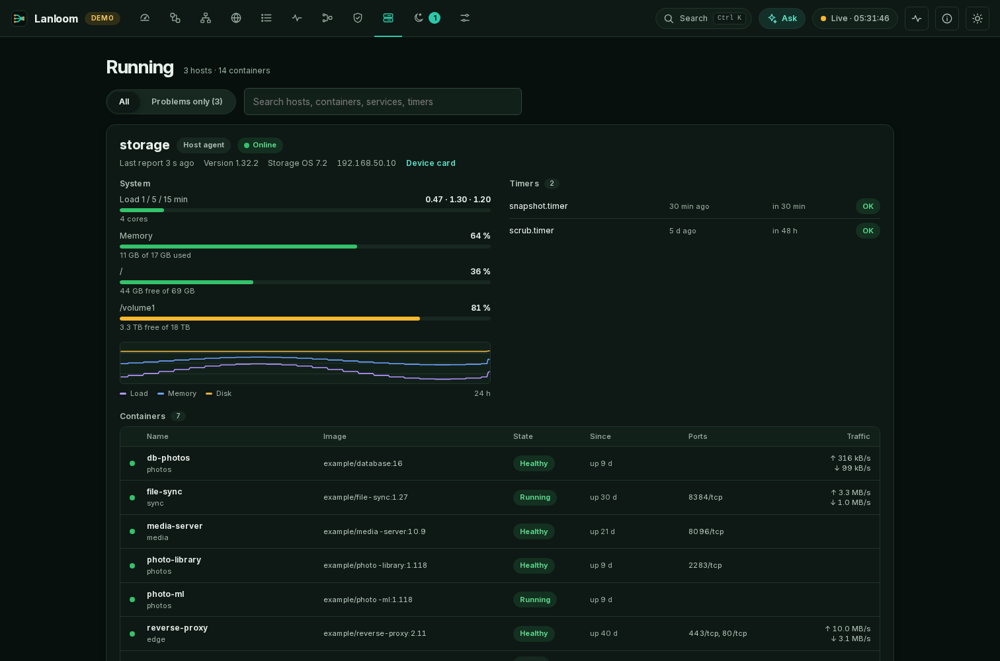
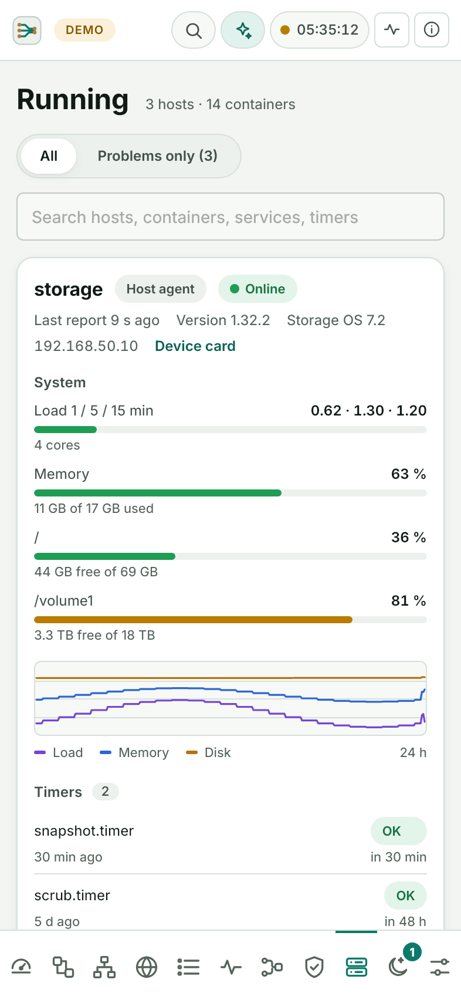
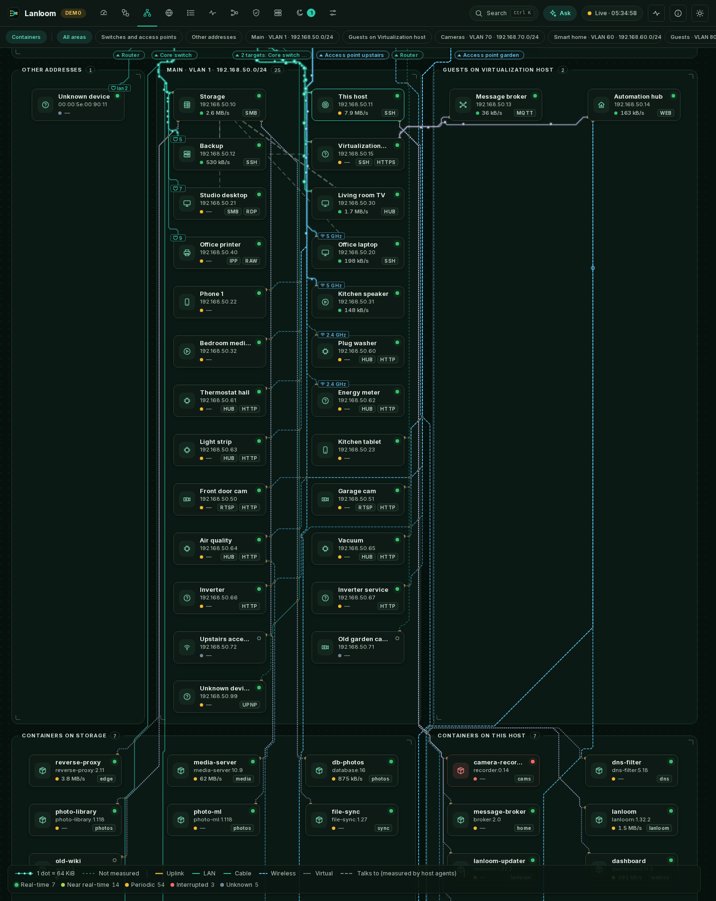
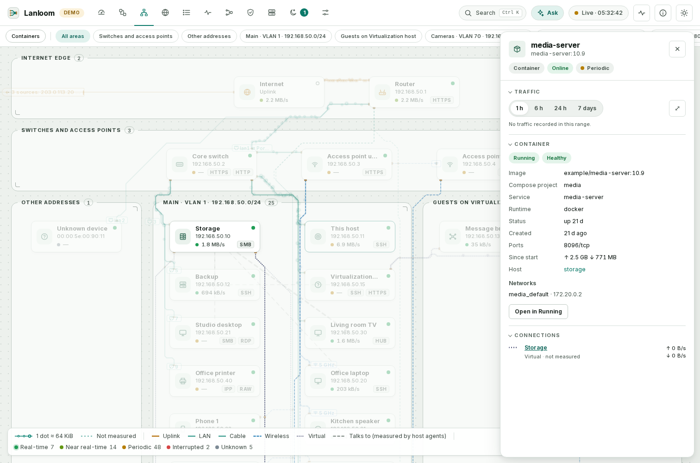
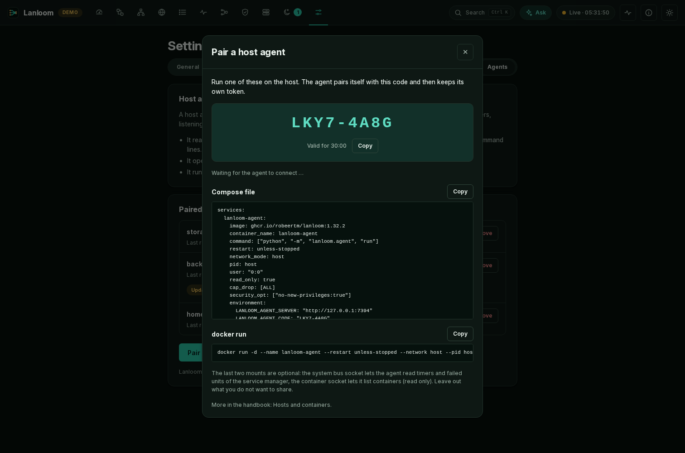

# Running

[Manual](README.md) · [Overview](overview.md) · [Map](map.md) · [Network](network.md) · [Devices](devices.md) · [Inventory](inventory.md) · [Firewall](firewall.md) · [Data paths](data-paths.md) · [Nightly report](nightly-reports.md) · [Automations](automations.md) · Running · [Updating](updating.md) · [Settings](settings.md) · [AI](ai.md)

## Purpose

What runs on the other hosts of your network: containers, listening services, timers, failed services, and how loaded
each host is. It needs the optional [host agent](../HOST-AGENT.md) on a host, or a container source (containers only).
Without either, the view says so and offers to pair one; the rest of Lanloom is not affected.

## What you see

One block per host that reports (a host agent or a container source), with the kind, the state (online, offline, the
time of the last report) and the version of the agent. If the version differs from Lanloom's, an *Update* chip names
the exact image to pull.

- **System** (agent): load for 1, 5 and 15 minutes against the cores, memory, swap, disks and the uptime, with a
  24-hour curve of load, memory and disk.
- **Containers**: name, image, state (running, restarting, exited ...), health, ports, live traffic (sent above,
  received below) and since when. Restarting and unhealthy ones come first. Containers that lived under 10 minutes are
  hidden and counted ("short-lived containers hidden").
- **Listening services**: port, address and the short process name; services that listen only on the host itself are
  counted, not listed.
- **Timers** and **Failed units** of the host's service manager, with the last and next run and the result.
- **Overlay VPN peers**, when the agent can read its status.
- **Device card** link: opens the card of the host on the map.

### On the map and on cards

- **Containers on the map.** Every host with containers carries them as small components that are **folded** into
  the host by default. Unfold one host with the button on its card, or all at once with the **Containers** chip above
  the board. The fold state is kept in this browser.

  

- **"Talks to" lines.** Measured conversations between the host of an agent and other known devices are drawn as
  **dashed lines** between the two, with moving dots like every other trace. The lines fade a few minutes after the
  traffic stops. The same conversations appear in *Active conversations* of the *Right now* rail.
- **Container card.** A click on a container opens its card: state and health, image, runtime, compose project and
  service, ports, networks, network mode, restarts, exit code, live traffic and traffic since the start.

  

- **Host agent section.** The card of a host that runs an agent (or is read through a source) has a *Host agent*
  section: version, last report, system, counts of containers and failed units, a link to the Running view and a button to
  show or hide the host's containers on the map.

### Settings > Agents

The list of paired hosts and container sources with their state, version, last report and the *Update* hint, and the
buttons **Pair a host agent** and **Add container source** (administrators).

## How to use it

- **Pair a host:** *Settings > Agents > Pair a host agent*. Lanloom shows a one-time code (valid 30 minutes) with a
  compose file and a `docker run` line to copy; the window says when the host reported. Step by step in
  [HOST-AGENT.md](../HOST-AGENT.md#installation).
- **Read containers without an agent:** *Add container source* with the address of a read-only socket proxy; *Test*
  first.
- **Filter:** *All* or *Problems only* (offline hosts, failed units, unhealthy or restarting containers); the search
  box finds hosts, containers, services and timers.
- **Fold containers:** the *Containers* chip on the map, the button on a host card, or the commands *Show containers on
  the map* and *Hide containers on the map* in the search ([PALETTE.md](../PALETTE.md)). *Open Running* and *Pair a
  host agent* are commands too.
- **Rename** a host (operators) or **remove** it (administrators; the agent's token is revoked at once, stop its
  container yourself).
- **Update an agent:** pull the image named in the *Update* chip and recreate the container.

## Limits

- Bytes are counted for TCP over IPv4 and IPv6 only. A container on the host network has no counters of its own, and
  without `pid: host` the agent shows no bytes per container and no process names.
- Without the system bus socket the timers and failed units show "not available"; without the runtime socket there are
  no containers. A container source shows containers only.
- A report comes every 10 seconds; a host is *offline* after 90 seconds of silence.
- Lanloom only reads. It cannot start, stop or restart anything on a host.
- Containers that lived under 10 minutes are hidden unless they restart or are unhealthy.

## Privacy

- **Read:** names, states and numbers of containers, services, timers and units, plus load, memory, disks and TCP byte
  counts. Never file contents, environment variables or command lines; the agent drops them before sending and Lanloom
  filters again ([HOST-AGENT.md](../HOST-AGENT.md#the-secret-filter)).
- **Stored:** per host the latest state and a 5-minute sample for 35 days; conversations in the data paths; of an agent
  only the hash of its token.
- **Sent:** from the agent only to its own Lanloom, never anywhere else. Lanloom contacts a container source only at
  the address an administrator entered, with read requests.
- **Roles:** every role sees the view and the lists. Operators rename; administrators pair, add and remove, and need a
  recent second confirmation for it.

## See also

- [HOST-AGENT.md](../HOST-AGENT.md) - installation, what is read, the secret filter, updates, container source
- [Map](map.md), [Devices](devices.md) and [Data paths](data-paths.md) - where the hosts and conversations appear
- [NIGHTLY-REPORT.md](../NIGHTLY-REPORT.md) and [NOTIFICATIONS.md](../NOTIFICATIONS.md) - what is told about hosts and containers
- [TROUBLESHOOTING.md](../TROUBLESHOOTING.md#host-agent-and-container-source) - not paired, offline, not available
