# Settings

[Manual](README.md) · [Overview](overview.md) · [Map](map.md) · [Network](network.md) · [Devices](devices.md) · [Inventory](inventory.md) · [Vulnerabilities](vulnerabilities.md) · [Firewall](firewall.md) · [Data paths](data-paths.md) · [Nightly report](nightly-reports.md) · [Automations](automations.md) · [Running](running.md) · [Updating](updating.md) · Settings · [AI](ai.md)

## Purpose

Scanning, connections to your router, controller and hub, appearance, notifications, users, security, backup, storage
and AI. Connections are read-only unless you switch on writing for a device family yourself. The settings are split
into sub pages; the tabs at the top show only the ones your role may open (`#/settings/<page>`).

Something not working? *Settings > General > Diagnostic export* downloads a redacted JSON file (no addresses, no names, no credentials) for an issue; see [Troubleshooting](../TROUBLESHOOTING.md#the-diagnostic-export).

## What you see

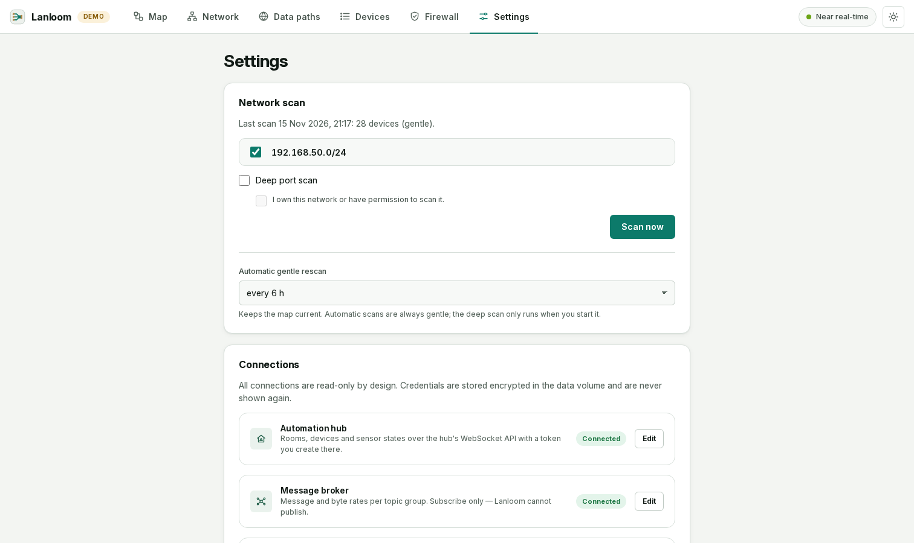

| Sub page | Address | Who can open it |
|---|---|---|
| [General](#general) | `#/settings` | every role (viewers and operators see appearance, their role and about; administrators see everything) |
| [Account](#account) | `#/settings/account` | every role |
| [Notifications](#notifications) | `#/settings/notifications` | every role |
| [Users](#users) | `#/settings/users` | administrators |
| [Security](#security) | `#/settings/security` | administrators |
| [Backup](#backup) | `#/settings/backup` | administrators |
| [Storage](#storage) | `#/settings/storage` | administrators |
| [Agents](#agents) | `#/settings/agents` | every role sees the list; administrators pair, add and remove, operators rename |
| [Network](#network) | `#/settings/network` | every role (operators and administrators may change things) |
| [API](#api) | `#/settings/api` | every role makes its own tokens; administrators also manage webhooks and see all tokens |
| [AI](#ai) | `#/settings/ai` | administrators |

### General

Every role: language, light or dark theme, colour theme, map animation, and a card with your role and what it allows.
Administrators additionally:

- **Network scan** - which networks to scan, *Scan now*, the rescan interval (never, or every 1, 3, 6, 12 or 24 hours),
  the optional deep scan (only with your consent) and the switch for the default SNMP read community (off by default).
  While a scan runs - started here, in the setup assistant or by the automatic rescan - a progress bar fills next to the
  button, the status line shows the phase, its progress, the devices found so far and the percentage, and *Scan now*
  turns into *Cancel*. *Last scan* names the last finished scan; a stopped scan does not replace it.
- **Connections** - the hub, MQTT broker, SNMP, switch controller, DNS filters and device-family adapters. Credentials are stored
  encrypted and never shown again. *Test connection* checks before you save.
- **Set up again** - starts the setup assistant over, or the demo.
- **Appearance** - speed unit (bytes or bits) next to language and theme, and the switch *Take the background noise out of
  exact port counters* (off by default; see [Network](network.md)).
- **Data paths** and **NetFlow / IPFIX from your router** - home country, own networks and tunnels, networks without
  internet, and the NetFlow receiver (see [Data paths](data-paths.md)).
- **MQTT output** - optional, off by default: a few of Lanloom's figures (devices online, new devices, internet line, open
  issues, health, vulnerability hints, nightly report) as sensors of your home-automation hub through MQTT discovery, with
  the broker, the topics, the sensors and their current value and the state of the connection. Only counts, a level, a
  flag and a time are published (see [Add-on and MQTT output](add-on.md)).
- **Nightly report** - time, time zone, retention and the delivery channels (see [Nightly report](nightly-reports.md)).
- **Updates** - version, the optional update check (the only outgoing connection of its own, at most every 6 hours; turn
  it off here) and the one-click updater where the updater sidecar runs. Channels, holding a version, going back and the signature check: [Updating](updating.md).
- **Diagnostic export** - one redacted JSON file (version, kind of installation, counts, the state and reason of every connection; no addresses, names or credentials) to attach to an issue. The download is written to the audit log; see [Troubleshooting](../TROUBLESHOOTING.md#the-diagnostic-export).

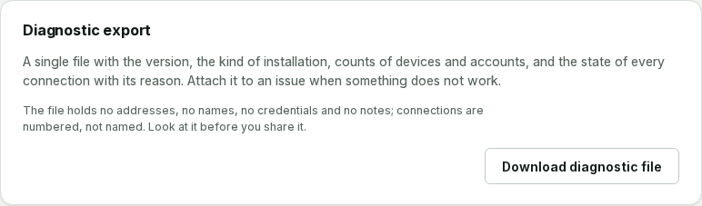

### Account

Needs any role. Your own account: language, password, two-step sign-in (authenticator app with ten recovery
codes, passkeys), and your own sessions with *Sign out everywhere*. Critical actions ask for a confirmation within the
last 10 minutes.

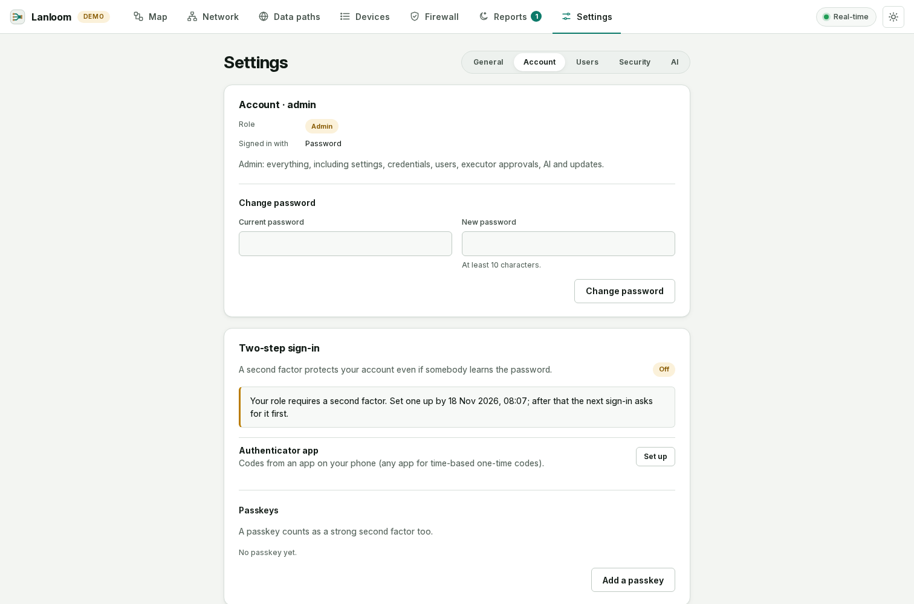

### Notifications

Needs any role for your own rules (per event: when, from which severity, which channels), quiet hours, push on this
device and the history. Operators plan maintenance. Administrators set the shared limits (flap protection, cool-down,
daily limit), the protected networks and the heartbeat. Nothing is sent until a channel is set up.

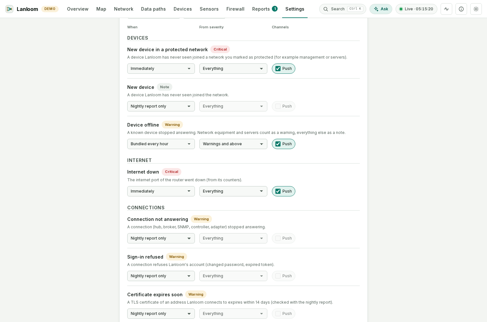

### Users

Needs the administrator role. Invite people with a one-time link (24 hours, bound to a role), change a role, disable or
delete an account, create a reset link. At least one enabled administrator must remain.

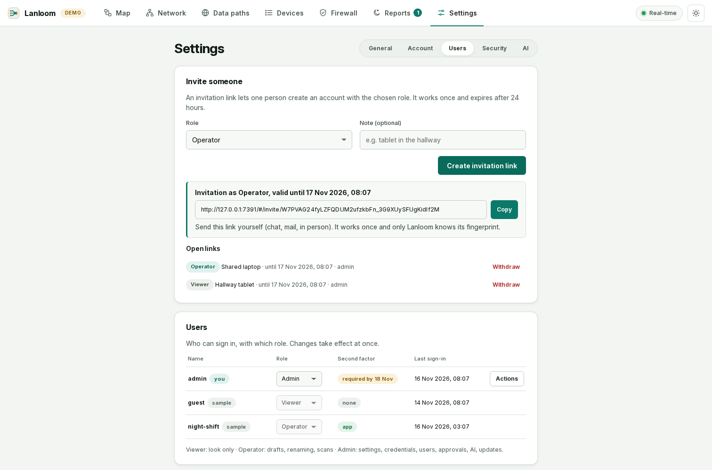

### Security

Needs the administrator role. Which roles must use a second factor (default: administrators only) with a grace period,
and the **audit log**: every change with who, when, what and result; filter, export as CSV, retention from 30 days to
10 years. The log is hash-chained so edits are shown (tamper-evident, not tamper-proof).

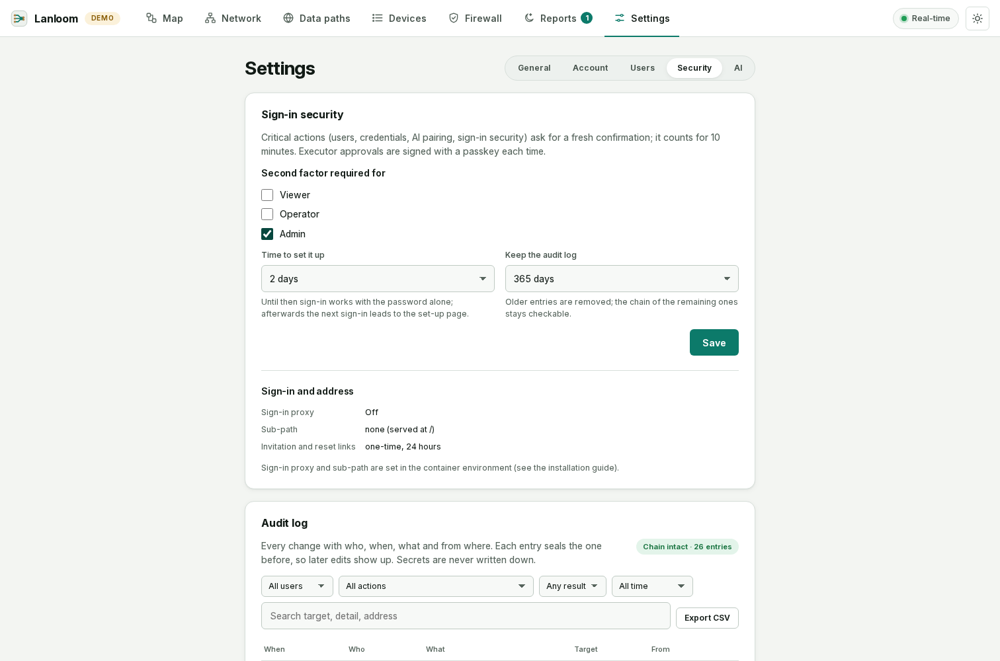

### Backup

Needs the administrator role and a fresh confirmation for export, download and restore. One encrypted file with your
passphrase (Argon2id, AES-256-GCM): accounts, connections with credentials, inventory, drafts, settings and the audit log,
optionally history. Automatic backups into the data volume, restore with a preview, and moving to another host.

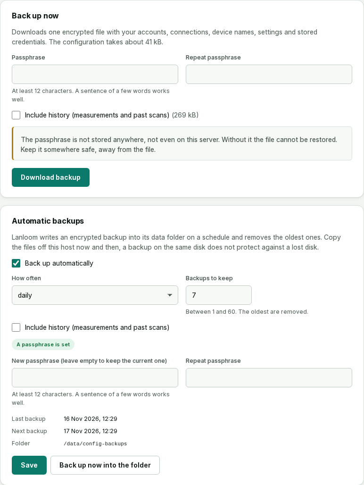

### Storage

Needs the administrator role. The space of every area, the retention of each kind of data (live history, data paths,
availability and events, reports, audit log, scan history), the nightly clean-up and the memory view.

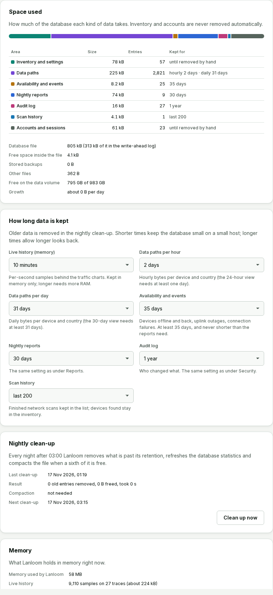

### Network

Needs any role to look; operators set protection classes (*Printer*, *Industrial*, *Passive only*) and administrators
allow a gentle scan across a router. It lists the networks and VLANs Lanloom knows with their reach (scanned directly,
scan allowed across router, adapter data only, never scanned), the scan protection list and everything that can be
connected to which device.

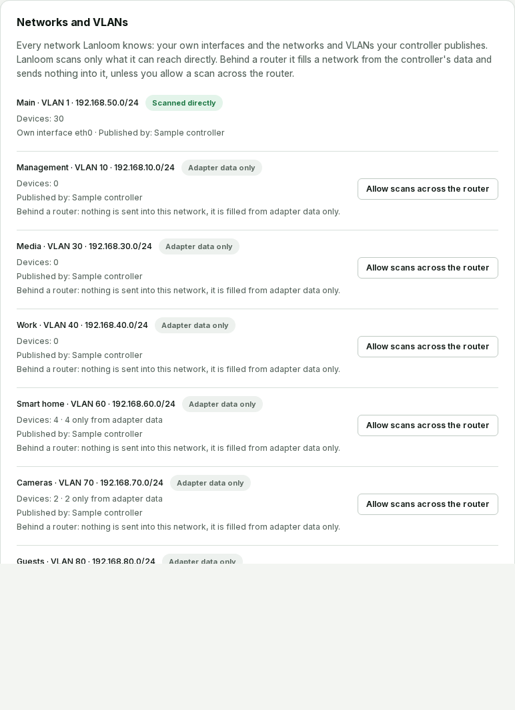

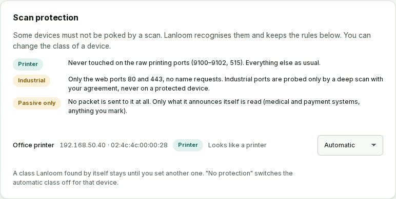

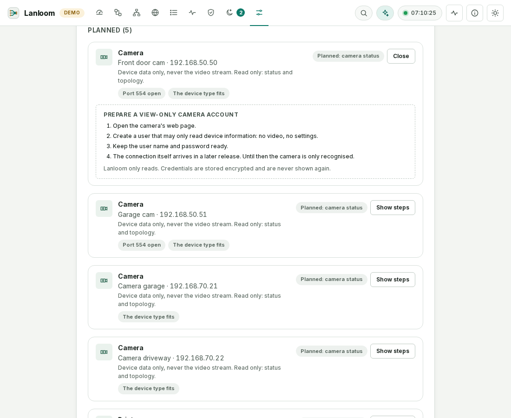

### Agents

The hosts that report to Lanloom: host agents and container sources, with kind, state, version, last report and an
*Update* hint with the exact image when the version differs. Administrators use **Pair a host agent** (a one-time code
valid 30 minutes, with a compose file and a `docker run` line to copy) and **Add container source** (the address of a
read-only socket proxy, with a test); operators rename; administrators remove, which revokes the agent's token at once.
What the agent reads and how to install it: [HOST-AGENT.md](../HOST-AGENT.md); what it shows: [Running](running.md).

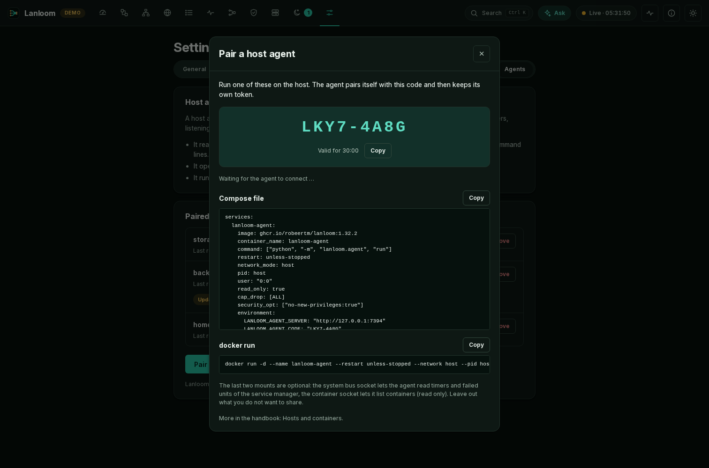

### API

Tokens for scripts (scope never above your role), the public API with its reference, webhooks (administrators), the delivery
log and external reports delivered by other programs. Everything about it is on its own page: [API](api.md).

### AI

Needs the administrator role. The *Local AI* and *Cloud AI* cards, the order, the permissions per function and the daily
limit for cloud requests. Off by default. See [AI](ai.md).

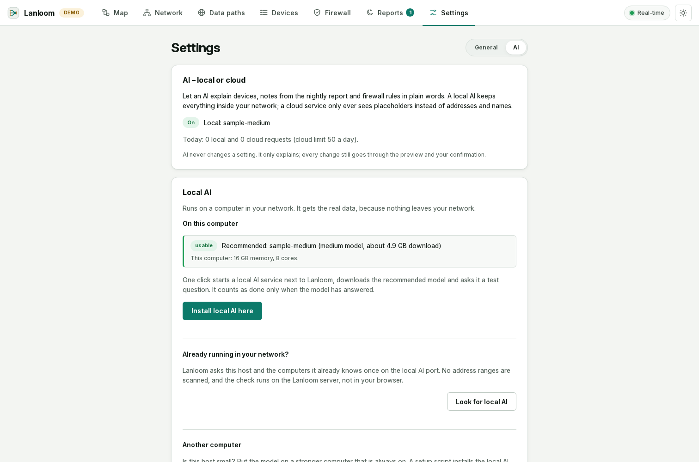

## How to use it

- Open **Settings** in the navigation and pick the tab. Changes are saved on the spot or with a *Save* button and
  confirmed with a short message.
- Language, theme, colour theme and map animation are personal choices (the language is stored with your account; the
  others in this browser).
- Add a connection under *General > Connections*, press *Test connection*, then *Save*. Prefer a view-only account
  and an access token over a password; never an owner account.
- Run **Scan now** after changing networks; automatic rescans cover only the networks you chose and the ranges you agreed to.
- Before upgrading or moving a host, make a backup (*Backup > Back up now*) and keep the passphrase apart from the file.

## Limits

- A role sees only the tabs it may open, and the server enforces the same rules: hiding a tab is not the protection.
- Connections for reading accept only read-only accounts where that is checkable; writes happen only in the optional
  executor, never in the app.
- A restore replaces the configuration, ends every session (including yours) and keeps the audit log of an instance that
  has its own.
- Passkeys are available only in secure contexts (HTTPS or localhost) and are bound to the address Lanloom is opened
  under.
- Login rate limits apply: after 5 failed sign-ins from one client address, that address waits, starting at 60 seconds.

## Privacy

- **Stored on the host:** settings, accounts (passwords as argon2id hashes), connections with credentials encrypted by
  the instance key `secret.key`, the audit log (names of changed fields, never secret values).
- **Stored in the browser:** language, theme, colour theme, map animation and the open state of the rails.
- **Sent:** nothing by default. Outgoing connections exist only where you switch them on: the update check (public
  release feed), report delivery and notifications, the heartbeat, push, the MQTT output, and AI. The list of every place that can open a
  connection is `security/egress.json` in the repository, checked by the tests.
- **Roles:** viewer, operator and administrator as described per sub page above; every route is checked against one
  central table on the server.

## See also

- [../TROUBLESHOOTING.md](../TROUBLESHOOTING.md) - when something does not work, and the diagnostic export
- [INSTALL.md](../INSTALL.md) - installation, updating and the forgotten password
- [ACCESS.md](../ACCESS.md) - roles, users, two-step sign-in, sessions, audit log, sign-in through a proxy
- [NOTIFICATIONS.md](../NOTIFICATIONS.md) - rules, quiet hours, maintenance, push, heartbeat
- [HOST-AGENT.md](../HOST-AGENT.md) - the optional host agent, the container source and the *Agents* page
- [BACKUP.md](../BACKUP.md) - backup, restore and moving to another host
- [Add-on and MQTT output](add-on.md) - running as an add-on of a home-automation hub, sensors over MQTT
- [PERFORMANCE.md](../PERFORMANCE.md#storage-and-retention) - retention and the nightly clean-up
- [DISCOVERY.md](../DISCOVERY.md#networks-and-vlans) - networks, scan protection, what can be connected
- [integrations/ai.md](../integrations/ai.md) - AI services
- [SECURITY.md](../../SECURITY.md) - the security model and how to report a vulnerability
