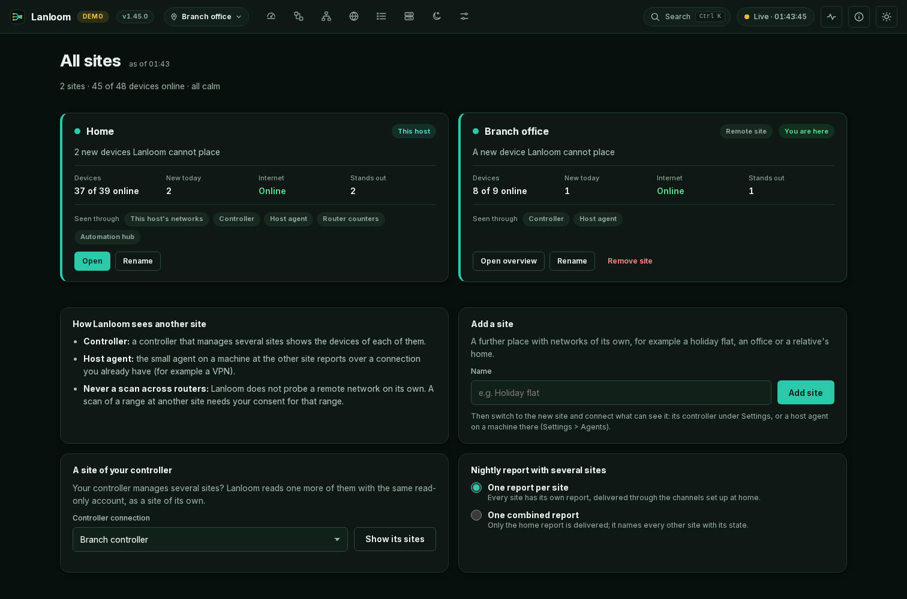
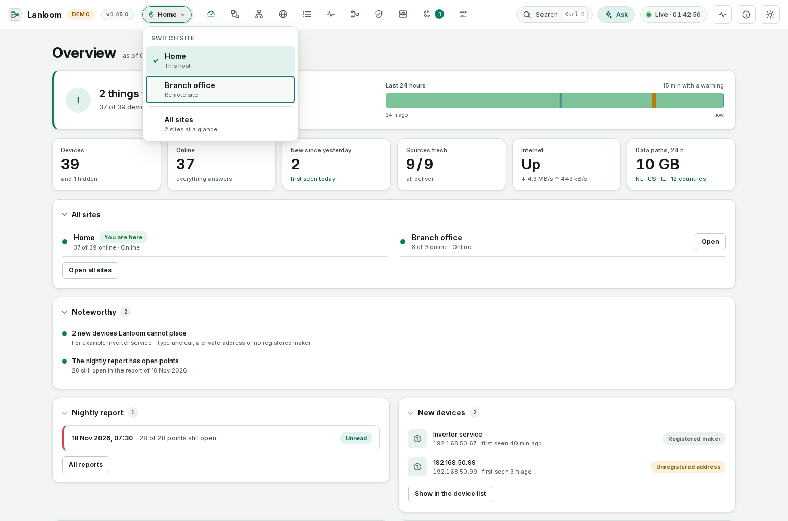
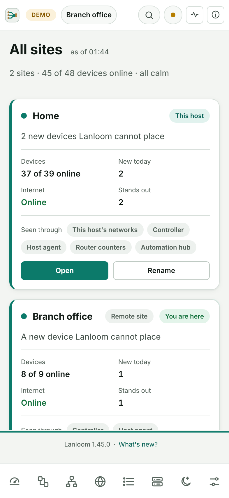

# Sites

[Manual](README.md) · [Overview](overview.md) · [Map](map.md) · [Network](network.md) · [Devices](devices.md) · [Inventory](inventory.md) · [Vulnerabilities](vulnerabilities.md) · [Firewall](firewall.md) · [Data paths](data-paths.md) · [Nightly report](nightly-reports.md) · [Automations](automations.md) · [Running](running.md) · Sites · [Updating](updating.md) · [Settings](settings.md) · [AI](ai.md)

## Purpose

One Lanloom for several places: your home, a holiday flat, a small office, the house of a relative. Each **site** has
its own networks, connections, devices, history and nightly report. The site Lanloom runs in is **Home**; an
installation from before sites existed simply became Home, with everything it had.

## What you see

- **Site switcher** next to the logo (only when you may see more than one site): the name of the current site and a
  menu with every site released for you and *All sites*. Your browser remembers the last site; another browser or
  phone keeps its own choice.

  

- **All sites** (`#/sites`, also in the switcher menu, the command palette and *Settings > Sites*): one card per site
  with its state (all calm, needs a look, problem), devices online, new devices of today, the internet, how many things
  stand out and the first of them, and how Lanloom sees the site (this host's networks, a controller, a host agent).
  *Open* switches to the site.
- **Overview card** *All sites* on the overview page of every site, as long as you may see more than one.
- Everything else - map, network, devices, data paths, reports, running hosts - always shows the **current site only**.

## How to use it

**Add a site** (administrators): *All sites > Add a site*, give it a name, then switch to it and connect what can see
it. There are exactly two ways, and Lanloom never takes a third one on its own:

1. **A controller that manages several sites.** *A site of your controller* lists the sites of a controller
   connection of the current site (read only) and adds the one you pick as a new Lanloom site. The connection is copied
   into the new site with the other site name; its secrets stay encrypted with the instance key. Nothing is written to
   the controller.
2. **The [host agent](../HOST-AGENT.md)** on a machine at the other site. Switch to the site, *Settings > Agents >
   Pair a host agent*: the pairing code belongs to that site, so the agent joins it. The agent reports over a connection
   you already have (for example a VPN to the other site).

**Never a scan across routers.** A remote site has no interface of the Lanloom host, so Lanloom does not scan, probe or
listen for flows there. If you really want a scan of a range at a remote site, allow that range under *Settings >
Network > Networks and VLANs* first (the same consent as for routed networks at home).

**Switch** with the button next to the logo, *Open* on a site card, or the palette (`Ctrl K`, "Switch site").

**Several tabs, several sites.** Each tab keeps the site it shows, also when you switch the site in another tab of the same
browser: its requests, its live feed and what it draws stay at its own site. A page never draws an answer that was made for
another site; if the server says the site of a page is not (or no longer) released for you, the page opens the site you may see
once. Switching cancels everything that is still on its way, without an error message, and keeps the view you are on (not
the device or filter you had open - those belong to the site you left). A link can name a site
(`#/devices?site=<site id>` - the id is part of the address of the site's cards); a page opened with such a link shows that
site from the very first moment, and a link to a site you may not see opens your own site with a short notice.

**Who sees which site** (administrators): *Settings > Users > Actions > Sites ...* per person - *All sites* (also the
ones added later, the default) or a list. An invitation can carry the sites too. Administrators always see every site.

**Nightly report with several sites** (*All sites*, administrators):

- *One report per site* (default): every site makes its own report at its own time; it is delivered through the
  channels set up at Home, with the site name in the title.
- *One combined report*: only the Home report is delivered. It has a *Sites* section with every other site, its devices,
  internet and open points. The reports of the other sites stay readable at their site.

Notifications work the same way: the rules are personal and apply at every site, the channels are the ones of Home,
and a notification of a site goes only to people who may see that site. Each maintenance window belongs to its site.

**Rename** a site (Home too: leave the name empty to show "Home" in your language) or **remove** a remote site (with
a confirmation; its data is deleted from Lanloom, nothing changes at the site).

## Limits

- At most 16 sites per instance.
- The **firewall editor**, the **executor** and the **AI assistant** work on the Home site only. At a remote site the
  Firewall tab and the AI parts are hidden; the server refuses those routes there.
- The NetFlow/IPFIX receiver and the MQTT output belong to Home. Webhooks are set up once and carry a `site` object
  (`id`, `name`) for events of a remote site.
- Each site starts its own background tasks (sources, reports, history). A remote site has no scanner, presence check
  or flow receiver and shares the vendor and geo tables with Home, so it is light: an empty site measured under 1 MB of
  memory, plus what its devices and history take.

## Privacy

- Every site keeps its data in a database of its own (`<data>/sites/<id>/lanloom.db`); Home keeps `lanloom.db`.
- The server decides the site of every request, and only among the sites released for the person. A request that names
  a site (header `X-Lanloom-Site`, `?site=` in the address, cookie `ll_site`) gets exactly that site - or, when it is
  unknown or not released, a refusal (`404`), never the data of another site. Every answer and every live frame names the
  site of its data, and the page throws away anything that names another site than it shows. Names and addresses of
  other sites never appear in an answer, the live feed or a report section; tests ask every route for both sites and as a
  person with one site and look for the other site's names, and a browser test watches every view while it switches.
  The rules for the code are in [SITE-SEPARATION.md](../SITE-SEPARATION.md).
- API keys follow the sites of their account (header `X-Lanloom-Site` picks among them). An external report
  (`POST /api/v1/ingest`) names its site when there are several; it is never booked for the default site. A host agent
  reports only for the site it was paired with.
- Links in notifications and delivered reports of a further site name that site, so they open it whatever the browser
  showed last.
- Backups contain every site; a restore brings back the site list and each site's data.
- Roles: everybody sees the sites released for them; adding, renaming, removing, the report mode and releasing sites
  are for administrators and are written to the audit log (removing needs a fresh confirmation).

## See also

[Settings](settings.md) · [Host agent](../HOST-AGENT.md) · [Nightly report](nightly-reports.md) · [API](api.md)
