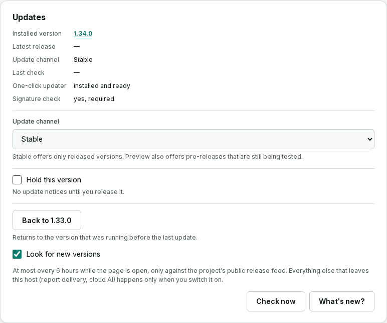
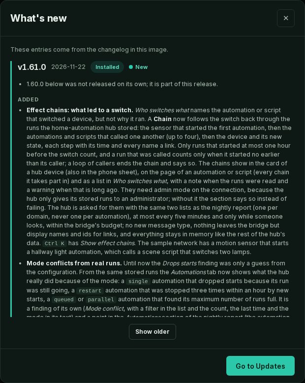
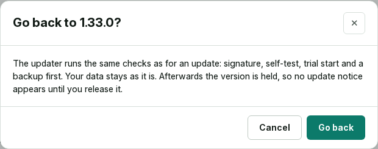
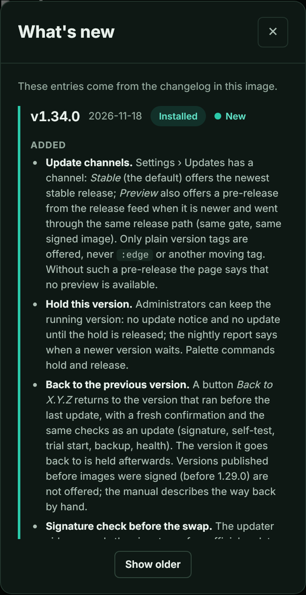

# Updating

[Manual](README.md) · [Overview](overview.md) · [Map](map.md) · [Network](network.md) · [Devices](devices.md) · [Inventory](inventory.md) · [Vulnerabilities](vulnerabilities.md) · [Firewall](firewall.md) · [Data paths](data-paths.md) · [Nightly report](nightly-reports.md) · [Automations](automations.md) · [Running](running.md) · [Sites](sites.md) · Updating · [Settings](settings.md) · [AI](ai.md)

## Purpose

Keep Lanloom current without risk: a notice when a new version exists, a one-click update that tests before it swaps,
a choice between stable and preview versions, a way to hold a version, a way back to the previous one, a signature
check before anything is swapped, and a "What's new?" panel that shows what each version changed.

Running as an add-on of a home-automation hub? Then the hub's add-on system updates Lanloom, and the parts below that
need the updater sidecar (notice, one-click update, channels, hold, going back) are switched off; see
[Add-on](../ADDON.md#updates).

## What you see

- **Update notice.** When a newer version exists, an *Update* button appears (administrators) with the release notes.
  The check is optional and runs at most every 6 hours (Settings > General > Updates).
- **Updates card** in *Settings > General* (administrators): installed version, update channel, *Hold this version*,
  *Check now*, the signature check state and, when there is one, *Back to X.Y.Z*. The *One-click updater* line names the
  version of the updater sidecar and says "renews itself after each update" when it does; below it a quiet line says
  when it last renewed itself.
- **Version number in the header** (on phones at the end of the page). It opens *What's new?*. A dot marks versions
  you have not seen yet.
- **Progress of an update:** Downloading, Checking the signature, Self-test, Trial start, Backing up, Switching,
  Checking health, then Done, Rolled back or Failed.

<table><tr>
<td width="50%"><br><sub>The Updates card in the settings</sub></td>
<td width="50%"><br><sub>What's new? from the version number in the header</sub></td>
</tr><tr>
<td width="50%"><br><sub>Going back asks first, in the app's own dialog</sub></td>
<td width="50%"><br><sub>On a phone the version sits at the end of the page</sub></td>
</tr></table>

## How to use it

**Update with one click.** With the updater sidecar the button does everything: it checks the signature, pulls the
image, runs a self-test without network, starts a trial on a copy of your data, backs up the database and tags the
previous image, swaps the container and checks health. If the new version does not come up healthy, the previous
one is restored automatically. The page reloads by itself when the new version runs.

**The updater renews itself.** After an update that came up healthy, the updater sidecar checks whether it is older
than the version it has just installed. If so, it renews itself from that very image (already checked: signature,
self-test, trial start and health), without pulling anything again. A short-lived helper container from that image
creates the sidecar anew with the same settings (name, data volume, runtime socket, network, restart policy, user and
labels, including the labels of your compose file, so a later `docker compose up -d` finds it and creates nothing
twice), starts it, waits until it reports with the new version and removes the old one. The helper runs without
network, with a read-only file system, without root and without any capability; it reaches the runtime socket through
the socket's group. Only one sidecar runs at any time: the old one stops before the new one starts. If the new one
does not report within 90 seconds, the helper removes it and starts the old one again; the page then says calmly that
the updater could not renew itself and keeps working at its version, and it tries again after the next update. The
nightly report notes a renewal that did not go through, and nothing else about it. The update of the app itself, its
checks, its backup and its way back are the same as before; the renewal starts only after the app runs healthy.

**Update by hand (no sidecar).** From the folder with your compose file:

```
docker compose pull && docker compose up -d
```

To renew the updater sidecar by hand, when the page shows this command:

```
docker compose pull && docker compose --profile updater up -d
```

The page shows it in these cases only:

- the sidecar comes from before self-renewal and is older than the app: renew it once, from then on it renews itself;
- a self-renewal did not go through (the old sidecar keeps working; the next update tries again);
- the sidecar does not renew itself on this installation: an image from another repository (your own builds), the
  switch `LANLOOM_UPDATER_RENEW: "0"` in the sidecar's environment, a runtime where the sidecar cannot find its own
  container, or a runtime socket that only root may use (then a helper without root could not reach it).

**Channels.** *Stable* is the default and offers the highest released stable version. *Preview* also offers a pre-release,
but only when it is newer than the newest stable release and went through the same release path (same
gate, same signed image). It never offers `:edge` or any other moving tag. Without such a pre-release the page says
that no preview is available; the project currently publishes no pre-releases. A preview offer is marked as a preview.

**Hold this version.** An administrator can keep the running version. There are no update notices until the hold is
released, and an update request is refused while the hold is on. When a newer version exists, the page says so
("Held at X.Y.Z, a newer version is available") and the nightly report notes that a newer version waits. Release the
hold on the same card or with the palette command *Release held version*.

**Going back.** *Back to X.Y.Z* returns to the version that ran before the last update. It needs the administrator
role and a fresh confirmation (sign in again or confirm a second factor within the last 10 minutes). It runs the same
checks as an update, signature included, and your data stays as it is. Afterwards the version is held, so no update
notice appears until you release it.

It is not offered for versions before 1.29.0: they were published before images were signed, and the updater cannot
check them before a swap. Then go back by hand: stop the stack, restore the database from the backup the updater made
(in the `backups/` folder of the data directory, one folder per update), set the image tag in your compose file to
that version (for example `ghcr.io/robeertm/lanloom:1.28.0` instead of `:latest`) and start again with
`docker compose up -d`. Keep the backup until the old version runs well; the guides on
[backup and restore](../BACKUP.md) and [installation](../INSTALL.md) show the details.

**Signature check.** From updater 1.34.0 on, the updater reads the signature of the candidate from the registry of the
official image and verifies it against the identity of the publishing workflow
(`https://github.com/robeertm/lanloom/.github/workflows/publish.yml@refs/heads/main`, issuer
`https://token.actions.githubusercontent.com`) and the public transparency log. Only then does it pull exactly that
digest, so the bytes it runs are the bytes it checked. If the check fails, nothing is swapped, nothing changes and a
clear message says why (no signature, signature does not check out, registry not reachable, or unknown signing keys,
which one manual update fixes). Older sidecars update without the check until you renew them; the page shows the
renew command above. A renewed sidecar renews itself after every later update, so the check never again depends on a
manual step. Images from another repository (your own builds) are not checked.

Check an image yourself, from the folder with your compose file:

```
docker compose exec updater python -m updater --verify ghcr.io/robeertm/lanloom:X.Y.Z
```

Exit code 0 means verified. The background and the manual way to verify are in [SECURITY.md](../../SECURITY.md#verifying-an-image).

**What's new?** Click the version number in the header, or use the palette command *What's new?*. The panel lists
the changes of each version from the CHANGELOG inside the image. Versions you have not seen carry a dot; opening the
panel clears it. Nothing is fetched online.

## Limits

- One-click update, hold-aware notices and going back need the updater sidecar; without it the page shows the manual commands.
- The updater renews itself only for the official image, only after a healthy update to a newer version (never after
  going back) and only where it can find its own container and the runtime socket is open to its group. A sidecar from
  before self-renewal is renewed once by hand.
- Going back reaches only the previous version, and not versions before 1.29.0.
- The signature check covers the official image only and needs the registry to be reachable at that moment.
- A run that is already waiting or going blocks a second request.
- The release feed is asked only while someone has the page open, and not at all when the check is off.

## Privacy

The only outbound connection of its own is the optional update check against the public release feed. During an
update or going back that an administrator started, the updater additionally reads the signature from the image
registry; nothing about your network is sent. The self-renewal of the updater opens no connection at all: its helper
runs without network and uses the image that is already there. *What's new?* reads the file in the image. Roles: every role may read
the version and *What's new?*; changing the channel, holding or releasing, updating and going back need the
administrator role, going back also a fresh confirmation. Each of these changes is written to the audit log with who,
when and the version.

## See also

- [Settings](settings.md#general) · [Nightly report](nightly-reports.md)
- [Installation](../INSTALL.md) · [Backup](../BACKUP.md) · [Search and commands](../PALETTE.md)
- [SECURITY.md](../../SECURITY.md#verifying-an-image) · [Troubleshooting](../TROUBLESHOOTING.md)
