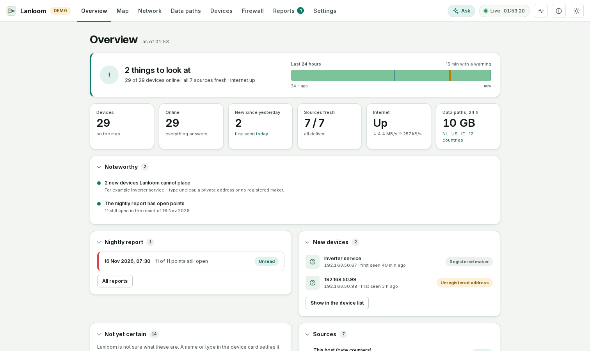
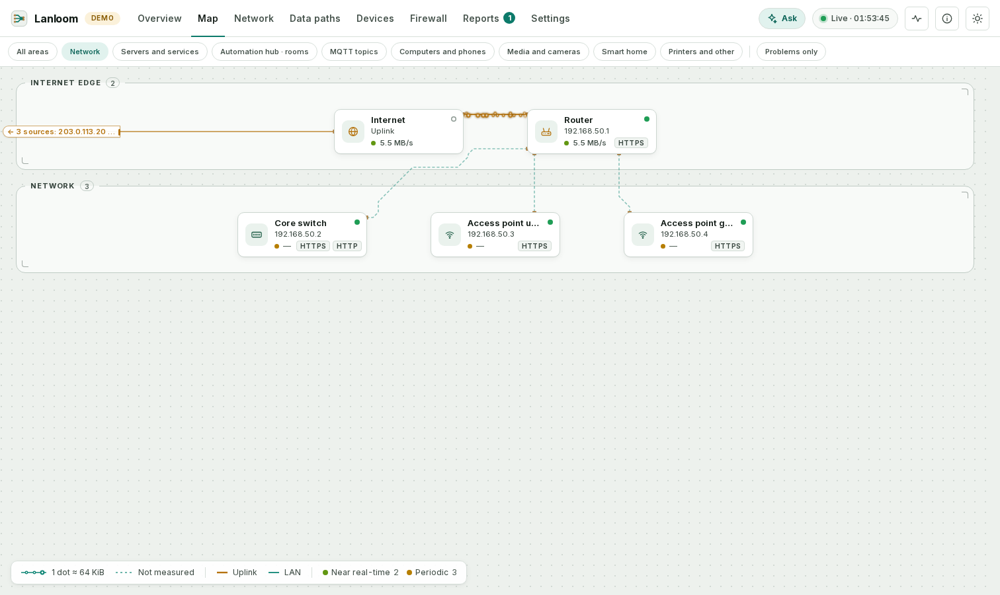
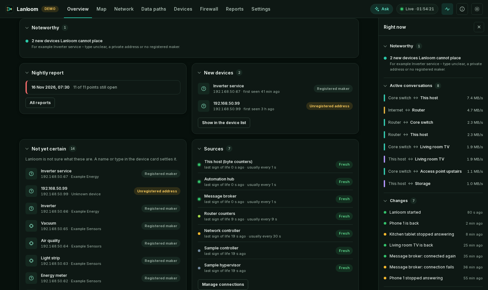

# The views of Lanloom

This page explains every view of the app and the parts around it: the *Right now* rail, the *About this view* rail, the
live state in the header and the deep links. The *About this view* rail (key `I`) shows a short version of each section
and links here.

- [Overview](#overview)
- [Map](#map)
- [Network](#network)
- [Data paths](#paths)
- [Devices](#devices)
- [Firewall](#firewall)
- [Nightly report](#reports)
- [Settings](#settings)
- [Right now](#right-now) · [About this view](#about-this-view) · [Live state and live grade](#live-state) · [Deep links and the back key](#deep-links) · [Keys](#keys)

## Overview

The start page. It answers one question in three seconds: how is the network doing?

- **Health banner.** "All good", "One thing to look at", "N things need a look" or "Something is down", with one line
  of counts (devices online, sources fresh, internet). The level is the most serious entry of the *Noteworthy* list.
- **Last 24 hours.** One strip with a five-minute step: green is calm, blue a hint, amber a warning, red a fault. Hover
  a coloured part to see when it began. Lanloom keeps this look back in memory; after a restart it fills up again over
  the day.
- **Key figures.** Devices on the map, devices online (offline ones are linked), new since yesterday, fresh sources,
  the internet line (state, measured rates or the last outage) and the data paths of the day (bytes and the top
  countries). Each figure is a link: devices, the device list filtered to new or offline devices, the live grade dialog,
  the internet component on the map, the data paths view.
- **Cards.** *Noteworthy* (one line and one sub line per issue, each linked to where it can be looked at),
  *Nightly report* (the latest report, open points, unread reports), *New devices* (with "first seen" and the origin of
  the address: registered maker, private or random address, unregistered address, only an IP address), *Not yet certain*
  (devices whose type Lanloom guesses), *Sources* (every connection with its calm state, its last sign of life and its
  usual rhythm).

### Calm states of a source

A source never shows an error text just because it has nothing yet:

| State | Meaning |
|---|---|
| Fresh | data arrives in its usual rhythm |
| Source waiting | just started, nothing has arrived yet |
| No data yet | connected for a while, but it has not reported anything |
| Stale | data stopped coming (older than its rhythm allows) |
| Connection fails | the connection does not work; the reason is shown |
| Off | switched off in the settings |

### What counts as noteworthy

- the internet line is down (router counters);
- a router, switch, access point, server, storage, hub or broker that used to answer does not answer any more;
- a connection fails, or stopped delivering;
- devices that joined since yesterday and that Lanloom cannot place (type unclear, private or random address, no
  registered maker);
- the latest nightly report has open points and is unread.

Features add their own entries (for example open incidents) through `lanloom.overview.register_note`; the start page
adds figures and cards through `Lanloom.registerOverviewTile` and `Lanloom.registerOverviewCard`.

The page redraws itself every ten seconds. Whatever you folded or unfolded – a card, "Show more" – stays as you left it.

## Map

Your network drawn like a circuit board: every device is a component, every connection a trace. Moving dots are measured
bytes; nothing is animated that was not measured. The chips above the board filter by **area** (one zone of the board;
the internet edge stays for orientation) or show **problems only** (components that are down or whose data stopped).
Click a component to open its card.

## Network

The same devices, ordered by how they are physically connected: which switch port or access point each one hangs on,
from the controller, LLDP, address tables or your own entry. The area chips work here as well. See
[TOPOLOGY.md](../TOPOLOGY.md).

## Data paths

Where your data went: countries and devices over 24 hours, 7 or 30 days. See [DATA-PATHS.md](../DATA-PATHS.md).

## Devices

Every device with type, certainty, maker, model and services; search by name, address, maker or service. From the start
page the list can open filtered (`#/devices?show=new`, `?show=unsure`, `?show=offline`); the chip above the list removes
the filter. See [DISCOVERY.md](../DISCOVERY.md).

## Firewall

Zones, networks and rules, read from your controller; changes as a draft with a dry run. See
[FIREWALL-EDITOR.md](../FIREWALL-EDITOR.md).

## Nightly report

A short report of every night with points to tick off. Each report has its own address (`#/reports/2026-11-16`). See
[NIGHTLY-REPORT.md](../NIGHTLY-REPORT.md).

## Settings

Scanning, connections, appearance, users, security, backup and AI. See [INSTALL.md](../INSTALL.md),
[ACCESS.md](../ACCESS.md) and [BACKUP.md](../BACKUP.md).

## Right now

Key `L`, the pulse button in the header, or the command "Show or hide Right now" in the search (`Ctrl K`). Four
sections, each foldable:

- **Noteworthy** – the same list as on the start page;
- **Active conversations** – the traces with measured traffic right now, busiest first, with their rate;
- **Changes** – what the event journal recorded in the last six hours: devices that stopped answering or came back, new
  devices, connections that failed or recovered, internet outages, Lanloom's own start;
- **New devices** – first seen since yesterday, with the origin of the address.

The rail refreshes every five seconds while it is shown and rests while the tab is in the background.

## About this view

Key `I`, the *i* button, or the command in the search. A short explanation of the open view and a link to this page. On
screens of 1900 pixels and wider it is open until you close it; Lanloom remembers your choice in this browser.

On screens narrower than 1280 pixels both rails slide over the page instead of sitting beside it; on a phone they fill
the screen and close with the ✕ button or `Esc`.

## Live state and live grade

The pill in the header shows the state of the live feed:

| Text | Meaning |
|---|---|
| Live · 14:32:05 | updates arrive; the time of the last one (on narrow screens only the time) |
| Updated 12 s ago | connected, but nothing arrived for more than five seconds |
| Disconnected | the connection to Lanloom is lost; it is retried on its own, or press **Reconnect** |
| Paused | the tab is in the background; the feed rests and resumes when you come back |

The dot is the overall live grade. Clicking the pill opens the live grade dialog: the grade, rhythm and age of every
source, what each grade means, and the **clock offset** between this browser and the server. When the clocks differ by
two seconds or more, times such as "seen 5 s ago" may look shifted by that much.

## Deep links and the back key

| Address | Opens |
|---|---|
| `#/overview` | the start page |
| `#/map`, `#/network` | the board |
| `#/map/<component>` | the board with the card of that component (the page switches to the other board if needed) |
| `#/map?zone=<area>`, `#/map?only=problems` | the board filtered |
| `#/devices/<device>` | the device list with that device's card |
| `#/devices?show=new` | the device list filtered (`new`, `unsure`, `offline`) |
| `#/reports/<day>` | that nightly report |
| `#/settings/<page>` | a settings page |

Opening a card, a report or a filter changes the address, so the back key closes the card or returns to the report or
filter you had before.

## Keys

| Key | Action |
|---|---|
| `L` | show or hide *Right now* |
| `I` | show or hide *About this view* |
| `/`, `Ctrl K`, `⌘ K` | search and commands |
| `Esc` | close a dialog or a rail that lies over the page |

Keys do nothing while you type in a field.
