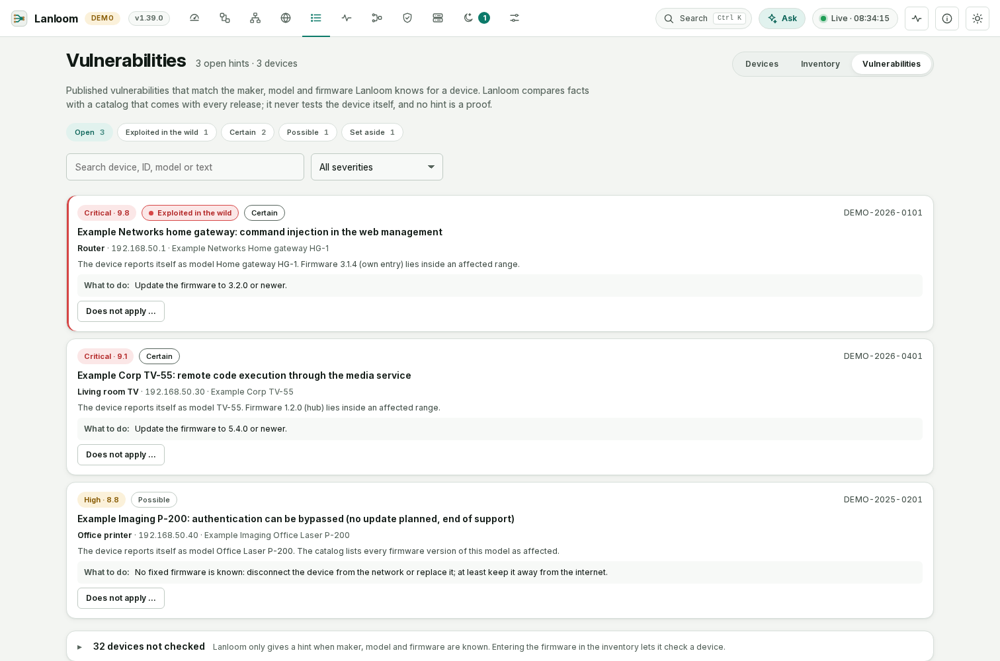
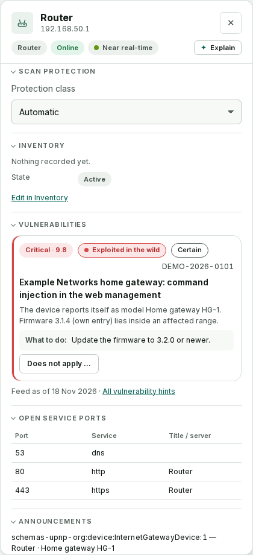
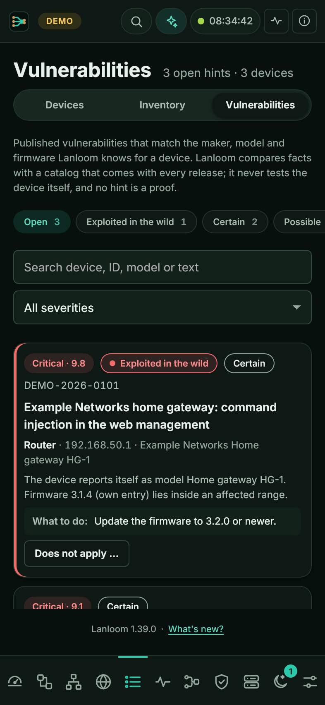

# Vulnerabilities

[Manual](README.md) · [Overview](overview.md) · [Map](map.md) · [Network](network.md) · [Devices](devices.md) · [Inventory](inventory.md) · Vulnerabilities · [Firewall](firewall.md) · [Data paths](data-paths.md) · [Nightly report](nightly-reports.md) · [Automations](automations.md) · [Running](running.md) · [Updating](updating.md) · [Settings](settings.md) · [AI](ai.md)

## Purpose

Routers, storage boxes, cameras and printers run firmware that is rarely updated. This page lists published
vulnerabilities that match the **maker, model and firmware** Lanloom knows for a device, most serious first, and says
for each one what to do. The catalog comes with every Lanloom release and is read offline: nothing is looked up on the
internet. It is part of the [device list](devices.md): the *Devices | Inventory | Vulnerabilities* switch at the top of
the page (`#/vulnerabilities`, with filters such as `#/vulnerabilities?show=exploited`).

## What you see

- **Quick filters** with counts: open, exploited in the wild, certain, possible, set aside. A chip is a link.
- **One card per hint**, most serious first (severity, then *exploited in the wild*, then certain before possible):
  - the **severity** with its score, a red **Exploited in the wild** mark when the public catalog of known exploited
    vulnerabilities lists it (with "used by ransomware" when the catalog says so), and the **certainty**;
  - the identifier (a link to the public record, opened only when you click it), the title, the device with its
    address, maker and model;
  - **why** Lanloom thinks so (the model the device reports, the firmware and where it comes from, or "every version is
    affected");
  - **what to do**: update the firmware to the first fixed version, look for an update, or - when no fixed firmware is
    known - disconnect or replace the device and at least keep it away from the internet.
- **Devices not checked** (folded): every device Lanloom could not check, with the reason (maker, model or firmware
  unknown, or a firmware that cannot be compared) and a link to enter the firmware in the inventory.
- **The feed card**: the date of the feed, how many entries it has, the sources, the limits and (for admins) the import
  of a newer feed file.
- **The device card** has a *Vulnerabilities* block with the open hints of that device, or a line saying the feed lists
  nothing for its model, its firmware is outside every affected range, or why it was not checked.
- On a phone the cards fill the width; the chips scroll sideways.

### Certain and possible

| Certainty | When |
|---|---|
| **Certain** | The model matches exactly, the maker is the catalog's maker, and the firmware - typed in by a person, reported by a connected controller or hub, or read from the device's management interface (SNMP) - lies inside an affected range. |
| **Possible** | The model matches, but the firmware was only read from what the device announces (UPnP, mDNS), the maker is known only from the hardware address, or the catalog lists every version of the model as affected. |
| *(no hint)* | Maker, model or firmware unknown, a model that only starts like a listed one, another maker with the same model name, or a firmware of another hardware branch (`5.21(AASZ.3)` is never compared with `5.21(AAZF.10)`). Lanloom prefers no hint to a wrong one. |

## How to use it

- **Read the card from top to bottom** and do what it says; the hint disappears by itself once the firmware is outside
  every affected range (Lanloom reads the firmware again with every scan, or take the new version into the inventory).
- **Does not apply …** (operators) sets a hint aside with an optional note - another hardware revision, the vulnerable
  service is switched off, the device is isolated. It stays under *Set aside* with who and when; *Bring back* returns it.
- **Not checked** devices: enter the firmware in the [inventory](inventory.md) (field *Firmware*) and Lanloom checks
  them at once.
- **A newer feed between releases** (admins): build one with `scripts/build_vulnfeed.py` (see
  [VULNERABILITIES.md](../VULNERABILITIES.md#building-a-feed-file)) and choose *Import feed file …* on the feed card.
  Its entries are added to the bundled ones; *Remove imported feed* goes back.
- **Notifications:** the event *Vulnerability hint* (group *Incidents*) is sent once per device and hint, calm by default
  (it goes into the nightly report); certain or exploited hints come as a warning, the rest as information.
- **Nightly report:** a *Vulnerability hints* section lists the hints that appeared that night, each with what to do, and
  the open total. It also notes once when the feed is older than 180 days.
- Search (`Ctrl K`): *Open Vulnerabilities*, *Show hints exploited in the wild*, *Show devices not checked for
  vulnerabilities*.

## Limits

- **No guarantee.** An empty list means that no published vulnerability with machine-readable firmware ranges matches
  the devices Lanloom could check - not that the network is safe.
- **No test of the device.** Lanloom compares facts with a catalog; it never probes a device for a vulnerability.
- **Only device firmware.** Operating systems and applications on computers are not covered (Lanloom cannot read their
  exact build from the network). The bundled feed holds every catalog entry of known exploited vulnerabilities that
  names device firmware, and the critical device-firmware entries of the national vulnerability database since 2020.
- **As good as what the device reports.** A device that reports a wrong model or firmware gets a wrong hint, or none.
  Firmware read from an announcement is often shortened; then Lanloom says "cannot be compared" instead of guessing.
- **As new as the feed.** A new feed comes with every release; the feed card shows its date.

## Privacy

- **Read:** the facts Lanloom already has (maker, model and firmware from the scan, connected controllers and the hub,
  and the firmware you typed into the inventory) and the feed file in the image.
- **Stored:** when each hint was first seen and the hints set aside (with the note), in Lanloom's database; an imported
  feed file in the data folder (`vulns/feed.json.gz`). All of it is part of every backup.
- **Sent:** nothing. The feed is never downloaded at run time; the link to a public record is opened only when you click
  it.
- **Roles:** everyone who sees the device list reads the hints. Operators set hints aside and bring them back; admins
  import or remove a feed file. Every change is written to the audit log (the length of a note, never its text).

## See also

- [VULNERABILITIES.md](../VULNERABILITIES.md) - matching rules, feed format, building a feed file, API
- [INVENTORY.md](../INVENTORY.md) - the firmware field that lets Lanloom check a device
- [NOTIFICATIONS.md](../NOTIFICATIONS.md) - the *Vulnerability hint* event
- [NIGHTLY-REPORT.md](../NIGHTLY-REPORT.md) - the *Vulnerability hints* section
